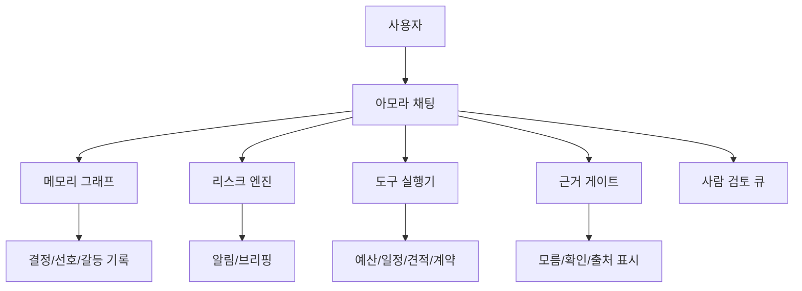

# 아모라 전 여정 파트너 설계

> 역사 문서. 현재 채택 기준과 구현 상태는
> `docs/AMORA_ENGINE_V2_2026-07-16.md`를 따른다.

최종 수정일: 2026-05-11

## 목표

아모라는 웨딩 정보를 알려주는 챗봇이 아니라, 예비부부가 생각한 결혼식을 실수 없이 끝까지 해낼 수 있게 옆에 붙어 있는 웨딩 파트너여야 한다.

사용자가 기대해야 하는 경험은 이것이다.

> 결혼 준비 중 뭔가 놓친 것 같으면 아모라가 먼저 알려준다.  
> 업체와 이야기할 때는 아모라가 질문 문구를 만들어준다.  
> 가족과 커플 사이에 말이 어려울 때는 아모라가 부드러운 문장으로 바꿔준다.  
> 본식 당일에는 아모라가 타임라인과 돌발상황을 잡아준다.  
> 식이 끝난 뒤에는 감사 인사, 후기, 정산, 앨범 수령까지 챙겨준다.

## 제품 원칙

1. 아모라는 답변보다 실행을 우선한다.
   - 사용자가 "드레스 피팅 잡았어"라고 하면 축하만 하지 않고 일정에 넣고, 준비물과 확인 질문을 붙인다.

2. 아모라는 실수 방지를 우선한다.
   - 추천을 많이 하는 것보다 빠진 항목, 위험 조항, 늦은 일정, 예산 초과를 먼저 잡는다.

3. 아모라는 커플의 취향을 지킨다.
   - 평균 결혼식으로 끌고 가지 않는다.
   - 사용자가 꿈꾸는 결혼식과 현실 제약을 동시에 맞춘다.

4. 아모라는 관계를 부드럽게 만든다.
   - 웨딩은 정보 문제가 아니라 가족, 커플, 업체와의 커뮤니케이션 문제다.
   - 아모라는 메시지, 전화 스크립트, 양가 설명 문구까지 도와야 한다.

5. 아모라는 모르면 모른다고 한다.
   - 데이터가 없는 업체를 추천하지 않는다.
   - 출처 없는 가격을 단정하지 않는다.
   - 법률, 의료, 세무 판단은 전문가 확인이 필요하다고 안내한다.

## 전 여정 기능 지도

| 단계 | 사용자 불안 | 아모라 기능 | 저장되어야 하는 데이터 |
|---|---|---|---|
| 시작 전 | 뭐부터 해야 할지 모름 | 웨딩 비전 인터뷰, 예산 초안, D-day 로드맵 | 예식일, 지역, 예산, 하객 수, 취향 |
| 탐색기 | 업체와 가격이 너무 많음 | 조건 정리, 견적 체크, 비교표, 질문 생성 | 후보 업체, 견적, 포함 항목, 제외 항목 |
| 계약 전 | 계약해도 되는지 불안 | 계약서 진단, 환불/변경 조항 체크, 업체 질문 문구 | 계약 조항, 계약금, 위험 라벨 |
| 준비기 | 빠뜨린 게 있을까 불안 | 주간 브리핑, 일정 알림, 예산 리스크, 커플 합의 모드 | 일정, 완료 상태, 담당자, 결정 히스토리 |
| 본식 전 | 실수가 날까 불안 | D-14 커맨드센터, 준비물, 연락망, 돌발상황 플랜 | 당일 타임라인, 담당자 연락처, 체크리스트 |
| 본식 당일 | 누가 뭘 해야 할지 모름 | 실시간 타임라인, 하객 안내 문구, 긴급 전화 스크립트 | 시간표, 장소, 역할, 비상 연락처 |
| 식 후 | 감사와 정산이 어려움 | 감사 인사 메시지, 후기 초안, 앨범/영상 수령 알림, 혼인신고 체크 | 하객 그룹, 받은 도움, 정산, 사후 일정 |
| 신혼 정착 | 결혼 뒤 실무가 남음 | 명절/집들이/양가 인사 코치, 신혼집 체크 | 가족 관계 메모, 생활 일정, 후속 과제 |

## 최고형 아모라 기능

### 1. 아모라 데일리 브리핑

매일 또는 앱 첫 진입 시 오늘 필요한 것만 보여준다.

- 이번 주 해야 할 일 3개
- 놓치면 위험한 것 1개
- 예산 초과 가능성
- 계약 전 확인할 질문
- 커플에게 함께 물어볼 질문

예시:

> 이번 주는 스튜디오 계약 전 확인이 제일 중요해요.  
> 원본/수정본 비용이 견적에 빠져 있어서, 계약금 전 이 문장을 보내보세요.

### 2. 실수 방지 레이더

아모라는 사용자의 진행 상태를 보고 자동으로 위험을 잡는다.

- D-120인데 스튜디오 미정
- D-60인데 청첩장 미완료
- 견적에는 원본 비용 미포함
- 예식장 계약서에 최소 보증인원 변경 기준 없음
- 예산은 맞지만 필수 추가금 포함 시 초과
- 일정은 잡혔지만 준비물 체크리스트 없음

### 3. 결정 기억 그래프

아모라는 모든 결정을 기억하고 서로 연결한다.

- 예식장 위치가 강남이면 스드메 이동 동선을 고려한다.
- 예산 성향이 가성비형이면 추천 문장도 가성비 기준으로 정렬한다.
- 부모님이 호텔을 원한다고 했으면 예식장 조언에서 가족 제약으로 반영한다.
- 이전에 "화려한 드레스는 부담스럽다"고 했으면 드레스 추천에서 제외한다.

기억 단위:

- hard constraint: 이미 결정된 것, 예산 한도, 날짜, 계약 상태
- soft preference: 분위기, 색감, 우선순위, 싫어하는 것
- risk signal: 불안, 갈등, 반복 질문, 계약 압박
- relationship context: 부모님 기대, 커플 역할 분담, 양가 민감 주제

### 4. 업체 커뮤니케이션 코치

사용자는 업체에게 무엇을 물어봐야 할지 모른다. 아모라는 바로 보낼 수 있는 문장을 만들어야 한다.

기능:

- 카톡 문구 생성
- 전화 전 체크리스트
- 상담 후 요약
- 계약 전 확인 질문
- 업체 답변 해석
- 말투 변환: 단호하게, 부드럽게, 정중하게, 짧게

예시:

> 안녕하세요. 계약 전 포함 항목을 한 번만 확인 부탁드립니다.  
> 원본 파일, 수정본, 헬퍼비, 얼리스타트비, 촬영 연장비가 현재 견적에 포함인지 각각 확인 가능할까요?

### 5. 커플 합의 모드

둘이 원하는 것이 다를 때 아모라는 한쪽 편을 들지 않고 합의안을 만든다.

흐름:

1. 각자 절대 포기 못할 것 3개 선택
2. 포기 가능한 것 3개 선택
3. 예산과 일정 제약 입력
4. 아모라가 충돌 지점과 합의안을 생성
5. 합의한 결정은 결정 그래프에 저장

예시:

> 두 분 모두 사진은 중요하게 보고 있어요.  
> 대신 예식장 장식은 양보 가능성이 있으니, 스튜디오에는 예산을 유지하고 꽃장식은 기본형으로 두는 안이 가장 덜 아픈 타협이에요.

### 6. 가족/혼주 대화 코치

웨딩에서 큰 갈등은 가족 커뮤니케이션에서 생긴다. 아모라는 예법을 알려주는 것에서 끝나면 안 되고, 실제 말문을 만들어줘야 한다.

기능:

- 부모님께 예산 설명하기
- 예단/예물 생략을 부드럽게 말하기
- 혼주 메이크업/한복 비용 정리하기
- 양가 일정 조율 문구 만들기
- 감정이 상하지 않는 거절 문장 만들기

### 7. 본식 당일 커맨드센터

본식 당일은 채팅보다 즉시 확인 가능한 체크리스트가 중요하다.

필수 기능:

- 시간대별 진행표
- 담당자별 역할
- 비상 연락처
- 준비물 체크
- 하객 안내 문구
- 신랑/신부/혼주별 따로 보는 할 일
- 돌발상황 대응 스크립트

돌발상황 예시:

- 축가자가 늦음
- 부케가 도착하지 않음
- 혼주 메이크업이 지연됨
- 하객 주차 문의가 몰림
- 사진 촬영 순서가 꼬임

### 8. 식 후 감사/정산 도우미

아모라는 식이 끝나고도 끝나면 안 된다.

기능:

- 하객 그룹별 감사 메시지
- 축의금/선물 감사 인사 문구
- 도와준 친구/가족에게 따로 보낼 메시지
- 업체 후기 초안
- 앨범/영상 수령 일정 알림
- 혼인신고 준비
- 신혼집 집들이 메시지

예시:

> 어제 먼 길 와주셔서 정말 감사드립니다.  
> 덕분에 정신없는 하루가 훨씬 든든했고, 두고두고 기억에 남을 것 같아요. 조만간 식사로 다시 인사드릴게요.

### 9. 하객 컨시어지

나중에는 하객이 아모라에게 물어볼 수 있어야 한다.

- 예식장 주소
- 주차 안내
- 식 시작 시간
- 셔틀 여부
- 축의금 계좌 안내
- 드레스 코드
- 2차 장소

주의: 하객에게 공개되는 정보는 커플이 허용한 것만 사용한다.

### 10. 웨딩 회고와 추억 정리

식 후 사용자가 남긴 데이터는 다음 커플을 위한 익명 지식이 된다.

- 잘한 결정
- 후회한 결정
- 예상보다 돈이 든 항목
- 업체 응답 품질
- 본식 당일 변수
- 다음 예비부부에게 남길 팁

단, 공개 전 사용자의 명시적 동의를 받아야 한다.

## 할루시네이션 방지 설계

아모라는 답변마다 내부적으로 근거 등급을 가져야 한다.

| 등급 | 의미 | 답변 방식 |
|---|---|---|
| A | 사용자가 직접 제공한 정보 | "아까 말씀하신 견적 기준으로" |
| B | DB에 저장된 사용자 데이터 | "등록된 예산 기준으로" |
| C | 검증된 공공/공식 출처 | "한국소비자원 기준으로" |
| D | 일반 웨딩 관행 | "업계에서 흔한 경우는" |
| E | 추론 | "제가 보기엔 가능성이 있어요. 다만 확인이 필요해요" |
| F | 근거 없음 | 답하지 말고 질문하거나 확인 요청 |

강제 규칙:

- 업체명, 가격, 가능 여부는 A/B/C 근거 없이는 단정하지 않는다.
- 업체 추천은 DB 검증 또는 사용자가 직접 언급한 업체만 가능하다.
- 견적 포함 항목은 사용자가 말한 것만 포함으로 본다.
- 계약서 판단은 "위험/주의/확인 필요"로 말하고 법률 확정 판단을 하지 않는다.
- 전화, 메시지 문구는 생성 가능하지만 사실관계는 사용자가 확인한 정보만 넣는다.
- 하객 안내는 커플이 공개 허용한 정보만 사용한다.

## 응답 계약

아모라의 답변은 항상 아래 중 하나여야 한다.

1. 확실히 아는 것
   - 근거를 짧게 붙인다.

2. 확인이 필요한 것
   - 무엇을 확인해야 하는지 질문 문구까지 준다.

3. 모르는 것
   - 모른다고 말하고, 확인 방법을 안내한다.

4. 실행 가능한 것
   - 일정 추가, 예산 수정, 체크리스트 생성 등 도구로 실행한다.

금지 답변:

- "아마 괜찮을 거예요"만 말하기
- 근거 없는 업체 추천
- 출처 없는 평균 가격 단정
- 사용자가 말하지 않은 포함 항목 추정
- 부모님/파트너 한쪽 편들기
- 갈등 상황에서 빠른 결론만 내기

## 필요한 시스템 구성

### 메모리 그래프

- 사용자의 예식일, 예산, 장소, 하객 수
- 결정된 업체와 계약 상태
- 취향과 싫어하는 것
- 가족과 커플 갈등 맥락
- 감사 인사를 보내야 할 사람
- 본식 당일 담당자와 연락처

### 리스크 엔진

- 일정 지연
- 예산 초과
- 계약 조항 누락
- 추가금 가능성
- 커뮤니케이션 위험
- 본식 당일 준비물 누락

### 근거 게이트

아모라가 답하기 전에 내부적으로 확인한다.

- 이 정보는 어디서 왔는가?
- 사용자가 제공했는가?
- DB에 있는가?
- 공식 출처가 있는가?
- 그냥 추론인가?
- 추론이라면 추론이라고 표시했는가?

## 구현 우선순위

### P0: 지금 바로 만들 것

1. 아모라 데일리 브리핑
2. 업체 메시지/전화 스크립트 생성
3. 계약 전 질문 생성기
4. 식 후 감사 메시지 생성기
5. 근거 등급 프롬프트와 응답 규칙 강화

### P1: 다음 단계

1. 커플 합의 모드
2. 가족 대화 코치
3. D-14 본식 커맨드센터
4. 계약서 진단 페이지
5. 하객 안내 문구 생성

### P2: 업체 공급이 쌓인 뒤

1. 검증 업체 매칭
2. 상담 예약 자동화
3. 하객 컨시어지 공개 페이지
4. 결제와 계약 관리
5. 분쟁 예방 로그

## 최종 목표 문장

아모라의 최종 목표는 사용자가 이런 감정을 갖게 하는 것이다.

> 준비하면서 놓친 게 있어도 아모라가 잡아줄 거야.  
> 업체랑 말할 때도 아모라가 도와줄 거야.  
> 본식 당일에도 아모라가 옆에 있을 거야.  
> 결혼식 끝나고 감사 인사까지 아모라가 같이 챙겨줄 거야.

이 감정이 생기면 웨딩한방은 단순 앱이 아니라 결혼 준비의 안전망이 된다.
