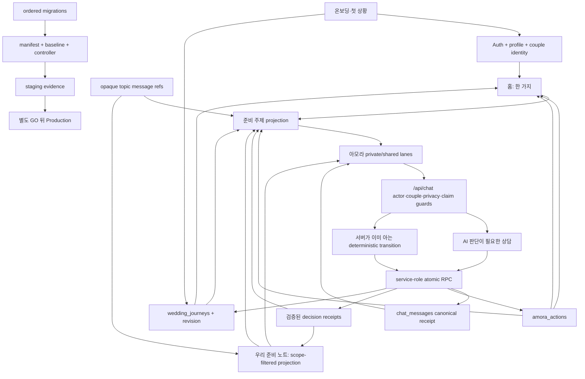

# 아모라 마스터 개발 계획

> 상태: `LIVING SOURCE OF TRUTH`
>
> 계획 버전: `v1.33 — MEDIATION PRIVATE DRAFT HOSTED VERIFIED`
>
> 마지막 갱신: 2026-08-18
>
> 대상 브랜치: `codex/amora-release-hardening-20260811`
>
> 내부 Android 빌드 후보 HEAD: `989aa3d56a45718acbe98ce5015c84f84cf3303d` · tree `a07bdaa3ef0dc265c5709656a9ed8c38420ce8a3`
>
> 현재 릴리스 상태: `deployment_blocked` · manifest 109개 · Production 관찰 적용 32개 · Production 기준 pending 77개 · tail `20260818150000`
>
> 현재 작업 상태: 격리 staging에 `20260818130000`~`20260818150000` 세 migration을 pre-apply 암호화 backup 뒤 적용했고 ledger 224개/head `20260818150000`, pending 0을 확인했다. commit `d22d5774`의 hosted 3계정 준비 노트 privacy probe와 commit `4903fe01`의 hosted 2계정 중재 private-draft probe가 모두 residue 0으로 통과했다. 중재는 owner-only 초안, 직접 shared insert·authenticated RPC·wrong actor 차단, requester의 canonical share와 exact replay까지 확인했다. requester acceptance·UI/기기 흐름과 criterion action-context positive path 등 STG-004 나머지 경계는 아직 미검증이다. Android internal build는 설치 가능하지만 실제 기기 검증은 계속 `BLOCKED`다.
>
> 현재 작업 스냅샷: hosted mediation probe commit `4903fe01db8fd9ce56fb34521f1f775d2eb247d0` · hosted notes probe commit `d22d5774` · Android internal build commit `989aa3d5` · `3b623e18` EX-009 checkpoint는 역사 증거 · HOLD 2 + tmp 36 제외 · Production write 0

이 문서는 아모라 제품 개발의 **단일 실행 정본**이다. 제품 철학만 설명하는 문서도 아니고, 완료된 작업만 기록하는 일지도 아니다. 우리가 만들려는 최종 아모라, 현재 구현, 빠진 연결, 다음 개발 순서, 리스크, 테스트, 배포 상태를 한곳에서 계속 갱신한다.

### 현재 제어판

| 항목 | 현재 값 |
|---|---|
| 작업 모드 | `PRODUCT VERTICAL` — 외부 권한이 필요한 restore는 BLOCKED로 분리하고 한 번에 소비자 수직 하나만 닫음 |
| 현재 작업 | `STG-004 IN_PROGRESS` — 181300 준비 노트와 181400 중재 private→shared DB 경계는 hosted verified; 181500 criterion action-context를 다음 단일 probe로 진행 |
| 최근 완료 제품 vertical | `MEDIATION PRIVATE DRAFT HOSTED PRIVACY` — 2계정 owner-only draft, direct/auth/wrong-actor deny, canonical share, same-id replay, cleanup residue 0 |
| 다음 소비자 vertical | `STG-004 CRITERION ACTION CONTEXT` — current shared criterion이 ordinary provider의 exact categorized action 승인에 실제 결박된 경우에만 원문 없는 context receipt가 생기는지 검증 |
| 동시에 진행 가능한 제품 vertical | 1개 |
| 일시 중단 | 새 가이드 확장, booking/거래 기능 확장, 측정 없는 AI 호출 최적화 |
| 실행 순서 | STG-004 남은 경계 → FV-012/FV-015(기기 확보 즉시) → STG-005~007 → FV-013 → DX-001~004 → LD-001~003/006 → EX-009 최종 재동결 → STG-008 → REL-201 → HT-011/LD-005 관찰 → REL-202 |
| Production | `NO-GO` |

문서를 처음 읽을 때는 `1. 아이디얼 아모라 → 3. 표준 준비 루프 → 4. 화면 계약 → 8. 현재 구현 상태 → 9. 실행 순서 → 17. 실행 백로그` 순서로 본다.

첨부 전략 자료 `C:/Users/kcho1/Downloads/웨딩한방_제품_전환_전략.docx.pdf`와 `C:/Users/kcho1/Downloads/결혼준비 가이드북 _ Notion.pdf`는 제품 참고 자료다. 그 안의 문장이나 구조를 그대로 지시로 취급하지 않는다. `PRINCIPLES.md`, 이 문서, 승인된 제품 결정, 실제 코드와 데이터 정본을 통해 검증한 원칙만 반영한다.

---

## 0. 이 문서를 사용하는 규칙

### 0.1 문서 우선순위

충돌이 생기면 다음 순서로 판단한다.

1. `PRINCIPLES.md`의 6개 원칙과 개인정보·승인·정본 경계
2. `docs/PRODUCT_CONTRACT_PARTNER_2026-08-08.md`의 현재 제품 범위와 거래층 보류 계약
3. `docs/MOBILE_PRODUCT_COMPLETION_STANDARD_2026-08-03.md`의 실기기·2계정·배포 완료 기준
4. 이 문서의 아모라 제품 목표, 후속 화면 위계, 실행 순서, 완료 기준
5. `DESIGN.md`와 `docs/MOBILE_APP_MASTERPLAN_2026-06-30.md`의 공통 시각·내비게이션 기반
6. `docs/AMORA_PERSONALIZED_PREPARATION_MAP_PRODUCT_DECISION_2026-08-15.md`
7. 기능별 상세 계약과 운영 문서
8. 실제 코드·테스트·DB migration·release manifest

실제 코드와 데이터는 현재 동작을 판정하는 정본이지만, 상위 제품·개인정보·출시 계약을 조용히 바꾸는 근거가 될 수 없다. 코드가 문서보다 앞서 있으면 그 차이를 이 문서에 즉시 기록하고, 오래된 계획 문장을 구현 사실처럼 인용하지 않는다.

`MOBILE_APP_MASTERPLAN_2026-06-30.md`의 4탭·공통 내비게이션·기본 디자인 방향은 유지한다. 다만 그 문서의 기존 홈 순서와 이 문서의 `지금 한 가지 우선` 위계가 충돌하면, 이 문서가 명시적인 후속 아모라 제품 결정으로 우선한다. 이런 successor 결정은 관련 `AMR-*` ID와 회귀 테스트 없이 추가할 수 없다.

### 0.2 작업 시작 규칙

아모라 관련 개발은 아래 항목이 모두 있어야 시작한다.

- [ ] 이 문서의 작업 ID가 있다.
- [ ] 소비자가 무엇을 더 쉽게 할 수 있게 되는지 한 문장으로 적었다.
- [ ] 읽거나 쓰는 정본 데이터와 개인/공유 범위를 적었다.
- [ ] 하지 않을 범위를 적었다.
- [ ] 가장 위험한 실패 시나리오와 복구 방법을 적었다.
- [ ] 공개 행동 테스트의 첫 RED를 정했다.
- [ ] 완료를 주장할 검증 단계와 배포 범위를 정했다.
- [ ] 변경할 모든 파일·hunk가 정확히 하나의 primary `AMR-*` 작업에 매핑된다.

작업 ID가 없으면 기능을 만들지 않는다. 유효해 보이는 아이디어라도 우선 이 문서의 백로그에 추가하고 현재 우선순위와 비교한다.

매핑되지 않은 diff가 하나라도 발견되면 새 편집을 즉시 중단하고 `AMR-AUDIT01`로 돌아간다. 현재 `NOW`가 아닌 작업은 테스트 보완처럼 보여도 active vertical의 P0/P1 차단 결함이 아니면 시작하지 않는다. 하나의 대형 파일이 여러 vertical을 포함하면 파일 전체를 한 작업으로 가장하지 않고 hunk·함수·테스트 seam을 tranche manifest에 적는다.

### 0.3 작업 종료 규칙

- [ ] 코드·검증·배포·사용자 검증 네 축을 각각 갱신하고, 필요할 때만 전체 요약 상태를 덧붙였다.
- [ ] 실행한 테스트 명령과 결과를 증거 칸에 기록했다.
- [ ] 실기기·2계정·hosted 검증을 하지 않았으면 완료로 표시하지 않았다.
- [ ] 새 migration이 있으면 manifest, baseline, backup/restore, finalizer gate를 갱신했다.
- [ ] 사용자에게 보이는 카피와 실제 동작이 일치하는지 확인했다.
- [ ] 새로 발견한 리스크와 보류 항목을 이 문서에 반영했다.
- [ ] 변경 이력에 날짜, 작업 ID, 결과를 한 줄 남겼다.
- [ ] active vertical과 직접 관련 없는 발견은 `PARKED`에 기록했으며 조용히 구현하지 않았다.

### 0.4 상태 정의

작업 순서를 나타내는 `workflow status`와 구현 사실을 나타내는 네 축을 섞지 않는다.

| workflow status | 의미 |
|---|---|
| `TODO` | 백로그에는 있으나 선행 조건이 끝나지 않음 |
| `READY` | 선행 조건·범위·첫 RED가 준비되어 바로 시작 가능 |
| `IN_PROGRESS` | 현재 편집·검증 중. 제품 vertical은 동시에 하나만 허용 |
| `VERIFIED` | 같은 snapshot에서 정한 증거와 완료 기준을 통과함 |
| `BLOCKED` | 외부 권한·hosted evidence·제품 결정 없이는 안전하게 진행 불가 |
| `HOLD` | 유효할 수 있으나 현재 제품 범위 밖. 조용히 구현하거나 candidate에 포함하지 않음 |

`[x]`는 같은 snapshot의 명령·결과·증거 위치가 있는 `VERIFIED`에만 쓴다. 코드가 존재하거나 과거 테스트가 통과했다는 이유만으로 체크하지 않는다.

기능 상태 하나만으로 `완료`를 표현하지 않는다. 모든 주요 항목은 아래 네 축을 함께 기록한다.

| 축 | 허용 표기 | 질문 |
|---|---|---|
| 코드 | `NOT-STARTED` · `PARTIAL` · `LOCAL-DIRTY` · `COMMITTED` | 의도한 구현이 어디에 존재하는가? `COMMITTED`는 코드 위치만 뜻하며 테스트 성공을 포함하지 않는다. |
| 검증 | `NONE` · `FOCUSED` · `AUTOMATED` · `DEVICE` · `MULTI-ACCOUNT` | 어떤 실패까지 실제로 재현·통과했는가? |
| 배포 | `LOCAL` · `STAGING` · `PREVIEW` · `INTERNAL` · `PRODUCTION` · `BLOCKED` | 소비자가 접근할 수 있는 환경은 어디인가? |
| 사용자 검증 | `NOT-RUN` · `OBSERVED` · `PILOT` · `MEASURED` | 실제 소비자가 이해하고 끝까지 사용했는가? |

예를 들어 코드가 `COMMITTED`여도 검증이 `NONE`이면 완료가 아니다. 검증이 `AUTOMATED`여도 배포와 사용자 검증은 별개다.

### 0.5 완료 단계

한 기능의 `완료`는 한 단어가 아니라 다음 단계로 기록한다.

| 단계 | 완료 조건 |
|---|---|
| C0 제품 계약 | 소비자 결과, 범위, 정본, 개인정보, 실패·복구가 합의됨 |
| C1 공개 행동 | 사용자 관점 RED가 존재하고 최소 GREEN을 통과함 |
| C2 로컬 통합 | focused tests, typecheck, lint, 관련 전체 회귀가 통과함 |
| C3 실기기 | 작은 화면, 글자 확대, VoiceOver/TalkBack, 느린 네트워크, 앱 복귀를 확인함 |
| C4 다중 사용자 | solo, 연결 커플, 2계정·2기기, 연결 해제·재연결을 확인함 |
| C5 Hosted | migration, staging, backup, restore, RLS/ACL, schema cache, rollback을 확인함 |
| C6 운영 | Preview/내부 배포, canary, 관측, 지원·삭제·복구 절차를 확인함 |
| C7 Production | Production 배포와 사후 모니터링을 통과함 |

### 0.6 하나씩 체크하는 단일 실행 ledger

이 표는 **현재 실행 경계와 최근 완료 증거**만 관리한다. 전체 범위와 장기 순서는 Section 17이 담당한다. 한 번에 `IN_PROGRESS`는 하나뿐이며, 작업을 바꿀 때 이전 행의 상태·증거·다음 행동을 먼저 갱신한다.

| package | primary AMR | workflow | deps | 코드 | 검증 | 배포 | 사용자 검증 | snapshot·증거 | 다음 행동 | 갱신 |
|---|---|---|---|---|---|---|---|---|---|---|
| `EX-001` | `AMR-AUDIT01` | `VERIFIED` | — | `COMMITTED` | `DIRECT` | `LOCAL` | `NOT-RUN` | 코드 후보 HEAD `b8fdfe94`; HT-009 core+search 23경로만 exact staging/commit, HOLD 2·tmp 36은 제외 | receipt adapter 경로 생성 전 allowlist를 이 ledger에 먼저 추가 | 2026-08-18 |
| `EX-002` | `AMR-AUDIT02` | `TODO` | EX-001 | `COMMITTED` | `STALE` | `LOCAL` | `NOT-RUN` | Section 24는 HT-001 이전 snapshot의 역사 증거. current HEAD allowlist/hash는 EX-009에서 재동결 필요 | Wave 3/4 종료 뒤 current candidate manifest 재생성 | 2026-08-18 |
| `EX-003` | `AMR-AUDIT03` | `TODO` | EX-002 | `COMMITTED` | `STALE` | `LOCAL` | `NOT-RUN` | HT-001이 `schedule/index.tsx` hunk를 변경해 기존 mixed-hotspot ledger를 무효화 | EX-009에서 current hunk ownership 재생성 | 2026-08-18 |
| `EX-004` | `AMR-DOC01` | `VERIFIED` | EX-001 | `COMMITTED` | `DIRECT` | `LOCAL` | `NOT-RUN` | release controller가 manifest 109/Production prefix 32/pending 77/tail 181500, `deployment_blocked`와 일치 | source/release 숫자 변경 시 재검증 | 2026-08-18 |
| `EX-005` | `AMR-REG01` | `TODO` | EX-003/004 | `COMMITTED` | `FOCUSED` | `LOCAL` | `NOT-RUN` | HT-007 snapshot에서 topic view/presentation/screen focused 93/93, mobile 1093/1093, mobile typecheck, targeted lint, diff-check PASS. root/web/release 전체 재실행은 EX-009로 이관 | Wave 3/4 종료 뒤 동일 snapshot 전체 gate | 2026-08-18 |
| `EX-006` | `AMR-GIT01` | `VERIFIED` | EX-005 | `COMMITTED` | `DIRECT` | `LOCAL` | `NOT-RUN` | 이전 union RC `b3f8a712 feat: integrate amora preparation journey candidate`가 원격 RC 브랜치와 일치 | 현재 delta에는 재사용하지 않음 | 2026-08-17 |
| `EX-008` | `AMR-C10` | `VERIFIED` | EX-006 | `COMMITTED` | `AUTOMATED` | `LOCAL` | `NOT-RUN` | commit `052f33e5`; 19개 canonical topic·10개 journey axis·7개 explicit gap, duplicate/missing/unmapped/malformed fail-closed와 전 topic의 `explicit_not_applicable_supported`를 read-only contract로 고정. focused 6/6, shared/web typecheck PASS | 실제 사용자 화면에서 known gap·parked가 완료처럼 보이지 않는지는 JRN-001/HT-012에서 확인 | 2026-08-18 |
| `EX-009` | `AMR-REG01` | `IN_PROGRESS` | JRN-005,HT-001~010/012,DX-001~004,LD-001~003/006,CARE-001/002,SAFE-001 | `CHECKPOINT-STALE` | `AUTOMATED` | `PREVIEW/INTERNAL/BLOCKED` | `NOT-RUN` | `3b623e18` checkpoint는 후속 commits `9a7901a0`, `989aa3d5` 때문에 역사 증거로 강등. Android internal build `7b99f8ad…`는 commit `989aa3d5`에서 FINISHED했지만 새 full candidate freeze가 아님. GitHub Actions는 코드 job 시작 전 account billing으로 차단 | FV-012/FV-015 실제 기기와 남은 DX/LD를 닫은 뒤 current HEAD의 allowlist·hotspot·migration SHA·전체 gate를 새로 생성. 2계정·hosted final candidate·Production은 미실행 | 2026-08-18 |
| `FV-000` | `AMR-F10` | `VERIFIED` | EX-006/008 | `LOCAL-DIRTY` | `AUTOMATED` | `LOCAL/BLOCKED` | `NOT-RUN` | compatibility C0 문서 + 161800 roleless RPC/member-model migration; PGlite 4/4 | hosted migration·rollback rehearsal 전 feature flag OFF | 2026-08-17 |
| `FV-001` | `AMR-F11` | `VERIFIED` | FV-000 | `LOCAL-DIRTY` | `AUTOMATED` | `LOCAL` | `NOT-RUN` | legacy role/couple 선행 조건과 neutral flag 경계를 onboarding contract로 고정 | 기기에서 legacy/neutral 양쪽 확인 | 2026-08-17 |
| `FV-002` | `AMR-F12` | `VERIFIED` | FV-001 | `LOCAL-DIRTY` | `AUTOMATED` | `LOCAL` | `NOT-RUN` | planning-foundation starting/already-preparing/unknown/later dependency와 partial fail-closed fixture | 실제 사용자 이해 관찰 전 과장 금지 | 2026-08-17 |
| `FV-003` | `AMR-F15` | `VERIFIED` | FV-000/002 | `COMMITTED` | `MULTI-ACCOUNT` | `STAGING/BLOCKED` | `NOT-RUN` | staging synthetic 2계정에서 create/replay·가입 전 상호 격리·authenticated join 차단·service join·가입 후 상호 조회·cleanup 전부 통과, residue 0 | 2기기 UI·구버전 10자 invite 차단/복구는 별도 검증 | 2026-08-18 |
| `FV-004` | `AMR-F13` | `VERIFIED` | FV-002/003 | `LOCAL-DIRTY` | `AUTOMATED` | `LOCAL` | `NOT-RUN` | 한 질문, 명시 선택, 모르겠어요·나중에, no-hidden-write 화면 계약 | 작은 화면·200%·스크린리더 필요 | 2026-08-17 |
| `FV-005` | `AMR-F14` | `VERIFIED` | FV-002/004 | `LOCAL-DIRTY` | `AUTOMATED` | `LOCAL` | `NOT-RUN` | 첫 행동·이유·완료 기준·사용 정보·수정 경로를 한 결과 상태에 표시 | 실기기 시각·이해도 관찰 필요 | 2026-08-17 |
| `FV-006` | `AMR-T03/F17` | `VERIFIED` | FV-005 | `LOCAL-DIRTY` | `AUTOMATED` | `LOCAL` | `NOT-RUN` | exact owner/couple private composer, empty-lane only, explicit send, auto-send·DB write 없음 | live provider/기기 왕복 필요 | 2026-08-17 |
| `FV-007~009` | `AMR-F17~18` | `VERIFIED` | FV-006 | `LOCAL-DIRTY` | `AUTOMATED` | `LOCAL/BLOCKED` | `NOT-RUN` | 한 personalized first action이 proposal→explicit apply→canonical receipt→same home action으로 이어지고 완료·막힘·변경·모름 후속을 보존; receipt 16/16·follow-up 33/33 | 실기기·2계정·live provider 검증 | 2026-08-17 |
| `FV-010` | `AMR-F16` | `VERIFIED` | FV-006~009 | `LOCAL-DIRTY` | `AUTOMATED` | `LOCAL` | `NOT-RUN` | device-only owner/couple stage handoff, 24h TTL, same-owner reload 복구, private-message 존재·account/couple switch 시 폐기, cold-start canonical receipt replay | 강제 종료·재로그인·저장소 차단 실기기 matrix | 2026-08-17 |
| `FV-011` | `AMR-U01` | `VERIFIED` | FV-010/EX-002~005 | `LOCAL-DIRTY` | `AUTOMATED` | `LOCAL` | `NOT-RUN` | strict pure composer 13/13, 독립 상태축 10,368조합, mobile 1046/1046, root typecheck·lint, web/mobile build PASS | 화면별 source-relevance adapter는 JRN-002에서 별도 연결; 실기기 FV-012 | 2026-08-17 |
| `FV-012` | `AMR-Q12` | `BLOCKED` | FV-011 | `COMMITTED` | `AUTOMATED` | `INTERNAL-PREVIEW` | `NOT-RUN` | mobile readiness 107/107, Expo iOS/Android/Web export PASS. Android build `7b99f8ad…`, commit `989aa3d5`, build version 5, status FINISHED. 설치 가능한 APK 생성은 접근성 실기기 통과와 다름 | 실제 Android에서 작은 화면·200% 글자·TalkBack·포커스·입력 가림·첫 가치 흐름을 사람이 확인 | 2026-08-18 |
| `FV-015` | `AMR-Q13` | `BLOCKED` | FV-010/011 | `COMMITTED` | `AUTOMATED` | `INTERNAL-PREVIEW` | `NOT-RUN` | FV-012와 같은 exact Android build를 복구 시험에 사용 가능. offline·slow network·token expiry·중단/복귀·wrong identity·중복 write는 아직 기기에서 미검증 | 실제 Android에서 네트워크 전환·강제종료·재로그인·재시도 matrix를 실행하고 중복 write/wrong identity 0을 기록 | 2026-08-18 |
| `FV-014` | `AMR-F20` | `VERIFIED` | FV-002/003/007/011 | `LOCAL-DIRTY` | `AUTOMATED` | `LOCAL/BLOCKED` | `NOT-RUN` | empty/canonical-existing guard, 최대 3항목 preview·승인, 161900 원자 receipt, private actor binding, secure restart draft, 주제의 사용자 보고 projection; mobile 1074/1074·release 220/220 | EX-007 재동결 뒤 hosted·2계정·실기기 검증 | 2026-08-18 |
| `EX-007` | `AMR-REG01` | `TODO` | FV-001~012/FV-014/015 | `COMMITTED` | `STALE` | `LOCAL` | `NOT-RUN` | HT-001 이후 과거 102-path freeze는 current candidate 증거가 아님 | final consumer vertical 뒤 EX-009 current freeze로 대체 | 2026-08-18 |
| `STG-001` | `AMR-REL11` | `VERIFIED` | EX-007 | `COMMITTED` | `AUTOMATED` | `LOCAL` | `NOT-RUN` | manifest 109개, Production 관찰 prefix 32개, ordered pending 77개와 tail 181500을 exact hash로 고정; release 245/245+fence PASS | migration/hash/classification 변화 시 재실행 | 2026-08-18 |
| `STG-002` | `AMR-REL12` | `VERIFIED` | STG-001 | `COMMITTED` | `MULTI-ACCOUNT` | `HOSTED-STAGING` | `NOT-RUN` | staging ledger 220/head 181100; commit `6b4add74`; pre-apply backup manifest `dc9bcf...5042`; dry-run 181100 단일 파일; apply 후 table 211/inventory `b6c287...6384`; 2계정 probe `11b574...fb5`, residue 0. Production write 0 | STG-003 별도 restore와 STG-004 전체 privacy/atomic probe | 2026-08-18 |
| `STG-003` | `AMR-REL13` | `BLOCKED` | STG-002 | `COMMITTED` | `FOCUSED` | `HOSTED-STAGING` | `NOT-RUN` | pre-apply encrypted logical backup 251,601 rows, plaintext disk write false. 별도 restore target 증거는 없음 | 승인된 별도 restore project/credential 확보 후 exact restore·표본 비교 | 2026-08-18 |
| `STG-004` | `AMR-REL14` | `IN_PROGRESS` | STG-002 | `COMMITTED` | `MULTI-ACCOUNT` | `HOSTED-STAGING` | `NOT-RUN` | pre-apply backup commit `2cdf527a`, 251,601 rows, manifest `fca1cfe8...0153`, plaintext disk write 0. staging 224/head 181500/pending 0. commit `d22d5774`/receipt `df8149ab...0fd7`는 중요 상담 저장·181300 준비 노트 검색의 owner/partner/outsider privacy와 residue 0을 검증했다. commit `4903fe01`/receipt `fcf28595...ee29`는 181400 중재에서 requester-private 초안, direct shared insert·authenticated RPC·wrong actor 차단, canonical shared card, same-id replay, couple visibility, residue 0을 검증했다. requester acceptance·UI/기기 흐름, 181500 criterion positive path, first-use/provider apply, 161700, Storage는 미실행 | 181500 criterion action-context receipt를 별도 synthetic 수직으로 검증. 중재 requester acceptance·이중 확인·roster 변경·재연결은 실제 앱/기기 단계에서 계속 확인 | 2026-08-18 |
| `HT-001` | `AMR-H12` | `VERIFIED` | FV-009 | `COMMITTED` | `AUTOMATED` | `LOCAL` | `NOT-RUN` | commit `2ae7bbab`; exact action ID/revision/couple-bound route, shared preferred selector, stale·변조·중복·nullable 회귀. mobile 1080/1080, shared/mobile typecheck, mobile lint/build, diff-check PASS | 실기기에서 home→topic same-action 접근성·복귀 확인 | 2026-08-18 |
| `HT-002` | `AMR-H11` | `VERIFIED` | HT-001 | `COMMITTED` | `AUTOMATED` | `LOCAL` | `NOT-RUN` | commit `08405399`; 큰 체크 퍼센트·중복 요약 제거, 정본 count reconciliation이 맞을 때만 4상태 표시. focused 85/85, mobile 1083/1083, typecheck, target/full lint, Expo iOS/Android/Web export, diff-check PASS; 390×844 web-export 시각 점검 | 실제 기기 작은 화면·200%·VoiceOver/TalkBack 확인 | 2026-08-18 |
| `HT-003` | `AMR-T11` | `VERIFIED` | HT-001/002 | `COMMITTED` | `AUTOMATED` | `LOCAL` | `NOT-RUN` | commit `f3f63c39`; 상태 다음에 한 행동·이유·완료 기준을 먼저 두고 개인 맥락·근거·미정·가이드·저장 대화·확인 기록·예산 도구·아모라 handoff를 순서대로 배치. 기존 data/write/navigation 계약 불변. topic focused 92/92, mobile 1084/1084, typecheck, target/full lint, Expo iOS/Android/Web export, diff-check PASS | 실제 기기 작은 화면·200%·VoiceOver/TalkBack에서 읽기·포커스 순서 확인 | 2026-08-18 |
| `HT-004` | `AMR-T11` | `VERIFIED` | HT-003 | `COMMITTED` | `AUTOMATED` | `LOCAL/BLOCKED` | `NOT-RUN` | commits `7d2c5376`, `710f3d59`; 전역 표현 설정과 미연결 기준은 topic evidence 0건. ordinary provider의 categorized action은 current shared criterion ID가 proposal에 전달되고 exact 승인이 원자 완료될 때만 181500 trigger가 기준 원문 없는 context receipt를 봉인한다. 모바일은 current criterion ID·topic·action revision exact match에서만 사실형 카피를 표시. mobile 1149/1149, DB 25/25, related criterion 21/21, release 245/245+fence, root typecheck/lint, Expo all-platform export PASS | owner-private·first-use·질문/후보/제약 adapter는 증명된 source가 생길 때만 별도 수직으로 추가. 실기기 이해도·2계정·hosted trigger 증거는 HT-008/STG-008 | 2026-08-18 |
| `HT-005` | `AMR-T12` | `VERIFIED` | HT-003/004 | `COMMITTED` | `AUTOMATED` | `LOCAL` | `NOT-RUN` | commit `4e334648`; explicit tap만 private unsent draft를 열고 exact owner/couple/topic/journey/action을 in-memory로 묶음. draft 편집·identity/lane 변경은 binding을 폐기하고, canonical persisted private assistant ID+request key가 확인된 뒤에만 write-free `/checklist` 복귀 CTA를 표시. 공개 계약 5/5, focused 222/222, mobile 1091/1091, typecheck, target/full lint, Expo iOS/Android/Web export, diff-check PASS | 실기기에서 occupied composer·편집·느린 응답·강제종료·복귀 포커스를 검증 | 2026-08-18 |
| `HT-006` | `AMR-T13` | `VERIFIED` | STG-004/HT-005 | `COMMITTED` | `MULTI-ACCOUNT` | `LOCAL/STAGING/BLOCKED` | `NOT-RUN` | backend `c27da3d7`, mobile `a4cb8d9a`. exact save/remove CAS와 오래된 원문 merge, owner/private·couple/shared scope, opaque ref navigation, identity fence, partial read, terminal unavailable/inaccessible와 transient retry를 분리. focused 45/45, mobile 1092/1092, typecheck/full lint/node syntax/diff-check PASS; staging 3계정 probe residue 0 | 실기기에서 오래된 원문 포커스·삭제 후 unavailable·오프라인 retry·뒤로가기를 확인 | 2026-08-18 |
| `HT-007` | `AMR-T14` | `VERIFIED` | HT-003/006 | `COMMITTED` | `AUTOMATED` | `LOCAL` | `NOT-RUN` | commit `911b5e16`; 저장 대화 lane unavailable fixture에서 개인화된 current action과 확인 일정 근거를 그대로 보존하고 저장 대화 section만 explicit unavailable로 표시. topic focused 93/93, mobile 1093/1093, typecheck, targeted lint, diff-check PASS | 실기기에서 mixed loaded/partial/unavailable 조합과 스크린리더 읽기 순서를 확인 | 2026-08-18 |
| `HT-009` | `AMR-M03` | `BLOCKED` | FV-011,HT-001/003/004/006/007 | `COMMITTED` | `AUTOMATED` | `LOCAL/BLOCKED` | `NOT-RUN` | commits `b8fdfe94`, `ef0d5dd4`, `15e59d3a`; 저장 대화·내 기준·우리 기준, strict first-use/provider-backed `add_amora_action` 적용 영수증, current `schedule/scheduled` 결정 영수증을 각각 정본 재검증 뒤 결합. 일정 lane은 event별 최신 raw 후보 손상 시 older fallback 없이 partial, query token·snapshot·journey revision cursor, 최종 owner/couple/privacy fence를 적용. mobile focused 26/26·full 1119/1119, web 관련 48/48, shared/web/mobile typecheck, web/mobile lint, node syntax, Expo iOS/Android/Web export, diff-check PASS. 실기기 도구 부재·Preview SSO·GitHub Billing 차단 | 접근 가능한 Preview/internal build와 실기기·2계정 환경을 확보하면 범위·stale 제거·부분 장애·검색·더 보기·읽기 전용 일정 복귀를 확인 | 2026-08-18 |
| `HT-010` | `AMR-M04` | `BLOCKED` | HT-009 | `COMMITTED` | `AUTOMATED` | `LOCAL/BLOCKED` | `NOT-RUN` | product commit `f453fb01`, plan commit `c1cd5105` 원격 포함 확인; runtime flag default-off, 동의 이전 source 차단, shared current-member 전원 동의, roster 변경 무효화, 결정적 민감정보 차단, 철회·수정·삭제 경계를 재확인. `GET ?export=memory`가 현재 owner의 shared+본인 private 기억만 versioned JSON으로 내보내며 상대 private·profile reasoning·source ID·채팅·일정·예산을 제외. 501행 이상은 partial export 대신 409. web memory 120/120, mobile focused 9/9·full 1120/1120, web/mobile typecheck·full lint, web/mobile build, diff-check, pre-push 8/8 PASS | 접근 가능한 실기기·2계정·격리 hosted에서 철회·삭제·roster 무효화·export E2E. 환경 확보 전 사용자/hosted 완료 체크 금지 | 2026-08-18 |
| `HT-012` | `AMR-V01` | `VERIFIED` | HT-003/EX-008 | `COMMITTED` | `AUTOMATED` | `LOCAL` | `NOT-RUN` | product commit `58acac74`; 7개 source type·상업 관계·확인일·한계 exact contract와 persisted output 재검증을 홈 why·주제 guide·커뮤니티·업체 상세의 기존 블록에 연결했다. rank·route·CTA·write 불변. common contract 14/14, mobile focused 115/115·full 1133/1133, web 관련 43/43, shared/web/mobile typecheck, web/mobile scoped lint, node syntax, diff-check PASS | 실기기에서 작은 화면·200%·VoiceOver/TalkBack와 광고·제안·저장 기록 구분 이해도를 확인하고 JRN-001에서 주제별 source truth를 감사 | 2026-08-18 |
| `JRN-001` | `AMR-C11` | `VERIFIED` | EX-008/HT-012 | `COMMITTED` | `AUTOMATED` | `LOCAL` | `NOT-RUN` | product commit `28e50260`; 19개 topic·7개 gap의 truth owner, evidence-only effect, partial/unavailable/conflict/applicability failure UI와 no-progress/no-completion/no-recommendation gap policy를 exact contract로 고정. 손상 coverage fail-closed. focused 15/15, shared/web typecheck, scoped lint, node syntax, diff-check PASS | JRN-002에서 기존 topic composer가 이 정책과 동일한 결과를 내는 adapter parity를 연결. 실기기/사용자 관찰은 후속 | 2026-08-18 |
| `JRN-002` | `AMR-C12` | `VERIFIED` | JRN-001/FV-011 | `COMMITTED` | `AUTOMATED` | `LOCAL` | `NOT-RUN` | product commit `62d1d5b3`; 19개 topic resolver+공통 consumer-state adapter가 canonical 상태 조합을 한 번만 판정하고 presentation이 그 primary state를 사용한다. malformed optional evidence는 core를 유지한 채 label 기여만 차단. relevant 93/93, mobile full 1139/1139, web truth 15/15, shared/mobile typecheck, scoped lint, node syntax, diff-check PASS | JRN-003에서 공식 근거의 source/date/region/scope를 같은 fail-closed 방식으로 연결. 실기기/사용자 관찰은 후속 | 2026-08-18 |
| `JRN-003` | `AMR-C13` | `VERIFIED` | JRN-001/HT-012 | `COMMITTED` | `AUTOMATED` | `LOCAL` | `NOT-RUN` | product commit `203b30d4`; versioned `kca_wedding_service_price_2025_11`에서 원문·2026-07-27 확인일·2025-11 공시 기간·6개 지역 scope·3개 적용 범위를 파생한다. quote engine·채팅 카드·공개 결과가 동일 parser를 재사용하고 손상 source/scope/calculation은 숫자를 숨긴다. focused 69/69, shared/web typecheck, web full lint 0 errors(기존 warning 1), node syntax, diff-check PASS | JRN-004에서 정상/배제/변경/부분 실패를 topic·official reference 결합 table fixture로 고정. 실기기·사용자 이해도·Preview/Production 검증은 후속 | 2026-08-18 |
| `JRN-004` | `AMR-C14` | `VERIFIED` | JRN-002/003 | `COMMITTED` | `AUTOMATED` | `LOCAL` | `NOT-RUN` | test commit `166341ff`; 19 topics × 정상/해당 없음/변경/부분 조회, 손상 optional record, 공식 근거 valid/구버전/누락/손상을 table fixture로 고정. 생산 runtime 변경 0. focused 8/8, mobile full 1142/1142, official reference 18/18, shared/mobile typecheck, scoped lint, node syntax, diff-check PASS | JRN-005에서 실제 해당 없음·다시 포함 조작과 진행률 불변을 사용자 흐름으로 연결. 실기기·사용자 관찰은 후속 | 2026-08-18 |
| `JRN-005` | `AMR-C15` | `VERIFIED` | JRN-004 | `COMMITTED` | `AUTOMATED` | `LOCAL` | `NOT-RUN` | product commit `2863aff6`; shared-scope 확인 뒤 canonical journey CAS로 제외·재포함. 체크 기록 보존, 분모 제외와 원상 복구, neutral copy, malformed snapshot/no-op/foreign topic 차단, one in-flight, owner/couple session fence, stale/active request 분리. related 99/99, map/dashboard matrix 99/99, mobile full 1147/1147, shared/mobile typecheck, targeted lint, diff-check PASS | EX-009에서 current candidate allowlist·mixed-file hunk·전체 gate를 같은 hash로 재동결. 실기기·2계정·사용자 이해도는 REL-201 exact build에서 검증 | 2026-08-18 |
| `CARE-001` | `AMR-E01` | `BLOCKED` | FV-006 | `COMMITTED` | `AUTOMATED` | `LOCAL/BLOCKED` | `NOT-RUN` | product commit `2f6dd0e3` 원격 포함. one-turn `listen_only`을 durable user/assistant metadata와 exact binding하고 provider tool 0, domain/decision write 0, stored context·장기 기억 read/enqueue 0, suggestion 0, AI 감사 로그·현재 conversation visibility 보존, W2/W5 safety 우선을 검증. web ingest+prompt 155/155, route 363/363, mobile chat 97/97·full 1123/1123, web/mobile typecheck·full lint, web build, Expo iOS/Android/Web export, diff-check, pre-push 8/8 PASS | 실기기·2계정에서 shared/private 표시, retry·cold start·W5 override·planning 복귀를 확인. hosted/Production 완료 체크 금지 | 2026-08-18 |
| `CARE-002` | `AMR-MED01` | `BLOCKED` | STG-004 | `COMMITTED` | `MULTI-ACCOUNT` | `LOCAL/HOSTED-STAGING/BLOCKED` | `NOT-RUN` | product commits `a40364cd`, `98b090a2`. 검증 전 mediation 본문 fail-closed에 더해, 요청자가 적은 요약과 AI 초안을 actor-private lane에 먼저 저장하고 별도 `함께 보내고 내 확인 남기기`에서만 canonical shared card+requester acceptance를 만든다. 구버전 shared 요청도 private로 강제하며 strict private metadata, current roster/privacy 재검증, opaque-id share/discard API, DB trigger `20260818140000`(SHA `6aa23631...96c8`)를 결박했다. 로컬 자동 gate에 더해 commit `4903fe01`의 hosted API probe에서 owner-only 초안, partner 0건, direct/auth/wrong-actor deny, requester share, same shared ID replay, couple read, residue 0을 확인했다. 이 probe는 `p_accept=false`라 requester acceptance·이중 확인 UI 완료 증거가 아니다 | 실제 앱 2계정/2기기에서 requester acceptance→상대 확인·철회·roster 변경·재시작/재연결·W2/W5 override를 확인. API probe만으로 소비자 UI 완료나 Production 완료 체크 금지 | 2026-08-18 |
| `SAFE-001` | `AMR-S01` | `BLOCKED` | STG-004 | `COMMITTED` | `AUTOMATED` | `INTERNAL-PREVIEW/BLOCKED` | `NOT-RUN` | web ingest·route·classifier·prompt·memory·mediation 7파일 1,089/1,089, mobile safety·consumer-state·mediation 4파일 143/143 PASS. W5 provider/write/memory 0과 W2 최소 context·provider tool/memory 0 경계를 유지한다. Android build `7b99f8ad…`는 설치 가능하지만 safety UI의 실제 접근성·복구를 검증한 증거가 아니다 | 같은 build에서 작은 화면·200%·TalkBack·느린 네트워크·복귀·중재/경청/승인 override copy를 확인하고 STG-004 privacy probe와 결박. 자동화만으로 완료 체크 금지 | 2026-08-18 |

`JRN-004 / journey fixture matrix`의 exact allowlist는 `docs/AMORA_MASTER_DEVELOPMENT_PLAN.md`, `apps/mobile/src/__tests__/amoraJourneyFixtureMatrix.test.mjs` 두 경로다. 정상·해당 없음·계획 변경·부분 조회의 19개 canonical topic 상태와, valid·unknown reference·구버전 round·누락 지역/범위의 공식 근거를 table fixture로 검증한다. 이 단계에서 production runtime·UI·AI·DB·rank·write를 수정하지 않으며, 기존 계약이 fixture를 통과하면 test-only로 닫는다.

`JRN-005 / applicability controls`의 product allowlist는 `apps/mobile/app/schedule/index.tsx`, `apps/mobile/src/lib/preparationTopicApplicability.mjs`, `apps/mobile/src/lib/preparationTopicApplicability.d.mts`, `apps/mobile/src/lib/preparationTopicPresentation.mjs`, `packages/shared/src/contracts/amoraPreparationMap.mjs`, `packages/shared/src/contracts/amoraPreparationTopic.mjs`와 대응 테스트 4개다. UI는 기존 주제 상세 row를 재사용하며 새 화면·AI 호출·DB migration을 추가하지 않는다. `[x]`는 LOCAL/AUTOMATED만 뜻하며, 실기기·2계정·격리 staging 증거가 없으므로 사용자 검증과 배포 상태는 계속 `NOT-RUN`/`LOCAL`이다.

`HT-009` search slice는 commit `b8fdfe94`로 닫았다. 기존 v1 list 응답은 유지하고 notes 전용 opt-in read만 추가했으며, `20260818130000` SHA-256은 `022707a3...f9d4`로 고정했다. 다음 canonical receipt adapter slice는 편집 전에 별도 exact allowlist와 source truth contract를 이 ledger에 먼저 추가한다.

`JRN-003 / 공식 근거 source-date-region`의 exact allowlist는 다음 14경로다: `docs/AMORA_MASTER_DEVELOPMENT_PLAN.md`, `packages/shared/src/contracts/amoraOfficialReferenceScope.mjs`, `packages/shared/src/contracts/amoraOfficialReferenceScope.d.mts`, `packages/shared/package.json`, `packages/shared/src/index.ts`, `apps/web/src/lib/amora/__tests__/amoraOfficialReferenceScope.test.ts`, `apps/web/src/lib/price/period.ts`, `apps/web/src/lib/price/period.test.ts`, `apps/web/src/lib/amora/quoteCheck.ts`, `apps/web/src/lib/amora/__tests__/quoteCheck.test.ts`, `apps/web/src/components/app/chat/QuoteAnalysisCard.tsx`, `apps/web/src/components/app/chat/QuoteAnalysisCard.test.tsx`, `apps/web/src/app/(community)/community/quote-check/page.tsx`, `apps/web/src/lib/quoteCheck/publicResult.test.ts`. source truth는 서버에 고정한 versioned `kca_wedding_service_price_2025_11`과 한국소비자원 참가격 원문 URL·2025-11 공시 라운드·2026-07-27 확인일이다. `studio/dress/makeup`과 exact 지역 scope만 허용하며, 임의 URL·자유 source 이름·미래 확인일·누락 지역·누락 적용 범위·손상 persisted output은 공식 참고값을 fail-closed로 숨긴다. 기존 reviewed guide/vendor/community 분류, 순위·추천·CTA·navigation·DB·AI·write는 바꾸지 않는다. 목록 밖 제품 파일이 필요하면 편집 전에 이 allowlist를 갱신한다.

`HT-009 / 실제 반영 영수증 adapter`의 exact allowlist는 다음 17경로다: `docs/AMORA_MASTER_DEVELOPMENT_PLAN.md`, `packages/shared/src/contracts/amoraPreparationTopicMessageRef.mjs`, `packages/shared/src/contracts/amoraPreparationTopicMessageRef.d.mts`, `apps/web/src/lib/amora/__tests__/preparationTopicMessageRefContract.test.ts`, `apps/web/src/lib/amora/preparationActionReceipt.ts`, `apps/web/src/lib/amora/__tests__/preparationActionReceipt.test.ts`, `apps/web/src/app/api/amora/preparation-topic-message-refs/route.ts`, `apps/web/src/app/api/amora/preparation-topic-message-refs/route.test.ts`, `apps/web/src/lib/price/productionBuildFence.test.ts`, `apps/mobile/src/lib/amoraPreparationNotesLoader.mjs`, `apps/mobile/src/lib/amoraPreparationNotesLoader.d.mts`, `apps/mobile/src/lib/amoraPreparationNotes.mjs`, `apps/mobile/src/lib/amoraPreparationNotes.d.mts`, `apps/mobile/src/__tests__/amoraPreparationNotesLoader.test.mjs`, `apps/mobile/src/__tests__/amoraPreparationNotes.test.mjs`, `apps/mobile/src/__tests__/amoraPreparationNotesScreenContract.test.mjs`, `apps/mobile/app/amora-notes.tsx`. `productionBuildFence.test.ts`는 full-web·pre-push gate가 현재 `preparation_notes_read_rpc_acl_count`를 반영하도록 맞추는 fixture-only 유지보수이며 제품 범위를 넓히지 않는다. 구현 중 이 목록 밖 제품 파일이 필요하면 즉시 중단하고 allowlist를 먼저 갱신한다. source truth는 `server_authoritative_first_use_action_application`과 `server_authoritative_provider_backed_add_action_application` 두 shared assistant receipt만 허용하며, exact 원본 proposal·사용자 confirmation·completed `amora_tool_executions` snapshot·현재 owner/couple/privacy 재검증을 모두 통과해야 한다. generic `decision_nodes`, 일반 provider 문장, legacy/unsealed action, private message, AI 재요약, 자동 공유, 새 write·migration은 금지한다.

`HT-009 / 실제 반영 영수증 adapter`의 로컬 코드 snapshot은 commit `ef0d5dd4`다. 이 commit은 Production·Preview·EAS·hosted DB에 배포하지 않았으며, 실기기와 2계정 확인 전에는 소비자 배포 완료로 체크하지 않는다.

`HT-009 / 일정 결정 영수증 adapter`의 exact allowlist는 다음 17경로다: `docs/AMORA_MASTER_DEVELOPMENT_PLAN.md`, `packages/shared/src/contracts/amoraPreparationTopic.mjs`, `packages/shared/src/contracts/amoraPreparationTopic.d.mts`, `packages/shared/src/contracts/amoraPreparationTopicMessageRef.mjs`, `packages/shared/src/contracts/amoraPreparationTopicMessageRef.d.mts`, `apps/web/src/lib/amora/preparationScheduleDecisionReceipt.ts`, `apps/web/src/lib/amora/__tests__/preparationScheduleDecisionReceipt.test.ts`, `apps/web/src/app/api/amora/preparation-topic-message-refs/route.ts`, `apps/web/src/app/api/amora/preparation-topic-message-refs/route.test.ts`, `apps/mobile/src/lib/amoraPreparationNotesLoader.mjs`, `apps/mobile/src/lib/amoraPreparationNotesLoader.d.mts`, `apps/mobile/src/lib/amoraPreparationNotes.mjs`, `apps/mobile/src/lib/amoraPreparationNotes.d.mts`, `apps/mobile/src/__tests__/amoraPreparationNotesLoader.test.mjs`, `apps/mobile/src/__tests__/amoraPreparationNotes.test.mjs`, `apps/mobile/src/__tests__/amoraPreparationNotesScreenContract.test.mjs`, `apps/mobile/app/amora-notes.tsx`. source truth는 shared/current-couple `decision_nodes` 중 `source='schedule'`, `decision_type='scheduled'`, user-confirmed, unsuperseded이며 현재 `wedding_journeys.progress.__events`와 exact snapshot·revision·origin 결박을 통과한 행만 허용한다. event별 최신 raw 후보가 손상되면 older fallback 없이 partial로 내리고, generic/manual/AI/legacy/private decision, 자동 수정, 새 write·migration은 금지한다. 검색과 cursor는 동일 snapshot·journey revision을 유지하고 최종 응답 전 owner/couple/privacy를 다시 확인한다.

`HT-009 / 일정 결정 영수증 adapter`의 로컬 코드 snapshot은 commit `15e59d3a`다. 모바일 focused 26/26·전체 1119/1119, 웹 관련 48/48, shared/web/mobile typecheck, web/mobile lint, 변경 mjs 문법 검사와 Expo iOS/Android/Web export를 통과했다. 이 commit은 Production·Preview·EAS·hosted DB에 배포하지 않았으며, 실기기와 2계정 확인 전에는 HT-009를 사용자 검증 완료로 체크하지 않는다.

`HT-009`의 당시 사용자 검증은 외부 차단이었다. 이후 EAS 계정 연결과 Android internal build 생성에는 성공했지만, 이 개발 환경에는 여전히 `adb`, Android emulator, Java와 연결된 실제 기기가 없어 실기기·2계정 검증을 실행하지 못했다. PR #105의 Vercel Preview는 READY지만 요청이 Vercel SSO로 302 전환되어 비로그인 QA가 불가능하다. GitHub Actions run `32089183407`의 7개 실패는 step과 runner가 시작되기 전 `recent account payments have failed or your spending limit needs to be increased` annotation으로 종료됐다. 따라서 코드 실패로 분류하거나 HT-009 사용자 검증을 완료 처리하지 않고 `LOCAL/AUTOMATED`, 사용자 검증 `NOT-RUN`을 유지한다.

`HT-010 / 사용자 기억 내보내기`의 exact allowlist는 다음 7경로다: `docs/AMORA_MASTER_DEVELOPMENT_PLAN.md`, `apps/web/src/app/api/amora/memory/route.ts`, `apps/web/src/app/api/amora/memory/__tests__/route.test.ts`, `apps/web/src/app/(app)/settings/amora-memory/page.tsx`, `apps/web/src/app/(app)/settings/amora-memory/page.sensitive-memory-copy.test.ts`, `apps/mobile/app/settings/amora-memory.tsx`, `apps/mobile/src/__tests__/amoraMemorySettings.test.mjs`. source truth는 현재 인증 owner와 exact couple roster에서 허용된 `shared + own role-private` visibility의 active automatic `decision_nodes`다. export는 visibility별 설정·동의 수와 정리된 기억만 포함하고 member/user/couple ID, 상대 role-private, 숨은 profile projection, 채팅 원문, 일정·예산, 새 AI 요약을 포함하지 않는다. runtime flag가 꺼져도 기존 기억의 조회·내보내기·삭제·철회는 허용하지만 새 동의·enqueue는 계속 차단한다. DB write·migration·새 화면·새 navigation은 금지한다. 첫 공개 RED는 `GET /api/amora/memory?export=memory`가 표준 조회 응답 대신 versioned scope-separated export와 attachment/no-store header를 반환하고 상대 private 식별자·데이터를 포함하지 않는다는 행동이다.

`CARE-001 / 명시적 경청 lane`의 exact allowlist는 다음 9경로다: `docs/AMORA_MASTER_DEVELOPMENT_PLAN.md`, `apps/web/src/app/api/chat/messages/route.ts`, `apps/web/src/app/api/chat/messages/route.test.ts`, `apps/web/src/app/api/chat/route.ts`, `apps/web/src/app/api/chat/__tests__/routeOpenAIContract.test.ts`, `apps/web/src/lib/ai/amoraPromptComposer.ts`, `apps/web/src/lib/ai/__tests__/prompts.test.ts`, `apps/mobile/app/(tabs)/chat.tsx`, `apps/mobile/src/__tests__/chatStream.test.mjs`. 소비자 결과는 AI 대화 lane에서 사용자가 한 턴의 `그냥 들어줘`를 명시적으로 선택하면 아모라가 안전 신호를 제외하고 조언·체크리스트·행동 카드·변경 제안으로 몰지 않는 것이다. canonical source truth는 ingest된 durable user row의 `metadata.interaction_mode='listen_only'`이며 `/api/chat` body와 exact 일치해야 한다. 응답에도 같은 marker를 남겨 exact retry·cold start에서 모드를 보존한다. 이 모드에서도 사용자·assistant 대화 원문은 현재 `나만 상담/함께 대화` 범위에 저장되고 provider 호출은 `ai_interactions_log`에 기록한다. 대신 provider tool schema 0, tool/domain/decision write 0, pending action 0, dissatisfaction auto-write 0, stored context·장기 기억 read/enqueue 0, suggestion chip 0을 강제한다. W2/W5 safety 경계는 이 모드보다 우선한다. partner lane, mediation, initial greeting, confirmed action, first-use/schedule-care binding, attachment·혼합 실행 요청과 결합하지 않으며 한 턴 성공 뒤 선택을 해제한다. 첫 공개 RED는 ingest route가 exact mode를 user row metadata에 저장·재생하고, `/api/chat`이 그 durable marker와 결박된 턴에서 provider tools 없이 응답하되 memory/domain write가 없고 assistant marker·감사 로그를 남기는 행동이다. DB migration·새 장기기억·자동 모드 추론·기존 대화 백필은 금지한다.

`CARE-002 / 요청형 중재 E2E`의 첫 privacy slice exact allowlist는 다음 10경로다: `docs/AMORA_MASTER_DEVELOPMENT_PLAN.md`, `packages/shared/src/safety/mediationRenderSafety.mjs`, `packages/shared/src/safety/mediationRenderSafety.d.mts`, `apps/mobile/app/(tabs)/chat.tsx`, `apps/mobile/src/components/chat/AmoraMediationCard.tsx`, `apps/mobile/src/__tests__/amoraMediation.test.mjs`, `apps/mobile/src/__tests__/amoraChatReceipts.test.mjs`, `apps/web/src/components/app/chat/ChatBubble.tsx`, `apps/web/src/components/app/chat/MediationCard.tsx`, `apps/web/src/components/app/chat/__tests__/MediationCardContract.test.ts`. source truth는 인증된 `/api/amora/mediation/accept`가 exact message id·proposal version·roster fingerprint를 현재 couple roster와 대조해 반환한 상태다. 모바일·웹 모두 이 검증이 성공하기 전에는 저장된 조율 본문과 AI 산문을 표시하지 않고, 검증 중에는 짧은 중립 상태만, 오류·roster 변경·legacy/malformed proposal에는 고정된 비공개 안내와 재시도만 표시한다. 공동 결정 write·기존 acceptance RPC·DB schema·navigation·AI prompt는 바꾸지 않는다. 첫 공개 RED는 confirmable proposal의 서버 검증 Promise가 끝나기 전과 409 실패 뒤에 requester summary·선택안·AI 산문 원문이 DOM에 존재하지 않고, 200 exact 상태 뒤에만 구조화 초안이 나타나는 행동이다.

`CARE-002 / 요청형 중재 E2E`의 두 번째 private-draft/share slice exact allowlist는 다음 경로다: `docs/AMORA_MASTER_DEVELOPMENT_PLAN.md`, `packages/shared/src/contracts/mediationProvenance.mjs`, `packages/shared/src/contracts/mediationProvenance.d.mts`, `apps/web/src/app/api/chat/route.ts`, `apps/web/src/app/api/chat/__tests__/routeOpenAIContract.test.ts`, `apps/web/src/app/api/amora/mediation/draft/route.ts`, `apps/web/src/app/api/amora/mediation/draft/route.test.ts`, `apps/web/src/types/database.types.ts`, `apps/web/src/stores/chatStore.ts`, `apps/web/src/stores/__tests__/chatStore.test.ts`, `apps/web/src/components/app/chat/ChatContent.tsx`, `apps/web/src/components/app/chat/ChatSidePanel.tsx`, `apps/web/src/components/app/chat/ChatBubble.tsx`, `apps/web/src/components/app/chat/MediationCard.tsx`, `apps/web/src/components/app/chat/MediationConsentDialog.tsx`, `apps/web/src/components/app/chat/MediationConsentDialog.test.tsx`, `apps/web/src/components/app/chat/__tests__/MediationCardContract.test.ts`, `apps/web/src/components/app/chat/MediationEntryContract.test.ts`, `apps/mobile/src/lib/amoraMediationRequest.mjs`, `apps/mobile/src/lib/amoraMediationRequest.d.mts`, `apps/mobile/src/lib/amoraMediation.ts`, `apps/mobile/src/__tests__/amoraMediationRequest.test.mjs`, `apps/mobile/src/__tests__/amoraMediation.test.mjs`, `apps/mobile/src/components/chat/AmoraMediationCard.tsx`, `apps/mobile/src/components/chat/AmoraMediationConsentModal.tsx`, `apps/mobile/app/(tabs)/chat.tsx`, `supabase/migrations/20260818140000_amora_mediation_private_draft_boundary.sql`, `apps/web/src/lib/ai/__tests__/mediationPrivateDraftBoundaryMigration.test.ts`, `supabase/release-manifests/vendor-disclosure-v2-20260718.json`, `supabase/release-contracts/vendor-disclosure-production-baseline-v1-20260815.json`, `scripts/lib/supabase-successor-release-contract.mjs`, `scripts/tests/successor-release-evidence-contract.test.mjs`, `scripts/tests/supabase-production-release.test.mjs`, `scripts/tests/supabase-release-fence.test.mjs`, `scripts/tests/production-write-fence-finalizer.test.mjs`, `docs/operations/SUCCESSOR_SUPABASE_RELEASE_CONTROLLER_2026-07-31.md`. 소비자 결과는 요청자가 적은 요약과 AI가 만든 초안을 먼저 요청자 자신의 private lane에만 저장해 검토하게 하고, 화면에 `나만 보는 조율 초안`과 `아직 상대방에게 보이지 않음`을 명시한 뒤, 요청자의 별도 `함께 보내고 내 확인 남기기`에서만 서버 고정 공유 카드와 requester acceptance를 한 트랜잭션으로 만든다는 것이다. 앱/API는 기존 service-role-only `share_amora_mediation_draft`·`discard_amora_mediation_draft` 경계를 호출하되 caller가 couple·visibility·공유 본문·acceptance 내용을 정하지 못한다. 서버는 current actor role·roster fingerprint·draft owner·sendable state를 다시 검증하고, shared 카드에는 private AI 산문을 복사하지 않는다. legacy/malformed/roster-changed draft, 다른 사용자의 private lane, W2/W5 hold, 실패·재시도는 fail-closed이며 exact retry는 같은 shared message만 재사용한다. release contract는 `20260818140000`의 exact hash와 hosted private-draft trigger 증거 없이는 계속 `deployment_blocked`여야 한다. 첫 공개 RED는 구버전 client가 `visibility='shared'`로 요청해도 durable assistant가 actor-private + strict draft marker로 저장되고 shared message는 0개이며, 명시적 share API 성공 뒤에만 canonical shared message 1개와 requester acceptance가 생기는 행동이다. 이 slice에서는 자동 중재 감지, 상대 private 조회, 숨은 요약, 장기 기억, 일반 chat 재설계, Production 배포를 금지한다.

전체 web regression에서 새 hosted evidence 필드 때문에 controller-ready fixture가 RED가 된 `apps/web/src/lib/price/productionBuildFence.test.ts`는 이 slice의 release fixture-only 추가 allowlist다. 제품 범위나 Production 권한을 넓히지 않는다.

`EX-008 / AMR-C10` coverage reconciliation의 exact allowlist는 `docs/AMORA_MASTER_DEVELOPMENT_PLAN.md`, `packages/shared/src/contracts/amoraPreparationCoverage.mjs`, `packages/shared/src/contracts/amoraPreparationCoverage.d.mts`, `apps/web/src/lib/care/__tests__/amoraPreparationCoverage.test.ts` 네 경로다. 기존 19개 canonical checklist topic·10개 journey axis·7개 explicit gap을 재사용하고, 각 연결 주제가 기존 preparation-map의 명시적 `not_applicable` 상태를 지원한다는 read-only capability만 결과에 봉인한다. 새 화면·write·AI·DB·guide·업체 거래 범위는 추가하지 않는다.

`HT-012 / AMR-V01` source disclosure 공통 계약 slice의 exact allowlist는 `docs/AMORA_MASTER_DEVELOPMENT_PLAN.md`, `packages/shared/src/contracts/amoraSourceDisclosure.mjs`, `packages/shared/src/contracts/amoraSourceDisclosure.d.mts`, `packages/shared/package.json`, `packages/shared/src/index.ts`, `apps/web/src/lib/amora/__tests__/amoraSourceDisclosure.test.ts` 여섯 경로다. 이 slice는 이미 선택된 항목을 `확인·저장한 준비 기록`, `아모라 제안`, `검수 가이드`, `공식 자료`, `업체 공개정보`, `다른 사용자 경험`, `광고·혜택`으로 엄격히 구분하는 read-only presentation 계약만 만든다. source type별 상업 관계와 확인일 조합이 맞지 않거나 확인일이 미래·비실재 날짜이면 fail-closed한다. 결과에는 rank·score·action·write authority를 넣지 않으며 `rankingPolicy='disclosure_only'`를 고정한다. 새 추천, 순위 변경, AI 호출, DB write/migration, 업체 자격·품질·예약·가격 보장, 화면 재설계는 금지한다. 첫 공개 RED는 일곱 source type이 서로 다른 badge·한계·정본 효과를 반환하면서 output exact keyset에 rank/action이 없고, 모순된 관계·날짜·extra key는 모두 `null`인 행동이다.

`HT-012 / AMR-V01` source adapter slice의 exact allowlist는 `docs/AMORA_MASTER_DEVELOPMENT_PLAN.md`, `apps/mobile/src/lib/dashboardExperience.mjs`, `apps/mobile/src/lib/dashboardExperience.d.mts`, `apps/mobile/src/__tests__/dashboardExperience.test.mjs`, `apps/mobile/src/lib/preparationTopicPresentation.mjs`, `apps/mobile/src/lib/preparationTopicPresentation.d.mts`, `apps/mobile/src/__tests__/preparationTopicPresentation.test.mjs`, `apps/mobile/src/lib/communityTrust.mjs`, `apps/mobile/src/lib/communityTrust.d.mts`, `apps/mobile/src/__tests__/communityTrust.test.mjs`, `apps/web/src/lib/ai/tools/vendorTools.ts`, `apps/web/src/lib/ai/tools/__tests__/vendorOfficialRecommendation.test.ts` 열두 경로다. 홈 adapter는 이미 저장된 일정·행동·업체 내부 기록과 아직 승인 전인 setup/확인 제안을 구분하되 기존 focus·rank·route를 바꾸지 않는다. topic adapter는 exact reviewed guide의 reviewedAt을 source disclosure에 결박한다. community adapter는 member experience와 ad/sponsorship을 분리하고 기존 origin/ad disclosure를 덮어쓰지 않는다. vendor adapter는 public view를 실제로 성공 조회한 서버 날짜만 `업체 공개정보` 확인일로 봉인하며 legacy/unavailable 상세에는 붙이지 않는다. 화면 컴포넌트·navigation·write·DB·ranking 변경은 이 slice에서 금지한다.

`HT-012 / AMR-V01` source presentation slice의 exact allowlist는 `docs/AMORA_MASTER_DEVELOPMENT_PLAN.md`, `apps/mobile/src/components/common/AmoraSourceDisclosureView.tsx`, `apps/mobile/src/__tests__/sourceDisclosurePresentation.test.mjs`, `apps/mobile/src/components/dashboard/WeddingHomeExperience.tsx`, `apps/mobile/src/components/dashboard/AmoraRecommendationWhySheet.tsx`, `apps/mobile/src/__tests__/dashboardExperience.test.mjs`, `apps/mobile/src/components/planning/PreparationTopicSummary.tsx`, `apps/mobile/src/__tests__/preparationTopicPresentation.test.mjs`, `apps/mobile/src/components/community/CommunityTrustBadges.tsx`, `apps/mobile/src/__tests__/communityTrustParityBoundary.test.mjs`, `apps/web/src/components/app/chat/VendorToolCard.tsx`, `apps/web/src/components/app/chat/VendorToolCard.test.tsx` 열두 경로다. Lazyweb UI route는 기존 화면 screenshot이 없으면 greenfield redesign으로 잘못 넓어진다고 반환했으므로 새 화면·카드·navigation을 만들지 않고 기존 fact/provenance/trust block의 inline badge/detail rhythm을 재사용한다. badge는 text와 accessibility label로 source type을 표시하고, detail에서 상업 관계·확인일·한계를 보여준다. old/malformed persisted vendor output은 정본 badge로 승격하지 않고 명시적 source-unavailable copy를 보인다. rank·route·CTA·action·section order·write는 바꾸지 않는다.

`JRN-001 / AMR-C11` journey truth audit의 exact allowlist는 `docs/AMORA_MASTER_DEVELOPMENT_PLAN.md`, `packages/shared/src/contracts/amoraJourneyTruthAudit.mjs`, `packages/shared/src/contracts/amoraJourneyTruthAudit.d.mts`, `packages/shared/package.json`, `packages/shared/src/index.ts`, `apps/web/src/lib/amora/__tests__/amoraJourneyTruthAudit.test.ts` 여섯 경로다. 소비자 결과는 모든 19개 canonical 준비 주제가 같은 진실 경계를 갖는 것이다: 문제 정의는 canonical checklist, 필요 여부·상태·진행률·완료는 저장한 checklist state, 결정은 검증된 receipt projection, 실행은 current schedule/shared action, 업체·금액·사용자보고 기록은 보조 근거만 소유한다. schedule·decision·user report·업체 기록은 checklist 완료나 결제·업체 확정을 대신하지 못하고, current open action만 terminal 완료를 `in_progress`로 낮출 수 있다. optional read의 partial/unavailable은 empty로 표현하지 않으며 conflict는 review로, applicability unknown은 확인 필요로 남긴다. 7개 coverage gap은 `now|known_gap|parked`와 surface owner를 보존하고 모두 진행률·완료·추천 권한이 없으며, parked는 행동 후보에서도 제외한다. 입력 coverage에 issue·누락·중복·unknown topic/gap·extra authority가 있으면 전체 audit을 fail-closed한다. 첫 공개 RED는 현재 `CATEGORY_CHECKLISTS` 기반 coverage가 19개 topic policy와 7개 gap policy를 exact keyset으로 만들고, 각 evidence lane의 허용 효과가 독립적이며, 손상된 coverage는 `null`인 행동이다. UI·navigation·DB·AI·write·ranking 변경과 새로운 준비 콘텐츠 추가는 금지한다.

`JRN-002 / AMR-C12` common topic adapter의 exact allowlist는 `docs/AMORA_MASTER_DEVELOPMENT_PLAN.md`, `packages/shared/src/contracts/amoraJourneyTruthAudit.mjs`, `packages/shared/src/contracts/amoraJourneyTruthAudit.d.mts`, `packages/shared/src/contracts/amoraPreparationTopicConsumerState.mjs`, `packages/shared/src/contracts/amoraPreparationTopicConsumerState.d.mts`, `packages/shared/package.json`, `packages/shared/src/index.ts`, `apps/mobile/src/lib/preparationTopicPresentation.mjs`, `apps/mobile/src/lib/preparationTopicPresentation.d.mts`, `apps/mobile/src/__tests__/preparationTopicConsumerState.test.mjs`, `apps/mobile/src/__tests__/preparationTopicPresentation.test.mjs` 열한 경로다. adapter는 19개 canonical topic의 JRN-001 policy를 resolver로 가져오고, exact preparation-topic view를 기존 `composeAmoraConsumerState` 입력으로만 변환한다. `unknown/not_applicable/not_started/exploring/in_progress/decision_needed/completed` 조합은 각각 applicability review/not applicable/ready/in progress/conflict/canonical completed로 단 한 번 매핑한다. schedule·decision·catch-up·vendor·budget evidence는 supporting provenance/money boundary에만 반영하며 status·progress·completion을 승격하지 않는다. optional evidence read failure는 이미 검증된 core topic을 empty/unavailable primary state로 덮지 않는다. presentation은 adapter의 primary state로 유효 조합을 판정하고 기존 status copy·next action·section order를 유지한다. unknown topic, 불가능한 applicability/status, 손상 policy, malformed evidence는 fail-closed한다. 첫 공개 RED는 19개 topic이 동일 truth owner를 사용하고 canonical 상태 조합이 공통 consumer primary state로 변환되며, 보조 evidence를 추가해도 primary state/action eligibility가 바뀌지 않는 행동이다. 새 UI·navigation·DB·AI·write·rank·카피 변경은 금지한다.

`HT-004 / AMR-T11`의 source-context receipt slice exact allowlist는 `docs/AMORA_MASTER_DEVELOPMENT_PLAN.md`, `apps/mobile/app/schedule/index.tsx`, `apps/mobile/src/lib/dashboardExperience.mjs`, `apps/mobile/src/lib/dashboardExperience.d.mts`, `apps/mobile/src/lib/preparationTopicPersonalization.mjs`, `apps/mobile/src/lib/preparationTopicPersonalization.d.mts`, `apps/mobile/src/__tests__/dashboardExperience.test.mjs`, `apps/mobile/src/__tests__/preparationTopicPersonalization.test.mjs`, `apps/mobile/src/__tests__/preparationTopicScreenContract.test.mjs`, `apps/web/src/lib/ai/__tests__/amoraProviderBackedAddActionApplicationMigration.test.ts`, `apps/web/src/lib/price/productionBuildFence.test.ts`, `supabase/migrations/20260818150000_amora_topic_criterion_action_context.sql`, `supabase/release-manifests/vendor-disclosure-v2-20260718.json`, `supabase/release-contracts/vendor-disclosure-production-baseline-v1-20260815.json`, `scripts/lib/supabase-successor-release-contract.mjs`, `scripts/tests/production-write-fence-finalizer.test.mjs`, `scripts/tests/successor-release-evidence-contract.test.mjs`, `scripts/tests/supabase-production-release.test.mjs`, `scripts/tests/supabase-release-fence.test.mjs`, `docs/operations/SUCCESSOR_SUPABASE_RELEASE_CONTROLLER_2026-07-31.md` 스무 경로다. 소비자 결과는 현재 두 사람이 확인한 기준이 ordinary provider의 categorized `add_amora_action` 제안에 전달되고 사용자가 exact 고정 확인을 눌러 action이 원자 완료된 경우에만 해당 주제의 `우리 상황`에서 그 기준을 보여주는 것이다. 서버 영수증에는 criterion 원문을 복사하지 않고 current decision ID·topic·source message·journey/action revision만 봉인한다. criterion 변경·삭제, action 수정, 주제/ID/revision 불일치, legacy·first-use·schedule-care·private 경로는 표시하지 않으며 action 성공 자체를 되돌리지 않는다. 사용자 카피는 AI가 기준을 인과적으로 사용했다고 단정하지 않고 `이 행동을 제안할 때 함께 전달됨`으로 제한한다. owner-private 기준을 shared action에 복사하거나 모든 질문·후보·제약을 적용됐다고 추정하는 것, backfill, 새 AI 호출, rank/status/progress 변경, Production 배포는 금지한다.

운영 규칙:

1. 중간 RED/GREEN에서는 관련 focused test만 실행하고, typecheck·lint·full suite·build는 package gate와 immutable freeze에서 한 번씩 실행한다.
2. 독립 검수는 기본 한 번만 한다. 같은 snapshot에서 GO가 난 뒤 코드가 바뀌지 않았다면 추가 적대 검수를 반복하지 않는다.
3. 문서·코드·테스트를 바꾸지 않는 조사도 어떤 gate를 닫는지 명확하지 않으면 시작하지 않는다.
4. active vertical 밖 발견은 P0/P1이 아니면 `HOLD/PARKED`에 기록하고 현재 편집에 섞지 않는다.
5. 증거에는 exact command, 시각, commit 또는 dirty snapshot digest, 로그/결과 위치를 남긴다.

---

## 1. 아이디얼 아모라

### 1.1 한 문장 정의

> **아모라는 사용자가 무엇을 물어봐야 할지 몰라도, 확인된 결혼 준비 상태와 사용자가 직접 고른 기준을 바탕으로 지금 할 한 가지와 이유를 먼저 제시하고, 이해·결정·대화·일정·예산·행동·결과를 하나의 준비 흐름으로 이어 주며 먼저 리드하는 개인화 결혼 준비 동반자다.**

아모라는 챗봇 하나, 체크리스트 하나, 업체 검색 하나가 아니다. 소비자가 결혼 준비를 직접 조립하고 관리하게 두는 대신, 복잡한 준비를 작고 안전한 다음 단계로 바꾸는 제품이다.

그러나 모든 대화를 실행으로 바꾸는 도구도 아니다. 사용자가 원하면 해결·저장 없이 들어주고, 요청할 때만 안전하게 의견을 정리하며, 고위험·위기 신호에서는 준비보다 개인 안전을 먼저 둔다.

### 1.2 소비자 약속

소비자는 아모라를 쓰며 다음을 느껴야 한다.

1. `무엇부터 해야 할지 몰라도 시작할 수 있다.`
2. `지금 할 일과 그 이유를 5초 안에 이해할 수 있다.`
3. `한 번에 하나씩 끝내므로 준비가 덜 버겁다.`
4. `내 상황·내 방식·우리 기준이 실제 안내에 반영된다.`
5. `예전에 아모라와 이야기한 중요한 내용을 다시 찾을 수 있다.`
6. `무엇이 확인됐고, 아직 모르고, 결정됐고, 실행됐는지 구분된다.`
7. `내가 승인한 것만 일정·예산·행동에 반영된다.`
8. `막히거나 계획이 바뀌어도 처음부터 다시 하지 않고 이어갈 수 있다.`
9. `혼자 사용해도 완전하고, 파트너와 연결하면 공유 범위가 더해진다.`
10. `아모라가 추측하거나 과장하지 않아 믿고 준비할 수 있다.`
11. `때로는 해결책이나 저장 없이 내 고민을 들어줄 수 있다.`
12. `먼저 챙김의 빈도·주제·다시 알림을 내가 통제할 수 있다.`

### 1.3 아모라의 일곱 역할

| 역할 | 소비자에게 보이는 동작 | 금지선 |
|---|---|---|
| 리더 | 현재 상태에서 가장 적절한 한 가지를 먼저 보여 줌 | 할 일을 억지로 만들거나 여러 추천을 경쟁시키지 않음 |
| 경청자 | 사용자가 원하면 해결·저장 없이 고민을 듣고 정리함 | 모든 대화를 행동 카드와 write로 몰지 않음 |
| 설명자 | 왜 필요한지, 선택지와 차이, 완료 기준을 쉬운 말로 설명 | 법률·가격·관습을 근거 없이 단정하지 않음 |
| 요청형 중재자 | 사용자가 명시적으로 요청할 때 각자의 범위를 지키며 공통 문장을 검토하게 함 | 숨은 갈등 감지, 한쪽 private 내용 재사용, 자동 중재 금지 |
| 계획 연결자 | 결정이 일정·예산·체크·행동에 미치는 영향을 미리 보여 줌 | 승인 전 기록 변경 금지 |
| 실행자 | 사용자가 확인한 변경만 원자적으로 반영하고 영수증을 보여 줌 | 자동 예약·결제·공유·업체 전송 금지 |
| 신뢰 가능한 기억 | 확인된 기준·결정·중요 대화·결과를 원래 범위 그대로 다시 연결 | 대화 추론을 사실이나 공동 결정으로 승격하지 않음 |

모든 역할보다 높은 `안전 override`가 있다. `W5` 즉시 위험에서는 일반 상담·중재·승인·도구 실행·장기 기억을 중단하고 서버 고정 안전 경로를 사용한다. `W2` 법률·의료·금융·세무·심리·비즉시 폭력·통제에서는 사실·불확실성·공식 확인 질문까지만 돕고 자동 실행과 장기 기억을 금지한다.

### 1.4 성공의 북극성

북극성은 채팅 수, 앱 체류시간, 체크 표시 수가 아니다.

> **사용자가 불확실성을 줄이고 실제 다음 준비로 이어진 ‘의미 있는 결정 또는 실행’의 주간 수**

의미 있는 결정 또는 실행은 다음 중 하나를 충족해야 한다.

- 사용자가 사실·선호·기준을 명시적으로 확인했다.
- 필요한 준비를 `유지·축소·대체·생략·미정` 중 하나로 정리했다.
- 일정·예산·행동이 승인된 도구 결과로 저장됐다.
- 실행 결과를 `완료·막힘·변경·아직 모름`으로 기록했다.
- 다음 한 가지가 이전 결과를 반영해 달라졌다.

### 1.5 제품이 주는 감정

- 기본 감정: `통제감`, `안심`, `이해`, `이어짐`
- 피해야 할 감정: `평가받음`, `뒤처짐`, `압박`, `정보 과부하`, `자동으로 뭔가 바뀔 것 같은 불안`
- 시각 방향: 조용한 editorial utility, 명확한 한 가지 행동, 검증 가능한 상태, 장식보다 정보 위계
- 사용하지 않을 장치: streak, 점수, 순위, 과한 축하 효과, 긴 선형 미션, 불안 유발 카운트다운

### 1.6 첨부 전략 자료에서 채택한 것과 채택하지 않은 것

첨부 전략 자료의 방향은 아래처럼 현재 제품 계약에 맞게 해석한다.

| 구분 | 반영 |
|---|---|
| 채택 | 다음 행동 우선, 업체 탐색 전 기준 정리, `모름`을 정상 상태로 취급, 대화를 계획으로 연결, 작은 단계, 쉬운 재개, 불안보다 통제감, 의미 있는 결정 중심 지표 |
| 조정 | `아모라가 리드한다`는 사용자의 선택권을 빼앗는 자동화가 아니라 근거·이유·완료 기준을 먼저 제시하는 것으로 정의 |
| 채택하지 않음 | 새 5탭 구조, 별도 mission DB, 강제 10~15분 온보딩, 승인 없는 자동 반영, 업체 추천·예약·결제를 먼저 확장, 전략 문구와 화면 구조의 그대로 복사 |

전략 자료는 사용자 문제와 제품 방향을 이해하는 근거이고, 실제 구현 지시는 아니다. 현재 개인정보·거래층·출시 계약과 실제 정본을 통과한 항목만 개발한다.

`결혼준비 가이드북 _ Notion.pdf`에서는 초보자가 놓치기 쉬운 넓은 준비 범위, 반복되는 쉬운 질문, 계약·가족 조율의 확인 포인트를 참고한다. 아모라는 정적인 30쪽을 복제하지 않고 다음 차이를 제품으로 만든다.

- 이미 끝낸 일, 해당 없는 일, 아직 모르는 일을 개인별로 분리한다.
- 전체 정보를 한꺼번에 주지 않고 지금 한 가지와 이유·완료 기준을 먼저 보여 준다.
- 상담에서 나온 기준·결정·실행을 scope와 출처가 있는 `우리 준비 노트`로 다시 찾게 한다.
- 바뀌는 가격·법·관행은 원문·확인일·적용 범위가 없으면 단정하지 않는다.
- 유료 자료의 문장·표·가격 배열을 복제하지 않고 자체 작성한 확인 질문과 정본 연결만 사용한다.

---

## 2. 핵심 소비자와 해결할 일

| 상황 | 현재 불편 | 아모라의 이상적 도움 | 성공 신호 |
|---|---|---|---|
| 처음 준비하는 개인 | 무엇을 물어야 할지 모름 | 최소 질문으로 현재 상태를 확인하고 첫 한 가지를 제시 | 첫 10분 안에 본인 상황에 맞는 다음 행동을 설명함 |
| 혼자 먼저 준비하는 사용자 | 파트너 가입 전에는 도움을 못 받을까 걱정 | 개인 상담·기준·계획을 완전하게 제공 | 공유 없이도 준비 흐름을 끝까지 이해함 |
| 연결된 커플 | 개인 생각과 공동 결정을 섞기 쉬움 | `나만 보기`, `둘이 확인`, `함께 보는 기록`을 명확히 분리 | 상대 비공개 내용이 보이지 않고 공동 변경은 둘이 확인함 |
| 이미 많이 준비한 사용자 | 기록이 흩어져 다음 일을 찾기 어려움 | 일정·예산·체크·행동·결정을 주제별 현재 상태로 재구성 | 검색 없이 현재 남은 핵심 준비를 말함 |
| 계획이 바뀌거나 막힌 사용자 | 기존 추천이 무용해지고 다시 시작해야 함 | 결과와 변경을 받아 다음 질문 또는 행동을 재계산 | 과거 stale 추천이 사라지고 새 한 가지로 이어짐 |
| 한동안 떠났다가 돌아온 사용자 | 어디까지 했는지 기억나지 않음 | 최근 결정·결과·미완료 한 가지를 이어서 보여 줌 | 별도 탐색 없이 재개 지점을 찾음 |

개인화는 사람을 추측하는 기능이 아니다. 확인된 차이를 실제 안내에 반영하는 기능이다.

### 2.1 persona별 완료 상태

| persona | 첫 진입 상태 | 아모라가 먼저 해야 할 일 | 첫 성공 | 절대 선행 조건으로 만들지 않을 것 |
|---|---|---|---|---|
| 처음 준비하는 solo | 저장된 준비 정본이 거의 없음 | `혼자 먼저`를 존중하고 최소 상황 한 가지를 물음 | 행동·이유·완료 기준을 본인 말로 설명 | partner 가입, 성별 역할, 전체 예산, 긴 설문 |
| 이미 준비 중인 solo | 일정·예산·체크·대화 일부 존재 | 중복 질문 없이 current record를 요약하고 공백 하나를 고름 | 기존 기록에서 나온 다음 행동을 수락·보류 | 모든 기록 재입력 |
| partner 미가입 사용자 | private 준비만 존재 | private 흐름을 끝까지 제공하고 공유는 선택지로만 둠 | private proposal→receipt→결과 루프 완료 | 커플 연결 전 기능 제한 |
| 연결 커플 | private와 shared가 함께 존재 | 범위와 필요한 확인자를 먼저 구분 | 두 사람 모두 공유 범위와 승인 상태를 설명 | 상대 private 기록의 존재·개수 노출 |
| 계획이 바뀐 사용자 | 이전 행동 또는 기준이 stale | 영향받는 기록만 멈추고 재계산 | 오래된 제안이 비활성화되고 새 행동 표시 | 전체 준비 초기화 |
| 복귀 사용자 | 마지막 맥락과 현재 revision이 다를 수 있음 | identity·revision을 먼저 확인하고 재개 지점을 제시 | 5초 안에 어디서 이어갈지 찾음 | 오래된 화면을 그대로 재생 |
| 보조기술 사용자 | 큰 글자·화면낭독기·키보드 탐색 | 같은 정보와 승인 경로를 동일 순서로 제공 | 핵심 vertical을 독립적으로 완료 | 시각 전용 의미·자동 포커스 강탈 |

`역할`은 bride/groom 같은 성별 표지보다 `누가 먼저 정리하는지`, `누가 확인해야 하는지`, `누가 실행하는지`가 제품 동작에 필요한 경우에만 묻는다. 기존 데이터 호환을 위해 role 필드가 필요하다면 첫 가치 뒤에 이유와 사용 범위를 설명하고 수집하는 compatibility 작업으로 분리한다.

### 2.2 제품 가설과 검증 방법

| 가설 | 관찰 가능한 신호 | 반증 조건 | 결정 |
|---|---|---|---|
| 한 가지 행동을 먼저 주면 막막함이 줄어든다 | 5초 안에 행동과 이유를 설명 | 행동은 보지만 왜 해야 하는지 반복 질문 | 이유·완료 기준 위계 수정 |
| `모르겠어요`가 있어도 첫 가치에 도달할 수 있다 | unknown 선택 뒤에도 유효한 다음 단계 | 강제로 값을 고르거나 흐름 중단 | 질문 dependency 축소 |
| solo-first가 이탈을 줄인다 | partner 미연결 사용자가 첫 루프 완료 | 연결 없이는 핵심 CTA가 막힘 | coupling 선행 조건 제거 |
| 관련 개인화만 보이면 신뢰가 높아진다 | 사용자가 어떤 기준이 왜 쓰였는지 설명 | 무관한 내/우리 기준이 반복 노출 | relevance gate 강화 |
| 대화가 정본 행동으로 이어져야 가치가 남는다 | proposal→approval→receipt→home return 완료 | 좋은 답변 뒤 실제 준비 상태가 불변 | vertical 연결을 우선하고 콘텐츠 확장 중지 |
| quiet state가 불필요한 압박을 줄인다 | 급한 일이 없을 때 사용자가 안심 | 제품이 억지 할 일을 생성 | proactive rank와 빈도 수정 |

---

## 3. 아모라의 표준 준비 루프

```text
현재 상태 확인
  → 지금 할 한 가지 선택
  → 왜 필요한지와 완료 기준 설명
  → 꼭 필요한 질문 하나
  → 선택지와 영향 비교
  → 반영 전 미리보기
  → 사용자 승인
  → 일정·예산·행동·결정에 원자 반영
  → 결과 영수증
  → 완료·막힘·변경·아직 모름 확인
  → 다음 한 가지 재계산
```

### 3.1 첫 이용의 최소 세로 흐름

첫 이용은 설정 완료가 아니라 첫 번째 유용한 결과까지 이어져야 한다.

```text
혼자 먼저 준비 / 함께 준비
  → 예식일 또는 아직 모름
  → 현재 준비 상태
  → 가장 막막한 준비 한 가지
  → 현재 확인된 것·아직 모르는 것
  → 근거 있는 지금 할 한 가지와 끝나는 기준
  → 설명·모름·보류·생략 중 선택
  → 필요한 경우 변경안 미리보기와 승인
  → 정본 반영과 영수증
  → 홈·준비 지도 갱신
```

성별 역할, 파트너 초대, 전체 예산, 하객 수, 분위기 같은 정보는 첫 행동을 실제로 바꿀 때만 뒤에서 묻는다. 파트너 연결이나 긴 설문을 첫 가치의 선행 조건으로 만들지 않는다.

첫 이용 성공은 두 단계로 분리한다.

1. **첫 가치**: 사용자가 `지금 한 가지·왜 지금인지·어디까지 하면 끝인지`를 이해한다. `모름·보류·나중에`를 골라도 성공이며 write는 필수가 아니다.
2. **첫 정본 루프**: 사용자가 실제 반영을 선택했을 때만 `preview→승인→canonical receipt→홈·지도 복귀`를 끝낸다. 반영을 원하지 않은 사용자를 실패로 집계하지 않는다.

### 3.2 첫 이용 상태 머신

```text
U0 로그인·아모라/AI/범위 고지
  → U1 혼자 먼저 / 함께 준비 + 처음 준비 / 이미 준비 중
  → U2 다음 행동을 바꾸는 최소 상황 확인
  → U3 grounding 충분?
      ├─ 아니오 + 답할 수 있음: 질문 하나 → U2
      ├─ 아니오 + 모르겠어요: unknown으로 유지
      │    ├─ unknown-safe 행동 있음: U4
      │    └─ 없음: 확인할 한 가지 또는 quiet/home, write 없음
      └─ 예: U4 지금 한 가지·이유·완료 기준
  → U5 사용자 선택
      ├─ 설명: U4 유지, write 없음
      ├─ 수정: U4 재계산, write 없음
      ├─ 모름: unknown-safe 행동 또는 home, action write 없음
      ├─ 보류: owner draft만 보존하고 home, 정본 write 없음
      ├─ 생략/해당 없음: 상태 변경 preview를 승인할 때만 U6
      └─ 시작/반영: U6 반영 미리보기
  → U6 미리보기
      ├─ 수정: U4
      ├─ 취소: draft 보존, write 없음
      └─ 승인: U7 원자 실행
  → U8 canonical receipt 재조회
  → U9 홈·준비 지도 갱신
  → U10 완료 / 막힘 / 변경 / 아직 모름
  → U11 다음 한 가지 또는 quiet state
```

전이 guard:

- partner 연결, 성별 역할, 전체 예산은 U4의 공통 선행 조건이 아니다.
- critical source가 `partial`, `unavailable`, `stale`, `conflict`이면 추천 대신 확인·복구 행동으로 전이한다.
- U7이 실패하거나 결과가 불명확하면 U8 성공 UI로 전이하지 않는다.
- 같은 request는 새 write가 아니라 같은 receipt를 재생한다.
- 앱 종료·세션 갱신 뒤에는 owner·couple·revision을 검증한 다음 정확한 상태만 복원한다.
- U4에서 행동·이유·완료 기준을 이해하면 첫 가치에 도달한다. U6~U9는 사용자가 반영을 선택한 경우의 별도 정본 루프다.

### 3.2A 이미 준비 중인 신규 사용자의 빠른 재구성

`이미 준비 중`은 정본 데이터가 이미 있는 기존 사용자만 뜻하지 않는다. 다른 캘린더·메모·메신저·스프레드시트에 준비 기록이 흩어진 신규 사용자도 첫 가치에서 제외하지 않는다.

```text
A0 current 정본 존재 여부 확인
  ├─ 존재: current record를 topic별로 재구성 → R0 반복 이용 흐름
  └─ 없음 + 사용자가 이미 준비 중 선택: A1 빠른 재구성
A1 이미 끝냄 / 진행 중 / 아직 모름 / 해당 없음 중 최대 세 주제를 한 번에 표시
  → A2 각 표시의 출처·범위·바뀔 상태를 요약
      ├─ 나중에: owner draft만 보존, write 없음, 첫 행동은 unknown-safe로 계속
      ├─ 수정: A1
      └─ 확인: A3 단일 atomic reconciliation preview·승인
  → A4 canonical receipt 재조회
  → A5 현재 상태·남은 공백·지금 한 가지 재계산
```

규칙:

- 외부 메모·파일·대화의 원문은 사용자가 항목별로 확인하기 전 사실·결정·완료로 승격하지 않는다.
- 첫 10분에는 전체 자료 가져오기를 강제하지 않는다. `지금은 건너뛰기` 뒤에도 유효한 첫 행동을 제공한다.
- bulk reconciliation은 정확한 diff, 항목별 범위, 취소 가능 preview, 하나의 canonical receipt가 없으면 실행하지 않는다.
- `이미 많이 준비함`은 완료율을 추정하는 신호가 아니다. 확인된 항목과 아직 확인하지 않은 공백을 분리한다.
- 자동 캘린더·메신저·문서 import는 별도 개인정보·중복·철회 계약이 승인되기 전 `PARKED`다. 첫 vertical은 사용자가 직접 확인한 최소 상태 재구성까지만 다룬다.

### 3.3 반복 이용 상태 머신

```text
R0 owner·couple·revision 확인
  → R1 critical reads
      ├─ loaded/actionable: 지금 한 가지
      ├─ loaded/quiet: 급한 준비 없음
      ├─ partial: 확인한 값 + 누락 범위 + 다시 확인
      ├─ stale: 이전 행동 비활성 + 영향 설명
      ├─ conflict: 충돌값 비교 + 확인 요청
      └─ unavailable: draft 보존 + 재시도
  → R2 사용자 선택
      ├─ 실행: preview→승인→R3 canonical 결과
      ├─ 아모라/경청: 대화만 하고 종료 가능, write 없음
      ├─ 보류: snooze/dismiss 선택 뒤 home, action write 없음
      └─ 중재 요청: 3.6 요청형 중재 경계
  → R3 write가 있었을 때만 canonical 결과
  → R4 결과가 있으면 다음 한 가지 재계산, 없으면 현재/quiet 유지
```

### 3.4 solo·couple 범위 상태 머신

```text
owner_private current
  → 사용자가 공유 제안 선택
  → 공유될 내용 미리보기
  → partner 미연결: pending share, solo 흐름은 계속
  → partner 연결
      ├─ 같은 내용 확인: couple_shared current
      ├─ 다른 내용: review_required
      ├─ 한쪽 철회·내용 변경: shared stale
      └─ unlink/identity change: projection 폐기
```

상대의 private 기록은 내용뿐 아니라 존재 여부와 개수도 노출하지 않는다.

### 3.5 재진입·deep link 상태 머신

```text
handoff 또는 last action 수신
  → owner·couple·revision 일치?
      ├─ 일치: exact step 복원
      ├─ revision 변경: 영향 설명 후 새 행동 계산
      ├─ 권한 상실: 이전 projection 폐기 + 범위 안내
      └─ 원문 unavailable: 대체 원문 금지 + 명시적 재시도
```

### 3.6 대화·중재·안전 상태 머신

```text
현재 발화 분류
  ├─ W5 즉시 위험
  │    → 모델·중재·write·기억 중단
  │    → 서버 고정 안전 응답과 즉시 도움 선택
  ├─ W2 고위험 인접
  │    → 현재 발화·직접 첨부만 최소 사용
  │    → 사실·불확실성·공식 확인 질문
  │    → 실행·중재 카드·장기 기억 없음
  ├─ listen_only / W3
  │    → 짧게 듣고 정리
  │    → 사용자가 요청하지 않으면 행동 카드·write 없음
  ├─ mediation_requested
  │    → 요청자 summary 범위 고지
  │    → 각자의 private 입력은 서로·알림·추천 근거로 미노출
  │    → 공유 summary를 각자 수정·확인
  │    → 동일 proposal version을 둘 다 확인할 때만 shared decision
  └─ W0/W1 planning
       → 일반 준비 루프
```

폭력·위협·강압·통제 신호가 있으면 일반 중재를 중단한다. W5는 일반 승인 액션보다 우선해 해당 요청의 실행도 하지 않는다. 안전 분류·고정 응답·문맥 최소화·기억 제외는 Production 무관용 gate다.

### 3.7 solo-first canonical identity

제품의 논리 정본은 `preparation_space`다. 처음에는 한 명만 있어도 되고, partner가 연결되면 같은 준비 공간의 current roster가 두 명이 된다. 현재 DB의 `couple_id`, bride/groom slot, owner role은 호환 구현일 수 있지만 사용자 의미나 개인화 사실로 사용하지 않는다.

물리 구현을 시작하기 전 `AMR-F10` ADR에서 현재 schema/RLS/RPC 전수를 기준으로 아래 둘 중 하나를 확정한다.

1. neutral membership layer를 추가하고 기존 `couple_id`를 preparation-space 호환 키로 유지
2. 기존 one-member couple을 compatibility adapter로 사용하되 legacy slot을 서버 내부에서만 취급하고 향후 neutral membership으로 이동

어느 쪽이든 필수 invariant는 같다.

- 첫 로그인부터 안정적인 preparation-space UUID가 있다.
- 한 명 roster가 유효하며 partner 가입 없이 journey/action/private chat을 사용한다.
- partner join은 기존 journey·action·message ID를 재생성하거나 owner-private 범위를 바꾸지 않는다.
- 두 번째 current member와 mutual confirmation 전에는 couple_shared write가 불가능하다.
- RLS/API/RPC는 current membership과 privacy epoch를 서버에서 다시 검증한다.
- unlink 뒤 owner-private 자산과 shared 자산의 귀속·stale·삭제 규칙이 명시된다.
- 이전 앱과 DB를 위한 rollback/dual-read 기간이 있다.

`AMR-F10` C0가 끝나기 전에는 UI에서 role 질문만 지우거나 임의 slot을 할당하지 않는다.

### 루프 규칙

1. 질문은 한 번에 하나만 한다.
2. 이미 저장된 답을 다시 묻지 않는다.
3. 근거가 부족하면 추천하지 않고 무엇이 필요한지 말한다.
4. `모름·보류·생략·해당 없음`을 정상 상태로 처리한다.
5. 아모라 제안, 사용자 입력, 둘이 확인한 결정, 실행 결과를 시각적으로 구분한다.
6. 반영 전에는 무엇이 바뀌는지 보여 준다.
7. 반영 후에는 DB 결과를 근거로 성공을 말한다.
8. 결과를 받기 전에는 다음 단계로 넘어가지 않는다.
9. 실패하면 입력을 잃지 않고 문제·원인·다음 선택을 보여 준다.
10. 사용자가 멈추면 언제든 같은 맥락에서 다시 시작할 수 있다.

---

## 4. 고객에게 보이는 정보 구조

새 다섯 번째 탭과 두 번째 체크리스트를 만들지 않는다. 현재 모바일 4탭을 유지한다.

| 표면 | 고객 질문 | 단일 역할 |
|---|---|---|
| 홈 | 지금 무엇을 해야 하지? | 지금 할 한 가지, 이유, 완료 기준, 전체 준비의 짧은 맥락 |
| 아모라 | 내 상황에서는 어떻게 해야 하지? | 설명·질문·비교·결정·미리보기·승인 |
| 커뮤니티 | 다른 사람의 경험은 어떻지? | 맥락형 경험 근거. 정본이나 자동 결정이 아님 |
| 마이 | 내 정보와 범위는 어떻게 관리하지? | 계정·커플·개인화·개인정보·알림·삭제 |
| 준비 지도 | 전체적으로 어디까지 했지? | 준비 주제별 현재 상태·미정·충돌·다음 행동 |
| 일정·예산·체크·행동 | 실제로 무엇이 반영됐지? | 사용자가 승인한 실행과 결과 기록 |
| 예절 가이드 `/manners` | 관행과 대화를 어떻게 확인하지? | 출처·검토일·적용 범위·한계가 있는 독립 읽기 기능. 체크 자동 저장 금지 |

### 4.1 홈의 이상적 순서

1. **아모라의 지금 한 가지**
   - 행동 제목
   - 왜 지금인지
   - 어디까지 하면 끝인지
   - 예상 부담 또는 필요한 시간은 실제 근거가 있을 때만
   - 주 CTA 하나
   - `왜 이 제안인가요?`
2. **결혼 준비 맥락**
   - 예식일 또는 아직 미정
   - `진행 중·확인 필요·아직 모름·완료` 상태 요약
   - 단순 체크 완료율을 전체 결혼 준비 완성도로 표현하지 않음
3. **우선 확인할 준비 주제**
   - 최대 3개
   - 상태와 한 줄 이유
   - 전체 지도 열기
4. **함께 확인할 항목**
   - 연결 커플에게 실제 pending approval이 있을 때만 최대 1개
   - 누구의 private 내용인지 추측하거나 존재를 노출하지 않고 공유 proposal만 표시
5. **이어지는 맥락**
   - 현재 한 가지와 연결된 내 기준·우리 기준·최근 결정·저장 대화가 있을 때만 짧게 표시
   - 홈을 대화 피드나 기록 보관함으로 만들지 않음
6. **도구**
   - 일정·예산·체크·커뮤니티는 필요할 때 여는 보조 표면

### 4.2 준비 지도

- 현재 19개 실행 카테고리와 감사로 확정할 독립 여정 주제를 함께 다룬다.
- 상태는 `확인 전·준비 전·알아보는 중·결정 필요·준비 중·완료·해당 없음·확인 필요`처럼 의미를 드러낸다.
- 진행률 하나로 사실·결정·실행을 섞지 않는다.
- 정본 일부를 읽지 못하면 빈 성공이 아니라 `일부 확인하지 못함`을 보여 준다.
- 사용자가 하지 않기로 한 선택 사항을 미완료로 압박하지 않는다.

### 4.3 준비 주제 화면

상단에는 상태와 다음 한 가지를 먼저 요약한다. 세부는 아래 순서로 점진 공개한다.

1. `지금 상태·지금 할 한 가지·왜 지금인지·끝나는 기준`
2. `우리 상황과 사용한 근거`
   - 내 방식 · 나만 보기
   - 내 기준 · 나만 보기
   - 우리 기준 · 둘이 확인
   - 저장된 사실과 실행 기록
3. `아직 정할 것`
4. `아모라의 맞춤 가이드`
5. `아모라와 저장한 대화`
6. `연결된 일정·예산·행동·확인 기록`
7. `아모라와 이 준비 이어보기`

중요 대화는 최대 두 개를 먼저 보여 주고 필요할 때 펼친다. 원문은 기존 채팅이 정본이며 주제 화면에는 참조만 둔다.

### 4.4 아모라 채팅

- 빈 입력창보다 현재 상태에서 시작할 수 있는 선택지 2~3개를 먼저 보여 준다.
- 개인 상담과 함께 보는 대화의 범위를 항상 표시한다.
- 아모라는 직접 답한 뒤 결과를 바꿀 사각지대만 1~2개 보충한다.
- 준비를 구체화할 질문은 한 번에 하나만 한다.
- 실행 가능한 내용은 `지금 할 한 가지·이유·완료 기준` 카드로 분리한다.
- 사용자가 `준비에 저장`할 때만 준비 주제와 연결한다.
- `준비에 저장` 성공은 canonical message ref를 재조회한 뒤 `{주제}에 저장했어요 · 나만 보기/함께 보기`처럼 범위를 포함해 알리고 `우리 준비 노트에서 보기`를 제공한다.
- 같은 message/topic/scope 재시도는 항목을 늘리지 않는다. `준비에서 빼기`는 참조만 제거하고 원래 대화를 삭제하지 않는다.
- 변경은 미리보기와 승인 뒤에만 적용한다.
- 영수증은 서버 메시지 ID와 실제 action/schedule/budget ID로 복구 가능해야 한다.

### 4.5 `우리 준비 노트` — 중요한 아모라 기록을 한눈에 보는 방식

고객에게 보이는 이름은 `우리 준비 노트`, 내부 작업명은 `중요한 아모라 기록(AMR-M03/HT-009)`이다. `우리`는 결혼 준비 공간의 이름이며 자동 공유를 뜻하지 않는다. 모든 항목은 `나만 보기` 또는 `함께 보기` 범위를 개별 표시한다. 새로운 ‘AI 기억함’을 만들지 않고 장기 기억 `AMR-M04/HT-010`과도 분리한다.

진입과 첫 화면:

1. 아모라 헤더의 글자가 있는 `준비 노트` 버튼으로 연다. 새 하단 탭을 만들지 않고, 기존 `함께 대화/나만 상담` 범위 선택과 합친 세그먼트도 만들지 않는다.
2. `지금 이어갈 이야기`를 최대 1건 보여 준다.
3. 기억나는 질문·답변 원문 일부·준비 주제를 검색한다.
4. 범위 필터 `전체 / 나만 보기 / 함께 보기`와 유형 필터 `저장 대화 / 내 기준 / 우리 기준 / 확인된 결정 / 실제 반영`을 제공한다.
5. 주제별로 `현재 상태 → 중요하게 이야기한 것 → 확인된 결정 → 아직 정하지 못한 것 → 다음 한 가지`를 같은 순서로 보여 준다.
6. 최근 중요 기록을 보여 주되 기록 수를 진행률로 표현하지 않는다.

기록 행 계약:

- AI가 새로 합성한 요약 대신 검증된 질문·답변 원문 일부와 `유형·주제·범위·현재성·저장일`을 보여 준다.
- `저장 대화`, `내 기준`, `우리 기준/결정`, `실제 반영 영수증`을 색뿐 아니라 문구와 접근성 이름으로 구분한다.
- 같은 원문을 같은 scope에서 여러 주제에 저장했다면 카드 하나와 주제 칩으로 묶는다.
- 원문을 누르면 exact source 대화로 이동하고 돌아올 때 출발한 기록 행과 현재 준비 맥락을 복원한다.
- 원문 삭제·권한 상실·stale이면 비슷한 대화나 AI 요약으로 대체하지 않고 `볼 수 없음`과 이유를 표시한다.
- v1은 저장 대화, 검증된 내/우리 기준, 이미 validator가 있는 canonical receipt만 표시한다. 일반 결정과 실제 반영 종류는 해당 source validator가 완성된 뒤 추가하며 generic `decision_nodes`나 추론한 결정으로 빈자리를 채우지 않는다.

privacy와 조회 계약:

- 검색 전에 서버가 owner/couple/scope/privacy epoch를 제한한다.
- 상대 private 기록은 내용뿐 아니라 존재·개수·검색 결과 수에도 포함하지 않는다.
- pagination 또는 source read 일부가 실패하면 전체 결과인 것처럼 말하지 않고 `partial`로 표시한다.
- identity가 바뀌면 검색어·필터·cursor·결과·scope projection을 모두 폐기한다.

표면별 역할은 그대로 유지한다.

- 홈: 현재 한 가지와 직접 연결된 맥락만 한 줄로 표시
- 준비 주제: 해당 주제의 기준·결정·저장 대화·실행 영수증 표시
- 아모라: 원문 대화와 결정 미리보기, `준비 노트` 진입 제공
- 마이: 개인화·기억 동의·내 기준·우리 기준의 관리·철회 제공

### 4.6 화면별 실행 계약

| 화면 | 첫 번째로 보일 것 | 두 번째 | 세 번째 | primary CTA | secondary CTA | 금지 |
|---|---|---|---|---|---|---|
| 온보딩 | 아모라가 돕는 범위와 개인/공유 경계 | 혼자 먼저 / 함께 준비 | 다음 행동을 바꾸는 질문 하나 | 선택하고 계속 | 모르겠어요 / 나중에 | bride/groom·partner 연결·긴 설문을 첫 가치 선행 조건으로 강제 |
| 첫 결과 | 지금 한 가지 | 왜 지금·어디까지 하면 끝 | 확인된 것·아직 모르는 것 | 시작하기 | 설명 듣기 / 보류 | 준비 전체가 끝난 듯한 퍼센트 |
| 홈 | 지금 한 가지·이유·완료 기준 | 주 CTA·왜 이 제안인가요 | 확인됨·미정·충돌 요약 | 행동 시작/재개 | 결과 남기기 | 여러 primary CTA, 무근거 긴급성 |
| 준비 지도 | conflict·임박·열린 행동 순 주제 | 상태·남은 핵심 결정 | 현재 한 가지 | 주제 열기 | 해당 없음/전체 보기 | 단일 완료율로 사실·결정·실행 혼합 |
| 준비 주제 | 상태와 지금 한 가지 | 이유·완료 기준 | 관련 개인화·근거 | 행동 또는 아모라 이어가기 | 아직 모름/보류 | 일정·예산·booking 기록을 행동보다 먼저 쌓음 |
| 아모라 | scope와 현재 주제 | starter 2~3개 또는 질문 하나 | 구조화된 행동 카드 | 답변/미리보기/승인 | 수정/지금은 아님 | starter 자동 전송, 승인 전 write |
| 우리 준비 노트 | 지금 이어갈 이야기 최대 1건 | 검색·범위·유형 필터 | 주제별 맥락과 최근 기록 | 이어서 준비하기 | 원문 보기/필터 지우기 | 새 탭, 자동 공유, 숨은 AI 요약, 기록 수를 진행률로 표현 |
| 예절 가이드 | 출처·검토일·적용 범위 | 관행의 예외와 확인 질문 | 관련 체크로 가는 명시적 링크 | 원문/관련 체크 보기 | 닫기 | 자동 체크 생성·완료, 무출처 의무 표현 |
| 실행 영수증 | 실제 반영 결과 | 바뀐 정본과 ID | 다음으로 돌아갈 위치 | 홈/주제에서 확인 | 결과 남기기 | provider 문장만으로 성공 주장 |
| 마이 | 현재 개인화와 공유 범위 | 내 기준·우리 기준 상태 | 철회·삭제·알림 설정 | 관리 | 설명 보기 | 상대 private 정보 존재 여부 노출 |

### 4.7 공통 화면 상태 계약

| 상태 | 보여 줄 내용 | 허용 행동 | 금지 |
|---|---|---|---|
| `loading` | 최초 skeleton 또는 같은 identity의 검증된 값 + `새로 확인 중` | 취소 가능한 대기 | 다른 identity의 캐시 표시 |
| `empty` | 정상 빈 상태와 시작 CTA | 만들기/건너뛰기 | 오류처럼 표현 |
| `partial` | 확인한 값, 누락 범위, 다시 확인 | 읽은 범위 내 탐색 | 누락 source에 의존한 추천 |
| `unavailable` | 무엇을 확인하지 못했는지, draft 보존 | 재시도/나중에 | 빈 성공으로 변환 |
| `stale` | 바뀐 source와 영향 | 재계산/검토 | 이전 승인·행동 재사용 |
| `conflict` | 충돌값과 출처 | 하나씩 확인 | 정상 추천 계속 |
| `write_error` | 성공 여부를 모른다는 사실 | canonical 상태 확인 | 성공 애니메이션·완료 표시 |
| `timeout` | 추측하지 않고 확인 필요 | 상태 재조회 | 새 write 자동 재실행 |
| `identity_changed` | 이전 범위 폐기 | 새 범위 load | 이전 projection 잔존 |
| `quiet` | 급한 준비가 없다는 정상 상태 | 전체 지도/원할 때 질문 | 일을 억지 생성 |
| `not_applicable` | 하지 않기로 한 상태와 되돌리기 | 다시 포함 | 미완료로 집계 |
| `blocked` | 정보·사람·비용·시간·불확실 중 원인 하나 | 회복 행동 하나 | 같은 행동 반복 제안 |
| `changed` | 영향받는 정본만 표시 | preview 후 재승인 | 전체 초기화 |

### 4.7A 독립 상태축의 화면 합성 순서

아래 축은 하나의 `status`로 덮어쓰지 않는다. 화면의 label, 경고, CTA를 만들 때 위에서 아래 순서로 guard를 적용하고, 낮은 축의 사실은 필요하면 보조 정보로 남긴다.

| 우선 | 독립 축 | 화면 결정 | 낮은 축에 대한 규칙 |
|---:|---|---|---|
| 1 | 안전·identity·scope | W5, 로그아웃, membership 상실, wrong owner/couple이면 일반 내용과 CTA를 즉시 폐기 | 과거 action·evidence·payment를 표시하지 않음 |
| 2 | read freshness | `loading/partial/unavailable/stale/conflict`를 먼저 표시 | 누락 source에 의존한 추천·완료·승인 CTA 금지 |
| 3 | applicability | `not_applicable`이면 미완료·지연으로 집계하지 않음 | 되돌리기 외 실행 CTA 금지 |
| 4 | approval·write certainty | proposal/review/approved/write_error/receipt를 구분 | 승인 전 실행, 불명확 write의 성공 표시 금지 |
| 5 | action lifecycle | ready/in_progress/blocked/changed/completed/quiet 중 현재 값을 표시 | completed는 canonical receipt가 있을 때만 |
| 6 | evidence provenance | 사용자 입력·AI 제안·공동 확인·업체 확인·공식 근거를 badge와 문장으로 병기 | evidence가 lifecycle을 자동 승격하지 않음 |
| 7 | money·contract | 계획 금액·견적·계약 입력·지급 확인·결제 증빙을 독립 표시 | 금액 입력을 결제·계약·업체 확정으로 해석하지 않음 |

대표 합성 예:

- `applicable + approved + partial evidence + blocked` → `일부 기록 확인 필요`가 상단, 검증된 blocked 원인과 `기록 다시 확인` CTA 하나. 승인됐다는 이유로 실행을 재개하지 않는다.
- `completed(user_reported) + vendor_unconfirmed + unpaid` → `사용자가 완료로 기록`, `업체 확인·결제 증빙 아님`을 함께 표시한다.
- `conflict + imminent date` → 긴급 추천이 아니라 충돌값 비교와 확인 CTA를 표시한다.
- `quiet + pending shared approval` → 개인 행동을 만들지 않고 실제 shared proposal 한 건만 보조 항목으로 보여 준다.

상태 합성 함수는 pure contract로 두고 모든 의미 있는 조합을 table-driven test로 고정한다. 화면마다 자체 우선순위를 만들지 않는다.

### 4.7B `우리 준비 노트` 상태 계약

| 상태 | 표시·행동 | 금지 |
|---|---|---|
| `loading` | 최초 skeleton, 같은 identity의 검증된 값이 있으면 `새로 확인 중` | 다른 identity 기록 재사용 |
| `empty` | `아직 직접 저장한 기록이 없어요`와 `아모라와 이야기하기` | 오류·뒤처짐 표현 |
| `no_results` | 검색어·필터를 유지하고 `필터 지우기` | 전체 기록이 없다고 표현 |
| `partial` | 확인된 결과 유지, 누락 범위와 `다시 확인` | 현재 결과 수를 전체 수로 표현 |
| `paginating` | 기존 결과를 유지하고 목록 끝에서만 추가 로딩 | 전체 skeleton으로 되돌리기 |
| `read_error` | 마지막으로 검증된 결과 보존, 재시도 | 빈 성공으로 변환 |
| `stale` | 바뀐 근거와 영향을 보여 주고 `현재 상태 확인` | 과거 결정·행동 재사용 |
| `unavailable/deleted` | 확인 불가 이유와 돌아가기 | 원문 재구성·대체 AI 요약 |
| `identity_changed` | 검색어·cursor·결과·scope를 즉시 폐기하고 새 identity load | 이전 개수·필터·목록 잔존 |

한 검색 요청은 같은 owner/couple/privacy epoch snapshot을 사용한다. private record filter는 검색·count·pagination 전에 적용한다.

### 4.8 접근성·카피 계약

- 터치 영역은 최소 44×44, primary CTA는 48 이상을 목표로 한다.
- 200% 글자 확대에서도 행동 제목·이유·완료 기준·CTA를 생략하지 않는다.
- 핵심 제목과 정보에 한 줄 말줄임을 사용하지 않는다.
- 색만으로 private/shared/proposal/success를 구분하지 않는다.
- 시각 순서와 screen reader 순서를 일치시킨다.
- 사용자가 탐색·스크롤·포커스를 시작하면 지연 자동 이동을 취소한다.
- 비동기 상태는 `polite`, 실제 오류만 `alert`로 알린다.
- `준비 노트`, `원문 보기`, `이어가기`, `다시 확인`은 최소 44×44 전체 행 또는 글자가 있는 버튼으로 제공하고 작은 아이콘·chevron만 필수 동작으로 쓰지 않는다.
- 핵심 이어가기를 화면 우측 상단에만 두지 않는다. 작은 iOS/Android에서 키보드가 열린 상태와 닫힌 상태 모두 한 손으로 검색→필터→기록 열기→이어가기를 완료한다.
- 준비 노트의 필터는 선택 가능한 역할과 현재 선택을 화면낭독기에 알린다. 기록 행은 `유형 → 제목 → 주제 → 범위 → 현재성 → 날짜` 순서로 읽힌다.
- 원문에서 돌아오면 출발한 기록 행의 포커스와 스크롤을 복원한다.
- `AppHeader`, `LoadingState`, `EmptyState`, `StatusPill`, `PrimaryButton`을 재사용하고 카드 안에 카드를 중첩하지 않는다.
- `저장됐어요`는 canonical receipt를 확인한 뒤에만 사용한다.
- `우리 기준`은 mutual confirmed + current revision일 때만 사용한다.
- 사용자 보고 완료는 `사용자가 완료로 기록`이라고 말한다.
- 업체 전송 전에는 `예약`, `확정`, `결제 완료`라고 부르지 않는다.
- 근거 없는 `필수`, `평균`, `늦었어요`, 예상 시간은 쓰지 않는다.
- AI 제안과 확인된 사실은 badge와 문장 모두로 구분한다.

---

## 5. 개인화와 기억의 정본

### 5.1 사용할 수 있는 개인화 입력

1. 사용자가 저장한 예식일·지역·예산·일정·체크 상태
2. 사용자가 직접 고른 6개 방식
   - 아모라의 말투
   - 결정을 시작할 때
   - 설명 깊이
   - 막혔을 때 도움 순서
   - 둘이 준비하는 방식
   - 가족 의견을 다룰 때
3. 본인이 검토해 저장한 `내 기준`
4. 두 사람이 같은 문장을 각각 확인한 `우리 기준`
5. 사용자가 남긴 `완료·막힘·변경·아직 모름` 결과
6. 현재 보고 있는 준비 주제의 최신 유효 기록
7. 사용자가 직접 주제를 골라 저장한 아모라 대화 참조

### 5.2 사용할 수 없는 입력

- 대화만 보고 추정한 성격·소득·계층·소비 성향
- 확인되지 않은 가족 관계·가족 의도·지역 관습
- 상대방의 비공개 대화나 개인 기준
- 폐기·대체·만료된 결정
- AI가 만들었지만 사용자가 확인하지 않은 사실
- 커뮤니티 경험을 현재 커플의 사실로 바꾼 값

### 5.3 범위 계약

| 범위 | 예시 | 표시 | 변경 조건 |
|---|---|---|---|
| `owner_private` | 개인 상담, 내 기준, 내 방식 | `나만 보기` | 본인만 저장·수정·삭제 |
| `couple_shared` | 우리 기준, 공유 일정·예산·행동 | `둘이 확인` 또는 `함께 보는 기록` | 정책에 맞는 당사자 승인 필요 |
| `reference` | 공식 정보, 검수 가이드, 커뮤니티 경험 | 출처·확인일·범위 | 정본 결정으로 자동 승격 금지 |
| `proposal` | 아모라 제안과 미리보기 | `아모라 제안` | 사용자 승인 전 write 금지 |

### 5.4 기억 수명주기

```text
원문 또는 정본 생성
  → 범위와 소유자 확인
  → 사용자의 명시적 저장/확인
  → 현재 revision과 연결
  → 홈·주제·채팅에서 필요한 만큼만 projection
  → 변경/철회/커플 해제 시 stale 처리
  → 삭제 요청 시 참조와 파생 데이터 정리
```

모든 projection은 owner, couple, scope, revision, current identity를 다시 검증한다. 조회 실패를 빈 값으로 오해하지 않는다.

### 5.5 개인화 관련성 결정표

| 입력 | 사용 가능 조건 | 실제로 바꾸는 것 | 바꾸면 안 되는 것 | 사용자 설명 |
|---|---|---|---|---|
| 말투·설명 깊이 | 모든 아모라 답변 | 문장 길이·설명 순서 | 행동 우선순위·사실 | `설명 방식을 이렇게 맞췄어요` |
| 결정 시작 방식 | 선택이 필요한 턴 | 질문·비교 시작 방식 | 사실·가격·마감 | `선택을 시작하는 방식을 반영했어요` |
| 막힘 도움 순서 | 같은 action/topic의 최근 결과가 blocked | 회복 행동의 순서와 표현 | 무관한 다른 주제 추천 | `막혔다고 남긴 이유를 먼저 풀어요` |
| 가족 의견 순서 | 가족 참여가 실제 쟁점인 주제 | 확인 질문 순서 | 가족 의도·역할 추정 | `가족 의견을 확인하는 순서를 반영했어요` |
| 내 기준 | 사용자가 해당 주제에 적용했거나 선택을 실제 변경 | 후보·상충 설명 | 모든 주제 상시 표시 | `이 준비에 연결한 내 기준이에요` |
| 우리 기준 | mutual confirmed + current revision + 주제 관련 | 공동 행동·상충 설명 | private 의견 대체 | `두 사람이 확인한 현재 기준이에요` |
| 일정·예식일 | exact topic 연결 + current record | 시기·실제 긴급도 | 임의 마감·허위 지연 | `저장된 일정 때문에 먼저 보여 드려요` |
| 예산 | exact category/topic 연결 | 상한·우선순위 상충 | 지불 완료·부담 주체 추정 | `이 주제에 저장된 예산 범위를 사용했어요` |
| 행동 결과 | same action/topic + current revision | 회복·다음 행동 | 장기 성격 기억 | `최근 결과를 반영해 다음 단계를 바꿨어요` |
| 저장 대화 | 사용자가 주제를 직접 연결 | 참고·재개 맥락 | 사실·결정·완료 승격 | `직접 저장한 대화를 이어 봐요` |
| 커뮤니티 경험 | 현재 질문의 참고 근거로만 | 사례 비교 | 커플 사실·추천 순위 | `다른 사람의 경험이며 우리 기록은 아니에요` |

개인화는 두 gate로 분리한다.

1. **표현 개인화**: 말투·설명 깊이는 문장의 길이와 순서만 바꾼다. 행동 rank, topic relevance, 사실, 제약, `우리 상황` 근거 badge를 바꾸거나 그곳에 노출되지 않는다.
2. **내용·주제 개인화**: 해당 topic의 질문·후보·제약·순서·행동 중 하나를 실제로 바꾸고, 그 차이를 source와 함께 설명할 수 있을 때만 `우리 상황`에 표시한다.

주제 화면에서 내용 개인화를 노출하려면 `이 입력이 이 주제의 어떤 선택 또는 설명 내용을 바꿨는가`를 한 문장으로 답할 수 있어야 한다. 답할 수 없으면 topic 계산·표시·근거 로그에서 제외한다. 전역 표현 설정이라는 이유만으로 모든 주제에 `내 방식·내 기준·우리 기준`을 반복 표시하지 않는다. 고정 fixture에서 표현 설정만 바꿨을 때 action ID·rank·source list·topic evidence가 바뀌는 경우는 0건이어야 한다.

### 5.6 invalidation 결정표

| 사건 | 즉시 폐기 | 재검증 뒤 유지 가능 | 후속 |
|---|---|---|---|
| 로그아웃·owner 변경 | 모든 owner projection, draft, delayed focus | 없음 | 새 session load |
| couple 변경·unlink | shared 기준·결정·행동 projection | owner-private 기록 | 범위 설명 후 새 couple load |
| source revision 변경 | 해당 source에 의존한 추천·preview | 영향 없는 다른 topic | 영향 설명·재계산 |
| 우리 기준 한쪽 변경/철회 | current shared criterion | 각자의 private 원문 | `review_required` |
| 저장 대화 삭제/원문 unavailable | topic message ref projection | 다른 exact refs | 대체 원문 없이 unavailable |
| partial read | 누락 source 의존 추천 | 검증된 값 | 확인 행동 |
| 같은 제안 보류 | 같은 source/revision의 제안 | 사용자가 지정한 재확인 시점, substantive source revision, 직접 요청 중 하나가 있을 때만 | 반복 억제 |

### 5.7 기억 소유권과 중요한 대화

- 대화 원문은 `chat_messages`이고, 기억은 원문을 대신하는 숨은 AI 요약이 아니다.
- `AMORA_AUXILIARY_MEMORY_ENABLED`는 아래 안전 gate가 모두 통과하기 전 `false`다. 중요한 대화 참조와 장기 AI 기억을 같은 기능으로 취급하지 않는다.
- 장기 기억 동의 기본값은 `false`이고 동의 이전 대화를 소급 저장·요약하지 않는다. owner-private 기억은 본인의 별도 opt-in 뒤에만 생성한다.
- shared 기억은 모든 current member가 같은 범위·같은 버전에 각각 동의한 뒤에만 생성하며, roster 변경 시 새 동의 전까지 사용을 중단한다.
- 주민등록번호, 연락처, 이메일, 계좌·카드·비밀번호, 정확한 주소, 건강·성 관련 민감정보는 모델 판단이 아니라 결정적 서버 필터로 queue·summary·memory 저장 전에 차단한다.
- owner-private 기억은 본인만 보고·고치고·지우고·공유 범위를 바꾼다.
- couple memory는 두 사람이 같은 내용을 확인한 경우에만 커플 자산이 된다. 한쪽 private 요약을 공동 기억으로 승격하지 않는다.
- 사용자는 마이에서 기억 동의 상태, 저장 근거, 사용 범위, 최근 사용 위치를 보고 철회할 수 있다.
- 동의 철회는 새 enqueue와 future prompt 사용을 즉시 중단하고, 이미 생성된 후보는 같은 owner/couple 범위의 잠금과 사후 소유권 검증으로 삭제·비활성화한다.
- 삭제는 UI 숨김이 아니라 source ref·projection·장기 기억 후보·future prompt 사용을 함께 중단한다. 법정·보안 감사 보존이 있다면 내용과 기간을 별도로 설명한다.
- 삭제 worker와 AI 원문 retention cron은 운영 owner, 수동 복구 절차, 처리 SLA, dry-run·사후 검증이 없으면 `false`로 유지한다.
- 내보내기는 원문 대화, 내가 확인한 기준, 공동 확인 기록을 범위별로 구분한다. 상대 private 내용은 포함하지 않는다.
- `중요한 아모라 기록`은 새 bottom tab이 아니라 아모라 안의 검색/필터와 주제·마이의 관리 화면으로 제공한다.

한눈에 보는 최소 분류:

1. 최근 이어갈 대화
2. 내가 저장한 주제 대화
3. 내가 확인한 기준
4. 두 사람이 확인한 기준·결정
5. 실제 실행 영수증
6. stale·삭제·unavailable 상태

검색 결과는 원문 source와 scope를 항상 보여 주며, 저장 대화·AI 요약·정본 결정을 같은 종류로 섞지 않는다.

---

## 6. 아모라가 먼저 리드하는 기준

사용자가 홈이나 아모라를 직접 열었을 때 보이는 `지금 한 가지`와 starter 2~3개는 핵심 안내다. 질문을 직접 만들어야만 시작되는 빈 채팅으로 두지 않지만, starter를 자동 전송하거나 저장하지도 않는다. opt-in·하루 상한·snooze/mute/off는 같은 제안을 반복 노출하는 proactive card와 reminder에 적용하며, 사용자가 직접 연 현재 상태 화면 자체를 숨기는 설정으로 쓰지 않는다.

### 6.1 앱 안에서 먼저 제안할 때

제안 자격은 아래를 모두 충족해야 한다.

- owner·couple·revision이 current다.
- 행동에 필요한 source가 모두 loaded다.
- conflict가 없고 partial source에 기대지 않는다.
- 근거, 왜 지금인지, 완료 기준이 있다.
- private/shared/proposal 범위를 설명할 수 있다.
- 사용자가 같은 source·revision의 제안을 최근 보류하지 않았다.

자격을 통과한 후보만 아래 순서로 한 개를 고른다.

1. 사용자가 저장한 실제 오늘·임박 일정
2. 이미 승인했지만 끝나지 않은 행동
3. 연결 커플이 실제로 확인할 수 있는 pending shared proposal
4. 다음 진행을 막는 선행 조건
5. 사용자가 남긴 `막힘·변경·아직 모름`의 회복 행동
6. 기준을 정하면 후보 또는 불확실성이 실제로 줄어드는 결정
7. source가 current인 재개 항목
8. 없으면 `이번 주는 급한 준비가 없어요`

booking 후보·결과는 이번 핵심 rank의 일반 후보가 아니다. 해당 provenance가 현재 active vertical에서 필요한 사실로 명시적으로 승인되기 전에는 주제의 보수적 기록으로만 두고 홈 우선순위를 바꾸지 않는다.

### 6.2 제안 설명

모든 제안은 최소한 다음을 설명할 수 있어야 한다.

- 어떤 저장 기록을 근거로 골랐는가?
- 왜 다른 일보다 먼저인가?
- 개인화 설정·내 기준·우리 기준 중 무엇이 영향을 주었는가?
- 끝났다고 볼 기준은 무엇인가?
- 지금 하지 않아도 되는가?

### 6.3 외부 알림

외부 알림은 in-app 리드가 검증된 뒤 별도 단계로 진행한다.

- `AMORA_CARE_OUTBOUND_ENABLED`는 deferred `AMR-L15` 안전 gate와 별도 사용자 승인 전 `false`다.
- 기본값은 꺼짐 또는 명시적 동의 전 미발송
- 빈도·조용한 시간·알림 종류를 사용자가 조절
- 저장된 실제 마감과 승인 행동만 사용
- 불안 유발 문구와 허위 긴급성 금지
- 탭하면 정확한 주제·행동·대화로 이동
- 계정·커플 변경 뒤 이전 범위 알림을 발송하지 않음

### 6.4 반복 억제와 quiet 규칙

- 첫 반복 proactive card·reminder 전에 `홈에서 먼저 챙기기` 범위와 끄는 방법을 설명하고 사용자가 선택하게 한다. 사용자가 직접 연 홈의 current action과 아모라 starter는 자동 발송이 아니며 이 동의의 대상이 아니다.
- 인앱 선제 제안은 기본 하루 한 건 이하이며, 사용자가 직접 질문하거나 연 화면의 답변은 이 상한에 포함하지 않는다.
- `지금은 아니에요`에서 `오늘은 그만 / 날짜 정해 다시 보기 / 다시 알리지 않기`를 선택한다.
- 단순 날짜 변경만으로 보류한 제안을 다시 띄우지 않는다. 사용자가 지정한 시점, substantive source revision, 직접 요청 중 하나가 필요하다.
- 주제별 mute, 전체 proactive pause/off, shared approval reminder off를 마이에서 관리한다.
- blocked 행동에는 같은 문장을 반복하지 않고 원인을 푸는 다른 회복 행동을 제시한다.
- 한 화면 primary action은 하나, 보조 watch item은 최대 세 개다.
- critical read가 partial/conflict면 `추천`이 아니라 `기록 확인`으로 표현한다.
- 제안할 근거가 없으면 일반적인 할 일을 채우지 않는다.
- 외부 알림은 in-app 제안의 이해도·거부·반복 억제가 pilot에서 검증된 뒤에만 시작한다.

---

## 7. 결혼 준비 범위

### 7.1 현재 실행 기반 19개 카테고리

`meeting`, `venue`, `studio`, `dress`, `makeup`, `ring`, `hanbok`, `yedan`, `honeymoon`, `houseware`, `housing`, `invitation`, `snap`, `shoes`, `bouquet`, `gift`, `mc`, `ham`, `pyebaek`

이 카테고리는 체크 실행의 현재 정본이다. 이것만으로 결혼 준비 전체를 완료했다고 말하지 않는다.

### 7.2 별도 상태가 필요한 여정 공백

| 키 | 사용자 문제 | 경계 | 현재 disposition |
|---|---|---|---|
| `planning_foundation` | 예식일·전체 예산·방식·우선순위·역할을 처음 정함 | 첫 10분 개인화와 직접 연결 | `NOW — first vertical` |
| `guest_operations` | 하객 명단·참석·좌석·식사·교통·숙박·접근성 | 단순 초대장 수량과 분리 | `LATER` |
| `contract_record_safety` | 사용자가 직접 확인한 포함·불포함·지급·변경·취소 기한을 놓치지 않음 | read-only 기록·확인 질문·실제 저장 기한 리마인드만. 법률 효력·환불 가능성·업체 확정 추정 금지 | `LATER — 전체 여정 coverage 감사에는 포함` |
| `contract_transaction_execution` | 업체 계약·결제·취소를 실제 실행 | 업체 중개·전자계약·결제·환불 실행과 법률 판단 | `BLOCKED/PARKED — 사용자 재승인 전 개발 금지` |
| `marriage_admin` | 현재 커플에게 필요한 행정 항목 확인 | 최신 공식 출처가 없으면 단정 금지 | `LATER` |
| `wedding_day_operations` | 당일 연락망·시간표·물품·이동·돌발 상황 | 체크리스트 완료율과 분리 | `LATER` |
| `post_wedding_closeout` | 결과물·정산·반납·감사·남은 행정 | 업체 완료·결제 증빙을 추정하지 않음 | `LATER` |

### 7.3 검수 가이드 원칙

- 가이드 수를 늘리는 것이 목표가 아니다.
- 현재 사용자에게 해당하고, 현재 미완료 질문과 정확히 연결되고, 검수일·범위·예외가 있는 경우만 노출한다.
- 공식 사실, 검수된 독립 설명, 변할 수 있는 관행, 사용자 경험, 아모라 제안을 구분한다.
- 가격·법·계약·행정은 최신 직접 근거가 없으면 확인 질문과 문서 대조 절차로만 안내한다.
- 19개 전체를 얕게 채우기 전에 `planning_foundation`과 핵심 소비자 루프를 먼저 완성한다.
- 현재 핵심 세로 흐름이 C4까지 검증되기 전에는 새 가이드 수를 늘리지 않는다.
- 업체 예약·결제·중개는 현재 거래층 보류 계약에 따라 소비자 로드맵 중심에서 제외한다. 관련 로컬 구현은 정본 무결성·향후 호환성 작업으로만 분류한다.
- `contract_transaction_execution`, booking/outcome UI 확장, 취소·환불·법률 판단은 시간이 지나면 자동으로 `LATER`에서 활성화되는 항목이 아니다. 사용자와 제품 범위를 다시 합의해야만 `PARKED`에서 이동한다. 반대로 소비자가 직접 확인한 계약 조건·지급 기한을 read-only로 기록하고 다시 확인하는 안전 기능까지 거래 실행으로 묶어 막지 않는다.

---

## 8. 현재 구현 상태

### 8.1 구현된 핵심 기반

| ID | 기능 | 코드 | 검증 | 배포 | 사용자 검증 | 현재 근거·남은 게이트 |
|---|---|---|---|---|---|---|
| AMR-F01 | 첫 이용 빠른 시작과 상태 검토 | `COMMITTED` | `AUTOMATED` | `LOCAL` (현재 후보) | `NOT-RUN` | `amoraEntryPlan`, starter, first-use action card · 실기기 첫 10분 E2E 필요 |
| AMR-P01 | 6개 명시적 개인화 설정 | `COMMITTED` | `AUTOMATED` | `LOCAL` (현재 후보) | `NOT-RUN` | settings/API/UI · 이해도 검증 필요 |
| AMR-P02 | owner-private 내 기준 | `COMMITTED` | `AUTOMATED` | `LOCAL` (현재 후보) | `NOT-RUN` | revision/receipt · 삭제·복구 실기기 필요 |
| AMR-P03 | 두 사람이 확인한 우리 기준 | `COMMITTED` | `AUTOMATED` | `LOCAL` (현재 후보) | `NOT-RUN` | proposal/acceptance · 2계정·2기기 E2E 필요 |
| AMR-H01 | 홈의 지금 할 한 가지 | `COMMITTED` | `AUTOMATED` | `LOCAL` (현재 후보) | `NOT-RUN` | 저장 일정·체크·행동 기반 focus · 의미 진행률 재검토 |
| AMR-H02 | 왜 이 제안인가요 | `COMMITTED` | `AUTOMATED` | `LOCAL` (현재 후보) | `NOT-RUN` | 근거와 개인화 범위 disclosure · 이해도 QA 필요 |
| AMR-O01 | 완료·막힘·변경·아직 모름 결과 | `COMMITTED` | `AUTOMATED` | `LOCAL` (현재 후보) | `NOT-RUN` | action outcome과 다음 도움 · live 실패·복구 E2E 필요 |
| AMR-M01 | 홈의 19개 준비 지도 projection | `COMMITTED` | `AUTOMATED` | `LOCAL` (현재 후보) | `NOT-RUN` | preparation overview · 독립 여정 공백 연결 필요 |
| AMR-S01 | W0~W5 scope와 deterministic crisis safety | `COMMITTED` | `AUTOMATED` | `LOCAL` (현재 후보) | `NOT-RUN` | shared classifier·client/server fixed safety · hosted/fleet/실기기 gate 필요 |
| AMR-MED01 | 모바일 요청형 중재와 private safety hold | `COMMITTED` | `AUTOMATED` | `LOCAL` (현재 후보) | `NOT-RUN` | explicit requestKind·requester summary·W2/W5 fence · 2계정 관찰 필요 |

### 8.2 dirty worktree의 로컬 구현

아래 항목은 유효하지만 현재 commit·hosted·Preview·Production에 반영되지 않았다.

| ID | 기능 | 코드 | 검증 | 배포 | 사용자 검증 | 현재 근거·남은 게이트 |
|---|---|---|---|---|---|---|
| AMR-T01 | 공통 준비 주제 상태·사실·남은 것·다음 행동 | `LOCAL-DIRTY` | `AUTOMATED` | `LOCAL` | `NOT-RUN` | shared topic contract, mobile presentation/summary · diff 동결·실기기 필요 |
| AMR-T02 | 주제의 내 방식·내 기준·우리 기준 | `LOCAL-DIRTY` | `AUTOMATED` | `LOCAL` | `NOT-RUN` | topic personalization과 schedule wiring · 최신 전체 회귀·시각 QA 필요 |
| AMR-T03 | 주제에서 아모라로 private handoff | `LOCAL-DIRTY` | `AUTOMATED` | `LOCAL` | `NOT-RUN` | staged draft, no auto-send · 실제 왕복 E2E 필요 |
| AMR-M02 | 주제별 저장 대화와 정확한 원문 회수 | `LOCAL-DIRTY` | `AUTOMATED` | `LOCAL` | `NOT-RUN` | message ref/API/migration/mobile · hosted RLS·오래된 원문 E2E 필요 |
| AMR-D01 | 주제별 현재 일정·예산·열린 행동 기록 | `LOCAL-DIRTY` | `AUTOMATED` | `LOCAL` | `NOT-RUN` | canonical adapters · 실데이터·부분 실패 QA 필요 |
| AMR-D02 | 업체 방문 후보·사용자 보고 완료 기록의 보수적 projection | `LOCAL-DIRTY` | `AUTOMATED` | `LOCAL/BLOCKED` | `NOT-RUN` | provenance-bound read · 거래층 핵심 기능이 아니라 무결성 지원 lane으로 격리 |
| AMR-D03 | 단일 주제 예산 변경 결정 기록 | `LOCAL-DIRTY` | `AUTOMATED` | `LOCAL` | `NOT-RUN` | canonical receipt projection · 실데이터·2인 E2E 필요 |
| AMR-G01 | 대표 검수 가이드 5개 | `LOCAL-DIRTY` | `AUTOMATED` | `LOCAL` | `NOT-RUN` | meeting/venue/studio/makeup/mc · 새 가이드 확장 일시 중단 |
| AMR-A01 | 첫 이용 공유 제안의 결정론적 원자 생성·적용 | `LOCAL-DIRTY` | `AUTOMATED` | `LOCAL/BLOCKED` | `NOT-RUN` | 161300/161400, strict replay · hosted·2계정 E2E 필요 |
| AMR-A02 | 출처가 증명된 일반 add-action 정확 승인 | `LOCAL-DIRTY` | `AUTOMATED` | `LOCAL/BLOCKED` | `NOT-RUN` | 161500/161600 · hosted·live-provider 회귀 필요 |
| AMR-R01 | 화면 활성 중 owner/couple bounded reconciliation | `LOCAL-DIRTY` | `AUTOMATED` | `LOCAL` | `NOT-RUN` | session fence와 45초 재검증 · 실기기 reconnect 필요 |
| AMR-R02 | booking outcome actor/time provenance | `LOCAL-DIRTY` | `AUTOMATED` | `LOCAL/BLOCKED` | `NOT-RUN` | 161700 · hosted PostgreSQL·release evidence 필요 |

### 8.3 부분 구현 또는 미구현

| ID | 기능 | 코드 | 검증 | 배포 | 사용자 검증 | 현재 문제 |
|---|---|---|---|---|---|---|
| AMR-F02 | 첫 10분 `planning_foundation` | `PARTIAL` | `FOCUSED` | `LOCAL` | `NOT-RUN` | 역할·날짜·기본 정보는 있지만 첫 개인화 지도와 한 흐름으로 검증되지 않음 |
| AMR-F10 | solo-first 준비공간 compatibility C0 | `LOCAL-DIRTY` | `AUTOMATED` | `LOCAL/BLOCKED` | `NOT-RUN` | 161800·roleless RPC·member model v2·rollback flag 구현, hosted/구버전 gate 미검증 |
| AMR-F11~15 | 최소 질문→개인화 첫 행동→비공개 초안 | `LOCAL-DIRTY` | `AUTOMATED` | `LOCAL` | `NOT-RUN` | mobile 1033/1033와 web neutral focused 108/108; 역할·날짜·예산 강제 없이 한 질문·한 행동·명시적 private 진입을 검증. 실기기 접근성·사용자 이해도 미검증 |
| AMR-F16 | 중단·재로그인 복구 | `LOCAL-DIRTY` | `AUTOMATED` | `LOCAL` | `NOT-RUN` | device-only exact owner/couple stage handoff, 24h TTL, private message·account/couple 변경 시 폐기, cold-start canonical receipt replay를 검증. 강제 종료·재로그인 실기기 matrix 미검증 |
| AMR-F17~18 | 승인·영수증·홈 복귀·결과 후속 | `LOCAL-DIRTY` | `AUTOMATED` | `LOCAL/BLOCKED` | `NOT-RUN` | proposal→명시 승인→canonical receipt→같은 홈 행동 및 완료·막힘·변경·모름 후속을 자동 검증. neutral 첫 세션의 실기기·2계정·live-provider E2E는 없음 |
| AMR-F20 | 이미 준비 중 사용자의 catch-up | `LOCAL-DIRTY` | `AUTOMATED` | `LOCAL/BLOCKED` | `NOT-RUN` | 외부 자동 import 없이 최대 3항목 preview·명시 승인·161900 원자 영수증·secure restart·주제 사용자보고 projection 구현; hosted·2계정·실기기 미검증 |
| AMR-H03 | 전체 준비를 의미로 보여 주는 진행 상태 | `PARTIAL` | `FOCUSED` | `LOCAL` | `NOT-RUN` | 홈 상단 큰 퍼센트를 상태 요약으로 교체하고 체크 퍼센트는 체크 도구 내부로 제한해야 함 |
| AMR-T04 | 일정 이외 일반 결정의 안전한 주제 연결 | `PARTIAL` | `FOCUSED` | `LOCAL` | `NOT-RUN` | 예산·일부 booking receipt만 연결, 일반 decision 전체는 읽을 수 없음 |
| AMR-M03 | `우리 준비 노트`의 중요한 대화·검증된 기준·지원 영수증 검색과 재개 | `COMMITTED` | `AUTOMATED` | `LOCAL` | `NOT-RUN` | 헤더 진입·scope/topic/type/질문/답변 검색·stable cursor·exact 원문·현재 행동 복귀까지 구현. 지원되는 canonical receipt adapter, 실기기·2계정 검증은 미완료 |
| AMR-M04 | 장기 기억 동의·민감정보 필터·철회·삭제·내보내기 | `COMMITTED` | `AUTOMATED` | `LOCAL/BLOCKED` | `NOT-RUN` | commit `f453fb01`; default-off·비소급·전원 동의·결정적 필터·철회/수정/삭제와 범위 분리 내보내기까지 로컬 검증. 실기기·2계정·hosted 삭제/roster 무효화 E2E 전 auxiliary memory 활성화·Production 완료 금지 |
| AMR-U01 | 독립 상태축의 공통 화면 합성 | `LOCAL-DIRTY` | `AUTOMATED` | `LOCAL` | `NOT-RUN` | strict pure composer·UI-facing contract·10,368 혼합 fixture 완료; 화면별 adapter·실기기 검증은 JRN-002/FV-012 소유 |
| AMR-V01 | 광고·업체 공개 정보·경험·아모라 제안의 출처 disclosure | `COMMITTED` | `AUTOMATED` | `LOCAL` | `NOT-RUN` | 공통 source type·상업 관계·확인일·한계 계약과 홈/topic/community/vendor 표시를 구현. 실기기 접근성·소비자 구분 이해도 관찰은 미완료 |
| AMR-E01 | 해결·행동·기억 저장 없이 듣는 명시적 경청 lane | `COMMITTED` | `AUTOMATED` | `LOCAL/BLOCKED` | `NOT-RUN` | commit `2f6dd0e3`; one-turn 선택·durable marker·retry/cold start·W2/W5 우선, 대화 원문·AI 감사 로그 보존과 tool/domain/decision/memory write 0을 자동 검증. 실기기·2계정·hosted E2E 전 사용자 완료·Production 완료 금지 |
| AMR-L01 | 앱 안의 체계적 선제 리드 정책 | `PARTIAL` | `FOCUSED` | `LOCAL` | `NOT-RUN` | 홈 한 가지는 있으나 stale/quiet/re-entry 정책 전체가 한 계약으로 검증되지 않음 |
| AMR-L02 | 사용자 통제형 외부 알림 | `NOT-STARTED` | `NONE` | — | `NOT-RUN` | 동의·빈도·조용한 시간·deep link·철회 계약 필요 |
| AMR-C01 | 6개 독립 여정 공백의 공통 topic adapter | `NOT-STARTED` | `NONE` | — | `NOT-RUN` | 현재 19개 체크 카테고리 밖 상태 모델 없음 |
| AMR-Q01 | 실제 고객·실기기·2계정·2기기 검증 | `NOT-STARTED` | `NONE` | — | `NOT-RUN` | 코드 테스트만으로 소비자 이해와 신뢰를 증명할 수 없음 |
| AMR-REL01 | 현재 로컬 후보의 hosted staging | `PARTIAL` | `AUTOMATED` | `BLOCKED` | `NOT-RUN` | local release contract는 있으나 5개 evidence class missing |
| AMR-REL02 | Production 배포 | `NOT-STARTED` | `NONE` | `BLOCKED` | `NOT-RUN` | Production 기준 pending 77·evidence 5종·legacy fleet/actor/password/invite/direct-writer/provider canary 미해결 |

### 8.4 전달·릴리스 현실

- Vercel Preview는 후보 `3b623e18955eb53fb3c03c08d652536cf890e4af`로 성공했다. Android internal Preview는 후속 commit `989aa3d56a45718acbe98ce5015c84f84cf3303d`로 별도 성공했다. 서로 다른 commit이므로 둘을 하나의 final candidate evidence로 합치지 않는다. `origin/main` 병합·Production 승격은 하지 않았다.
- GitHub Actions run `32112683361`은 코드 job을 한 단계도 시작하지 못하고 계정 결제/지출 한도 사유로 차단됐다. 로컬 pre-push 8/8이나 EAS build 성공을 GitHub CI 성공으로 바꾸어 말하지 않는다. internal mobile artifact는 생겼지만 실기기 사용자 검증은 없다.
- release manifest는 109개, Production에서 마지막으로 관찰한 successor 적용 prefix는 32개, 그 기준 pending은 77개, tail은 `20260818150000`이다. 격리 staging은 별도로 224개/head `20260818150000`까지 적용했고 dry-run pending 0을 확인했다.
- 격리 staging apply와 로컬 암호화 backup receipt는 존재하지만 Production release manifest의 5개 승격 evidence class(hosted staging·backup·hosted restore·Storage·finalizer)는 아직 모두 `missing`이다. 별도 restore와 최종 candidate binding 전에는 이 로컬 receipt를 승격 증거로 복사하지 않는다.
- headerless Phase-A actor traffic, legacy direct password·10자 invite·direct chat writer fleet drain, provider runtime/grant canary의 fresh 운영 증거도 없다.
- first-value·neutral personalization의 로컬 자동 증거는 기존 full/focused gate를 유지한다. hosted 증거는 staging synthetic 계정으로 neutral create/replay·가입 privacy와 중요 상담/준비 노트 범위에 더해, 중재 private draft의 owner-only 조회·direct/auth/wrong-actor 차단·requester canonical share·same-id replay·cleanup residue 0까지 확인했다. 이는 API 수준 다중 계정 검증이며 requester acceptance, 2기기 UI·접근성·실사용자 관찰을 대신하지 않는다.
- 따라서 `COMMITTED`와 `LOCAL-DIRTY`는 소스 상태일 뿐 현재 소비자 제공 상태가 아니다.

### 8.5 committed baseline과 현재 dirty delta

이전 86-path union candidate는 `b3f8a712`로 commit/push되었다. 2026-08-17 당시 그 위 dirty delta는 118개였고 active first-value·neutral personalization·release·truth-doc candidate 80개, 무소유 `decisionMap` prototype 2개, 파생 임시 산출물 36개로 나뉘었다. 아래 표는 그 시점의 tranche 구성을 보존한 역사다. `decisionMap` 2개는 현재도 `HOLD/EXCLUDE`한다.

| # | tranche | 경로 수 | primary AMR | 핵심 경계 | disposition |
|---:|---|---:|---|---|---|
| 1 | 계획·거버넌스·근거 | 7 | PLAN01/DOC01 | master plan, 진입 문서, 역사 요약, superseded 2.0 plan, gap evidence | `KEEP+FINALIZE`; 실행 정본은 master 하나 |
| 2 | mobile chat mixed hotspot | 1 | F16/F17,T03,M02,A01,R01,D14~17 | entry·draft·save·approval·receipt·resume | `KEEP`, hunk ledger 필수 |
| 3 | first-use mobile 계약·UI·테스트 | 6 | F01/F16/F17,A01,D14 | reload·shared draft·confirmation·home continuation | `KEEP+FINALIZE` |
| 4 | schedule/topic mixed hotspot | 1 | T01~03,M02,D01~03,G01,R01,H12/T14 | topic truth·personalization·guide·records·handoff | `KEEP`, hunk ledger·device QA 필수 |
| 5 | home→topic deep link·session | 8 | H12,D01,R01,T14/F16 | exact topic focus·foreground identity | `KEEP+FINALIZE` |
| 6 | topic core·presentation | 8 | T01,D01/T14 | shared truth projection·summary·partial/conflict | `KEEP+FINALIZE` |
| 7 | topic personalization·private handoff | 3 | T02/T03 | owner-private·confirmed shared criterion·explicit draft | `KEEP+FINALIZE`, 2계정 gate |
| 8 | reviewed guide modules | 3 | G01 | exact unfinished item→read-only 5개 guide | 현재 5개 `FREEZE`, 추가 확장 `HOLD` |
| 9 | saved-conversation references | 12 | M02/T13/T14 | explicit save/remove·opaque ref·exact original | `KEEP+FINALIZE`, hosted RLS 필수 |
| 10 | topic budget decision receipt | 3 | D03/T04 | exact receipt·bounded verification·read-only evidence | `KEEP+FINALIZE` |
| 11 | booking intent/outcome integrity | 5 | D02/R02/T04 | provider-unconfirmed intent·actor/time provenance | 161700 `IN — integrity hardening`; 소비자 UI 확장 `PARKED` |
| 12 | first-use deterministic proposal/application | 5 | A01/F17,D13~17 | server proposal·exact confirmation·atomic replay | `KEEP+FINALIZE`, hosted·2계정 필수 |
| 13 | ordinary provider add-action exact apply | 5 | A02/D13~17 | positive seal·provider-free exact application | `KEEP+FINALIZE` 별도 tranche |
| 14 | web chat execution mixed hotspot | 2 | A01/A02,D13~17 | request claim·privacy·finalizer·provider boundary | union review 또는 hunk ledger 필수 |
| 15 | shared export plumbing | 2 | T01/G01/M02 | runtime exports·package boundary | 관련 tranche와 함께 `KEEP` |
| 16 | release baseline·controller·manifest | 15 | REL11/REL14/REG01/DOC01 | 당시 successor 102 migration·32 prefix·70 suffix·evidence gate·production build fence fixture parity | SQL freeze 뒤 마지막 finalize |
| 17 | unscoped decision-map prototype | 2 | `UNOWNED` | `apps/web/src/constants/decisionMap/types.ts`, `venue.ts`; importer·실재 contract test 없음 | `HOLD / EXCLUDE FROM CANDIDATE`; 삭제 금지, 별도 재승인 없이는 구현 금지 |

파생 임시 산출물 36개는 제품 후보에서 제외한다.

- `tmp/pdfs/wedding-guide-review/page-01.png`~`page-30.png`: 30개
- `tmp/pdfs/wedding-guide-review/contact-*.png`: 5개
- `tmp/redteam-chat.diff`: 1개
- disposition: `UNMAPPED / EXCLUDE FROM CANDIDATE`. 사용자 승인 없이 삭제하지 않으며, cleanup 또는 ignore 여부를 `AMR-AUDIT02`에서 정한다.

### 8.6 mixed-file freeze 규칙

아래 네 파일은 하나의 경로에 여러 AMR이 섞여 있으므로 단순 path 매핑만으로 완료라고 할 수 없다.

- `apps/mobile/app/(tabs)/chat.tsx`
- `apps/mobile/app/schedule/index.tsx`
- `apps/web/src/app/api/chat/route.ts`
- `apps/web/src/app/api/chat/__tests__/routeOpenAIContract.test.ts`

freeze 전에 다음 중 하나를 선택한다.

1. `file + hunk/function + AMR IDs + required tests` 소유 ledger를 만들고 그 경계로 review한다.
2. 파일 전체를 union tranche로 review하고 포함된 모든 P0/P1·테스트 gate를 상속한다.

수동 복사로 파일을 쪼개지 않는다. 같은 candidate 파일에 미검증 hunk가 남으면 일부 AMR만 완료라고 주장하지 않는다.

### 8.7 문서 drift 정리 상태

- `START_HERE.md`와 `docs/README.md`의 `f8851f74`·2026-08-12 handoff는 역사 snapshot으로 명시했다.
- 현재 실행 기준은 이 문서와 실제 Git·tests·migration manifest로 바꿨다.
- 현재 release 기준은 제품 코드 snapshot `710f3d59`, manifest 109, Production 관찰 prefix 32, Production 기준 pending 77, tail 181500이다. 격리 staging ledger는 224/head 181500이며 probe code snapshot은 `4903fe01`이다.
- 날짜별 product summary의 95~98 migration 숫자는 역사 기록으로만 유지한다.
- `amoraEntryPlan.d.mts`, `dashboardExperience.d.mts`, `scheduleSessionFence.d.mts`는 LF→CRLF 경고가 있으나 현재 diff-check 오류는 아니다.

### 8.8 현재 UX·구조와 목표의 직접 차이

| 영역 | 현재 확인한 동작 | 목표와의 차이 | 실행 ID |
|---|---|---|---|
| onboarding | 5단계이며 bride/groom role과 couple create/join 뒤 quick start가 열림 | partner·성별 역할 없는 첫 가치가 아직 아님 | FV-001~004 |
| home | Amora hero·정본 한 가지·이유와 `진행 중·확인 필요·아직 모름·완료` 4상태를 표시 | 실제 기기·200%·screen reader에서 상태와 한 행동의 이해도는 아직 미검증 | HT-001/002/008 |
| topic | 상태→한 행동→이유/완료 기준→개인 맥락·근거→미정→가이드→저장 대화→확인 기록→예산 도구→아모라 handoff 순 | 개인 맥락이 현재 주제·행동과 실제 관련된 source인지 paired gate가 아직 미완료 | HT-003/004 |
| personalization | 전역 표현 설정과 미연결 기준은 topic evidence에서 제외. ordinary provider shared action은 current criterion ID·topic·action revision을 DB receipt로 exact 결박 | owner-private·first-use·question/candidate/constraint source adapter와 실기기 이해도는 미완료 | HT-004,JRN-002,HT-008 |
| important records | 아모라 헤더의 `우리 준비 노트`에서 저장 대화·내 기준·우리 기준·검증된 적용 영수증·현재 일정 결정을 범위·유형·주제·질문/답변으로 검색하고 exact 원문·홈 행동·일정으로 복귀 | 실기기·2계정에서 privacy 표식, 검색·더 보기·뒤로가기, stale 제거와 partial 이해도는 아직 미검증 | HT-009/008 |
| chat | first-use·scope·approval·receipt 기반은 강함 | 8,517줄 오케스트레이터에 lane·recovery가 집중 | EX-003, FV-006/007 |
| schedule/topic | identity·realtime·evidence·focus·UI가 4,044줄에 집중 | optional lane mixed-state와 변경 회귀 위험 | EX-003, HT-007 |
| web chat API | actor/privacy/claim/provider/finalizer가 5,469줄 route에 집중 | provider보다 상태 전이 결합이 병목 | EX-003, DX-003 |
| shared topic | 1,709줄 contract가 여러 receipt 종류를 결합 | evidence 추가가 전체 projection에 영향 | HT-007, 19.3 규칙 |

대형 파일이라는 이유만으로 먼저 리팩터링하지 않는다. active vertical의 RED가 seam 필요성을 증명할 때만 최소 추출한다.

---

## 9. 개발 우선순위와 단계별 계획

### 9.0 한 번에 하나의 소비자 세로 흐름

현재 진행할 제품 수직은 `최소 상황 확인 → 근거 있는 한 행동 → 쉬운 설명/모름 → 미리보기/승인 → 정본 반영 → 영수증 → 홈·준비 지도 복귀 → 완료·막힘·변경 후속` 하나다.

- 이 흐름과 직접 연결되지 않는 새 가이드, 새 DB 축, 새 provider 최적화, booking 기능은 시작하지 않는다.
- 예외는 P0/P1 신뢰·개인정보·데이터 무결성 회귀와 현재 후보를 안전하게 동결·검증하는 작업뿐이다.
- 현재 vertical이 최소 C4를 통과하기 전에는 다른 소비자 vertical을 동시에 `IN PROGRESS`로 두지 않는다.
- 새 아이디어는 버리지 않고 `LATER`에 기록하되 현재 순서를 바꾸려면 사용자 승인을 받는다.
- 단계는 엄격한 gate다. 단계 A의 allowlist·hunk ledger·회귀·commit plan이 끝나기 전 B 구현을 시작하지 않고, B 구현 뒤 `EX-007` exact-SHA 재동결이 끝나기 전 C hosted apply를 시작하지 않는다.

### 단계 A. 현재 작업을 잃지 않고 하나의 후보로 동결

목표: 새 기능을 더하지 않고 8월 16~17일 dirty worktree를 의도한 단위로 정리한다.

- [x] `AMR-PLAN01` 이 문서를 정본으로 생성하고 저장소 규칙에서 참조한다.
- [x] `AMR-AUDIT01` 124개 경로를 16개 candidate tranche 86개·무소유 prototype 2개·임시 산출물 36개로 재분류했다.
- [x] `AMR-AUDIT02` guide freeze, 161700 integrity IN·booking UI PARKED, tmp와 `decisionMap` 2개 제외를 exact path/hash candidate allowlist로 확정한다. 삭제는 별도 승인 전 금지한다.
- [x] `AMR-AUDIT03` 네 mixed hotspot의 함수/hunk 소유 ledger를 만든다.
- [x] `AMR-REG01` mobile/shared/web/release 관련 전체 회귀를 현재 freeze에서 다시 실행했다.
- [x] `AMR-DOC01` 실행 정본과 진입 문서의 current/history 경계, release 숫자, migration tail drift를 정리한다.
- [x] `AMR-GIT01` mixed hotspot과 상호 의존 migration을 분리 복사하지 않고 exact candidate 86개를 union RC 1개로 review·commit하는 경계를 고정했다.
- [x] `AMR-C10` 현재 전체 결혼 여정을 read-only matrix로 감사해 connected·explicit not-applicable support·known gap·parked를 구분한다.

완료 기준:

- [x] candidate 86개 경로가 모두 tranche와 작업 ID에 매핑되고, 무소유 2개는 HOLD로 분리된다.
- [x] mixed hotspot의 모든 hunk가 작업 ID와 테스트에 매핑된다.
- [x] 현재 candidate에서 focused→type/lint→full/build 검증이 초록이며, 이후 변경 시 `VERIFIED`를 즉시 해제한다.
- [x] 새 기능 추가 없이 candidate 86개만 스테이징된 reviewable union diff가 만들어지고 HOLD 2·tmp 36은 제외된다.

### 단계 B. 첫 10분 소비자 계약과 로컬 vertical

목표: 인프라 작업보다 먼저 `아무것도 모르는 사용자가 무엇을 보고 무엇을 누르고 어디까지 가야 첫 가치인가`를 공개 행동으로 잠근다.

- [x] `AMR-F10` solo-first preparation-space ADR로 data model, RLS, existing app compatibility, migration, rollback을 확정한다. — C0/local only; hosted gate는 별도
- [x] `AMR-F11` 현재 onboarding이 bride/groom role과 couple create/join을 첫 가치 전에 요구하는 지점을 행동 테스트로 고정한다.
- [x] `AMR-F12` `planning_foundation`에서 다음 행동을 실제로 바꾸는 최소 입력·질문 dependency 표와 paired personalization fixture를 만든다.
- [x] `AMR-F13` 한 화면 한 결정, 3~5개 선택지, `모르겠어요`, `나중에`를 구현한다.
- [x] `AMR-F14` 입력 직후 `현재 확인된 것·아직 모르는 것·지금 한 가지·왜·완료 기준·사용한 근거·수정`을 같은 상태에서 만든다.
- [x] `AMR-F15` partner 가입과 성별 역할 없이 owner-private 첫 루프를 끝내는 compatibility contract를 구현한다. — feature flag default-off
- [x] `AMR-F16` 중단·앱 종료·재로그인·identity/revision 변경에서 정확히 재개하거나 fail-closed한다. — local automated, 실기기 미검증
- [x] `AMR-F17` 첫 제안→설명/수정/보류→preview→승인→canonical receipt→홈·지도의 같은 action으로 돌아가는 로컬 E2E를 만든다. — local automated, hosted·live-provider 미검증
- [x] `AMR-F18` 완료·막힘·변경·아직 모름 결과가 첫 다음 행동을 실제로 바꾸는 행동 테스트를 만든다. — local automated
- [x] `AMR-F20` 이미 준비 중인 신규 사용자의 `empty / canonical-existing / external-progress` 진입 guard와 항목별 catch-up preview·확인·receipt를 구현한다. — local automated, hosted·2계정·실기기 미검증
- [x] `AMR-U01` 4.7A의 독립 상태축과 CTA 우선순위를 pure composer/table fixture로 고정한다. — 13/13 + 10,368 조합, local C2

완료 기준:

- [x] 처음 온 solo 사용자가 partner 연결 없이 첫 행동과 이유·완료 기준을 설명한다. — automated screen/contract 기준
- [x] role UI를 지우기 전에 one-member compatibility roster와 current RPC가 C0 설계·PGlite 테스트로 증명된다. — hosted 미검증
- [x] 모르는 값을 임의로 채우지 않고도 유효한 다음 단계가 존재한다.
- [x] partial/stale/conflict에서는 추천하지 않고 확인 행동을 보여 준다.
- [ ] 성공은 canonical receipt로만 말하고 같은 request는 같은 receipt를 재생한다.
- [ ] 온보딩 완료가 아니라 첫 개인화 결과 이해가 C2까지 이어지고, 사용자가 반영을 선택한 경우에만 정본 반영·복귀가 이어진다.
- [x] 관련 입력 하나를 바꾸면 질문·행동·제약 중 실제 하나가 달라지고, 말투만 바꾸면 action ID·rank·source list는 그대로다.
- [ ] 흩어진 외부 기록이 있어도 자동 대량 write 없이 최대 세 항목을 확인해 현재 상태를 재구성하거나 건너뛰고 첫 가치로 간다.

### 단계 C. ordered suffix Hosted staging, product claim은 active vertical만

목표: DB migration 역사를 골라 적용하거나 속이지 않는다. Production 관찰 시점 이후 73개 ordered suffix 전체를 migration별 owner·flag·probe와 함께 격리 staging에서 검증하되, 소비자 완료 주장은 단계 B의 active vertical로만 제한한다. Production 배포가 아니다.

- [x] `AMR-REL11` 73개 suffix의 모든 migration을 `active dependency / integrity hardening / unrelated feature-off / parked product surface`로 분류하고 exact hash·owner·probe를 기록한다. — release contract 235/235+fence
- [x] `AMR-REL12` 격리 hosted staging에 ordered suffix 전체와 후속 무결성 migration 181000/181100을 exact order로 적용한다. — staging 220/head 181100, pre-apply encrypted backup, 단일 dry-run/apply, Production write 0
- [ ] `AMR-REL13` 현재 remote backup과 별도 restore 프로젝트 복구를 검증한다.
- [ ] `AMR-REL14` active RPC와 message-ref RLS/ACL/PostgREST schema cache를 확인한다.
- [ ] `AMR-REL15` first-use proposal/apply와 exact retry의 provider 0회·AI log 0회·canonical receipt를 확인한다.
- [ ] `AMR-REL16` feature flag off rollback과 finalizer rehearsal을 실행한다.
- [ ] `AMR-REL17` suffix에 포함된 Storage·booking integrity·provider·message-ref 경계를 모두 hosted probe한다. 제품 UI가 PARKED여도 schema/RPC evidence는 생략하지 않는다.
- [ ] `AMR-F19` solo 1계정과 연결 커플 2계정에서 단계 B vertical을 hosted data로 재실행한다.

완료 기준:

- [ ] hostedStaging, backup, hostedRestore, Storage, finalizer 다섯 evidence class와 suffix별 보안 probe가 실제 영수증으로 존재한다.
- [ ] 실패 시 이전 DB와 기능 플래그로 돌아가는 절차를 실행해 봤다.
- [ ] 161700 booking provenance는 `integrity hardening IN`, booking 소비자 UI 확장은 `PARKED`로 분리되고 ACL·provenance probe를 통과한다.
- [ ] active vertical 외 기능이 schema에 존재하거나 staging됐더라도 소비자 완료·활성 기능으로 주장하지 않는다.
- [ ] manifest는 자동으로 Production ready가 되지 않는다. 별도 승인 전 `NO-GO`다.

### 단계 D. 홈·준비 지도·주제·채팅을 하나의 이야기로 연결

목표: 소비자가 기능 사이를 번역하지 않아도 같은 상태가 이어진다.

- [x] `AMR-H11` 홈 상단의 큰 전체 퍼센트를 제거하고 `진행 중·확인 필요·아직 모름·완료` 상태 요약으로 대체한다. 체크 퍼센트는 체크 도구 안의 보조 정보로만 둔다. 로컬 자동 검증 완료, 실제 기기 접근성은 `AMR-T15`에서 별도 확인한다.
- [x] `AMR-H12` 홈의 한 가지와 준비 주제의 한 가지가 같은 정본·revision을 사용한다. 로컬 자동 검증 완료, 실제 기기 왕복은 `AMR-T15`에서 별도 확인한다.
- [x] `AMR-T11` 주제 화면의 `우리 상황` 개인화 vertical을 로컬 자동 검증 범위에서 닫는다. HT-003에서 행동 우선 위계를, HT-004에서 표현 개인화·미연결 기준의 action/rank/source 불변과 exact topic effect gate를 고정했고, ordinary provider shared action에는 DB action-context receipt를 연결했다. owner-private·first-use·다른 effect 종류와 실기기 검증은 증명 가능한 source별 후속/HT-008에서 진행한다.
- [x] `AMR-T12` `아모라와 이 준비 이어보기`가 private unsent draft를 만들고 사용자가 전송해야 시작되며, 실제 저장 답변 뒤 exact 주제로 복귀하게 한다. 로컬 자동 검증 완료, 느린 응답·강제 종료 실기기는 별도 확인한다.
- [x] `AMR-T13` 아모라 답변을 명시적으로 주제에 저장·해제하고 opaque ref로 정확한 원문에 돌아오며, 삭제·권한 상실과 일시 실패를 구분한다. 로컬 자동 검증과 저장 backend의 synthetic 3계정 staging probe 완료, 실기기 왕복은 별도 확인한다.
- [x] `AMR-T14` optional evidence lane의 partial/unavailable이 core 행동이나 다른 검증 근거를 지우지 않으며 해당 lane에서만 구분되게 한다. 로컬 자동 검증 완료, mixed-state 실기기 접근성은 `AMR-T15`에서 별도 확인한다.
- [ ] `AMR-T15` 글자 확대·작은 화면·VoiceOver/TalkBack에서 순서와 포커스를 확인한다.
- [ ] `AMR-M03` 아모라 안의 `우리 준비 노트`에서 주제를 기억하지 못해도 중요한 대화·검증된 기준·지원되는 영수증을 scope·topic·type으로 찾고 원문과 현재 행동으로 돌아오게 한다.
- [ ] `AMR-V01` 광고·업체 공개 정보·다른 사용자 경험·아모라 제안·canonical 저장을 source type, 상업 관계, 확인일, 한계로 구분한다.

완료 기준:

- [ ] 홈에서 시작한 한 가지가 주제·채팅·실행·결과를 거쳐 다시 홈으로 돌아온다.
- [ ] 중요한 대화와 기준을 별도 검색 없이 해당 준비에서 찾는다.
- [ ] 주제를 기억하지 못해도 아모라의 `우리 준비 노트`에서 검색·필터로 exact 원문과 현재 다음 행동을 다시 찾는다.
- [ ] 개인·공유 범위가 화면마다 달라지지 않는다.

### 단계 E. 결정·실행·결과의 정본 루프 완성

목표: 아모라의 좋은 대화가 실제 준비를 바꾸되, 사용자가 통제한다.

- [ ] `AMR-D11` 일정 외 일반 결정 중 현재성을 증명할 canonical receipt 종류를 하나씩 확정한다.
- [ ] `AMR-D12` AI 추출·legacy·비공개·superseded decision을 일반 결정으로 읽지 않는다.
- [ ] `AMR-D13` 변경 전 영향 미리보기와 승인 범위를 모든 쓰기 도구에서 통일한다.
- [ ] `AMR-D14` action/schedule/budget writes와 assistant receipt/request claim을 원자적으로 처리한다.
- [ ] `AMR-D15` 같은 request의 재시도·동시 탭·앱 복귀가 같은 결과를 재생한다.
- [ ] `AMR-D16` 완료·막힘·변경·아직 모름이 다음 홈·주제 안내를 실제로 바꾼다.
- [ ] `AMR-D17` provider 실패가 이미 성공한 변경을 실패처럼 보이게 하지 않는다.

완료 기준:

- [ ] 대화 성공을 DB 결과와 영수증으로 증명한다.
- [ ] 실행 전·후·재시도 어느 경계에서도 중복 write나 거짓 실패가 없다.
- [ ] 사용자는 무엇이 바뀌었는지 취소가 아닌 현재 상태 관점에서 확인할 수 있다.

### 단계 F. 선제 리드와 재개

목표: 사용자가 매번 질문을 만들지 않아도 아모라가 부담 없이 이끈다.

- [ ] `AMR-L11` in-app trigger 우선순위와 quiet state를 shared contract로 고정한다.
- [ ] `AMR-L12` stale·conflict·partial data일 때 추천 대신 확인 행동을 보여 준다.
- [ ] `AMR-L13` 최근 결과·저장 대화·우리 기준을 현재 한 가지와 연결해 resume 문맥을 만든다.
- [ ] `AMR-L14` 제안 빈도와 반복 방지 규칙을 만든다.
- [ ] `AMR-L16` 급한 일이 없을 때 일을 만들지 않는 정상 경로를 검증한다.
- [ ] `AMR-L17` in-app 선제 리드의 opt-in, 하루 상한, snooze, topic mute, 전체 pause/off, shared approval reminder off를 current identity에 결박해 저장·철회한다.

`AMR-L15` 외부 알림은 이 단계의 active scope가 아니다. in-app pilot 통과와 별도 사용자 재승인 뒤 `LATER` package로만 시작한다.

완료 기준:

- [ ] 돌아온 사용자가 5초 안에 재개 지점을 이해한다.
- [ ] 같은 제안이 이유 없이 반복되지 않는다.
- [ ] in-app 제안은 opt-in·하루 상한·snooze/mute/off를 지키고 quiet에서 억지 행동을 만들지 않는다.
- [ ] 계정·커플 변경, opt-out, mute 뒤에는 이전 범위의 선제 제안과 reminder가 0건이다.

### 단계 G. 전체 여정 깊이 확장

목표: 가이드 개수가 아니라 결혼 준비의 실제 누락을 줄인다.

순서:

1. `planning_foundation`
2. `guest_operations`
3. `wedding_day_operations`
4. `post_wedding_closeout`
5. `contract_record_safety` — 사용자가 직접 확인한 조건·기한의 read-only 기록과 재확인
6. `marriage_admin`
7. 기존 19개 주제의 실제 사용자 공백 중 pilot로 확인된 것

`contract_record_safety`의 read-only coverage는 사용자 보호 항목으로 감사하되, `contract_transaction_execution`, booking/업체 거래, 취소·환불·법률 판단은 이 자동 순서에 포함하지 않는다. 별도 제품 범위 재승인 전까지 `PARKED`다.

- [x] `AMR-C10` 가입 전 준비 기반부터 결혼 후 마감까지 전체 여정 matrix를 만들고 각 항목을 `connected / explicit not-applicable support / known gap / parked` 중 하나로 분류한다.
- [x] `AMR-C11` 각 주제의 사용자 문제·상태·결정·실행·완료 증거가 독립적인지 감사한다.
- [x] `AMR-C12` 공통 topic contract를 재사용하고 주제별 UI를 복제하지 않는다.
- [x] `AMR-C13` 공식 근거가 필요한 내용은 출처·확인일·지역·적용 범위를 기록한다.
- [x] `AMR-C14` 대표 정상/배제/변경/부분 실패 fixture를 통과시킨다.
- [x] `AMR-C15` 실제 사용자에게 해당하지 않는 주제를 건너뛰고 다시 포함할 수 있게 하며 체크 기록과 진행률을 정확히 보존한다. (`LOCAL/AUTOMATED`; 실기기·2계정·사용자 관찰은 미완료)

완료 기준:

- [ ] 전체 여정이 지도에 보이는 것과 가이드 검수가 끝난 것을 별도 상태로 측정한다.
- [ ] 초보자가 무엇을 빠뜨릴 수 있는지 unknown gap으로 남기지 않고, 미구현은 `known gap`으로 정직하게 보여 준다.
- [ ] 얕은 콘텐츠로 빈칸을 채우지 않는다.
- [ ] 법률·업체 확정·결제 증빙을 제품이 보장한다고 말하지 않는다.

### 단계 H. 실고객 검증과 Production

Wave 3·4와 `JRN-001~005` 코드로 관찰 테스트를 실행하기 전에 `EX-009`로 최종 후보를 다시 동결한다. 이어 `STG-008`에서 그 후보의 migration manifest·순서·SHA를 기존 S1 증거와 대조한다. 하나라도 바뀌었으면 격리 staging의 ordered suffix·backup/restore·RLS/ACL/finalizer 검증을 다시 실행하고, 같으면 기존 증거를 exact candidate hash에 재봉인한다. 그 뒤에만 `REL-201`로 같은 hash를 staging·Preview·internal mobile에 배포한다. `HT-011`과 `LD-005`는 그 build에서만 실행한다. 이전 `EX-007/STG-007` build의 증거를 최종 제품 관찰로 재사용하지 않는다.

- [ ] `AMR-Q11` solo 사용자와 연결 커플의 첫 10분 관찰 테스트를 한다.
- [ ] `AMR-Q12` 실제 작은 화면, 글자 확대, VoiceOver/TalkBack을 확인한다.
- [ ] `AMR-Q13` 느린 네트워크, 오프라인, 중단·복귀, 세션 만료를 확인한다.
- [ ] `AMR-Q14` 2계정·2기기 invite/accept/share/unlink/relink를 확인한다.
- [ ] `AMR-Q15` 제안 이해, 범위 이해, resume 성공, 거짓 완료 여부를 측정한다.
- [ ] `AMR-Q16` in-app 선제 리드가 구현된 뒤 별도 7일 pilot로 유용성·무관함·압박감·반복 억제를 검증한다.
- [ ] `AMR-Q17` 중요 대화·전체 coverage·개인화 관련성·광고/업체 disclosure를 first-value pilot과 분리해 관찰한다.
- [ ] `AMR-FLT01` supported mobile fleet와 minimum version을 고정하고 구형 binary drain/강제 업데이트 증거를 만든다.
- [ ] `AMR-FLT02` headerless Phase-A actor traffic과 legacy direct chat writer가 지원 fleet에서 0건임을 fresh 로그로 증명한다.
- [ ] `AMR-FLT03` 구형 direct Supabase password 경로와 10자 invite UI가 남은 binary를 차단하고 새 15자 invite 호환을 검증한다.
- [ ] `AMR-FLT04` provider DB runtime·single-use grant·cost/failure canary를 hosted에서 검증한다.
- [ ] `AMR-REL21` TestFlight/Play 내부 배포와 Preview canary를 통과한다.
- [ ] `AMR-REL22` 지원·삭제·알림·rollback 담당과 절차를 실제로 시험한다.
- [ ] `AMR-REL23` 별도 Production GO 승인 뒤에만 배포한다.

`AMR-FLT01~04`는 `AMR-REL23`의 필수 선행 조건이다. 문서상 차단 사유를 “오래된 것”으로 간주해 생략할 수 없다.

---

## 10. 현재 `NOW / NEXT / LATER`

### NOW: 다른 기능을 추가하기 전에 닫을 것

1. [x] `AMR-PLAN01` 이 문서와 저장소 운영 규칙 연결
2. [x] `AMR-AUDIT01` 현재 delta 140개를 active candidate 102·무소유 2·tmp 36으로 재감사
3. [x] `AMR-AUDIT02` 102개 active candidate의 exact path/hash를 잠그고 tmp·decisionMap 38개를 제외
4. [x] `AMR-AUDIT03` mixed hotspot의 hunk/function 소유 ledger가 FV-011 뒤에도 동일함을 재검증
5. [x] `AMR-DOC01` stale handoff current 문구와 release 숫자 drift를 교정
6. [x] `AMR-REG01` 현재 first-value delta의 root full test/build까지 재실행하고 네 축 상태를 재고정
7. [x] `AMR-GIT01` union RC와 후속 first-value/integrity 변경을 commit/push; 현재 staging 검증 기준 코드 HEAD는 `6b4add74`
8. [x] `AMR-C10` 초보자 전체 여정 coverage matrix를 read-only로 동결
9. [x] `AMR-F10` solo preparation-space compatibility data/RLS/migration/rollback C0와 161800 local 구현
10. [x] `AMR-F11~15` 첫 10분 최소 질문→개인화 행동→private draft 공개 행동을 C2 자동 검증
11. [x] `AMR-F16~18` 첫 제안→승인→영수증→홈·결과 후속과 owner/couple-bound 재진입을 로컬 자동 검증
12. [x] `AMR-U01` 안전·identity·scope·freshness·applicability·approval·lifecycle·provenance·money를 단일 pure composer와 10,368 혼합 fixture로 고정

13. [x] `AMR-F20` 이미 준비 중 사용자의 최대 3항목 preview→명시 승인→원자 receipt→주제 사용자보고 복귀를 로컬 자동 검증

### NEXT: 현재 제품 후보를 정직하게 고정하고 검증

1. `STG-002~007` 격리 staging에서만 ordered apply·backup/restore·RLS/ACL·finalizer 검증 — exact clean commit/origin과 staging DB credential 필요
2. 같은 candidate hash의 Preview/internal build에서 실기기·2계정·재시작·접근성 검증
3. `AMR-H11~T15/M03` 홈·주제·채팅·우리 준비 노트 하나의 왕복
4. `AMR-D11~17` 결정·실행·결과 루프
5. `AMR-L11~14/L16~17` in-app 선제 리드·resume·persisted controls

### LATER: 핵심 루프가 검증된 뒤

1. 6개 독립 여정 공백
2. 나머지 주제의 검수 가이드
3. 동의 기반 외부 알림
4. 커뮤니티 맥락 근거 강화
5. 운영 지표 기반 추천 순서 조정

### PARKED: 사용자 재승인 없이는 시작하지 않음

1. 계약·지급·취소·환불의 실제 실행과 법률·환불 판단
2. 업체 예약·결제·중개·확정 표현
3. booking/outcome의 소비자 기능 확장
4. 현재 5개를 넘는 검수 가이드 추가
5. 일반 `decision_nodes` 전체 projection
6. 제품 vertical과 무관한 AI provider 호출 제거

---

## 11. 리스크와 복구 계약

| 리스크 | 사용자에게 생기는 문제 | 예방 | 사용자 복구 | 출시 게이트 |
|---|---|---|---|---|
| 잘못된 다음 행동 | 엉뚱한 준비를 먼저 함 | current revision·근거·우선순위 검증 | `왜 이 제안`, 변경/아직 모름, 다시 계산 | stale fixture + 실제 계정 |
| 전체 진행률 과장 | 많이 남았는데 완료처럼 오해 | 체크·결정·실행 상태 분리 | 세부 상태와 미정 표시 | 카피·행동 QA |
| 비공개 내용 노출 | 파트너 신뢰와 개인정보 침해 | owner/couple/scope 서버 재검증 | 즉시 숨김·세션 폐기·감사 | 2계정 privacy tests |
| 승인 전 자동 변경 | 사용자가 통제력을 잃음 | preview/approval/write 분리 | 변경 미적용, draft 보존 | mutation contract tests |
| 성공 후 AI 실패 | 저장됐는데 실패처럼 보임 | 원자 finalizer와 canonical receipt | exact replay | provider failure injection |
| 중복 탭·재시도 | 일정·행동이 중복 저장됨 | request key·operation key·claim | 같은 영수증 재생 | race/idempotency tests |
| 일부 조회 실패 | 빈 준비로 오해 | loaded/partial/unavailable 분리 | 새로고침·기존 정본 보존 | slow/network tests |
| 오래된 결정 사용 | 바뀐 계획과 충돌 | revision/currentness/supersession | 확인 필요 상태 | A→B→A fixtures |
| 계정·커플 전환 | 이전 사용자 기록이 남음 | session fence·identity clear | 재인증·새 load | unlink/relink E2E |
| 정보 과부하 | 무엇부터 할지 더 막막함 | 홈 한 가지, progressive disclosure | 전체 지도는 별도 | 5초 이해 테스트 |
| 알림 피로 | 아모라를 끄거나 불안해함 | opt-in·빈도·quiet state | 설정·즉시 철회 | notification pilot |
| AI 환각 | 거짓 사실을 계획으로 믿음 | proposal 표시, tool 결과만 정본 | 수정·거절·출처 보기 | prompt/eval + write fence |
| 광고·추천 혼합 | 제휴가 맞춤 추천처럼 보임 | 일반 순위와 광고 분리, 관계·출처·확인일 표시 | 광고 숨기기·다른 기준 보기 | ranking parity + disclosure QA |
| 업체 정보 과장 | 등록/공개 정보가 자격·품질 보장처럼 보임 | qualification 기준·미확인 항목·광고 상태 공개 | 원문·확인일·신고 | vendor source contract |
| 접근성 포커스 이동 | 화면낭독기 사용자가 길을 잃음 | manual interaction cancel, no focus steal | 현재 위치 유지 | VO/TalkBack smoke |
| migration drift | 로컬만 되고 실제 환경이 깨짐 | ordered manifest/hash/fence | feature off·restore | staging/backup/restore |
| 중요 대화 분실 | 과거 결정 이유를 못 찾음 | message ID ref와 integrity | 정확한 원문 회수 또는 명시적 unavailable | old-message E2E |

---

## 12. 테스트 계획

### 12.1 기능별 필수 테스트 층

| 층 | 검증 내용 |
|---|---|
| 순수 계약 | input/output, exact keys, scope, revision, stale/invalid/partial |
| 공개 행동 | 소비자가 보는 문구·CTA·결과·복구 |
| 모바일 화면 계약 | 로딩·빈 상태·부분 실패·접근성·딥링크·복귀 |
| Web/API | 인증·actor·couple·privacy epoch·request claim·SSE replay |
| DB/PGlite | ACL/RLS·원자성·rollback·동시성·immutable receipt |
| AI eval | 답의 깊이·최소 질문·사실/제안 구분·위기/민감 정보 |
| 전체 회귀 | shared/web/mobile typecheck, lint, test suites |
| 실기기 | iOS/Android, 작은 화면, 글자 확대, VO/TalkBack |
| Hosted | staging migration, PostgREST, backup/restore, live provider |

### 12.2 반드시 통과할 소비자 시나리오

- [ ] 아무것도 정하지 않은 solo 사용자가 `모르겠어요`로 시작한다.
- [ ] 이미 일정·예산이 있는 사용자가 중복 질문 없이 다음 행동을 받는다.
- [ ] 파트너 없는 사용자도 전체 기능을 이해하고 사용한다.
- [ ] 연결 커플의 owner-private 기준이 상대에게 노출되지 않는다.
- [ ] 우리 기준은 두 사람이 같은 내용을 확인한 뒤에만 사용된다.
- [ ] 주제 화면에서 저장 대화를 열고 정확한 원문으로 돌아간다.
- [ ] 주제를 기억하지 못한 사용자가 `우리 준비 노트`에서 기억나는 문장으로 기록을 찾아 60초 안에 exact 원문을 연다.
- [ ] 준비 노트의 private/shared와 저장 대화/기준/확인된 결정/실제 반영 유형을 소비자가 구분한다.
- [ ] 원문에서 돌아온 뒤 10초 안에 현재 다음 행동을 다시 찾고 출발한 기록 행의 포커스가 복원된다.
- [ ] 승인 전에는 DB가 바뀌지 않는다.
- [ ] 승인 후 provider가 실패해도 성공한 결과를 영수증으로 복구한다.
- [ ] 완료·막힘·변경·아직 모름마다 다음 행동이 다르게 이어진다.
- [ ] partial load를 빈 성공으로 보여 주지 않는다.
- [ ] 계정·커플 전환 후 이전 기록과 알림이 사라진다.
- [ ] 같은 요청을 두 번 보내도 결과가 하나다.
- [ ] 화면낭독기 탐색 중 지연 스크롤·포커스가 사용자를 되돌리지 않는다.
- [ ] 급한 준비가 없을 때 일을 억지로 만들지 않는다.
- [ ] 광고·제휴 여부가 일반 추천 순서를 바꾸지 않고 사용자가 관계를 즉시 구분한다.

---

## 13. 제품 지표

### 13.1 핵심 지표

- 주간 의미 있는 결정 또는 실행 수
- 제안 → 이해 → 승인 → 반영 → 결과 기록까지의 완주율
- 결과 기록 뒤 다음 행동으로 이어진 비율
- 재방문 시 5초 안에 재개 지점을 찾은 비율
- 주제에서 과거 중요 대화를 찾은 성공률

### 13.2 첫 가치 지표

- 홈 로드 뒤 지금 할 한 가지를 이해하는 시간: 목표 5초 이내
- 첫 이용 뒤 개인화된 첫 한 가지에 도달하는 시간: 목표 첫 10분 안
- 주요 행동 수: 다음 행동 완료 또는 아모라 질문까지 3회 이내
- `모르겠어요`를 선택해도 막힘 없이 다음 단계에 도달하는지

### 13.3 신뢰·품질 가드레일

- 승인 없는 자동 write: 0
- private-to-shared 범위 누출: 0
- DB 성공을 실패로 표시한 건수
- stale 제안 노출 건수
- 중복 action/schedule/budget write 건수
- partial/unavailable을 loaded empty로 표시한 건수
- crash-free sessions, API failure, provider latency/failure
- 알림 철회 후 발송 건수: 0

지표 목표값은 실제 pilot baseline 없이 성공처럼 적지 않는다. 계측 정의와 표본을 먼저 고정한 뒤 목표를 기록한다.

### 13.4 첫 관찰 테스트 설계

`FV-013`은 아래 첫 세션 형성 관찰까지만 소유한다. 선제 리드가 구현되기 전에는 7일 반복·피로를 검증할 수 없으므로 longitudinal pilot을 이 gate에 끼워 넣지 않는다.

형성 관찰 최소 표본:

- solo 6명
- 실제 연결 커플 3쌍, 6명
- 총 12명
- 처음 준비하는 사용자 최소 4명, 외부·legacy에 기록이 흩어진 이미 준비 중 사용자 최소 4명
- 복귀 사용자 시나리오 최소 2명. 위 집단과 중복 가능하지만 별도로 결과를 기록
- 가족 참여 방식·지역·문화/종교·커플 형태가 한 유형으로만 구성되지 않게 모집
- screen reader·큰 글자·운동 접근성 중 실제 보조기술 사용자 또는 전문가 세션 최소 2회를 별도 필수 gate로 둔다

모집 시작 전에 persona 배정, 과제, 성공 정의, 관찰자 개입 기준, 중단 기준을 versioned 연구 계획에 고정한다. 첫 참가자 결과를 본 뒤 threshold를 바꾸면 기존 결과로 통과를 주장하지 않고 변경 이유를 기록한 뒤 새 version으로 다시 실행한다.

`FV-013` 첫 가치 과제는 write를 강제하지 않는다.

1. 아무것도 모르는 상태에서 첫 행동까지 간다.
2. 한 질문에 `모르겠어요` 또는 `나중에`를 선택한다.
3. 왜 이 행동이 먼저인지 설명한다.
4. 앱을 종료하고 같은 단계로 돌아온다.
5. private와 shared의 차이를 설명한다.

별도 정본 루프 과제는 안전한 test proposal에 반영을 선택한 참가자 또는 지정된 8명에게 수행한다. 첫 행동을 보류한 사람에게 write를 강제하지 않는다.

6. proposal을 수정하고 승인한다.
7. canonical receipt와 홈·준비 지도 복귀를 확인한다.
8. `막혔어요` 또는 `바뀌었어요`를 남긴다.
9. 연결 커플은 한쪽이 다른 답을 선택해 conflict/review 상태를 확인한다.

`HT-011 / AMR-Q17` whole-product 후속 과제는 `HT-004`, `HT-009`, `EX-008`, `JRN-001~005`와 광고·업체 disclosure 화면을 `EX-009`로 재동결하고, `STG-008` S1 재봉인을 거친 뒤 `REL-201` exact build에 배포하여 같은 cohort 또는 같은 quota의 대체 참가자에게 별도 세션으로 수행한다. 이 과제는 `FV-013` 완료에 포함하지 않는다.

10. 주제를 기억하지 못한 상태에서 아모라 헤더의 `우리 준비 노트`를 열고 기억나는 문장으로 60초 안에 정확한 과거 대화를 찾는다.
11. private/shared와 저장 대화/기준/확인된 결정/실제 반영 유형을 설명하고, 원문에서 돌아온 뒤 10초 안에 현재 다음 행동을 다시 찾는다.
12. 전체 지도에서 남은 준비와 `known gap / 해당 없음`을 설명한다.
13. 무관한 개인화가 노출됐는지 찾고, 왜 쓰인 기준인지 설명한다.
14. 광고·업체 정보·다른 사용자 경험과 아모라 제안을 구분한다.

사전 고정할 형성 관찰 통과 기준:

- 전체 12명 중 10명 이상이 도움 없이 첫 vertical을 첫 10분 안에 완료한다.
- 전체 12명 중 10명 이상이 홈에서 5초 안에 행동과 이유를 말한다.
- 정본 루프 과제 지정 8명 중 7명 이상이 preview→승인→receipt→홈 복귀를 완료한다. 보류·나중에를 선택한 첫 가치 사용자의 DB write는 0건이어야 한다.
- 처음 준비 집단과 이미 준비 중 집단은 각각 최소 4명 중 3명이 첫 vertical을 완료해야 한다. 전체 평균으로 한 집단의 실패를 상쇄하지 않는다.
- solo는 최소 6명 중 5명이 owner-private 첫 루프를 완료하고, 연결 커플 3쌍은 모두 shared 범위·승인·conflict를 정확히 설명한다.
- 복귀 시나리오 2명 모두 5초 안에 재개 위치를 찾는다.
- 접근성 세션에서 핵심 vertical을 막는 focus·순서·label·터치 결함은 0건이어야 한다. 발견하면 비율과 무관하게 수정 후 재검증한다.
- 같은 혼동이 2회 이상 나오면 해당 화면은 수정 전 다음 gate로 가지 않는다.
- private 누출, 승인 없는 write, 거짓 성공, 중복 write는 표본과 무관하게 0건이다.
- 연결 커플 3쌍 모두 상대 private 기록의 내용·존재·개수를 보지 못한다.
- 모든 참가자가 `아모라 제안`과 `실제 저장`을 구분한다.
- 앱 재실행 뒤 잘못된 단계 복귀는 0건이다.

`HT-011 / AMR-Q17` 후속 통과 기준:

- 중요한 저장 대화 회수 실패와 잘못된 scope 원문 노출은 0건이다.
- 전체 12명 중 10명 이상이 주제명을 모른 채 기억나는 문장으로 60초 안에 exact 원문을 열고, 돌아온 뒤 10초 안에 현재 다음 행동을 찾는다.
- 상대 private 기록의 내용·존재·개수와 검색 결과 수 노출은 0건이다.
- 모든 참가자가 전체 지도에서 `확인됨·미정·known gap·해당 없음`을 구분한다.
- 내용·우선순위를 바꾸지 않은 표현 설정이 topic 근거나 `우리 상황`으로 노출된 사례와, 사용자가 source를 설명할 수 없는 주제 개인화는 0건이다.
- 모든 참가자가 광고·업체 공개 정보·다른 사용자 경험·아모라 제안·canonical 저장을 구분한다.

위 수치는 제품 효과를 일반화하는 통계가 아니라 다음 개발 gate로 쓰는 사전 기준이다. 안전·개인정보·무결성 기준은 처음부터 0건 gate다.

`LD-005 / AMR-Q16`은 `LD-001~003` rank·반복·resume, `LD-006` persisted controls, `HT-009` 중요 대화 회수, `SAFE-001` 안전 override를 `EX-009`로 재동결하고 `STG-008` S1 재봉인을 거친 `REL-201` exact build에서 7일 longitudinal pilot을 별도로 소유한다. 최소 10명의 동의 사용자를 대상으로 하루 한 건 상한, snooze/mute/off, 같은 제안 반복, 복귀 성공, 제안 피로, 중요한 대화 회수를 관찰한다. 시작 전에 `도움됨 / 무관함 / 압박됨` 질문과 일일 기록 방식을 고정한다. 최소 8명은 한 번 이상 실제로 도움이 된 선제 제안을 보고해야 하고, 무관하거나 반복되어 압박을 느꼈다는 사용자가 2명을 넘으면 rank·빈도 정책을 수정하고 재실행한다. `다시 알리지 않기` 뒤 재노출, proactive off 뒤 노출, 날짜만 바뀐 동일 제안 반복은 0건이어야 한다.

### 13.5 최소 계측 이벤트

원문 대화, 답변 내용, 예산·날짜 값, 상대 식별자를 이벤트 payload에 넣지 않는다.

- `first_context_completed`
- `next_action_viewed`
- `recommendation_reason_opened`
- `unknown_or_defer_selected`
- `proposal_previewed`
- `approval_submitted`
- `canonical_receipt_confirmed`
- `outcome_recorded`
- `resume_completed`
- `scope_explainer_opened`

각 이벤트는 owner/couple 원문 ID 대신 허용된 pseudonymous operation/request key와 app version, surface, state class, result class만 사용한다. 이벤트 스키마는 개인정보 감사 전 배포하지 않는다.

---

## 14. 명시적 비범위

- 다섯 번째 하단 탭
- 기존 체크리스트와 별개의 두 번째 준비 시스템
- `우리 준비 노트`를 숨은 AI 요약·자동 장기 기억·상대 private 기록 검색으로 만드는 것
- AI가 성격·소득·가족 의도·역할을 추정하는 개인화
- 승인 없는 일정·예산·행동·공동 결정 변경
- 자동 파트너 공유·업체 문의·예약·계약·결제
- 업체 확정, 결제 증빙, 법률·환불·책임 보장
- streak·점수·순위·불안 유발 카운트다운
- 유료 자료의 문장·구조·표·가격 배열 복제
- 검수되지 않은 가이드를 19개에 일괄 채우기
- 모든 AI 호출을 무조건 제거하기
- 현재 제품 핵심 루프보다 앞선 대규모 커뮤니티·마켓플레이스 확장

---

## 15. 새 작업 항목 템플릿

```markdown
### AMR-<영역><번호> — 작업명

현재 vertical:

workflow status: TODO

선행 package:

네 축 상태:
- 코드: NOT-STARTED
- 검증: NONE
- 배포: —
- 사용자 검증: NOT-RUN

소비자 결과:
- 이 작업 뒤 사용자는 ...할 수 있다.

현재 문제:
- 현재는 ... 때문에 ...한다.

정본과 범위:
- 읽기:
- 쓰기:
- owner_private / couple_shared / reference / proposal:

개인화:
- 무엇이 실제 안내를 바꾸는가:
- 왜 현재 주제와 관련 있는가:
- 사용자에게 보여 줄 근거:

판단 경계:
- AI가 판단하는 부분:
- 결정론적으로 검증·실행하는 부분:
- 사용자 승인이 필요한 부분:

정상 흐름:
1.
2.
3.

실패·복구:
- 실패:
- 사용자 메시지:
- 재시도/rollback:

하지 않을 것:
-

첫 RED:
-

사용자 검증:
- 대상:
- 시나리오:
- 관찰할 성공/실패:

완료 체크:
- [ ] C0 제품 계약
- [ ] C1 공개 행동
- [ ] C2 로컬 통합
- [ ] C3 실기기
- [ ] C4 다중 사용자
- [ ] C5 Hosted
- [ ] C6 운영
- [ ] C7 Production

증거:
- snapshot/commit/digest:
- 실행 시각:
- 명령:
- 결과:
- 로그/영수증 위치:
- commit:
- 배포 환경:
- 사용자 검증 결과:
```

---

## 16. 의사결정 기록

| 날짜 | 결정 | 이유 | 거절한 대안 |
|---|---|---|---|
| 2026-08-15 | 아모라를 개인화 결혼 준비 지도로 정의 | 채팅·체크·저장만으로는 현재 상태와 다음 행동이 연결되지 않음 | 별도 가이드북, 저장함 중심, 채팅 중심 |
| 2026-08-15 | 기존 4탭 유지 | 새 메뉴보다 기존 정본을 하나의 흐름으로 연결하는 것이 우선 | Today/Journey/Plan/Explore/Amora 5탭 |
| 2026-08-15 | 개인/공동 범위 분리 | solo 완전성과 커플 개인정보를 동시에 지킴 | 파트너 연결 전 기능 제한, 자동 공유 |
| 2026-08-16 | 서버가 이미 아는 exact 적용에서만 provider 제거 | 신뢰성과 지연을 개선하면서 AI 판단 영역을 보존 | 모든 상담·도구 호출 결정론화 |
| 2026-08-17 | 이 문서를 단일 living 개발 정본으로 사용 | 세부 기능으로 우선순위가 새는 문제를 막고 현재/목표/배포를 함께 추적 | 날짜별 작업 로그만 계속 추가 |
| 2026-08-17 | 아모라 홈은 기존 모바일 마스터플랜의 D-day·진행률보다 `지금 한 가지`를 우선 | 첫 화면에서 소비자가 다음 행동·이유·완료 기준을 바로 이해하게 함 | 큰 전체 진행률을 계속 최상단에 둠 |
| 2026-08-17 | in-app 선제 리드는 opt-in·하루 상한·snooze/mute/off를 기본 계약으로 유지하고 외부 알림은 별도 재승인 | 리드와 압박을 분리하고 사용자가 언제든 통제하게 함 | 날짜만 바꿔 반복, core 단계에서 외부 알림 동시 개발 |
| 2026-08-17 | 장기 기억은 default-off·비소급·범위별 동의·민감정보 서버 필터 뒤에만 활성화 | 유용한 재개와 숨은 프로파일링·민감정보 저장을 분리 | 대화 전체를 자동 기억하거나 한쪽 동의로 공유 기억 생성 |
| 2026-08-17 | 고객 표면은 `우리 준비 노트`, 내부 기능은 `중요한 아모라 기록`으로 구분하고 아모라 헤더에서 연다 | 정적 보관함이 아니라 현재 행동·주제 맥락·exact 원문 회수를 연결하면서 private/shared와 장기 기억을 혼동하지 않기 위해 | 새 하단 탭, 대화 범위와 합친 세그먼트, 숨은 AI 기억함 |
| 2026-08-17 | 첫 가치는 행동·이유·완료 기준의 이해, 첫 정본 루프는 반영을 선택한 경우의 승인·영수증으로 분리 | `모름·보류·나중에`를 정상 성공으로 유지하고 write를 가치의 강제 조건으로 만들지 않기 위해 | 모든 참가자에게 첫 10분 write 강제 |
| 2026-08-17 | 홈 상단 큰 전체 퍼센트는 제거하고 의미 상태 요약으로 교체 | 체크 완료율을 전체 결혼 준비 완성도로 오해하지 않게 함 | 퍼센트 이름만 바꾸고 상단 유지 |

---

## 17. 최종 실행 백로그

아래 work package는 사람이 집중해서 수행하는 0.5~2일 크기의 계획 단위다. 시간은 약속이 아니라 범위를 통제하기 위한 예상치다. 하나가 2일을 넘으면 RED·정본·UI·배포 중 하나로 다시 나눈다.

### Wave 0 — 후보 동결

| ID | 크기 | 의존성 | 변경 seam | 첫 RED/증거 | 완료 기준 |
|---|---:|---|---|---|---|
| `EX-001` inventory snapshot | 반복 gate | 없음 | `git status`, master plan | snapshot 변경 시 이전 freeze를 current로 오인 | 현재 delta 140 = active candidate 102 + unowned HOLD 2 + tmp 36, HEAD/count 고정 |
| `EX-002` candidate allowlist | 0.5일 | EX-001 | tranche manifest | guide/booking/tmp/decisionMap 포함 여부가 암묵적 | guide 5개 freeze, 161700 integrity IN·booking UI PARKED, tmp·decisionMap 제외, exact path/hash, 삭제 없음 |
| `EX-003` mixed-file hunk ledger | 1일 | EX-002 | chat.tsx, schedule/index.tsx, route.ts, route test | path만으로 여러 AMR 완료 주장 가능 | 함수/hunk→AMR→테스트→risk가 전부 매핑 |
| `EX-004` truth-doc drift | 0.5일 | EX-001 | START_HERE, docs README, 운영 controller | old handoff가 current처럼 읽힘 | 검증 코드 HEAD·109/Production 32·pending 77/tail 181500·staging 224/head 181500을 current로, 과거값 historical로 표기 |
| `EX-005` freeze regression | 완료 | EX-003/004 | shared/web/mobile/release 명령 | 이전 focused 수치만 존재 | 같은 freeze에서 focused→type/lint→full/build PASS, 변경 시 상태 하향 |
| `EX-006` commit plan | 완료 | EX-005 | exact candidate manifest·staged index | review 단위가 불명확 | mixed hotspot 포함 union RC 1개, staged 86·HOLD/tmp 0·hash mismatch 0 |
| `EX-008` whole-journey coverage inventory | 1일 | EX-006 | checklist·manners·planning gaps·product contract | 초보자 전체 누락을 설명하는 matrix 없음 | 모든 단계 covered/not-applicable/known gap/parked, 사용자 화면 소유자·근거 표시 |

Hard stop: 새 dirty path, migration hash 변화, 무소유 hunk, 테스트 수치 불일치가 생기면 `EX-001`로 돌아간다.

### Wave 1 — 첫 10분 vertical

| ID | 크기 | 의존성 | 변경 seam | 첫 RED | 완료 기준 |
|---|---:|---|---|---|---|
| `FV-000` solo identity ADR | 1일 | EX-006/008 | onboarding API, profiles/couples/RLS/RPC schema | neutral solo가 current API/RPC를 통과하지 못함 | 3.7 logical model, physical option, migration, rollback, compatibility C0 승인 |
| `FV-001` 현재 선행 조건 characterization | 0.5일 | EX-006,FV-000 | onboarding, first-value contracts | role/couple action 없이는 첫 카드 도달 불가 | 현재 동작을 fixture로 고정하고 제거 대상/호환 대상 구분 |
| `FV-002` grounding dependency table | 1일 | FV-001 | pure shared/mobile contract | date/budget/role를 불필요하게 요구 | 입력마다 바꾸는 행동·unknown 처리·질문 순서가 결정론적이고, 관련 입력 A/B paired fixture에서 질문·행동·제약 중 하나만 의도대로 달라짐 |
| `FV-003` solo-first compatibility | 1.5일 | FV-000/002 | onboarding/auth/profile/couple seam | partner·gender role 없는 owner가 막힘 | owner-private 첫 루프 완료, 기존 couple 데이터 호환, privacy 약화 없음 |
| `FV-004` one-question UI | 1.5일 | FV-002/003 | onboarding screen + public screen contract | 한 화면에 여러 결정, unknown 없음 | 한 질문·3~5 선택·모름·나중에·draft 보존 |
| `FV-005` first result card | 1일 | FV-002/004 | first-use card/presentation | 답 뒤 현재·미정·행동이 분산 | 한 카드에 한 가지·이유·완료 기준·사용한 근거·수정 경로, 표현 설정만 바뀌면 action/rank/source parity 유지 |
| `FV-006` private consultation→proposal | 1.5일 | FV-005 | mobile chat entry, API first-use seam | starter 선택 또는 re-entry가 auto-send/잘못된 lane | owner-bound draft, explicit send, 수정·보류, 범위 고정 |
| `FV-007` preview→approval→receipt | 2일 | FV-006 | chat API, deterministic proposal/apply, atomic RPC | 중복 확인·transport 실패·stale revision | write 1개, canonical receipt 1개, exact replay, 성공 후 provider 실패 무관 |
| `FV-008` home/map return | 1일 | FV-007 | dashboard selector, deep link, topic selector | receipt action과 홈/topic action ID·revision 불일치 | 같은 action·revision, 정확한 focus, 수동 탐색 포커스 보존 |
| `FV-009` outcome→next | 1일 | FV-008 | action feedback/follow-up | 네 결과가 같은 다음 행동을 생성 | 완료·막힘·변경·모름 각각 다른 안전한 후속/quiet |
| `FV-010` interruption/re-entry | 1일 | FV-006~009 | session fence, persisted draft, retry | 각 단계 강제 종료·계정 전환 | same identity exact resume, different identity 즉시 폐기 |
| `FV-011` consumer-state composition | 1일 | FV-010 | pure state composer + UI contract | partial/stale/conflict를 loaded action으로 표시하거나 독립 축을 덮어씀 | AMR-U01 소유로 4.7/4.7A 단일 상태·혼합 상태 table fixtures, 화면별 임의 우선순위 0 |
| `FV-012` accessibility/device | 1일 | FV-011 | onboarding, card, chat, home/topic | 200%·VO/TalkBack 완료 증거 없음 | iOS/Android 핵심 vertical 독립 완료, focus steal 0 |
| `FV-015` resilience/device recovery | 1일 | FV-010/011 | network/offline/session/device contracts | 느린 네트워크·offline·token expiry에서 draft/receipt/current identity가 섞임 | `AMR-Q13` 소유로 timeout·offline·중단·복귀·세션 만료를 실기기에서 검증, 중복 write·wrong identity 0 |
| `FV-014` advanced-user catch-up | 1.5일 | FV-002/003/007/011 | onboarding + catch-up 전용 reconciliation transaction | 외부/legacy 진행 사용자가 empty onboarding 또는 임의 완료 추정으로 들어감 | empty/canonical/external guard, 최대 3항목, 항목별 source·preview·명시 승인, FV-007 원자 패턴을 재사용한 catch-up 전용 canonical receipt, skip 가능, 자동 import 0 |
| `EX-007` post-vertical immutable freeze | 1일 | FV-001~012,FV-014/015 | exact diff·migration SHA·full gates | 구현 뒤 S0 재고정 증거 없음 | 새 HEAD/allowlist/hunk ledger, focused→full/type/lint/build 같은 commit |

### Wave 2 — full ordered suffix Hosted gate

| ID | 크기 | 의존성 | 변경 seam | 첫 RED/증거 | 완료 기준 |
|---|---:|---|---|---|---|
| `STG-001` ordered suffix classification | 0.5일 | EX-007 | migration dependency graph | 73개 suffix 안 active·parked·unrelated scope 혼재 | 모든 migration owner·flag·probe·product disposition과 exact hash 고정 |
| `STG-002` isolated ordered apply | 1일 | STG-001 | hosted staging full suffix | `controller_ready=false`, evidence missing | 73개 exact hash·order 적용, selective history 없음, Production ref 금지 |
| `STG-003` backup/restore | 1.5일 | STG-002 | backup + separate restore | 복구 영수증 없음 | backup 생성, 별도 restore, 데이터/ACL 표본 검증 |
| `STG-004` suffix privacy/atomic probes | 1.5~2일 | STG-002 | 모든 included RLS/ACL/RPC/PostgREST | anon/auth/service 공격·동시 확인 미실행 | message refs·first-use·provider apply·161700·Storage 경계, leak/duplicate 0 |
| `STG-005` live-provider boundary | 1일 | STG-004 | provider+API+DB | mock/source contract만 존재 | AI가 필요한 첫 답은 로그, exact proposal/apply는 provider·AI log 0 |
| `STG-006` feature-off rollback | 1일 | STG-004/005 | flags/controller/finalizer | rollback 문서만 존재 | 실행해 보고 원상태·감사 로그 보존 확인 |
| `STG-007` two-account E2E | 1.5일 | STG-006,FV-012 | Preview API + internal mobile | 실제 2계정·2기기 증거 없음 | private/shared·retry·unlink/relink·offline까지 통과 |
| `FV-013` first-session observed pilot | 1~2일 | STG-007,FV-014/015 | 실제 사용자 | 자동 테스트만 존재 | 13.4의 12명 첫 세션 표본·과제·persona gate만 실행; 7일 proactive pilot은 LD-005 소유 |

### Wave 3 — 홈·지도·주제·채팅 왕복

| ID | 크기 | 의존성 | 핵심 seam | 첫 RED | 완료 기준 |
|---|---:|---|---|---|---|
| `HT-001` single priority contract | 1일 | FV-009 | dashboardExperience + shared selector | 홈과 topic이 다른 한 가지 | 6.1 rank 하나, action/revision parity |
| `HT-002` progress truth | 0.5일 | HT-001 | home presentation | 체크 %가 전체 준비처럼 보임 | 홈 상단 큰 퍼센트 제거, `진행 중·확인 필요·아직 모름·완료` 상태 요약; 체크 %는 체크 도구 내부 보조 정보만 |
| `HT-003` topic hierarchy | 1일 | HT-001 | PreparationTopicSummary | 정본 기록이 행동보다 먼저 | 상태→행동→이유/완료→근거→미정→guide→saved→records→handoff |
| `HT-004` relevance gate | 1일 | HT-003 | personalization selector/presentation | 표현 설정만으로 무관한 내/우리 기준·rank가 바뀜 | 표현 개인화는 문장만, 내용 개인화는 topic 질문·후보·제약·행동을 실제 바꾼 source만 표시; action/rank/source parity RED |
| `HT-005` handoff round trip | 1일 | HT-003/004 | topic→chat→topic | 자동 전송·원래 topic 손실 | explicit send, exact topic, receipt 후 복귀 |
| `HT-006` saved conversation round trip | 1.5일 | STG-004,HT-005 | message-ref API/RLS/mobile | private ref 또는 오래된 원문 오류 | exact original 또는 explicit unavailable, delete/unlink fail-closed |
| `HT-007` optional evidence state | 1일 | HT-003 | schedule evidence lanes | 한 lane 실패가 empty/다른 lane 삭제 | identity snapshot 하나, lane별 partial, core 비차단 |
| `HT-009` 우리 준비 노트 | 1.5일 | FV-011,HT-001/003/004/006/007 | Amora header entry + search/filter + topic projections | 검색 결과만 있거나 current action·topic 맥락이 없고, partial이 empty로 보이거나 wrong-scope 존재·개수가 노출됨 | 지금 이어갈 이야기 1건, 검색·범위·유형 필터, 주제별 기준·지원되는 결정·미정·다음 행동, 최근 기록, exact 원문 복귀. 한 identity snapshot·cursor pagination·privacy·freshness, auxiliary memory 완전 분리 |
| `HT-008` actual device QA | 1일 | HT-002~007,HT-009 | home/topic/chat/우리 준비 노트 | 정적 테스트만 존재 | 작은 화면·큰 글자·VO/TalkBack·reconnect, 검색→필터→원문→복귀 통과 |
| `HT-010` memory safety and ownership | 2일 | HT-009 | feature flag, server filter, My consent/view/edit/delete/export | 동의 전·민감정보 포함·한쪽 동의만으로 기억 생성 가능 | flag default false, private opt-in 비소급, shared current-member 전원 동의, 민감정보 결정적 차단, 철회 즉시 future use 중단, deletion/invalidation/export E2E |
| `HT-012` source/disclosure surfaces | 1일 | HT-003,EX-008 | shared source contract + home/topic/community/vendor presentation | 광고·업체 공개 정보·경험·AI 제안이 같은 추천처럼 보임 | source type·상업 관계·확인일·한계 badge/copy, ranking parity, canonical 저장과 구분 |

### Wave 4 — 결정·실행·선제 리드

| ID | 크기 | 의존성 | 핵심 seam | 첫 RED | 완료 기준 |
|---|---:|---|---|---|---|
| `DX-001` planning foundation decision | 1~1.5일 | FV-013 | exact receipt validator | AI/legacy/private/stale 결정이 projection될 수 있음 | foundation 한 종류만 current receipt로 연결 |
| `DX-002` mutation preview parity | 1일 | DX-001 | action/schedule/budget preview | 도구마다 승인 범위가 다름 | 변경·영향·scope·취소를 같은 계약으로 표현 |
| `DX-003` atomic result loop | 2일 | DX-002 | route/finalizers/mobile recovery | write 성공 뒤 실패, 동시 확인 | canonical result 하나, false failure 0, exact replay |
| `DX-004` outcome recompute | 1일 | DX-003 | feedback→home/topic | 결과가 rank를 바꾸지 않음 | 네 결과가 current action/quiet를 재계산 |
| `LD-001` proactive rank | 1일 | DX-004 | shared ranking contract | partial/conflict에서도 confident 추천 | 6.1 자격·순위·quiet 통과 |
| `LD-002` repeat suppression | 0.5일 | LD-001 | suggestion history | 보류한 제안 반복 | 사용자 지정 재확인 시점·substantive source revision·직접 요청 전에는 재노출 금지; 단순 날짜 변경은 불충분 |
| `LD-003` resume context | 1일 | LD-001/002 | recent receipt/ref/criterion | 오래된 맥락 또는 private 혼합 | current exact context만 한 줄, 5초 재개 |
| `LD-006` in-app proactive controls | 1.5일 | LD-001/002 | identity-bound settings + suggestion history | opt-in·day cap·snooze·mute·pause/off·shared reminder 제어가 policy 문장뿐 | 모든 control의 persisted writer/readback, owner/couple 전환 clear, 철회 즉시 적용, cross-account leak 0 |
| `CARE-001` listen-only lane | 1일 | FV-006 | chat mode/scope UI | 모든 대화가 action/proposal로 수렴 | 명시적 경청 선택, no tool/write/memory, 사용자가 원할 때만 planning 전환 |
| `CARE-002` requested mediation E2E | 1.5일 | STG-004 | mobile requestKind, mediation card, acceptance | 자동 감지·한쪽 요약·unsafe card 위험 | explicit request, separate scope, same-version dual confirmation, private non-disclosure |
| `SAFE-001` W2/W5 override gate | 1일 | STG-004 | scope router, fixed safety, context minimizer | 승인·중재가 safety보다 먼저 갈 수 있음 | W5 provider/write/memory 0, W2 context 최소·도구/기억 0, device copy QA |

### Wave 5 — 최종 후보·관찰·여정 확장·Production

| ID | primary AMR | 크기 | 의존성 | 첫 증거 | 완료 기준 |
|---|---|---:|---|---|---|
| `JRN-001` journey truth audit | AMR-C11 | 1일 | EX-008,HT-012 | 각 주제의 문제·상태·결정·실행·완료 증거 독립성 미검증 | 모든 supported topic과 known gap의 truth owner·failure UI 확정 |
| `JRN-002` common topic adapter | AMR-C12 | 1일 | JRN-001,FV-011 | 주제별 UI/상태 복제 가능 | 공통 contract·composer 재사용, topic-specific duplicate state machine 0 |
| `JRN-003` source-date-region contract | AMR-C13 | 1일 | JRN-001,HT-012 | 공식 근거가 필요한 내용의 출처·시효·범위 누락 | source·확인일·지역·적용 범위 없으면 fail-closed |
| `JRN-004` journey fixture matrix | AMR-C14 | 1일 | JRN-002/003 | 정상만 통과하고 배제·변경·partial fixture 부재 | 대표 정상/배제/변경/부분 실패 table fixtures 통과 |
| `JRN-005` applicability controls | AMR-C15 | 1일 | JRN-004 | 선택 주제가 미완료 압박으로 남음 | 해당 없음·다시 포함·known gap을 정확히 표현하고 진행률 왜곡 0 |
| `EX-009` final candidate re-freeze | AMR-REG01 | 1일 | JRN-005,HT-001~010/012,DX-001~004,LD-001~003/006,CARE-001/002,SAFE-001 | Wave 3~5 제품 변경 뒤 pilot 대상 exact hash·allowlist·full gate 부재 | 새 HEAD/allowlist/hunk ledger/migration SHA, focused→type/lint→full/build를 같은 snapshot에서 재실행 |
| `STG-008` final candidate S1 reseal | AMR-REL14 | 0.5~2일 | EX-009,STG-006 | EX-009와 기존 S1 migration/hash가 같은지 증명하지 않음 | EX-009와 STG-006 manifest/order/hash를 비교. 동일하면 기존 backup/restore/RLS/ACL 증거의 exact binding을 재봉인하고, 하나라도 다르면 격리 staging에서 ordered suffix·backup/restore·RLS/ACL/finalizer S1 전체 재실행 |
| `REL-201` internal canary | AMR-REL21 | 1~2일 | STG-008 | 최종 후보와 같은 commit·DB evidence의 staging/Preview/Internal 증거 부재 | EX-009 exact hash와 STG-008 S1 evidence를 staging·Preview·internal mobile에 결박하고 S2 전체 통과 |
| `HT-011` whole-product comprehension follow-up | AMR-Q17 | 1일 | REL-201,JRN-005,HT-004/009/012 | 검색·coverage·개인화·광고 구분을 최종 build에서 관찰하지 않음 | Section 13.4 과제 10~14와 후속 기준 통과; FV-013 결과와 별도 기록 |
| `LD-005` 7-day in-app proactive pilot | AMR-Q16 | 1.5일 작업/7일 관찰 | REL-201,LD-001~003/006,HT-009,SAFE-001 | 최종 build에서 제안 유용성·무관함·압박감과 controls·회수·안전 증거 없음 | Section 13.4 longitudinal gate, 재노출·wrong identity·safety 위반 0, 결과·결정 기록 |
| `FLT-001` supported fleet | AMR-FLT01 | 1일 | REL-201 | 실제 supported version·install 분포 부재 | minimum version, drain/force-update receipt |
| `FLT-002` actor/direct-writer | AMR-FLT02 | 1일 | REL-201 | headerless/direct-writer fresh 0건 증거 부재 | 지원 fleet traffic 0건, server-only boundary |
| `FLT-003` password/invite compatibility | AMR-FLT03 | 1.5일 | REL-201 | legacy direct password·10자 input binary 존재 가능 | legacy 차단, 15자 invite 2기기 성공, recovery |
| `FLT-004` provider canary | AMR-FLT04 | 1일 | REL-201 | hosted runtime/grant canary 부재 | single-use grant, settled/failed log, retry/cost guard |
| `REL-202` operations rehearsal | AMR-REL22 | 1일 | HT-011,LD-005,HT-010,SAFE-001,JRN-005,FLT-001~004 | 지원·삭제·rollback 담당/실행 증거 부재 | 담당자·runbook·삭제·지원·rollback 실행 receipt와 final evidence seal |
| `REL-203` Production decision | AMR-REL23 | 0.5일 | REL-202 | S3 gate review | 모든 선행 증거 + 별도 사용자 승인; 아니면 NO-GO |

### Deferred package — 별도 사용자 재승인 뒤에만

| ID | primary AMR | 크기 | 시작 조건 | 완료 기준 |
|---|---|---:|---|---|
| `LD-004` external notification contract | AMR-L15 | 1.5일 | in-app 7일 pilot 통과 + 외부 알림 범위 별도 사용자 승인 | opt-in default-off, 종류·빈도·quiet hours·deep link·즉시 철회, wrong identity 발송 0 |

- `planning_foundation`을 제외한 새 journey adapter는 첫 vertical pilot과 `HT/DX/LD` 핵심 왕복이 통과한 뒤 하나씩만 시작한다.
- 한 adapter는 문제·상태·정본·해당 없음·완료 증거·실패 UI·공식 근거를 함께 가져야 한다.
- 새 guide는 실제 사용자 공백이 반복 관찰되고 current five가 core loop를 방해하지 않을 때만 하나씩 추가한다.
- Production은 Section 19의 모든 gate와 별도 사용자 승인을 받은 뒤에만 진행한다.

### 17.1 package→primary AMR registry

한 package에는 primary AMR 하나만 둔다. 괄호 안 ID는 함께 통과해야 하는 secondary gate이며 소유권을 나누는 표기가 아니다.

| package | primary AMR | secondary gate |
|---|---|---|
| EX-001 | AMR-AUDIT01 | — |
| EX-002 | AMR-AUDIT02 | — |
| EX-003 | AMR-AUDIT03 | — |
| EX-004 | AMR-DOC01 | — |
| EX-005 | AMR-REG01 | — |
| EX-006 | AMR-GIT01 | — |
| EX-007 | AMR-REG01 | AMR-GIT01 |
| EX-008 | AMR-C10 | — |
| EX-009 | AMR-REG01 | AMR-GIT01, AMR-C15 |
| FV-000 | AMR-F10 | — |
| FV-001 | AMR-F11 | — |
| FV-002 | AMR-F12 | — |
| FV-003 | AMR-F15 | AMR-F10 |
| FV-004 | AMR-F13 | — |
| FV-005 | AMR-F14 | — |
| FV-006 | AMR-T03 | AMR-F17 |
| FV-007 | AMR-A01 | AMR-F17, AMR-D14~17 |
| FV-008 | AMR-H12 | AMR-F17 |
| FV-009 | AMR-D16 | AMR-F18 |
| FV-010 | AMR-F16 | — |
| FV-011 | AMR-U01 | AMR-T14, AMR-S01 |
| FV-012 | AMR-Q12 | AMR-T15 |
| FV-013 | AMR-Q11 | AMR-F19, AMR-Q15 |
| FV-014 | AMR-F20 | AMR-A01, AMR-U01 |
| FV-015 | AMR-Q13 | AMR-F16, AMR-U01 |
| STG-001 | AMR-REL11 | — |
| STG-002 | AMR-REL12 | — |
| STG-003 | AMR-REL13 | — |
| STG-004 | AMR-REL14 | AMR-REL17 |
| STG-005 | AMR-REL15 | — |
| STG-006 | AMR-REL16 | — |
| STG-007 | AMR-F19 | AMR-Q14 |
| STG-008 | AMR-REL14 | AMR-REL11~17, AMR-REG01 |
| HT-001 | AMR-H12 | AMR-L11 |
| HT-002 | AMR-H11 | — |
| HT-003 | AMR-T11 | — |
| HT-004 | AMR-T11 | AMR-P01~03 |
| HT-005 | AMR-T12 | — |
| HT-006 | AMR-T13 | AMR-M02 |
| HT-007 | AMR-T14 | — |
| HT-008 | AMR-T15 | AMR-Q12 |
| HT-009 | AMR-M03 | — |
| HT-010 | AMR-M04 | AMR-M03, AMR-P02~03 |
| HT-012 | AMR-V01 | AMR-C10, AMR-T11 |
| HT-011 | AMR-Q17 | AMR-REL21, AMR-M03, AMR-C10~15, AMR-T11, AMR-V01 |
| DX-001 | AMR-D11 | AMR-D12 |
| DX-002 | AMR-D13 | — |
| DX-003 | AMR-D14 | AMR-D15, AMR-D17 |
| DX-004 | AMR-D16 | — |
| LD-001 | AMR-L11 | AMR-L12, AMR-L16 |
| LD-002 | AMR-L14 | — |
| LD-003 | AMR-L13 | — |
| LD-004 | AMR-L15 | — |
| LD-005 | AMR-Q16 | AMR-REL21, AMR-L11~14, AMR-L16~17, AMR-M03, AMR-S01 |
| LD-006 | AMR-L17 | AMR-L11, AMR-L14 |
| CARE-001 | AMR-E01 | — |
| CARE-002 | AMR-MED01 | AMR-Q14 |
| SAFE-001 | AMR-S01 | AMR-Q12, AMR-REL14 |
| JRN-001 | AMR-C11 | AMR-C10 |
| JRN-002 | AMR-C12 | AMR-U01 |
| JRN-003 | AMR-C13 | AMR-V01 |
| JRN-004 | AMR-C14 | AMR-C11~13 |
| JRN-005 | AMR-C15 | AMR-C14 |
| FLT-001 | AMR-FLT01 | — |
| FLT-002 | AMR-FLT02 | — |
| FLT-003 | AMR-FLT03 | — |
| FLT-004 | AMR-FLT04 | — |
| REL-201 | AMR-REL21 | AMR-REL14, AMR-REG01 |
| REL-202 | AMR-REL22 | AMR-Q16~17, AMR-M04, AMR-S01, AMR-C15, AMR-FLT01~04 |
| REL-203 | AMR-REL23 | AMR-REL22, AMR-FLT01~04, AMR-Q16~17, AMR-M04, AMR-S01, AMR-C10~15 |

---

## 18. 구현 아키텍처와 경계



### 18.1 source-of-truth 표

| 영역 | 정본 | projection guard | writer | 금지 |
|---|---|---|---|---|
| 현재 사용자 | Auth user + `profiles.id` | current session | 인증/API 경계 | 이전 사용자 캐시 재사용 |
| 현재 커플 | `profiles.couple_id` + `couples` roster | owner가 current roster에 포함 | 승인된 couple RPC | couple_id 문자열만 신뢰 |
| 준비 상태 | `wedding_journeys.progress` + revision | exact current snapshot | revision CAS/API | AI 문장·로컬 state를 확정 취급 |
| 열린 실행 | `amora_actions` | current couple·open·source revision | atomic action RPC | 완료·타 커플 action 추천 |
| 결정/영수증 | provenance-bound `decision_nodes` | source·actor·revision·snapshot·acceptance | service-role atomic RPC | generic 전체 읽기 |
| 대화 원문 | `chat_messages` | owner/roster/visibility | chat finalizer | topic table에 원문 복사 |
| 주제 저장 대화 | opaque message refs | ref + 원문 current auth 재검증 | service-only RPC | private 원문 shared 복사 |
| 우리 준비 노트 | message refs + 검증된 기준 + source별 canonical receipt | owner/couple/scope/privacy epoch + source validator + cursor snapshot | source별 기존 writer, projection은 read-only | 숨은 AI 요약, generic decision 전체 읽기, private 존재·개수 노출 |
| AI 감사 | `ai_interactions_log` | provider call 단위 | 서버만 | provider 0회 경로에 가짜 receipt |
| 릴리스 | manifest + baseline + hosted evidence | exact hash/order/count | release controller | local green을 배포 완료로 표현 |

### 18.2 AI와 결정론의 경계

AI가 맡는 것:

- 사용자의 자유문장 이해
- 상황에 맞는 설명·비교·질문
- 아직 구조화되지 않은 proposal 작성

서버가 결정론적으로 맡는 것:

- actor·couple·scope·privacy epoch·revision 검증
- canonical input/digest/operation key 생성
- 승인된 write·receipt·request claim 원자 완료
- exact replay·rollback·provider call accounting

사용자가 맡는 것:

- private/shared 범위 선택
- proposal 수정·보류·승인
- 완료·막힘·변경·아직 모름 결과

AI는 DB를 직접 쓰지 않는다. 서버가 이미 canonical 결과를 아는 transition에서 provider를 호출하지 않는다. AI 판단이 실제로 필요한 상담은 없애지 않고 모든 호출을 `ai_interactions_log`에 기록한다.

### 18.3 복잡도 관리 규칙

- `chat.tsx`, `schedule/index.tsx`, `/api/chat/route.ts`를 대규모 재작성하지 않는다.
- active vertical에서 필요한 pure seam만 characterization RED 뒤 추출한다.
- 리팩터링 자체가 소비자 vertical을 늦추면 PARKED한다.
- `schedule` optional evidence가 한 identity snapshot을 섞는 재현 P1이 있을 때만 bundle coordinator를 만든다.
- shared topic contract에는 receipt 종류를 무한 추가하지 않고 validator를 독립 모듈로 유지한 뒤 projection에서 조합한다.

---

## 19. 릴리스·rollback·중단 게이트

### Gate S0 — immutable candidate

- 하나의 commit/hash와 hunk ownership ledger
- Production 관찰 시점 기준 73개 pending ordered suffix 전체의 migration owner·product disposition·flag·probe·SHA 고정
- `tmp/` 및 무관 산출물 제외
- focused→type/lint→full test/build를 같은 commit에서 실행
- 새 migration 또는 unowned hunk 발견 시 S0부터 다시 시작

### Gate S1 — isolated hosted staging

- Production과 분리된 project ref
- 적용 전 remote baseline·backup
- 별도 restore 프로젝트 복구
- ordered suffix 전체 적용, selective history 금지
- 모든 included RPC의 anon/auth/service-role 공격 probe
- PostgREST schema cache·RLS·ACL·Storage·161700 provenance·concurrency·provider-after-write fault injection
- `EX-009` 뒤 `STG-008`은 final candidate의 manifest/order/SHA를 이 증거에 exact binding한다. 기존 S1과 하나라도 다르면 ordered suffix·backup/restore·RLS/ACL/finalizer를 전부 재실행하고, 같을 때만 기존 증거를 재봉인한다.

### Gate S2 — Preview + internal mobile

- Wave 3·4와 `JRN-001~005` 뒤 `EX-009`에서 다시 고정한 exact candidate hash
- 같은 hash에 결박된 `STG-008` final-candidate S1 evidence
- web/API/mobile이 같은 commit과 staging project를 가리킴
- live provider·2계정·2기기·접근성·offline·token expiry·reconnect
- feature flag 기본 off와 cost guard
- 사용자 입력·private/shared·receipt 복구 증거

### Gate S3 — Production GO

다음이 전부 있어도 자동 배포하지 않고 별도 승인을 받는다.

- controller-ready hosted evidence
- backup/restore receipt
- Preview canary
- internal mobile build
- 2기기 E2E
- `FV-013` 첫 세션 관찰 테스트와 post-LD `LD-005/AMR-Q16` 7일 in-app proactive pilot gate
- `HT-011/AMR-Q17` 중요 대화·coverage·개인화 관련성·광고/업체 disclosure 후속 관찰 gate
- 전체 여정 matrix의 모든 항목이 `covered / explicit not-applicable / known gap / parked`로 분류되고 소비자 화면과 일치
- 중요 대화 회수 gate
- 장기 기억 flag default-off, 동의 default-false·비소급, shared current-member 전원 동의, 민감정보 결정적 서버 필터, 철회·삭제·범위 변경 gate
- W2/W5 안전 override와 요청형 중재 privacy gate
- 광고·추천 분리와 업체 정보 출처/관계 disclosure gate
- supported fleet/minimum version과 구형 binary drain/force-update receipt
- headerless Phase-A actor traffic 0건과 legacy direct chat writer 0건 fresh evidence
- legacy direct-password 경로 차단과 10자→15자 invite 호환/복구 E2E
- provider DB runtime·single-use grant·settlement/failure canary
- rollback 담당자·중단 기준·지원·삭제 절차

현재는 `NO-GO`다.

필수 실행 순서는 아래처럼 단방향이다.

```text
Wave 3·4 구현
  → JRN-001~005 coverage/applicability 구현
  → EX-009 최종 후보 재동결
  → STG-008 final-candidate S1 증거 재봉인 또는 전체 재검증
  → REL-201 exact hash staging·Preview·internal 배포
  → HT-011 whole-product 관찰 + LD-005 7일 pilot
  → FLT-001~004
  → REL-202 운영·rollback rehearsal와 evidence seal
  → REL-203 별도 Production 승인
```

### rollback 원칙

- staging 전 실패: 후보를 고치고 S0부터 다시 검증한다.
- staging migration 실패: 격리 project를 재생성하거나 검증한 backup으로 restore한다.
- Production 일부 migration 뒤에는 임의 down migration을 실행하지 않는다. feature off → 이전 호환 API → forward-fix를 우선한다.
- 웹/API는 이전 immutable deploy로 복귀한다.
- 모바일은 이전 승인 build/channel로 복귀하며 DB는 한 버전 이전 앱과 호환해야 한다.
- receipt와 audit log를 rollback 편의를 위해 삭제하지 않는다.

### 즉시 중단 조건

- private/shared 누출 또는 상대 private 존재 여부 노출
- 승인 없는 write
- partial/unavailable을 loaded empty로 표시
- DB 성공을 실패로 표시하거나 중복 write
- stale revision이 current 상태를 덮음
- migration/hash drift 또는 unowned hunk
- hosted 증거 없이 `deployment_blocked`를 ready로 변경
- 계획에 없는 새 제품 기능·guide·booking/transaction 확장

---

## 20. 변경 이력

| 날짜 | 작업 ID | 변경 | 증거/상태 |
|---|---|---|---|
| 2026-08-18 | AMR-T11/REL11 | current shared criterion이 ordinary provider의 categorized action 제안에 실제 전달되고 exact 승인으로 저장된 경우에만, DB가 기준 원문 없는 action-context receipt를 봉인하고 주제 `우리 상황`이 current criterion ID·topic·action revision 일치에서만 사실형으로 표시하도록 연결 | commit `710f3d59` · RED→GREEN · mobile 1149/1149 · provider application DB 25/25 · related criterion 21/21 · release 245/245+fence · root typecheck/lint(오류 0, 기존 경고 1) · Expo iOS/Android/Web export · migration `0018ec40...0f4b` · manifest 109/Production 32/pending 77/tail 181500 · 실기기/2계정/hosted/Production 미실행 |
| 2026-08-18 | AMR-E01 | AI 대화에서 사용자가 한 턴의 `그냥 들어줘`를 명시하면 조언·행동·기억 저장으로 몰지 않고 듣는 응답만 생성하되, 현재 공개 범위의 대화 저장과 AI 감사 로그는 유지하는 lane 추가 | product `2f6dd0e3` 원격 포함 · web ingest+prompt 155/155 · route 363/363 · mobile chat 97/97·full 1123/1123 · web/mobile typecheck·full lint·build/export · diff-check · pre-push 8/8 PASS · 실기기/2계정/hosted/Production 미실행 |
| 2026-08-18 | AMR-M04 | 장기 기억의 기본 OFF·비소급·공유 전원 동의·민감정보 차단·철회/수정/삭제 경계를 재감사하고, 현재 owner가 볼 수 있는 shared+본인 private 아모라 기억만 API·웹·모바일에서 JSON으로 내보내는 수직 추가 | product `f453fb01`·plan `c1cd5105` 원격 포함 확인 · TDD RED→GREEN · web memory 120/120 · mobile focused 9/9·full 1120/1120 · web/mobile typecheck·full lint·build · diff-check·pre-push 8/8 PASS · 실기기/2계정/hosted/Production 미실행 |
| 2026-08-17 | AMR-PLAN01 | 아이디얼 아모라, 현재 구현, 소비자 세로 흐름, 4축 상태, 단계별 개발, 리스크, 테스트, 배포를 통합하고 저장소 진입점에 연결 | 구조·표·공백 검증 통과 · 제품 코드/배포 변경 없음 |
| 2026-08-17 | AMR-PLAN02 | 제품·소비자·엔지니어링 적대 검수로 화면 위계, advanced-user catch-up, 상태 합성, 연구 gate, ordered suffix, 기억·선제 리드 안전, WBS 의존·소유를 최종 교정 | 독립 product/consumer/engineering review GO · Production은 S0~S3 전 NO-GO · 제품 코드/commit/deploy 변경 없음 |
| 2026-08-17 | AMR-PLAN03 | `우리 준비 노트` 화면·상태·privacy·원문 회수 계약, first-value/write 분리, 증거 기반 단일 ledger, orphan AMR package, 최종 re-freeze→internal→pilot→Production 의존을 추가하고 123-path drift를 반영 | 소비자·UX·실행 독립 검수 반영 · 제품 구현은 EX-001~003 전 NO-GO · Production NO-GO |
| 2026-08-17 | AMR-AUDIT01 | 124 dirty 경로를 candidate 86·무소유 decisionMap HOLD 2·tmp 36으로 재분류하고 snapshot drift를 닫음 | `git status --porcelain=v1 -uall`, importer/test 직접 검색 · EX-001 VERIFIED · 삭제/commit/deploy 없음 |
| 2026-08-17 | AMR-AUDIT02 | 기존 master plan의 self-normalized hash를 포함한 candidate 86개 canonical LF SHA-256 manifest와 HOLD 2·tmp 36 exact exclusion list를 고정 | RED `EX002_MANIFEST_MISSING` → GREEN candidate 86/HOLD 2/tmp 36; exact digest는 self-excluded Section 23 정본 · 삭제/commit/deploy 없음 |
| 2026-08-17 | AMR-AUDIT03 | chat·schedule·web chat route·route contract test의 변경 new-side line을 21개 primary-AMR seam과 필수 회귀·소비자 실패에 결박 | 자동 검증 GREEN: 4파일·5,328 changed points, overlap/uncovered/multi-owned/empty seam 모두 0 · 제품 코드/삭제/commit/deploy 없음 |
| 2026-08-17 | AMR-DOC01 | 진입 문서와 release controller의 current/history 경계 및 101/32/69/tail 161700 상태를 실제 파일과 대조 | stale current 표기 0, 과거 SHA는 historical 한정, Production `deployment_blocked` 유지 · 제품 코드/commit/deploy 없음 |
| 2026-08-17 | AMR-REG01 | stale production build-fence release fixture를 현재 remote-baseline·hosted evidence 계약으로 맞추고 동일 candidate에서 전체 검증 사다리를 재실행 | focused 10/10, release 216/216+fence, root typecheck/lint/full test/build PASS · Production 배포 없음 |
| 2026-08-17 | AMR-GIT01 | mixed hotspot·DB·release·docs의 상호 의존을 보존하는 union RC 1개로 commit 경계를 고정하고 exact allowlist만 staging | staged 86(A52/M34), manifest path/hash mismatch 0, HOLD 2·tmp 36 staged 0 · commit 직전 |
| 2026-08-17 | AMR-F10~16/REL14/DOC01 | roleless neutral 준비공간, 최소 planning-foundation 질문·첫 행동, owner/couple-bound 비공개 draft와 restart-safe stage handoff, 161800 release 계약을 local default-off로 구현 | focused 78/78 · mobile 1024/1024 · neutral migration 4/4 · backend 434/434 · release 218/218+fence · shared/web/mobile typecheck · mobile lint · diff-check PASS · 기기/2계정/hosted/배포 없음 |
| 2026-08-17 | AMR-F15~18/REG01/DOC01 | neutral member 표시와 payer 표현을 모바일·웹 온보딩·채팅·프로필·설정·중재·커뮤니티·예산·준비주제·축의금까지 같은 server capability와 shared resolver로 연결하고 첫 행동의 승인·영수증·홈·후속·재진입을 로컬 완성 | root 324/324 · mobile 1033/1033 · web 699 files/7482 tests · lint 후 money/budget 12/12 · root typecheck/lint(오류 0, 기존 경고 1)/web·mobile build · diff-check PASS · 기기/2계정/hosted/배포 없음 |
| 2026-08-17 | AMR-AUDIT02~03/REG01 | 현재 118-path dirty snapshot을 active 80·HOLD 2·tmp 36으로 재분리하고 active path/LF SHA·mixed hunk 소유·자동 회귀 증거를 같은 living plan에 재동결 | Section 22/23 CURRENT · active 80=M58+U22 · HOLD/tmp candidate 제외 · product tests/type/lint/build PASS · commit/deploy 없음 |
| 2026-08-17 | AMR-U01/AUDIT02~03/REG01 | 독립 상태축의 공통 consumer-state composer와 UI-facing contract를 구현하고 새 3경로를 포함한 후보를 재동결 | focused 13/13·10,368축 matrix·mobile 1046/1046·root typecheck/lint(오류 0, 기존 경고 1)·web/mobile build PASS · active 83/HOLD 2/tmp 36 · 실기기/hosted/commit/deploy 없음 |
| 2026-08-18 | AMR-F20/REL14 | 이미 준비 중 사용자의 최대 3항목 상태를 외부 자동 import 없이 preview·명시 승인하고, 161900 단일 트랜잭션 receipt·secure restart·주제의 별도 사용자보고 기록으로 연결 | catch-up contract 10/10 · migration 6/6 · web onboarding/API 72/72 · mobile 1074/1074 · release 220/220+fence · shared/web/mobile typecheck · mobile lint · hosted/기기/2계정/commit/deploy 없음 |
| 2026-08-18 | AMR-F10/F15/REL12 | 실 hosted 2계정 probe에서 발견한 Auth→profile trigger 부재와 one-time invite `NOT NULL` drift를 181000/181100 successor로 복구하고 격리 staging에서 재검증 | 코드 HEAD `6b4add74` · release 235/235+fence · encrypted backup 251,601 rows/plaintext 0 · staging 220/head 181100 · create/replay/privacy/join/read/cleanup 전부 true · residue 0 · Production write 0 |
| 2026-08-18 | AMR-H12 | 홈의 우선 행동을 category-only navigation에서 exact action ID/revision/couple-bound contract로 승격하고 준비 주제 shared selector가 같은 행동을 유지하도록 연결 | commit `2ae7bbab` · RED→GREEN · mobile 1080/1080 · shared/mobile typecheck · mobile lint/build · stale/변조/중복 fail-closed · 실기기/사용자 관찰/Production 없음 |
| 2026-08-18 | AMR-H11 | 홈의 큰 체크리스트 퍼센트와 중복 상태 배지를 제거하고 저장한 준비 정본의 `진행 중·확인 필요·아직 모름·완료`만 2×2로 표시 | commit `08405399` · focused 85/85 · mobile 1083/1083 · mobile typecheck · target/full lint · Expo iOS/Android/Web export · 390×844 web-export 시각 점검 · 실기기/200%/스크린리더/사용자 관찰/Production 없음 |
| 2026-08-18 | AMR-T11 | 준비 주제에서 정본 기록보다 지금 한 행동·이유·완료 기준을 먼저 보여주고, 개인 맥락·근거·미정·가이드·저장 대화·확인 기록·예산 도구·아모라 handoff를 한 읽기 흐름으로 재배치 | commit `f3f63c39` · topic focused 92/92 · mobile 1084/1084 · mobile typecheck · target/full lint · Expo iOS/Android/Web export · data/write/navigation 불변 · 실기기/200%/스크린리더/사용자 관찰/Production 없음 |
| 2026-08-18 | AMR-T11 | 전역 말투 설정과 주제 미연결 내·우리 기준이 모든 topic의 근거처럼 반복 노출되던 공백을 닫고, exact topic·current criterion·적용 효과가 결박된 기준만 표시 | commit `7d2c5376` · RED→GREEN · focused 103/103 · mobile 1086/1086 · mobile typecheck · target/full lint · Expo iOS/Android/Web export · action/rank 계산과 표현 설정 분리 · 실제 source adapter/기기/사용자 관찰/Production 없음 |
| 2026-08-18 | AMR-T12 | 준비 주제의 exact 맥락을 나만 상담의 unsent draft로 넘기고, 실제 저장된 아모라 답변이 있을 때만 같은 주제로 복귀 | commit `4e334648` · 공개 계약 5/5 · focused 222/222 · mobile 1091/1091 · typecheck/lint/export PASS · 실기기/사용자 관찰/Production 없음 |
| 2026-08-18 | AMR-M02/REL14 | 중요 상담 저장의 PostgREST 40001 무한 재시도를 PT409로 교정하고 synthetic 3계정 staging에서 저장·조회·원문·해제·동시 재생·ACL을 검증 | backend commit `c27da3d7` · migration `c3e26959...9358` · release 239/239+fence · staging receipt `cea5bc51...fa86` · residue 0 · Production write 0 · STG-004 나머지 경계 미실행 |
| 2026-08-18 | AMR-T13 | 저장한 중요 상담을 opaque ref로 exact 원문에 복구하고 삭제·권한 상실은 terminal 안내, 일시 read 실패만 재시도로 분리 | mobile commit `a4cb8d9a` · focused 45/45 · mobile 1092/1092 · typecheck/full lint/node syntax/diff-check PASS · 실기기/사용자 관찰/Preview/Production 없음 |
| 2026-08-18 | AMR-T14 | 저장 대화 lane을 불러오지 못해도 개인화된 현재 행동과 다른 확인 근거는 유지하고, 실패한 lane만 unavailable로 표시 | commit `911b5e16` · topic focused 93/93 · mobile 1093/1093 · mobile typecheck · targeted lint · diff-check PASS · 실기기/사용자 관찰/Preview/Production 없음 |
| 2026-08-18 | AMR-M03 | 아모라 헤더에서 `우리 준비 노트`를 열어 저장 대화·내 기준·우리 기준을 공개 범위·주제·유형으로 찾고 exact 원문과 동일 current action으로 복귀하는 core slice 구현 | commit `e6946264` · focused 14/14 · mobile 1107/1107 · mobile typecheck/full lint · Expo iOS/Android/Web export · source partial/unavailable·same-identity snapshot 보존 · 질문 검색/cursor/receipt adapter/실기기/2계정/Preview/Production 미완료 |
| 2026-08-18 | AMR-M03/REL11 | `우리 준비 노트`에 질문·답변 서버 검색, snapshot-bound cursor 더보기, 질문/답변 분리 표시와 identity fail-closed를 추가하고 service-only read RPC를 릴리스 계약에 고정 | commit `b8fdfe94` · focused 18/18 · mobile 1111/1111 · web/DB 46/46 · release 241/241+fence · migration `022707a3...f9d4` · manifest 107/Production 32/pending 75/tail 181300 · Production write 0 |
| 2026-08-18 | AMR-M03/REL14 | 격리 staging에 181300~181500을 암호화 backup 뒤 적용하고 `우리 준비 노트` 검색의 owner shared+private, partner shared-only, outsider 차단, authenticated RPC deny, cleanup을 3계정으로 검증 | backup manifest `fca1cfe8...0153`, 251,601 rows, plaintext disk write 0 · staging 224/head 181500/pending 0 · probe commit `d22d5774`, receipt `df8149ab...0fd7`, residue 0 · Production write 0 · 181400/181500 positive-path probe는 다음 수직 |
| 2026-08-18 | AMR-MED01/REL14 | 격리 staging에서 중재 AI 초안이 요청자 private lane에만 남고 명시적 서버 공유 뒤에만 canonical shared card가 생기는 경계를 2계정으로 검증 | probe commit `4903fe01` · receipt `fcf28595...ee29` · owner-only private/partner 0건 · direct shared insert/authenticated RPC/wrong actor deny · requester share/same-id replay/couple read · residue 0 · `p_accept=false`라 acceptance/UI·기기 완료는 미검증 · Production write 0 |
| 2026-08-18 | AMR-V01 | canonical 준비 기록·아모라 제안·검수 가이드·업체 공개정보·다른 사용자 경험·광고/혜택의 권위를 공통 계약으로 구분하고 기존 홈 why·주제 guide·커뮤니티 trust·업체 상세에 표시 | product commit `58acac74` · common 14/14 · mobile focused 115/115·full 1133/1133 · web 관련 43/43 · shared/web/mobile typecheck · web/mobile scoped lint · node syntax·diff-check PASS · rank/route/CTA/write 불변 · 실기기/사용자 관찰/Preview/Production 없음 |
| 2026-08-18 | AMR-C11 | 19개 canonical 준비 주제와 7개 known/parked gap의 문제·상태·결정·실행·완료 진실 소유자를 분리하고 보조 근거가 진행률·완료·추천 권한으로 승격되지 않게 고정 | product commit `28e50260` · RED export missing → GREEN · coverage+truth focused 15/15 · shared/web typecheck · scoped lint · node syntax·diff-check PASS · UI/DB/AI/write/rank 변경 없음 · 실기기/사용자 관찰/Preview/Production 없음 |
| 2026-08-18 | AMR-C12 | 19개 준비 주제가 JRN-001 truth policy와 기존 공통 consumer-state composer 하나로 상태를 판정하고 presentation의 기존 카피·다음 행동을 유지하도록 연결 | product commit `62d1d5b3` · export/presentation RED → GREEN · relevant 93/93 · mobile 1139/1139 · web truth 15/15 · shared/mobile typecheck · scoped lint · node syntax·diff-check PASS · malformed optional evidence는 core 유지/label 제외 · UI/DB/AI/write/rank 변경 없음 |

---

## 21. 현재 계획 검수 판정

검수 기준이 된 이전 문서 SHA-256은 `067394C82E4449DFEAF1710E7AAE4415880944543A339B5B1D830149ECC1BD16`이다. 그 검수에서 발견된 소비자·UX·실행 blocker를 v1.1에 반영했다.

| 관점 | 판정 | 반영한 핵심 |
|---|---|---|
| 소비자 가치 | `PLAN GO` | 첫 가치와 write 분리, 관련 개인화 paired fixture, 홈 퍼센트 제거, `우리 준비 노트`를 NEXT/Wave 3에 명시 |
| UX·접근성 | `PLAN GO` | 준비 노트 정보 위계·상태·privacy·검색·exact 원문·한 손·200%·screen reader 계약 |
| 기술 실행 | `FIRST VALUE + CONSUMER STATE + CATCH-UP + HOME/TOPIC TRUTH + RELEVANCE + TOPIC/CHAT/NOTES ROUND TRIPS + OPTIONAL-EVIDENCE ISOLATION LOCAL; MESSAGE-REF BACKEND HOSTED VERIFIED` | F10~18·U01·F20과 HT-001~007·009는 local automated이며 neutral entry·first action lifecycle·상태 우선순위·advanced-user catch-up·home→topic exact action·과장 없는 홈 상태·행동 우선 주제 위계·개인화 관련성 gate·ordinary shared action의 current criterion receipt·private 상담 복귀·중요 상담 exact 원문 복구·검증된 적용/일정 영수증 검색·optional lane 격리까지 연결됨. owner-private·first-use·question/candidate/constraint source adapter, 2기기 UI·접근성·live provider·실사용 관찰은 남음 |
| Hosted·Production | `STAGING PARTIAL / PRODUCTION NO-GO` | staging 224/head 181500/pending 0. neutral 2계정, message-ref+preparation-notes 3계정, mediation private-draft→explicit shared 2계정 DB/API 경계는 통과. 별도 restore, mediation acceptance/UI, criterion positive path, first-use/provider apply/161700/Storage 전체 probe와 evidence 5종은 미완료이며 `deployment_blocked` 유지 |

`HT-007 / AMR-T14`까지와 `HT-009 / AMR-M03`의 로컬 코드 vertical을 완료했다. HT-009는 commit `b8fdfe94`의 service-only 질문·답변 검색/snapshot cursor, `ef0d5dd4`의 strict first-use/provider-backed 적용 영수증, `15e59d3a`의 current schedule decision 영수증으로 나뉜다. 승인된 staging ref `rgxdizztidbgwnsbadml`은 pre-apply encrypted backup 뒤 ledger 224/head `20260818150000`, pending 0이다. commit `d22d5774`의 synthetic 3계정 probe는 저장 대화·181300 준비 노트의 scope privacy와 cleanup을 확인했고, commit `4903fe01`의 synthetic 2계정 probe는 181400 중재 private draft의 owner-only 조회, 우회 차단, canonical share, exact replay와 cleanup을 확인했다. 후자는 `p_accept=false`인 DB/API 경계 증거라 requester acceptance나 앱 UX 완료를 뜻하지 않는다. 별도 restore, 181500 criterion positive path, first-use/provider apply/161700/Storage, 2기기 UI, 200%/스크린리더, live provider, 실사용자 관찰은 남아 있다. Production에는 쓰지 않았고 계속 `NO-GO`다.

<!-- AMORA:HUNK-LEDGER:BEGIN -->

## 22. EX-003 mixed-hotspot ownership ledger — `HISTORICAL / SUPERSEDED BY SECTION 25`

기준 HEAD `b3f8a712866b0023bae6efa662f3d40ed8eb13c3` 위의 당시 102-path active delta에서, 여러 vertical이 섞일 수 있는 네 파일의 **new-side changed line**을 아래 primary AMR에 정확히 한 번씩 배정한 역사 증거다. 이후 커밋이 네 파일을 더 변경했으므로 current ownership은 Section 25의 commit-bound evidence만 사용한다.

| seam | 파일 | changed-line 범위 | primary AMR | secondary | 소유 동작 | 필수 회귀 | 소비자 실패 |
|---|---|---|---|---|---|---|---|
| `CHAT-F16` | `apps/mobile/app/(tabs)/chat.tsx` | `19;107-111;123;2604;2614-2616;2645-2654;2792;3077;3091-3092;3164-3199;3580;3591-3596;3784-3804` | `AMR-F16` | `AMR-F13,AMR-T03,AMR-R01` | planning-foundation stage를 owner/couple-bound device handoff에서 읽고, private composer가 비어 있을 때만 복구하며 기존 private message·identity 변경에서 폐기 | `planningFoundationDraftHandoff.test.mjs`; `amoraEntryPlan.test.mjs`; `chatStream.test.mjs` | 재로그인 뒤 초안 유실, 다른 커플 초안 노출, 사용 중인 private draft 덮어쓰기 |
| `CHAT-F15` | `apps/mobile/app/(tabs)/chat.tsx` | `2;115;157-158;2644;3090;3602;3606-3608;3617-3644;3653;3655;3658;3660;3667-3669;3678;3681-3686;5168;6899-6909;7029-7035;7041-7051;7063;8423` | `AMR-F15` | `AMR-R01,AMR-P01` | server-derived member-model을 fail-closed로 확인하고 v2에서 나/파트너 라벨·중립 색·중립 중재 context를 사용하며 v1 호환 표현을 유지 | `neutralMemberPresentation.test.mjs`; `amoraMediationRequest.test.mjs`; `amoraChatSharedConfirmation.test.mjs`; `chatStream.test.mjs` | 역할 고정 표현 재노출, 확인 안 된 모델에서 잘못된 상대 표시, provider prompt에 호환 슬롯 이름 유출 |
| `SCH-F15` | `apps/mobile/app/schedule/index.tsx` | `65-69;175-176;291-335;528-530;576-578;740;773;906;924-937;945-949;953;966-967;1613-1614;1793;1808-1821;1832-1836;1840-1843;3129-3133;3202` | `AMR-F15` | `AMR-R01,AMR-T14` | 준비주제 payer 표현을 current owner·exact roster·member-model에 결박하고 load/reconnect mismatch에서 상태를 폐기 | `neutralBudgetPayerPresentation.test.mjs`; `preparationTopicPresentation.test.mjs`; `preparationTopicScreenContract.test.mjs` | 다른 계정의 가족 구분 표시, 부분 조회를 정상 표시로 오인, 주제 카드와 상세 표현 불일치 |
| `SCH-F20` | `apps/mobile/app/schedule/index.tsx` | `82;504-509;687-688;709-710;759-760;974;981;989;1046-1078;1477-1498;1599-1600` | `AMR-F20` | `AMR-T01,AMR-T14,AMR-R01` | owner-private/shared user-reported catch-up decision을 독립 optional read로 불러와 exact session·couple fence 뒤 준비주제에 투영하고 core checklist·status·progress를 바꾸지 않음 | `preparationTopicCatchUpRecords.test.mjs`; `preparationTopicView.test.mjs`; `preparationTopicPresentation.test.mjs`; `preparationTopicScreenContract.test.mjs` | 다른 사용자의 비공개 기록 노출, stale 결과 반영, partial 조회를 빈 정상으로 표시, 사용자 보고를 체크리스트·업체·계약·결제 사실로 과장 |
| `WEB-F15` | `apps/web/src/app/api/chat/route.ts` | `2107-2141;2532-2533;2535-2540;2871-2873;2892-2894;2905-2907;3879;3882-3884` | `AMR-F15` | `AMR-P01,AMR-D14` | feature flag가 켜진 비-demo 요청에서 DB member-model을 provider 호출 전에 확인하고 v2 conversation/private prompt를 사용자·파트너 표현으로 생성 | `routeOpenAIContract.test.ts` neutral member-model cases; `neutralPreparationSpace.test.ts` | 검증 실패 뒤 provider 전송, 내부 bride/groom 슬롯·이름 노출, 웹·모바일 개인화 불일치 |
| `WEBTEST-F15` | `apps/web/src/app/api/chat/__tests__/routeOpenAIContract.test.ts` | `260-261;415-422;1622;1709-1710;3219-3260` | `AMR-F15` | `AMR-REG01` | couple member-model fixture와 v2 neutral provider-context·lookup failure no-egress 공개 회귀를 고정 | 이 파일 neutral participant/fail-closed tests; full route contract | mock 기본값 누락으로 legacy 회귀 은폐, lookup 실패가 provider 호출로 새어 나감 |

검증 규칙:

1. `git diff --unified=0`의 네 파일 new-side changed line은 위 범위 중 정확히 하나에 속해야 한다.
2. 범위끼리 겹치거나 빠진 changed line이 있으면 실패한다.
3. 각 primary AMR의 필수 회귀가 실패하면 candidate 전체를 `VERIFIED`로 올리지 않는다.
4. Section 24의 해당 파일 hash가 달라지면 이 ledger도 즉시 무효다.
5. 삭제된 base-side line은 new-side 소유 범위에 억지로 넣지 않고, 같은 diff hunk의 consumer behavior test로 검증한다.

<!-- AMORA:HUNK-LEDGER:END -->

<!-- AMORA:CANDIDATE-FREEZE:BEGIN -->

## 23. EX-002 이전 union candidate manifest — `HISTORICAL / SUPERSEDED BY SECTION 24`

이 블록은 기준 HEAD `b3f8a712866b0023bae6efa662f3d40ed8eb13c3` 위의 2026-08-17 당시 dirty snapshot을 보존한다. 현재 실행 기준이 아니며, current candidate는 Section 24만 사용한다. 당시 dirty 121개를 active candidate 83개, 무소유 `HOLD` 2개, 비제품 임시 산출물 36개로 분리했다. `HOLD`와 `tmp/`는 당시에도 candidate·commit·deploy에 포함하지 않았다.

| 항목 | 고정 값 |
|---|---|
| 기준 HEAD | `b3f8a712866b0023bae6efa662f3d40ed8eb13c3` |
| git snapshot | `121 = M 58 + U 63` |
| active candidate | `83 = M 58 + U 25` |
| 제외 | `HOLD 2 + tmp 36` |
| content hash | strict UTF-8 decode 후 CRLF/CR을 LF로 정규화한 SHA-256 lowercase |
| plan self-hash | 이 BEGIN~END 블록 전체를 BEGIN/END 두 marker만 남기도록 정규화한 뒤 같은 LF SHA-256 적용 |
| set digest | path 오름차순의 `status<TAB>path<TAB>sha256<LF>` 전체 SHA-256 |
| candidate set digest | `ca707ea65193b698ffa90a631da2dd63411d44388a9af98f69c912b1f8aac2ed` |

`M`은 tracked modified, `U`는 untracked다. 아래 경로·상태·hash가 하나라도 달라지거나 새 dirty 경로가 생기면 `EX-002`, Section 22 ledger, `EX-005`를 즉시 무효화하고 새 제품 편집을 중단한다.

| 상태 | active candidate path | canonical LF SHA-256 |
|---|---|---|
| `M` | `apps/mobile/.env.example` | `8dc4b9c83d67f82dc4455ea2b7226942864f204cd2812ca26c2fdbed095ac84f` |
| `M` | `apps/mobile/app/(tabs)/chat.tsx` | `b25924efb3534002732027799af1b69d86ec54652e7356d57093c78f0703688d` |
| `M` | `apps/mobile/app/(tabs)/profile.tsx` | `741dcbf5a2ee12062c7f10e097465c7fc4bbb3515886ff2fdb01b298d5418e00` |
| `M` | `apps/mobile/app/budget/index.tsx` | `a2e0b4947fa9c44d05b2f30b8748ff9785c19205b8491ce5dbf741e2be473625` |
| `M` | `apps/mobile/app/onboarding/index.tsx` | `2fe33183152aea9af1830f420f53df52f301ebc803b2442571c0f60d83c4dbdd` |
| `M` | `apps/mobile/app/schedule/index.tsx` | `5d19fb315e213be85b6c199147bbfc9839d711d1496fd6eb62ac0c8cd5b1ba70` |
| `M` | `apps/mobile/app/settings/index.tsx` | `d87964ff4854a35db8923b0234a01166f974d8d9dc2473ec366d3fd0b6ed096c` |
| `M` | `apps/mobile/src/__tests__/amoraChatReceipts.test.mjs` | `56820d658ae0209ee100611102bd93c6a9ab48de1c5e52a7004ea2935400932b` |
| `M` | `apps/mobile/src/__tests__/amoraChatSharedConfirmation.test.mjs` | `acd6e1351aee72773118db0dadb0615be2571927830d584edcbfb44fe90f218b` |
| `U` | `apps/mobile/src/__tests__/amoraConsumerState.test.mjs` | `977f9942666fd27a2b7372158e75d6390d7dfa855b8a394521396c0271e05b21` |
| `M` | `apps/mobile/src/__tests__/amoraEntryPlan.test.mjs` | `e399e687e9e2ccf6322e22cf3507b680735221e62dc1552ae975ae9ba2252804` |
| `M` | `apps/mobile/src/__tests__/amoraMediationRequest.test.mjs` | `f095fa7d374349b34a4e552e9f73dfcb39cf639c7696cdf095019ea15ec4af98` |
| `M` | `apps/mobile/src/__tests__/chatStream.test.mjs` | `d580a75ef9035d39f9810296b9c1bb654635faffb1978c640bf4d73f026f8617` |
| `U` | `apps/mobile/src/__tests__/neutralBudgetPayerPresentation.test.mjs` | `381dd32c779763a282fa87c771d04696d7eaab23d3bf368f83519207e66e6f2b` |
| `U` | `apps/mobile/src/__tests__/neutralMemberPresentation.test.mjs` | `4acd31d1035c25d04e754d3c3691a4416c2cd3fc072f7850f445829b6708bf53` |
| `M` | `apps/mobile/src/__tests__/onboardingActorFence.test.mjs` | `2e4ec4fc8f050caa7b0dc23894bb0338050db44f605a0003e1900ca4c8e90d09` |
| `M` | `apps/mobile/src/__tests__/onboardingFirstValue.test.mjs` | `5d91dd7a99c427a644a6d68e03926e8b07a503fa251185ee0c5ca94db6337b02` |
| `U` | `apps/mobile/src/__tests__/planningFoundationDraftHandoff.test.mjs` | `1169608830937929cfb84771492d9bb015c5a346f5dcf7c239ec6ec5fb8bbd67` |
| `U` | `apps/mobile/src/__tests__/planningFoundationFirstValue.test.mjs` | `f83b5eda44034b758540d2ef6a070545544e56efa68c2f28067e13465f7edf37` |
| `M` | `apps/mobile/src/__tests__/preparationMap.test.mjs` | `9a24d93b69a09295fa3e3f346b550fb9592ef266577333bd5ccb4d9c3d4379ca` |
| `M` | `apps/mobile/src/__tests__/preparationTopicPresentation.test.mjs` | `5902ee76587155b79f39b2130c312aaadff7affbf29eb28c1cc2be2a775e880d` |
| `M` | `apps/mobile/src/__tests__/preparationTopicScreenContract.test.mjs` | `a9712f200e34f1133ea17bde7fdfd2f002160f14a3784633bf45db2aadaed1e4` |
| `M` | `apps/mobile/src/components/planning/PreparationTopicSummary.tsx` | `dabcb6454decb96ac512665ce7e2cdedf0990efed115476f0c2841d91b768e96` |
| `M` | `apps/mobile/src/lib/amoraEntryPlan.d.mts` | `5092516304d5cde66ef8b7c06ddc449f2c41894541ec3b02ed76a40d10358c55` |
| `M` | `apps/mobile/src/lib/amoraEntryPlan.mjs` | `9979b333bb21319ca3c884cb9591bf42970ca2f25b3abf08397247f9cf2cc230` |
| `M` | `apps/mobile/src/lib/amoraMediationRequest.d.mts` | `5ff16dd51834b02abdba7d779703ce22636eaf77702aa8d53009e6fe31ff3376` |
| `M` | `apps/mobile/src/lib/amoraMediationRequest.mjs` | `3c10059edb9fb0b6365e3726ac788e61e9622411fb7eea9077c79aeb16c6ab0f` |
| `U` | `apps/mobile/src/lib/neutralBudgetPayerPresentation.d.mts` | `34912212c5e88367973280077e3aadf60fb37bcc2d9145dbea910398e9a18901` |
| `U` | `apps/mobile/src/lib/neutralBudgetPayerPresentation.mjs` | `3b0c1969e8fc63bec4ebc5f8ffb4e7a3fad50bccd9d1906116ac07b42a4d9980` |
| `U` | `apps/mobile/src/lib/neutralMemberPresentation.d.mts` | `a9908b7461c4defb24be6756eb7347a9f3d05912e69a90fce9bec8cda503f4fc` |
| `U` | `apps/mobile/src/lib/neutralMemberPresentation.mjs` | `23f935240ff8c7f0a220181c3fddfdb39837840e35a63fbc2081c8bc51dc015a` |
| `M` | `apps/mobile/src/lib/onboardingFirstValue.d.mts` | `097a55fcef6762092b460f10e2e6fb79ae9fecf4db2b8062587a0a960625054b` |
| `M` | `apps/mobile/src/lib/onboardingFirstValue.mjs` | `a9a143fe5b472054e59ef7bacc3ecc94a7fa64bd1b7a5e490593f6da8a391659` |
| `U` | `apps/mobile/src/lib/planningFoundationDraftHandoff.d.mts` | `a9e986b794aa022e3893994cbe115762df4e42bbf1b42897489634e51228b958` |
| `U` | `apps/mobile/src/lib/planningFoundationDraftHandoff.mjs` | `da5a1404b8e543d7b20f6ab2e57b7ed7fb74e947dd5277394b17b283ea8c7a6c` |
| `U` | `apps/mobile/src/lib/planningFoundationDraftHandoff.ts` | `1e6241c43080feade8334f103317a595005cb42a790167e5dc5c416d937d2bbd` |
| `M` | `apps/mobile/src/lib/preparationTopicPresentation.d.mts` | `c58a3aed96a7acec1feeab2bdf463f82487619890fdd29b5f08131bac497f058` |
| `M` | `apps/mobile/src/lib/preparationTopicPresentation.mjs` | `e3fda583574147979abfa2f15d063ab0046df021e6aa91aece564e0c85d409ad` |
| `M` | `apps/web/.env.example` | `923d0315f5f9c431fde8f6427237c93e70ab524494337229393c4d4bcb2ba769` |
| `U` | `apps/web/src/app/(app)/money/page.neutral-presentation.test.ts` | `79f212f1f965b174984d0e0e259c7969a630806d0c163dabef3fd8c4535999ea` |
| `M` | `apps/web/src/app/(app)/money/page.tsx` | `92cb7440ab669f8fd0cfa1862677ea998a61c0d6603b579f95dccb710208e441` |
| `M` | `apps/web/src/app/(auth)/onboarding/page.tsx` | `e718c05d34a6d71a786e581bbacf54fd32ea5f7c1ab81c5cd670c459e8cf2e43` |
| `M` | `apps/web/src/app/api/auth/me/route.ts` | `18fe5d93d14d4365f79c808427bc5de7bd965ce4c7f57f701826354d0a5dec66` |
| `M` | `apps/web/src/app/api/chat/__tests__/routeOpenAIContract.test.ts` | `9ada7a81ab9cdfe32add8f59478b1521c1045f9f13e0557d22cba734d0486737` |
| `M` | `apps/web/src/app/api/chat/route.ts` | `7c970e8553f9ff538d7513243af1d9e4f7a7ad93118e6a6fb80e503acbaf29ec` |
| `M` | `apps/web/src/app/api/onboarding/__tests__/route.test.ts` | `a82bbf55ceff273cec081469b1db42e6d9a607f340b878979048185b007b2651` |
| `M` | `apps/web/src/app/api/onboarding/route.ts` | `8e2253a89b06b861069f3e34c0816d816978ec57ccb85c8f4096faf11e88996f` |
| `M` | `apps/web/src/components/app/budget/__tests__/budgetReliability.test.ts` | `1fdadbb1825217f2d42eaa3332cd1d8b44b544d03fdeff0196faed1ea26dfc48` |
| `M` | `apps/web/src/components/app/budget/BudgetContent.tsx` | `43d0cbe2ff175316839871695c55d688f2a57b019bb360b6b706db71cfbeb058` |
| `M` | `apps/web/src/components/onboarding/__tests__/onboardingReliability.test.ts` | `b7cb8a012ecd521bf5815a23405c30801dc56cd2bae1d97eab00438e67851214` |
| `U` | `apps/web/src/components/onboarding/NeutralPreparationStart.test.tsx` | `07d18b9b205ce18933152c9866dc1e08d89e902c16ea1336793a75000115b832` |
| `U` | `apps/web/src/components/onboarding/NeutralPreparationStart.tsx` | `3df9ece492cdf40119537c5a1d39616656f2fd60d7240c8306aef9f06f1291f0` |
| `M` | `apps/web/src/lib/care/__tests__/amoraPreparationCoverage.test.ts` | `78c2b6fbfcf8e9a9cd0d3a39ed4946d918ed0704447f04921a787880d43d5078` |
| `M` | `apps/web/src/lib/community/__tests__/initialFeed.test.ts` | `02eed0dae2e70d1865f830e27462a252704d81fea4b7dd4b88b26940d5296492` |
| `M` | `apps/web/src/lib/community/authorProfiles.ts` | `3492f05895984592999c18a54ae147ea81c2fcbc0213ffd3bdaa6d6357254d3a` |
| `U` | `apps/web/src/lib/couples/__tests__/amoraNeutralPreparationSpaceMigration.test.ts` | `a2e38df517e44c8547d8c75758aa4e45258952fcc946d980357e05a98d21cb0b` |
| `M` | `apps/web/src/lib/couples/__tests__/membershipRpc.test.ts` | `f841a1be558330c6364e863cc85cd86bc4a3e5335305986de8759e2bfb47826c` |
| `M` | `apps/web/src/lib/couples/membershipRpc.ts` | `4e7aac2286b5d02a7e73db28155a64ab7006b433f8815b2381c9fdd8dea60f3f` |
| `U` | `apps/web/src/lib/onboarding/neutralPreparationSpace.test.ts` | `b65a57c13a9e07005c322ccef251894efd39d87cd7d041e6d3df8ae684211cb5` |
| `U` | `apps/web/src/lib/onboarding/neutralPreparationSpace.ts` | `ce4fe27ff3ef68eeff8ceb7137ac4d8cd9a4c12907141cf4be2df8d28fb675ff` |
| `M` | `apps/web/src/lib/price/productionBuildFence.test.ts` | `90d7da2491d6e1fc07dbd18867fdcce02431d2a479b91aa422a5fe8e3d99e637` |
| `M` | `apps/web/src/types/database.types.ts` | `f9f76352bf06de2e9135c3c871feff98f7e838d237505d3fcfe1af2bc1e4fe1d` |
| `M` | `docs/AMORA_MASTER_DEVELOPMENT_PLAN.md` | `6f5e477cdec9443aa54221506077edd844da3058adb17e8d0979fc65a5e5fabe` |
| `M` | `docs/AMORA_NEUTRAL_COUPLE_MEMBER_MIGRATION_PROPOSAL_2026-08-02.md` | `998a33c61587f3b5cd71e4f8bae058e01d47fd483fd45eacee8dc8ffdcebeb41` |
| `M` | `docs/operations/SUCCESSOR_SUPABASE_RELEASE_CONTROLLER_2026-07-31.md` | `b8cb07976fdb0acc28be4e43e4d68f33a55c62d07448fa60c0b7e3f1eefdb72e` |
| `M` | `packages/shared/package.json` | `0c2be4c7d342b3696e0697547ea16e3042de05920784086658edca0c618a21bc` |
| `U` | `packages/shared/src/contracts/amoraBudgetPayerPresentation.d.mts` | `09a129811487fe11dafa7e458bebc32851d57196d86f3703ba62660a277cc73f` |
| `U` | `packages/shared/src/contracts/amoraBudgetPayerPresentation.mjs` | `d12d11d817621c334ceea68c8d8bae6e3a83929b5160ba49ab6622624f7d7878` |
| `U` | `packages/shared/src/contracts/amoraConsumerState.d.mts` | `3b15088b0ed3b5abe544140ac722cc53c3030dcbd26dd94cb18b4446afbc1684` |
| `U` | `packages/shared/src/contracts/amoraConsumerState.mjs` | `2547c80e07540379f29d0f50d732a34d762fbfa24e54c55a671fb86dc9c5407a` |
| `U` | `packages/shared/src/contracts/amoraPlanningFoundation.d.mts` | `3221e6cca3ce65db34bbd05c3df456615471db465c8082899e5e441cc4ed9944` |
| `U` | `packages/shared/src/contracts/amoraPlanningFoundation.mjs` | `891644381354cb1c13a136993fc3cbb0882e8f92edb73dbc0d8e56d9483d301b` |
| `M` | `packages/shared/src/contracts/amoraPreparationCoverage.d.mts` | `50269e6a3376308826dd2a11bb51b86307fd9554557179a196e2aea01193746d` |
| `M` | `packages/shared/src/contracts/amoraPreparationCoverage.mjs` | `50315a09276bfe7e0b89b34baa98ce1db4daa9eb8c3594f7358af546b79e2e94` |
| `M` | `packages/shared/src/index.ts` | `1488d4a4b4e258f6e75844f1a5ee9f40f830d42416d56b09e5e56fb6d475152a` |
| `M` | `scripts/lib/supabase-successor-release-contract.mjs` | `39c72fe1d9bbd21675d929abca34f229ffeb63636b4b66608d579e5864b469b7` |
| `M` | `scripts/tests/production-write-fence-finalizer.test.mjs` | `916175ca46ab07f964b175daf2a7de9dc73688b1ac43e00f1ac5ff89b761846b` |
| `M` | `scripts/tests/successor-release-evidence-contract.test.mjs` | `f51e2f4e0a6ded6fac6bceec2789079d01c1167ab40df733800159029743d9c8` |
| `M` | `scripts/tests/supabase-production-release.test.mjs` | `0ff8bccd3d98ba362b31e8fe3fc2f23508f4bbf3b7403022dcb43954c0b5345f` |
| `M` | `scripts/tests/supabase-release-fence.test.mjs` | `b98ed24d9dceacd1aa4a79791e0e4eac57f084c1926dcc9798da09d081471b35` |
| `U` | `supabase/migrations/20260816180000_amora_neutral_preparation_space.sql` | `ce00fb20715ce45d1b7edccb8ea28c1af35e2dee9c3692552696f892639c2867` |
| `M` | `supabase/release-contracts/vendor-disclosure-production-baseline-v1-20260815.json` | `1796d88ccf126add4739230870fbf8a2fd5e0e55f8a0b2ce19c25cb9af7d5404` |
| `M` | `supabase/release-manifests/vendor-disclosure-v2-20260718.json` | `6d31bf0bbd210f2b24df8393a376819251862fcd9b0b31793ad2dfe6193b4e59` |

### HOLD — candidate 제외

| 상태 | path | canonical LF SHA-256 |
|---|---|---|
| `HOLD` | `apps/web/src/constants/decisionMap/types.ts` | `92320c4407503526418f6312207210ef42708eceaf7469cc62a6ef2a868da97f` |
| `HOLD` | `apps/web/src/constants/decisionMap/venue.ts` | `4c9bd68acb84dde7b74eb72a13ab835d61f75dd638800cf90e13f21fef414b40` |

두 파일은 현재 active vertical과 owner가 없고 guide freeze 밖의 decision-map 확장이므로 import 여부와 무관하게 조용히 포함하지 않는다. 별도 제품 결정·AMR·RED 전에는 편집하지 않는다.

### tmp — candidate 제외

아래 36개는 PDF 검토 이미지와 red-team patch 산출물이다. 제품 코드·릴리스 입력이 아니며 사용자 승인 없이 삭제하지 않는다.

- `tmp/pdfs/wedding-guide-review/contact-01-06.png`
- `tmp/pdfs/wedding-guide-review/contact-07-12.png`
- `tmp/pdfs/wedding-guide-review/contact-13-18.png`
- `tmp/pdfs/wedding-guide-review/contact-19-24.png`
- `tmp/pdfs/wedding-guide-review/contact-25-30.png`
- `tmp/pdfs/wedding-guide-review/page-01.png`
- `tmp/pdfs/wedding-guide-review/page-02.png`
- `tmp/pdfs/wedding-guide-review/page-03.png`
- `tmp/pdfs/wedding-guide-review/page-04.png`
- `tmp/pdfs/wedding-guide-review/page-05.png`
- `tmp/pdfs/wedding-guide-review/page-06.png`
- `tmp/pdfs/wedding-guide-review/page-07.png`
- `tmp/pdfs/wedding-guide-review/page-08.png`
- `tmp/pdfs/wedding-guide-review/page-09.png`
- `tmp/pdfs/wedding-guide-review/page-10.png`
- `tmp/pdfs/wedding-guide-review/page-11.png`
- `tmp/pdfs/wedding-guide-review/page-12.png`
- `tmp/pdfs/wedding-guide-review/page-13.png`
- `tmp/pdfs/wedding-guide-review/page-14.png`
- `tmp/pdfs/wedding-guide-review/page-15.png`
- `tmp/pdfs/wedding-guide-review/page-16.png`
- `tmp/pdfs/wedding-guide-review/page-17.png`
- `tmp/pdfs/wedding-guide-review/page-18.png`
- `tmp/pdfs/wedding-guide-review/page-19.png`
- `tmp/pdfs/wedding-guide-review/page-20.png`
- `tmp/pdfs/wedding-guide-review/page-21.png`
- `tmp/pdfs/wedding-guide-review/page-22.png`
- `tmp/pdfs/wedding-guide-review/page-23.png`
- `tmp/pdfs/wedding-guide-review/page-24.png`
- `tmp/pdfs/wedding-guide-review/page-25.png`
- `tmp/pdfs/wedding-guide-review/page-26.png`
- `tmp/pdfs/wedding-guide-review/page-27.png`
- `tmp/pdfs/wedding-guide-review/page-28.png`
- `tmp/pdfs/wedding-guide-review/page-29.png`
- `tmp/pdfs/wedding-guide-review/page-30.png`
- `tmp/redteam-chat.diff`

<!-- AMORA:CANDIDATE-FREEZE:END -->
<!-- AMORA:CANDIDATE-FREEZE-V2:BEGIN -->

## 24. EX-002 union candidate manifest — `HISTORICAL / VALID AT CAPTURE`

이 블록은 기준 HEAD `b3f8a712866b0023bae6efa662f3d40ed8eb13c3` 위의 2026-08-18 local dirty snapshot을 고정한 역사 증거다. 당시 active candidate는 이후 commit/push되었고, 현재 후보 상태로 재사용하지 않는다. `HOLD`와 `tmp/`를 candidate·commit·deploy에서 제외하는 규칙만 계속 유효하다.

| 항목 | 고정 값 |
|---|---|
| 기준 HEAD | `b3f8a712866b0023bae6efa662f3d40ed8eb13c3` |
| git snapshot | `140 = M 62 + U 78` |
| active candidate | `102 = M 62 + U 40` |
| 제외 | `HOLD 2 + tmp 36` |
| content hash | strict UTF-8 decode 후 CRLF/CR을 LF로 정규화한 SHA-256 lowercase |
| plan self-hash | Section 23과 Section 24의 BEGIN~END 블록을 각각 두 marker만 남기도록 정규화한 뒤 같은 LF SHA-256 적용 |
| candidate set digest | `ef2424d01e04fb37333d9489b6e294405f2f359dced9b39e07d5402fe21ed2fb` |

### 24.1 Active candidate 102

| 상태 | 경로 | canonical LF SHA-256 |
|---|---|---|
| `M` | `apps/mobile/.env.example` | `8dc4b9c83d67f82dc4455ea2b7226942864f204cd2812ca26c2fdbed095ac84f` |
| `M` | `apps/mobile/app/(tabs)/chat.tsx` | `b25924efb3534002732027799af1b69d86ec54652e7356d57093c78f0703688d` |
| `M` | `apps/mobile/app/(tabs)/profile.tsx` | `741dcbf5a2ee12062c7f10e097465c7fc4bbb3515886ff2fdb01b298d5418e00` |
| `M` | `apps/mobile/app/budget/index.tsx` | `a2e0b4947fa9c44d05b2f30b8748ff9785c19205b8491ce5dbf741e2be473625` |
| `M` | `apps/mobile/app/onboarding/index.tsx` | `04e8fefac89ad6ba73dff1ea94bc5c4263127e96ebc3d6295349b5a37adcab5b` |
| `M` | `apps/mobile/app/schedule/index.tsx` | `1fb3da2129993806c10b47a9e7494ef3a565852acd657fc15168058d04991b53` |
| `M` | `apps/mobile/app/settings/index.tsx` | `d87964ff4854a35db8923b0234a01166f974d8d9dc2473ec366d3fd0b6ed096c` |
| `M` | `apps/mobile/src/__tests__/amoraChatReceipts.test.mjs` | `56820d658ae0209ee100611102bd93c6a9ab48de1c5e52a7004ea2935400932b` |
| `M` | `apps/mobile/src/__tests__/amoraChatSharedConfirmation.test.mjs` | `acd6e1351aee72773118db0dadb0615be2571927830d584edcbfb44fe90f218b` |
| `U` | `apps/mobile/src/__tests__/amoraConsumerState.test.mjs` | `977f9942666fd27a2b7372158e75d6390d7dfa855b8a394521396c0271e05b21` |
| `M` | `apps/mobile/src/__tests__/amoraEntryPlan.test.mjs` | `e399e687e9e2ccf6322e22cf3507b680735221e62dc1552ae975ae9ba2252804` |
| `M` | `apps/mobile/src/__tests__/amoraMediationRequest.test.mjs` | `f095fa7d374349b34a4e552e9f73dfcb39cf639c7696cdf095019ea15ec4af98` |
| `U` | `apps/mobile/src/__tests__/amoraPreparationCatchUp.test.mjs` | `b0b78cc77d9c72cc535aa5b78b4a0cf68a4f4bc842d8fbc45b2abe6bff79b75d` |
| `M` | `apps/mobile/src/__tests__/chatStream.test.mjs` | `d580a75ef9035d39f9810296b9c1bb654635faffb1978c640bf4d73f026f8617` |
| `U` | `apps/mobile/src/__tests__/neutralBudgetPayerPresentation.test.mjs` | `381dd32c779763a282fa87c771d04696d7eaab23d3bf368f83519207e66e6f2b` |
| `U` | `apps/mobile/src/__tests__/neutralMemberPresentation.test.mjs` | `4acd31d1035c25d04e754d3c3691a4416c2cd3fc072f7850f445829b6708bf53` |
| `M` | `apps/mobile/src/__tests__/onboardingActorFence.test.mjs` | `2e4ec4fc8f050caa7b0dc23894bb0338050db44f605a0003e1900ca4c8e90d09` |
| `M` | `apps/mobile/src/__tests__/onboardingFirstValue.test.mjs` | `410a07ba05c08d99c5889c9c80b0cdfc5b17c61568cd451b7bfac80a2e546bcf` |
| `U` | `apps/mobile/src/__tests__/planningFoundationDraftHandoff.test.mjs` | `1169608830937929cfb84771492d9bb015c5a346f5dcf7c239ec6ec5fb8bbd67` |
| `U` | `apps/mobile/src/__tests__/planningFoundationFirstValue.test.mjs` | `f83b5eda44034b758540d2ef6a070545544e56efa68c2f28067e13465f7edf37` |
| `U` | `apps/mobile/src/__tests__/preparationCatchUpDraft.test.mjs` | `2acdeb1dff2b48045c56aaed83962277d43d599b8e82f5480761ac292fa2a305` |
| `M` | `apps/mobile/src/__tests__/preparationMap.test.mjs` | `9a24d93b69a09295fa3e3f346b550fb9592ef266577333bd5ccb4d9c3d4379ca` |
| `U` | `apps/mobile/src/__tests__/preparationTopicCatchUpRecords.test.mjs` | `23fc870fb6165394599f1f977f8624c14abd543e812cca37546ce939853d317c` |
| `M` | `apps/mobile/src/__tests__/preparationTopicPresentation.test.mjs` | `e6da43ce9f47b066c329a83b9547ffb5410636559754e713a7dc35d5b5a201df` |
| `M` | `apps/mobile/src/__tests__/preparationTopicScreenContract.test.mjs` | `c42807fe619402830240ed2a9ae1f74d456752185bf65547956a923e00e1f2e7` |
| `M` | `apps/mobile/src/__tests__/preparationTopicView.test.mjs` | `1ea9cf36f67635422d283c19710e1d72944239990a68250af05916087d963541` |
| `U` | `apps/mobile/src/components/onboarding/AmoraPreparationCatchUp.tsx` | `bcbedb1c77a5df6894255a5a875b1a94d3dc197ce1df13b125d9e35541132d11` |
| `M` | `apps/mobile/src/components/planning/PreparationTopicSummary.tsx` | `ed4aafa8521e5dfa4db08ae93e85d54e24711986ae5613cdee34434689fc88dd` |
| `M` | `apps/mobile/src/lib/amoraEntryPlan.d.mts` | `5092516304d5cde66ef8b7c06ddc449f2c41894541ec3b02ed76a40d10358c55` |
| `M` | `apps/mobile/src/lib/amoraEntryPlan.mjs` | `9979b333bb21319ca3c884cb9591bf42970ca2f25b3abf08397247f9cf2cc230` |
| `M` | `apps/mobile/src/lib/amoraMediationRequest.d.mts` | `5ff16dd51834b02abdba7d779703ce22636eaf77702aa8d53009e6fe31ff3376` |
| `M` | `apps/mobile/src/lib/amoraMediationRequest.mjs` | `3c10059edb9fb0b6365e3726ac788e61e9622411fb7eea9077c79aeb16c6ab0f` |
| `U` | `apps/mobile/src/lib/neutralBudgetPayerPresentation.d.mts` | `34912212c5e88367973280077e3aadf60fb37bcc2d9145dbea910398e9a18901` |
| `U` | `apps/mobile/src/lib/neutralBudgetPayerPresentation.mjs` | `3b0c1969e8fc63bec4ebc5f8ffb4e7a3fad50bccd9d1906116ac07b42a4d9980` |
| `U` | `apps/mobile/src/lib/neutralMemberPresentation.d.mts` | `a9908b7461c4defb24be6756eb7347a9f3d05912e69a90fce9bec8cda503f4fc` |
| `U` | `apps/mobile/src/lib/neutralMemberPresentation.mjs` | `23f935240ff8c7f0a220181c3fddfdb39837840e35a63fbc2081c8bc51dc015a` |
| `M` | `apps/mobile/src/lib/onboardingFirstValue.d.mts` | `b54a89b7f0c759582932c14ca61414370020a7e8187232a734030c4ff1ebab11` |
| `M` | `apps/mobile/src/lib/onboardingFirstValue.mjs` | `331cf6f66f32d0d57e438899f0204e25763799043c74aa6025621b82e92d69b7` |
| `U` | `apps/mobile/src/lib/planningFoundationDraftHandoff.d.mts` | `a9e986b794aa022e3893994cbe115762df4e42bbf1b42897489634e51228b958` |
| `U` | `apps/mobile/src/lib/planningFoundationDraftHandoff.mjs` | `da5a1404b8e543d7b20f6ab2e57b7ed7fb74e947dd5277394b17b283ea8c7a6c` |
| `U` | `apps/mobile/src/lib/planningFoundationDraftHandoff.ts` | `1e6241c43080feade8334f103317a595005cb42a790167e5dc5c416d937d2bbd` |
| `U` | `apps/mobile/src/lib/preparationCatchUpDraft.d.mts` | `2bd14f2833c702b2e6f5b6f0bdab8a9ee0f897b0ba6f705ac4341fcbce237153` |
| `U` | `apps/mobile/src/lib/preparationCatchUpDraft.mjs` | `d662f7bb2ae79c0fc1c26ba434b239416a0932a74aec2706a9b47e5718c20362` |
| `U` | `apps/mobile/src/lib/preparationCatchUpDraft.ts` | `0a1d1cec5d34a62df19b61b520922c2c71cddb423a2f33e72906407ade816b94` |
| `U` | `apps/mobile/src/lib/preparationTopicCatchUpRecords.d.mts` | `d2d93a5489256268477d675a24f4a02fab4e71c4796c553d6ef0a97492625634` |
| `U` | `apps/mobile/src/lib/preparationTopicCatchUpRecords.mjs` | `f18fb5d48e3acc9d504e29de3abae856590bfb028744d3ec7239f9e224878497` |
| `M` | `apps/mobile/src/lib/preparationTopicPresentation.d.mts` | `62ab6b32ed122c5bb64aedca7b7be2365c756e11a1e32fb634f95f5038d84c58` |
| `M` | `apps/mobile/src/lib/preparationTopicPresentation.mjs` | `0b881b785c8ece078b2684e822a01bb407a9873767d7fd6086a4370076aaec70` |
| `M` | `apps/web/.env.example` | `923d0315f5f9c431fde8f6427237c93e70ab524494337229393c4d4bcb2ba769` |
| `U` | `apps/web/src/app/(app)/money/page.neutral-presentation.test.ts` | `79f212f1f965b174984d0e0e259c7969a630806d0c163dabef3fd8c4535999ea` |
| `M` | `apps/web/src/app/(app)/money/page.tsx` | `92cb7440ab669f8fd0cfa1862677ea998a61c0d6603b579f95dccb710208e441` |
| `M` | `apps/web/src/app/(auth)/onboarding/page.tsx` | `e718c05d34a6d71a786e581bbacf54fd32ea5f7c1ab81c5cd670c459e8cf2e43` |
| `U` | `apps/web/src/app/api/amora/preparation-catch-up/route.test.ts` | `d6773d534b8d60222305380218a806c4678280096126872c3ebcca351b07705c` |
| `U` | `apps/web/src/app/api/amora/preparation-catch-up/route.ts` | `ffd8d68906b7863ce0d84983f96d9f8078d31cbe83c3da08665201d8682c735f` |
| `M` | `apps/web/src/app/api/auth/me/route.ts` | `18fe5d93d14d4365f79c808427bc5de7bd965ce4c7f57f701826354d0a5dec66` |
| `M` | `apps/web/src/app/api/chat/__tests__/routeOpenAIContract.test.ts` | `9ada7a81ab9cdfe32add8f59478b1521c1045f9f13e0557d22cba734d0486737` |
| `M` | `apps/web/src/app/api/chat/route.ts` | `7c970e8553f9ff538d7513243af1d9e4f7a7ad93118e6a6fb80e503acbaf29ec` |
| `M` | `apps/web/src/app/api/onboarding/__tests__/route.test.ts` | `e20725c1bddb8a97beac7fac87cca9b826807cc924f86d41a380dc10a1f42197` |
| `M` | `apps/web/src/app/api/onboarding/route.ts` | `e811509fb11953096c7057aa3724792b37f6b3e7bd2183e849fd5f92c53d8bb6` |
| `M` | `apps/web/src/components/app/budget/BudgetContent.tsx` | `43d0cbe2ff175316839871695c55d688f2a57b019bb360b6b706db71cfbeb058` |
| `M` | `apps/web/src/components/app/budget/__tests__/budgetReliability.test.ts` | `1fdadbb1825217f2d42eaa3332cd1d8b44b544d03fdeff0196faed1ea26dfc48` |
| `U` | `apps/web/src/components/onboarding/NeutralPreparationStart.test.tsx` | `07d18b9b205ce18933152c9866dc1e08d89e902c16ea1336793a75000115b832` |
| `U` | `apps/web/src/components/onboarding/NeutralPreparationStart.tsx` | `3df9ece492cdf40119537c5a1d39616656f2fd60d7240c8306aef9f06f1291f0` |
| `M` | `apps/web/src/components/onboarding/__tests__/onboardingReliability.test.ts` | `b7cb8a012ecd521bf5815a23405c30801dc56cd2bae1d97eab00438e67851214` |
| `U` | `apps/web/src/lib/amora/__tests__/amoraPreparationCatchUpMigration.test.ts` | `08644c162e340b72a832ee6fbe3356c9488b77ca8122e20c50f1684448942ebc` |
| `M` | `apps/web/src/lib/care/__tests__/amoraPreparationCoverage.test.ts` | `78c2b6fbfcf8e9a9cd0d3a39ed4946d918ed0704447f04921a787880d43d5078` |
| `M` | `apps/web/src/lib/community/__tests__/initialFeed.test.ts` | `02eed0dae2e70d1865f830e27462a252704d81fea4b7dd4b88b26940d5296492` |
| `M` | `apps/web/src/lib/community/authorProfiles.ts` | `3492f05895984592999c18a54ae147ea81c2fcbc0213ffd3bdaa6d6357254d3a` |
| `U` | `apps/web/src/lib/couples/__tests__/amoraNeutralPreparationSpaceMigration.test.ts` | `a2e38df517e44c8547d8c75758aa4e45258952fcc946d980357e05a98d21cb0b` |
| `M` | `apps/web/src/lib/couples/__tests__/membershipRpc.test.ts` | `f841a1be558330c6364e863cc85cd86bc4a3e5335305986de8759e2bfb47826c` |
| `M` | `apps/web/src/lib/couples/membershipRpc.ts` | `4e7aac2286b5d02a7e73db28155a64ab7006b433f8815b2381c9fdd8dea60f3f` |
| `U` | `apps/web/src/lib/onboarding/neutralPreparationSpace.test.ts` | `b65a57c13a9e07005c322ccef251894efd39d87cd7d041e6d3df8ae684211cb5` |
| `U` | `apps/web/src/lib/onboarding/neutralPreparationSpace.ts` | `ce4fe27ff3ef68eeff8ceb7137ac4d8cd9a4c12907141cf4be2df8d28fb675ff` |
| `M` | `apps/web/src/lib/price/productionBuildFence.test.ts` | `5a2699c7d64511306caad0d1a49dde45df9c182da125570f25c331a9ce65c087` |
| `M` | `apps/web/src/types/database.types.ts` | `f9f76352bf06de2e9135c3c871feff98f7e838d237505d3fcfe1af2bc1e4fe1d` |
| `M` | `docs/AMORA_MASTER_DEVELOPMENT_PLAN.md` | `38ee26a6b8e5b091fb8ac69334e6c1f093f0b928ae0ab24e7bab04e01b935ca7` |
| `M` | `docs/AMORA_NEUTRAL_COUPLE_MEMBER_MIGRATION_PROPOSAL_2026-08-02.md` | `998a33c61587f3b5cd71e4f8bae058e01d47fd483fd45eacee8dc8ffdcebeb41` |
| `M` | `docs/README.md` | `e4df22c9f4f136cd300dca7c8f734ad01b93c5b99c6390a37dded0a827cb502a` |
| `M` | `docs/operations/SUCCESSOR_SUPABASE_RELEASE_CONTROLLER_2026-07-31.md` | `ce73d1d4d35f8c830a967d6608b93060a2574fc89e8ee98df76c51b52f40a33d` |
| `M` | `packages/shared/package.json` | `9de15be633a7b868187af385b449875a3095bf2e54e317010cdc51b08b92cdff` |
| `U` | `packages/shared/src/contracts/amoraBudgetPayerPresentation.d.mts` | `09a129811487fe11dafa7e458bebc32851d57196d86f3703ba62660a277cc73f` |
| `U` | `packages/shared/src/contracts/amoraBudgetPayerPresentation.mjs` | `d12d11d817621c334ceea68c8d8bae6e3a83929b5160ba49ab6622624f7d7878` |
| `U` | `packages/shared/src/contracts/amoraConsumerState.d.mts` | `3b15088b0ed3b5abe544140ac722cc53c3030dcbd26dd94cb18b4446afbc1684` |
| `U` | `packages/shared/src/contracts/amoraConsumerState.mjs` | `2547c80e07540379f29d0f50d732a34d762fbfa24e54c55a671fb86dc9c5407a` |
| `U` | `packages/shared/src/contracts/amoraPlanningFoundation.d.mts` | `9045f561b59a2a79cfc996d56f9c7c2a8ecd6753dea09210ac49afb0b60b5482` |
| `U` | `packages/shared/src/contracts/amoraPlanningFoundation.mjs` | `21778ea6050a6c0c3d6e533f7f2fb32e64fddc4cc8195932fd71c39cd5e564a5` |
| `U` | `packages/shared/src/contracts/amoraPreparationCatchUp.d.mts` | `adb289289d788d0f85852c168935603455178873494c33071df1489d7a7dbb80` |
| `U` | `packages/shared/src/contracts/amoraPreparationCatchUp.mjs` | `f38415048b094dc91532046e66a91856523e7e3509f0f95f6a18ed9b33acc32f` |
| `M` | `packages/shared/src/contracts/amoraPreparationCoverage.d.mts` | `50269e6a3376308826dd2a11bb51b86307fd9554557179a196e2aea01193746d` |
| `M` | `packages/shared/src/contracts/amoraPreparationCoverage.mjs` | `50315a09276bfe7e0b89b34baa98ce1db4daa9eb8c3594f7358af546b79e2e94` |
| `M` | `packages/shared/src/contracts/amoraPreparationTopic.d.mts` | `735fce23c9f4782b56cea5df16085ee35e75714ca3717476b15ce28b157b26a3` |
| `M` | `packages/shared/src/contracts/amoraPreparationTopic.mjs` | `890867d280bc07881e6e6a87085756e683196a7067ad244b5752527bb00e304e` |
| `M` | `packages/shared/src/index.ts` | `5ee3aac8df33d8c1a73e24927755664f9a6502fc814547724518f662f3251ab8` |
| `M` | `scripts/lib/supabase-successor-release-contract.mjs` | `6033430120e2792c54e0a86c884a7c80f68d6c36cefcd8c26d978aa705193a9a` |
| `M` | `scripts/tests/production-write-fence-finalizer.test.mjs` | `e0f834ec3658d213ce5ce0bf992e8b9e21a9b03d9ff677429177bec383e560eb` |
| `M` | `scripts/tests/successor-release-evidence-contract.test.mjs` | `29a4549ceb313fbae105a64ce6235d9b1ca93d063a613b0c6d933965447154f0` |
| `M` | `scripts/tests/supabase-production-release.test.mjs` | `26ab25d08f859dbcc644728576282da057f23481da0f1f90ab660cb88402980d` |
| `M` | `scripts/tests/supabase-release-fence.test.mjs` | `ce5254527eb8392d60627b9d17d5c760288825936e9442fd2a7666ec7b857aea` |
| `U` | `supabase/migrations/20260816180000_amora_neutral_preparation_space.sql` | `ce00fb20715ce45d1b7edccb8ea28c1af35e2dee9c3692552696f892639c2867` |
| `U` | `supabase/migrations/20260816190000_amora_preparation_catch_up.sql` | `637d56cfba243e25f6488d1aaf08f1873b9d4aad30bb54f7cedc3870b1eb9cce` |
| `M` | `supabase/release-contracts/vendor-disclosure-production-baseline-v1-20260815.json` | `b1e484d6c930d6c8e1fbc5730650e3818017efa929d30c3bfa1fd0f5cf1845a1` |
| `M` | `supabase/release-manifests/vendor-disclosure-v2-20260718.json` | `81791d29546cf040281a4b780fc2048c9bfeaece51d3c106e86029e78eea8d05` |

### 24.2 HOLD 2 — candidate 제외

| 상태 | 경로 | canonical LF SHA-256 |
|---|---|---|
| `U` | `apps/web/src/constants/decisionMap/types.ts` | `92320c4407503526418f6312207210ef42708eceaf7469cc62a6ef2a868da97f` |
| `U` | `apps/web/src/constants/decisionMap/venue.ts` | `4c9bd68acb84dde7b74eb72a13ab835d61f75dd638800cf90e13f21fef414b40` |

### 24.3 비제품 tmp 36 — candidate 제외

- `tmp/pdfs/wedding-guide-review/contact-01-06.png`
- `tmp/pdfs/wedding-guide-review/contact-07-12.png`
- `tmp/pdfs/wedding-guide-review/contact-13-18.png`
- `tmp/pdfs/wedding-guide-review/contact-19-24.png`
- `tmp/pdfs/wedding-guide-review/contact-25-30.png`
- `tmp/pdfs/wedding-guide-review/page-01.png`
- `tmp/pdfs/wedding-guide-review/page-02.png`
- `tmp/pdfs/wedding-guide-review/page-03.png`
- `tmp/pdfs/wedding-guide-review/page-04.png`
- `tmp/pdfs/wedding-guide-review/page-05.png`
- `tmp/pdfs/wedding-guide-review/page-06.png`
- `tmp/pdfs/wedding-guide-review/page-07.png`
- `tmp/pdfs/wedding-guide-review/page-08.png`
- `tmp/pdfs/wedding-guide-review/page-09.png`
- `tmp/pdfs/wedding-guide-review/page-10.png`
- `tmp/pdfs/wedding-guide-review/page-11.png`
- `tmp/pdfs/wedding-guide-review/page-12.png`
- `tmp/pdfs/wedding-guide-review/page-13.png`
- `tmp/pdfs/wedding-guide-review/page-14.png`
- `tmp/pdfs/wedding-guide-review/page-15.png`
- `tmp/pdfs/wedding-guide-review/page-16.png`
- `tmp/pdfs/wedding-guide-review/page-17.png`
- `tmp/pdfs/wedding-guide-review/page-18.png`
- `tmp/pdfs/wedding-guide-review/page-19.png`
- `tmp/pdfs/wedding-guide-review/page-20.png`
- `tmp/pdfs/wedding-guide-review/page-21.png`
- `tmp/pdfs/wedding-guide-review/page-22.png`
- `tmp/pdfs/wedding-guide-review/page-23.png`
- `tmp/pdfs/wedding-guide-review/page-24.png`
- `tmp/pdfs/wedding-guide-review/page-25.png`
- `tmp/pdfs/wedding-guide-review/page-26.png`
- `tmp/pdfs/wedding-guide-review/page-27.png`
- `tmp/pdfs/wedding-guide-review/page-28.png`
- `tmp/pdfs/wedding-guide-review/page-29.png`
- `tmp/pdfs/wedding-guide-review/page-30.png`
- `tmp/redteam-chat.diff`

<!-- AMORA:CANDIDATE-FREEZE-V2:END -->

## 25. EX-009 candidate checkpoint — `HISTORICAL / STALE`

이 체크포인트는 당시 구현을 잃지 않고 정확히 재현하기 위한 로컬 후보 증거다. 후속 commits `9a7901a0`, `989aa3d5`가 더해졌으므로 현재 후보 증거로 재사용하지 않는다. 정식 EX-009 완료나 Production 승인이 아니며, Section 17의 미완료 선행 package를 닫은 뒤 새 HEAD에서 다시 생성해야 한다.

| 항목 | 현재 증거 |
|---|---|
| 후보 commit | `3b623e18955eb53fb3c03c08d652536cf890e4af` |
| 제품 코드 commit | `710f3d5962c7de0f432e10d311bf7916675e3954` |
| 후보 tree | `e9f70b60761236d2458984bbf5379c9ef07b67a7` |
| 비교 기준 | 이전 union RC `b3f8a712866b0023bae6efa662f3d40ed8eb13c3` |
| candidate delta | `235 = A 89 + M 146 + D 0` |
| migration delta | `10 = A 8 + M 2`; 각 blob과 SHA-256은 evidence JSON에 고정 |
| release | manifest 109 · Production 관찰 applied 32 · pending 77 · tail `20260818150000` · `deployment_blocked` |
| 제외 | `apps/web/src/constants/decisionMap/types.ts`, `venue.ts`, `tmp/` 36개 · 삭제하지 않고 후보에서만 제외 |
| mixed hotspot | mobile chat, mobile schedule, web chat route, route contract test의 모든 변경 commit을 primary AMR·회귀에 1:1 배정 |
| 자동 gate | freeze contract 5/5 · 후보 commit의 pre-push 8/8 PASS · Preview PASS |
| 미완료 | GitHub Actions account billing 차단 · 실기기 · 2계정/2기기 · final-candidate hosted staging · Production |

기계 판독 정본은 `docs/operations/evidence/amora-final-candidate-freeze-20260818.json`이고 검증기는 `scripts/tests/amora-final-candidate-freeze.test.mjs`다. 검증기는 후보 commit/tree, 235개 path/status/blob allowlist, 10개 migration SHA, release fail-closed 상태, 네 hotspot의 변경 commit owner, 제외 범위와 외부 gate의 과장 없는 상태를 확인한다.

정식 EX-009 완료 조건은 그대로다. `SAFE-001`, `DX-001~004`, `LD-001~003/006` 등 Section 17의 선행 package를 실제로 닫고, 그 뒤의 새 HEAD에서 이 체크포인트를 다시 생성해 focused→type/lint→full/build를 같은 snapshot으로 재실행해야 한다.

## 26. Android internal Preview build receipt — `FINISHED / DEVICE QA NOT-RUN`

| 항목 | 확인된 값 |
|---|---|
| build ID | `7b99f8ad-a4dc-4dab-8cbb-5ad98275c903` |
| Expo build page | `https://expo.dev/accounts/hanbang/projects/wedding-hanbang/builds/7b99f8ad-a4dc-4dab-8cbb-5ad98275c903` |
| git commit | `989aa3d56a45718acbe98ce5015c84f84cf3303d` |
| git tree | `a07bdaa3ef0dc265c5709656a9ed8c38420ce8a3` |
| profile / distribution | `preview` / `INTERNAL` |
| platform / build version | `ANDROID` / `5` |
| status | `FINISHED` · 2026-08-18T08:44:39.900Z |
| 사전 검증 | mobile release readiness 107/107 · mobile typecheck PASS · Expo iOS/Android/Web export PASS |
| preview-only 보정 | `SENTRY_DISABLE_AUTO_UPLOAD=true`; runtime reporting과 Production source-map upload 요구는 유지 |
| 하지 않은 일 | APK 실제 설치·작동, 작은 화면, 200% 글자, TalkBack, offline/slow network, 중단/복귀, token expiry, 2계정/2기기, hosted final-candidate 결박, Production |

첫 EAS 시도 `5cef8bfc-c399-4d46-aa03-35ab85d77f9d`는 preview environment에 Sentry org/slug가 없어 source-map upload 단계에서 실패했다. 제품 runtime이나 앱 compile 실패로 숨기지 않고, 공식 Sentry Gradle 경계가 지원하는 preview-only auto-upload disable을 `eas.json`에 명시했다. 두 번째 build에서 해당 경계를 적용해 APK 생성까지 완료했다. 이 영수증은 `FV-012/FV-015`의 실행 입력일 뿐 완료 증거가 아니다.
