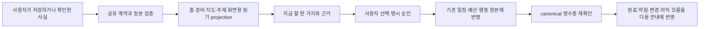

# 아모라 제품 방향·구현 통합 정리 — 2026-08-16

> 현재 실행 정본은 `docs/AMORA_MASTER_DEVELOPMENT_PLAN.md`다. 이 문서는 2026-08-16까지의 제품 결정과 구현 증거를 보존하는 역사 스냅샷이며, 이후 개발 순서나 완료 상태는 마스터 계획에서 갱신한다.

> 목적: 이번 대화에서 합의한 아모라의 제품 본질, 실제 개발된 범위, 아직 부족한 범위, 다음 개발 순서를 한 문서에서 구분해 본다.
>
> 기준 저장소: `codex/amora-release-hardening-20260811`
>
> 현재 HEAD: `6855394f4c363c851f016b7d9cfb9bc409944ce2`
>
> 릴리스 후보 구현 commit: `b4d4051bd198c24fc441a9e171fed259b9b253bd`
>
> 상태 요약: **개인화 핵심 기반 구현 / 모바일 준비 주제·저장 대화 회수·대표 5개 검수 가이드·첫 이용 결정론적 제안과 정확한 적용·출처가 증명된 일반 add-action 정확 승인·원자 dispatcher 정합성 로컬 구현 / 현재 worktree dirty·미커밋 / hosted DB·Vercel Preview·Production·EAS 미배포**

---

## 1. 한 문장으로 정리한 우리가 원하는 아모라

> **아모라는 사용자가 질문해야만 답하는 챗봇이 아니라, 확인된 결혼 준비 상태와 사용자가 직접 고른 기준을 바탕으로 먼저 지금 할 한 가지와 이유를 제시하고, 필요한 지식·결정·대화·일정·예산·행동을 준비 주제별로 이어 주는 개인화 결혼 준비 리더다.**

소비자가 느껴야 하는 최종 감정은 다음과 같다.

- `결혼 준비를 잘 몰라도 아모라가 지금 할 것부터 알려준다.`
- `왜 해야 하는지와 어디까지 하면 되는지 쉽게 이해된다.`
- `예전에 물어보고 정한 내용을 다시 찾을 수 있다.`
- `내 상황과 우리 기준이 실제 안내에 반영된다.`
- `결정한 결과가 일정·예산·행동으로 정확히 이어진다.`
- `무엇이 끝났고 무엇이 남았는지 한눈에 보인다.`

---

## 2. 이번 대화에서 확정한 제품 원칙

### 2.1 아모라는 먼저 리드한다

`먼저 리드한다`는 사용자의 동의 없이 자꾸 푸시하거나 말을 많이 건다는 뜻이 아니다.

- 처음 들어오면 빈 입력창 대신 현재 준비 상태 확인부터 시작한다.
- 다시 들어오면 지난 상태에서 이어서 지금 할 한 가지를 먼저 보여 준다.
- 근거가 부족하면 한 번에 필요한 질문 하나만 묻는다.
- 급한 일이 없으면 일을 만들어 내지 않고 `이번 주는 급한 준비가 없어요`라고 말한다.
- 외부 알림은 별도 동의와 빈도 통제가 있을 때만 사용한다.

좋은 시작 예시:

- `아직 날짜를 몰라도 괜찮아요. 생각하는 계절부터 하나만 볼까요?`
- `지난번에는 예식장 지역을 정했어요. 이제 예상 하객 범위를 보면 후보를 줄일 수 있어요.`
- `드레스 피팅이 3일 남았어요. 오늘은 준비물 두 가지만 확인하면 충분해요.`
- `이 행동이 막혔다고 남겼어요. 후보를 더 찾기보다 빠진 사실 하나부터 확인해 볼게요.`

### 2.2 개인화는 많이 추측하는 것이 아니다

아모라의 개인화는 **확인된 차이를 정확하게 반영하는 것**이다.

사용해도 되는 입력:

1. 사용자가 저장한 예식일·지역·예산·일정·체크 상태
2. 사용자가 직접 고른 말투·설명 깊이·결정 시작 방식
3. 본인이 검토해 저장한 `내 기준`
4. 두 사람이 같은 내용을 각각 확인한 `우리 기준`
5. 사용자가 직접 남긴 `완료·막힘·변경·아직 모름` 결과
6. 현재 보고 있는 준비 주제의 최신 유효 기록

사용하면 안 되는 입력:

- 대화만 보고 추정한 성격·소득·계층·소비 성향
- 확인되지 않은 가족 관계·가족 의도·지역 관습
- 상대방의 비공개 대화나 개인 기준
- 오래되었거나 폐기된 결정
- AI가 만들었지만 사용자가 확인하지 않은 사실

### 2.3 혼자 써도 완전해야 한다

- 파트너가 가입하지 않아도 개인 사용자는 전체 준비 도움을 받을 수 있어야 한다.
- 개인 상담과 개인 기준은 기본적으로 본인만 본다.
- 공동 기준과 공동 결정은 두 사람이 명시적으로 확인한 경우만 공유한다.
- `파트너에게 보일 초안`을 제품의 중심 기능으로 만들지 않는다.
- 공유·전송·예약·결제·업체 문의는 자동으로 하지 않는다.

### 2.4 모름·보류·생략도 정상적인 준비 상태다

- `모르겠어요`
- `추천해 주세요`
- `나중에 정할게요`
- `우리에게는 필요 없어요`
- `막혔어요`
- `내용이 바뀌었어요`

위 응답은 실패가 아니다. 아모라가 설명 방식과 다음 행동을 조정할 입력이다.

### 2.5 한 가지를 먼저 보여 주되 전체를 숨기지 않는다

- 홈의 주 행동은 한 개로 유지한다.
- 놓치면 실제 피해가 생길 병렬 마감·계약 위험은 `지켜볼 것`으로 제한해서 보여 줄 수 있다.
- 전체 준비 지도는 언제든 열 수 있어야 한다.
- 완료율 숫자로 사실·결정·실행을 한꺼번에 섞지 않는다.

---

## 3. 팀 전략 PDF에서 가져온 것과 가져오지 않은 것

검토 자료: `C:/Users/kcho1/Downloads/웨딩한방_제품_전환_전략.docx.pdf`

14쪽 전체를 검토했고, 다음 철학은 현재 아모라 방향과 잘 맞아 흡수했다.

### 가져온 것

- 다음 행동을 먼저 보여 주기
- 업체를 찾기 전에 우리 기준을 먼저 만들기
- `모름`을 유효한 답으로 인정하기
- 관습 항목을 `유지·축소·대체·생략·미정`으로 다루기
- 대화가 말로 끝나지 않고 계획에 남게 하기
- 불안보다 통제감을 주기
- 큰 과정을 작고 끝낼 수 있는 단계로 나누기
- 매번 같은 이해·선택·승인·반영 패턴 사용하기
- 중간에 떠났다가도 쉽게 이어서 준비하기
- 체류시간이나 채팅 수보다 의미 있는 결정과 실행을 측정하기

### 그대로 가져오지 않은 것

- `미션`을 새 핵심 데이터나 별도 메뉴로 만들지 않는다.
- 5개 챕터를 전체 결혼 준비의 정본으로 만들지 않는다.
- 10~15분짜리 필수 온보딩을 강요하지 않는다.
- `오늘·우리 여정·우리 계획` 같은 새 탭을 대량 추가하지 않는다.
- 결정 결과를 사용자 승인 없이 `자동 반영`하지 않는다.
- 웨딩홀이나 상견례 하나를 전체 제품 구조처럼 확대하지 않는다.
- 유료 자료의 문장·목차·표·사례·가격 배열을 복제하지 않는다.

결론은 `코스`를 새 제품 구조로 만드는 것이 아니라, **기존 준비 주제 안에서 결정을 쉽게 끝내는 안내 방식**으로만 사용하는 것이다.

---

## 4. 고객에게 보이는 하나의 제품 구조

새 탭과 두 번째 체크리스트를 만들지 않는다. 기존 표면이 서로 다른 정본을 보여 주지 않도록 하나의 준비 상태로 연결한다.

| 표면 | 고객 질문 | 역할 |
|---|---|---|
| 홈 | 지금 무엇을 해야 하지? | 가장 중요한 한 가지, 이유, 예상 부담, 완료 기준 |
| 준비 지도 | 전체적으로 어디까지 했지? | 준비 주제별 상태와 남은 결정 |
| 준비 주제 | 이 준비에서 무엇을 알고 정해야 하지? | 상황·결정·가이드·대화·일정·예산·행동을 한곳에서 보기 |
| 아모라 채팅 | 내 상황에서는 어떻게 해야 하지? | 현재 문맥에서 먼저 설명하고 최소 질문으로 정리하기 |
| 일정·예산·체크·행동 | 실제 계획에 무엇이 반영됐지? | 사용자가 승인한 실행과 결과 영수증 |

### 준비 주제 화면의 공통 순서

1. `지금 상태`
2. `우리 상황`
3. `아직 정할 것`
4. `아모라의 맞춤 가이드`
5. `내가 물어보고 보관한 것`
6. `지금 할 한 가지`
7. `연결된 일정·예산·행동`

모든 내용을 처음부터 길게 펼치지 않는다. 요약을 먼저 보여 주고 세부는 사용자가 연다.

---

## 5. 아모라가 세세한 고민까지 다루는 방법

상견례 전용 상세 기능을 만드는 것이 아니다. 상견례는 공통 엔진을 검증한 대표 사례일 뿐이며, 같은 질문 구조를 모든 결혼 준비 분야에 적용한다.

각 주제는 필요한 경우 아래를 검토한다.

1. 우리에게 이 준비가 필요한가?
2. 무엇을 먼저 결정해야 하는가?
3. 누가 참여하고 누가 확인해야 하는가?
4. 날짜·마감·선행 조건은 무엇인가?
5. 예산·견적·계약·결제에서 무엇을 구분해야 하는가?
6. 후보는 어떤 기준으로 비교해야 하는가?
7. 실행 전에 무엇을 다시 확인해야 하는가?
8. 변경·취소·지연·불참 같은 예외는 무엇인가?
9. 완료되었다고 볼 수 있는 증거는 무엇인가?
10. 이후 다른 준비에 어떤 영향을 주는가?

아모라는 이 목록을 매번 모두 출력하지 않는다. 사용자의 현재 상태에 실제로 관련 있는 내용만 먼저 보여 준다.

### 검수 가이드의 필수 구성

- 쉬운 개념 설명
- 지금 확인하는 이유
- 결정할 선택지와 상충 관계
- 자주 헷갈리는 부분
- 비용·일정·계약·가족 영향
- 생략·축소·대체 방법
- 업체나 가족에게 실제로 물어볼 문장
- 필요한 서류·근거·마감
- 완료 증거와 다음 행동
- 출처·확인일·적용 범위·달라질 수 있는 조건

공식 정보, 검수된 독립 콘텐츠, 일반적이지만 변할 수 있는 관행, 사용자 경험, 아모라 제안을 구분한다.

---

## 6. 중요한 아모라 대화를 한눈에 다시 찾는 방법

대화 전체를 복제하거나 AI가 임의로 중요한 사실로 확정하지 않는다. 현재 worktree에는 다음 최소 흐름을 **모바일 전용·미커밋 로컬 구현**으로 연결했다.

1. 저장이 끝난 아모라 AI 답변 중, 현재 커플의 `W0` 또는 `W1` 질문에 직접 답한 안전한 메시지에만 `준비에 저장`을 보여 준다.
2. 사용자가 19개 기존 준비 주제 중 하나를 직접 고른다. AI는 답변 내용으로 주제를 자동 추정하지 않는다.
3. 새 저장소에는 원문·요약·메모를 복제하지 않고 기존 메시지 ID 참조와 무결성 확인값만 남긴다.
4. 준비 주제의 `저장한 대화`에서 공유 답변과 본인 비공개 답변의 범위를 그대로 보존해 보여 준다. 파트너의 비공개 대화는 존재나 개수도 노출하지 않는다.
5. 항목을 열면 최신 200개 대화 목록에 없는 오래된 메시지도 서버가 현재 권한과 원문 무결성을 다시 확인해 정확한 질문·답변으로 연다.
6. 원문이 삭제되면 참조도 함께 삭제되고, 권한 상실·변경·조회 실패 때는 다른 대화나 빈 성공 상태로 대체하지 않는다.
7. 저장한 답변은 AI 요약·사실·결정·완료 증거가 아니다. 주제 상태·진행률·다음 행동을 자동으로 바꾸지 않는다.

기존 웹 `/saved`는 주제 키가 없는 커플 공유 원문 스냅샷이므로 이번 흐름에 재사용하거나 자동 이관하지 않았다.

---

## 7. 실제로 어떻게 개발했는가

### 7.1 전체 기술 흐름

새로운 거대 상태 저장소를 만들지 않고 기존 정본을 재사용했다.

| 정보 | 정본 |
|---|---|
| 체크 상태 | 기존 wedding journey progress와 checklist IDs |
| 일정 | 기존 schedule event와 moment identity |
| 예산 | 기존 예산 카테고리와 사용자 정의 카테고리 |
| 실행 행동 | 기존 `amora_actions` |
| 공동 결정 | 기존 `decision_nodes`와 revision |
| 개인·공동 기준 | 기존 criterion/personalization 저장소 |
| 대화 | 기존 `chat_messages` 원문 + `amora_preparation_topic_message_refs` 참조; 원문·AI 요약은 복제하지 않음 |
| 가이드 | 현재 정본: `packages/shared`의 버전 고정 독립 작성 정적 레지스트리 v1. 부모님 첫 만남·결혼식장·사진 촬영 결과물·헤어/메이크업·진행자/축하 노래의 대표 5개만 있으며, 공식·변동 정보용 서버 콘텐츠 정본은 아직 없음 |

### 7.2 공유 계약 계층

웹·모바일이 같은 데이터 의미를 사용하도록 `packages/shared`에 런타임 계약을 추가했다.

대표 계약:

- `amoraPreparationMap`: 19개 현재 체크리스트를 읽기 전용 준비 지도 상태로 투영
- `amoraPreparationCoverage`: 전체 여정 감사와 명시적 제품 공백 계산
- `amoraPreparationTopic`: 한 준비 주제의 상태·근거·미정·다음 행동·연결 필드
- `amoraPreparationGuide`: 현재 주제 상태·정확한 미완료 체크 항목·검토 유효일을 모두 통과할 때만 대표 5개 독립 작성 가이드를 반환
- `amoraCoreCriterion`: 개인 기준
- `amoraCoupleCriterion`: 두 사람이 확인한 공동 기준
- `amoraActionOutcomeFeedback`: 행동 결과를 다음 안내에 반영하는 단기 피드백
- `amoraFirstUseGrounding`·`amoraFirstUsePromotion`: 첫 이용 행동의 근거와 중복 방지
- `amoraPreparationTopicMessageRef`: 준비 주제별 저장 대화 목록·정확한 상태·명시 저장/제거·원문 회수 계약
- `todayOneCare`: 일정에 맞춘 짧은 케어 카드

`amoraPreparationTopic`, `amoraPreparationTopicMessageRef`, `amoraPreparationGuide`는 현재 worktree의 **미커밋 로컬 구현**이다. 릴리스 후보 commit과 현재 Vercel Preview에는 포함되지 않았다.

### 7.3 서버와 데이터 계층

- owner·couple·roster·privacy epoch·revision을 서버에서 다시 확인한다.
- 개인 기준과 공동 기준을 별도 저장·검증한다.
- 행동 결과는 canonical receipt를 다시 읽은 뒤에만 성공으로 표시한다.
- 동일 요청·재시작·다른 기기 재시도를 idempotent하게 복구한다.
- AI가 근거 없는 계약 완료·결제·금액·합의·마감을 행동으로 만들지 못하게 검증한다.
- 서비스 전용 RPC와 FORCE RLS를 사용해 private source와 공유 기록을 분리한다.
- 승인 전에는 자동 일정·예산·공유 기록을 만들지 않는다.

대표 migration:

- `20260814120000_amora_explicit_action_execution.sql`
- `20260814130000_amora_core_criterion.sql`
- `20260814140000_amora_couple_core_criterion.sql`
- `20260815120000_amora_action_outcome_feedback.sql`
- `20260815130000_amora_first_use_action_promotions.sql`
- `20260816120000_amora_preparation_topic_message_refs.sql`
- `20260816130000_amora_first_use_deterministic_proposal.sql`
- `20260816140000_amora_first_use_deterministic_application.sql`
- `20260816150000_amora_provider_backed_add_action_application.sql`
- `20260816160000_amora_atomic_action_href_parity.sql`

### 7.4 모바일 첫 이용 경험

구현된 흐름:

1. 역할과 혼자/함께 준비 여부를 확인한다.
2. 날짜·예산·취향을 모두 입력하지 않아도 빠르게 시작할 수 있다.
3. 빈 채팅에서 아모라가 먼저 현재 상태를 확인하는 선택지를 보여 주되, 사용자가 고르고 직접 전송해야 상담이 시작된다.
4. AI 개인 상담은 확인된 내용과 아직 모르는 내용을 구분하고, 지금 할 행동·이유·완료 기준을 카드로 보여 준다.
5. `1/3 나만 정리` 결과는 개인 상담에만 저장되며, 상대방과 공동 준비 기록은 아직 바뀌지 않는다.
6. 사용자가 `2/3 함께 볼 초안`을 직접 보내야 함께 대화에 저장된다. 이 단계도 공동 준비 기록은 바꾸지 않는다.
7. 서버가 현재 owner·couple·privacy epoch·journey revision·원문 binding을 다시 검증한 뒤, 이미 확정된 공유 제안 카드는 별도 AI 호출 없이 원자적으로 저장·복구한다.
8. 사용자가 `3/3 준비에 반영 전`에서 고정 문장 `좋아요. 제안한 변경을 적용해 주세요.`를 그대로 전송한 경우에만, 서버가 제안 원문과 행동 ID를 다시 묶어 확인하고 별도 AI 호출 없이 정확한 행동을 적용한다.
9. 행동·도구 실행 영수증·아모라 답변·채팅 요청 완료를 한 트랜잭션에서 확정한다. 같은 요청은 검증된 동일 영수증만 재생하고, 모바일은 서버 메시지 ID로 임시 메시지를 교체한 뒤 홈의 정확한 행동으로 이어진다.

첫 개인화·비공개 상담 답변은 그대로 AI 경로와 `ai_interactions_log`를 사용한다. AI를 제거한 범위는 서버가 이미 정답을 알고 있는 첫 이용 공유 제안 생성과 그 제안의 **순수한 고정 적용 요청**, 그리고 별도 출처 seal과 DB provider 영수증 증명을 통과한 일반 add-action 제안의 정확한 고정 적용뿐이다. 무엇을 제안할지 판단하는 단계, 비공개·add-action 외 일반 요청·일정 케어·추가 질문을 섞은 문장·첨부·legacy/unsealed 요청은 기존 AI/provider 경로를 유지한다. provider를 호출하지 않은 경로에는 가짜 provider receipt나 AI 호출 로그를 만들지 않는다.

주요 source:

- `apps/mobile/src/lib/onboardingFirstValue.mjs`
- `apps/mobile/src/lib/amoraEntryPlan.mjs`
- `apps/mobile/src/components/chat/AmoraStarterCard.tsx`
- `apps/mobile/src/components/chat/AmoraFirstUseActionCard.tsx`
- `apps/mobile/src/lib/actionReceiptHomeHandoff.mjs`
- `apps/web/src/lib/ai/amoraFirstUseDeterministicApplication.ts`
- `supabase/migrations/20260816140000_amora_first_use_deterministic_application.sql`

### 7.5 개인화 설정·내 기준·우리 기준

구현된 명시적 개인화 설정:

1. 아모라 말투
2. 결정을 시작하는 방식
3. 설명 깊이
4. 막혔을 때 도움 순서
5. 둘이 준비하는 방식
6. 가족 의견을 확인하는 순서

`내 기준`은 본인이 검토한 한 문장만 private로 저장한다. `우리 기준`은 두 사람이 같은 문장을 각각 확인한 경우에만 공동 결정으로 확정한다.

주요 source:

- `apps/mobile/app/settings/amora-style.tsx`
- `apps/mobile/src/components/chat/AmoraPersonalizationSheet.tsx`
- `apps/mobile/src/lib/amoraPersonalization.mjs`
- `apps/mobile/src/lib/amoraCoreCriterion.mjs`
- `apps/mobile/src/lib/amoraCoupleCriterion.mjs`

### 7.6 홈의 개인화된 한 가지

홈은 단순히 가장 최근 항목을 고르지 않는다.

현재 우선순위:

1. 사용자가 저장한 마감이 지났거나 오늘인 행동
2. 오늘의 저장된 일정
3. 결과 기록이 필요한 방문·문의
4. 7일 안의 마감 또는 사용자가 높음으로 저장한 행동
5. 기본 확인 시점으로 계산한 체크리스트 경고
6. 그 밖의 열린 행동
7. 일반 다음 단계 또는 차분한 상태 확인

추천에는 실제 사용한 근거만 `왜 이 제안인가요?`에서 보여 준다. 개인 설정과 개인 결과는 `나만 보기`, 함께 확인한 기준은 `커플 공유`로 설명한다.

주요 source:

- `apps/mobile/src/lib/dashboardExperience.mjs`
- `apps/mobile/app/(tabs)/dashboard.tsx`
- `apps/mobile/src/components/dashboard/WeddingHomeExperience.tsx`
- `apps/mobile/src/components/dashboard/AmoraRecommendationWhySheet.tsx`

### 7.7 행동 결과와 다음 도움

사용자는 행동 결과를 다음처럼 남길 수 있다.

- `끝냈어요`
- `막혔어요`
- `내용이 바뀌었어요`
- `아직 모르겠어요`

결과는 장기 성격으로 저장하지 않는다. 현재 행동에 대한 24시간 단기 상황 적응으로만 사용한다.

- 완료: 끝난 행동을 다시 추천하지 않고 다음 준비에 완료 연결만 보여 준다.
- 막힘: 막힘 사유에 맞는 가장 작은 회복 단계를 제안한다.
- 변경: 바뀐 사실 하나를 확인한다.
- 아직 모름: 완료로 몰지 않고 확인할 사실 하나를 제안한다.

결과 영수증은 사용자가 읽고 확인할 때까지 유지하며, 새로고침·Realtime·계정 전환·늦은 응답 경합에서 잘못 사라지거나 다른 세션에 남지 않도록 lease와 identity fence를 사용한다.

### 7.8 결혼 질문의 깊이와 저작권 경계

아모라 답변은 질문의 폭에 따라 깊이를 조절한다.

- 전체 준비 질문: 일정·비용·계약·사람·실행·예외를 내부 점검하고 관련 항목만 우선 표시
- 한 가지 질문: 먼저 직접 답하고 결과를 바꿀 사각지대 1~2개만 보충
- 이미 확인한 내용: 반복하지 않음
- 저장 기록과 현재 말이 충돌: 현재 말을 우선하되 충돌을 숨기지 않음
- 가족 형태·성 역할·지역 관습: 정답으로 전제하지 않음
- 확인되지 않은 가격·비율·시기: 생성하지 않음

외부 가이드북은 질문을 작게 나누고 예외를 놓치지 않는 정보 설계만 연구했다. 원문·고유 배열·표·수치·사례를 코드와 콘텐츠에 복제하지 않았다.

### 7.9 모바일의 읽기 전용 개인화 준비 지도

구현된 기반:

- 기존 19개 카테고리·132개 체크 항목을 새 테이블 없이 읽기 전용으로 투영한다.
- 상태를 `확인 전·시작 전·진행 중·완료·하지 않기로 함·기록 확인 필요`로 구분한다.
- 저장 기록이 없으면 완료나 적용 여부를 추정하지 않는다.
- 저장 상태가 실제 항목과 충돌하면 `기록 확인 필요`로 보여 준다.
- 홈은 근거를 구분해 최대 세 주제만 요약하고 전체 보기는 기존 체크리스트를 연다.
- 새 탭·새 체크리스트·자동 저장·자동 공유를 추가하지 않았다.

주요 source:

- `packages/shared/src/contracts/amoraPreparationMap.mjs`
- `packages/shared/src/contracts/amoraPreparationCoverage.mjs`
- `apps/mobile/src/lib/preparationMapPresentation.mjs`
- `apps/mobile/src/components/dashboard/WeddingHomeExperience.tsx`

### 7.10 현재 로컬 구현된 모바일 공통 준비 주제 요약

독립된 새 주제 페이지가 아니다. 기존 모바일 `/schedule`에서 체크리스트 카테고리를 펼쳤을 때 상단에 붙는 읽기 전용 요약이다. 현재 worktree의 미커밋 로컬 구현이며 Vercel Preview에는 포함되지 않았다.

구현된 범위:

- 19개 기존 준비 카테고리에 공통 `PreparationTopicView`를 계산한다.
- 실제 저장 체크 상태, 정확히 연결된 일정, 같은 주제의 저장 예산, 커플에게 공개된 열린 행동만 근거로 사용한다.
- `확인 전·준비 전·일정 연결됨·준비 중·결정 필요·완료·해당 없음`을 구분한다.
- 제외한 준비에 실제 일정이나 열린 행동이 남아 있으면 숨기지 않고 `기록 확인 필요`로 표시한다.
- 체크리스트가 완료돼도 열린 행동이 남아 있으면 완료라고 말하지 않는다.
- 예산은 같은 기존 카테고리 키의 저장값만 읽으며, 잘못된 금액·결제 완료·부담 주체를 추정하지 않는다.
- 행동은 현재 커플의 `open` 상태와 같은 카테고리 키가 정확히 일치하는 경우만 연결한다. 비공개 행동 결과는 섞지 않는다.
- 행동 조회가 실패하면 빈 목록처럼 숨기지 않고 다시 불러오기 상태를 보여 주며, 계정·커플 전환이나 핵심 조회 실패 때 이전 화면의 기록을 지운다.
- 일정 변경 기록은 공유 범위·사용자 확인·현재 커플·현재 여정 revision을 모두 확인하고, 저장된 `after` 스냅샷이 현재 일정과 정확히 일치하는 추가·수정·취소·복원 영수증만 `확인한 일정 기록`으로 보여 준다.
- 일정 변경 기록은 읽기 전용 근거이며 진행률이나 다음 행동의 우선순위를 바꾸지 않는다. 오래됐거나 자동 생성됐거나 비공개이거나 현재 일정과 달라진 기록은 표시하지 않는다.
- 잘못된 일정 상태와 표시 위험 문자는 개인화 근거에서 제외한다.
- 한 화면에 근거를 과도하게 나열하지 않고 핵심 요약과 다음 행동을 먼저 보여 준다.
- 예산 수정은 새 편집기를 만들지 않고 기존 `/budget` 화면에 정확한 카테고리 키만 넘긴다.

아직 연결되지 않은 범위:

- 일정 이외 일반 결정의 주제 연결

주요 source:

- `packages/shared/src/contracts/amoraPreparationTopic.mjs`
- `apps/mobile/src/lib/preparationTopicPresentation.mjs`
- `apps/mobile/src/components/planning/PreparationTopicSummary.tsx`
- `apps/mobile/app/schedule/index.tsx`

### 7.11 모바일 준비 주제의 저장 대화와 정확한 원문 회수

현재 worktree에 로컬 구현된 범위다. 모바일 화면만 연결했으며 Preview·Production·EAS에는 배포하지 않았다.

- 저장 대상은 영구 저장된 아모라 AI 답변 중 현재 커플의 `W0`·`W1` 질문과 정확히 연결되고 안전 경계를 통과한 메시지로 제한한다.
- 사용자가 준비 주제를 직접 선택하며, AI 주제 추론·AI 요약·원문 복사를 하지 않는다.
- 공유 원문은 커플이 함께 보고, 본인 비공개 원문은 소유자만 본다. 상대방의 비공개 원문은 조회·목록·개수에서 모두 숨긴다.
- 저장과 제거는 revision·request ID·privacy epoch를 확인하는 멱등 요청으로 처리해 중복 탭·응답 유실·오래된 재시도가 상태를 되돌리지 못하게 한다.
- 주제 화면은 `저장한 대화`를 보조 정보로 최대 두 개 먼저 보여 주고 필요할 때만 펼친다.
- 항목을 열면 불투명한 참조 ID로 서버가 원문을 다시 검증하고 정확한 질문·답변을 반환하므로 최근 200개 바깥의 대화도 회수할 수 있다.
- 원문 메시지 삭제 시 외래키 cascade로 참조도 삭제된다. 삭제·변경·권한 상실은 404 또는 충돌 상태로 처리하며 유사한 다른 대화를 대신 열지 않는다.
- 이 참조는 읽기 보조 정보이며 준비 상태·진행률·결정·홈 추천·다음 행동의 근거로 사용하지 않는다.

주요 source:

- `packages/shared/src/contracts/amoraPreparationTopicMessageRef.mjs`
- `supabase/migrations/20260816120000_amora_preparation_topic_message_refs.sql`
- `apps/web/src/app/api/amora/preparation-topic-message-refs/route.ts`
- `apps/web/src/app/api/amora/preparation-topic-message-refs/[refId]/route.ts`
- `apps/mobile/src/lib/preparationTopicMessageRefs.mjs`
- `apps/mobile/app/(tabs)/chat.tsx`
- `apps/mobile/src/components/planning/PreparationTopicSummary.tsx`
- `apps/mobile/app/schedule/index.tsx`

### 7.12 모바일 대표 5개 주제 검수 가이드 v1

현재 dirty worktree에만 있는 **미커밋 로컬 구현**이다. Vercel Preview에서 확인하는 웹 기능이 아니며, EAS 빌드나 모바일 Production에는 배포하지 않았다.

- 공통 계약은 정적 독립 작성 콘텐츠 가운데 `meeting`·`venue`·`studio`·`makeup`·`mc` 다섯 주제만 지원한다.
- 정확한 표시 계기는 `meeting_01`~`meeting_03`, `venue_06`·`venue_07`, `studio_04`·`studio_06`, `makeup_04`~`makeup_06`·`makeup_08`, `mc_05`·`mc_06`이다. 현재 체크리스트의 ID와 문구가 정본과 정확히 일치하고 해당 항목이 미완료일 때만 후보가 된다.
- 주제가 `applicable`이고 상태가 `not_started`·`exploring`·`in_progress`이며, 화면의 현재 미정 항목도 같은 `unfinished_checklist` ID·문구를 가리킬 때만 가이드 하나를 결정적으로 표시한다. 완료·해당 없음·기록 충돌·항목 불일치에는 표시하지 않는다.
- 기존 세 콘텐츠는 `2026-08-16`, `studio`·`makeup` 콘텐츠는 `2026-08-17` 내부 편집 검토로 고정했고 재검토 기한은 모두 `2026-11-16`이다. 서울 기준 현재 날짜가 없거나 각 검토일 전이거나 재검토 기한 뒤면 런타임에서 fail-closed로 가이드를 반환하지 않는다.
- 내용은 웨딩한방이 독립 작성한 정적 콘텐츠다. 결정할 것·예외·실제로 물어볼 문장·완료 증거·적용 범위·한계를 담으며, 외부 가이드북의 문장·표·배열·수치·사례를 복제하지 않는다.
- 새 화면이나 새 탭을 만들지 않았다. 기존 모바일 준비 주제 요약에서 `다음 행동` 뒤, `저장한 대화` 앞에 읽기 전용으로 붙고 기본은 접힌 상태다.
- 이 조각에는 AI 호출·API·DB·저장·완료 처리·새 내비게이션이 없다. 펼쳐 읽는 것만 가능하며 준비 상태를 바꾸지 않는다.
- 이는 19개 전체 주제나 결혼 준비 전체 가이드의 완성이 아니다. `studio` 가이드는 결과물·촬영 범위·계약 전 서면 확인만, `makeup` 가이드는 사전 확인·대상 인원·포함 범위·요청사항만, `mc` 가이드는 진행자·축하 노래와 연결된 순서 확인만 다룬다. 결과 만족도·품질·가격 적정성·업체 신뢰도나 본식 당일 전체 운영을 판단한다는 뜻이 아니다.

주요 source:

- `packages/shared/src/contracts/amoraPreparationGuide.mjs`
- `packages/shared/src/contracts/amoraPreparationTopic.mjs`
- `apps/mobile/src/lib/preparationTopicPresentation.mjs`
- `apps/mobile/src/components/planning/PreparationTopicSummary.tsx`
- `apps/mobile/src/__tests__/preparationGuideModules.test.mjs`

### 7.13 첫 이용 고정 적용의 provider-free 원자 처리

현재 dirty worktree에만 있는 **미커밋 로컬 구현**이다. hosted DB·Vercel Preview·Production·EAS에는 배포하지 않았다.

- 대상은 서버가 만든 공유 첫 이용 제안, 그 제안의 정확한 행동 ID, 고정 적용 문장, `W0` 범위, 첨부 없음이 모두 일치하는 요청 하나다. 앱이나 라우트가 행동 제목·내용·결과를 새로 정해서 DB에 넘기지 않으며, DB가 저장된 제안과 binding에서 다시 계산한다.
- 첫 개인화·비공개 상담 답변은 계속 AI가 만든다. 이 첫 이용 계약은 일반 행동에 적용하지 않는다. 일반 add-action의 정확한 승인은 7.14의 별도 positive-seal 경계만 예외이며, 일정 케어·고정 문장 뒤 추가 질문·첨부 요청은 계속 기존 AI/provider 경로에 남는다.
- 정확한 대상에서는 provider 예약·호출·provider ledger·`ai_interactions_log`를 만들지 않고 `provider_call_count: 0`인 서버 영수증을 반환한다.
- 한 DB 트랜잭션 안에서 현재 커플·권한·privacy epoch·journey revision·제안 원문을 확인하고, 행동과 canonical 도구 실행 영수증을 저장한 뒤 정확한 아모라 답변을 남기고 채팅 요청 claim을 마지막에 완료한다. 중간 오류는 일부 성공처럼 보이지 않도록 전체를 되돌린다.
- 최초 응답과 동일 요청 재시도 모두 제안 원문·행동·영수증·메시지 metadata를 엄격하게 다시 검증한다. 이미 완료된 요청은 새 행동을 만들지 않고 검증된 동일 결과만 재생한다.
- 모바일은 `done` 영수증만 먼저 도착해도 `serverMessageId`로 `temp_` 메시지를 교체한다. 임시 ID가 남아 Realtime을 기다리거나 홈 이어가기가 끊기는 경로를 막고, 열린 행동의 정확한 ID와 `/wedding/lounge` 연결을 유지한다.

이 단계가 없으면 DB 행동 저장은 성공했는데 뒤따르는 AI 호출 실패가 전체 실패처럼 보일 수 있었다. 이번 변경은 **이미 사용자가 확인한 적용 결과를 알리는 기계적 단계**만 AI에서 분리하며, 무엇을 제안할지 판단하는 개인화 AI를 대체하지 않는다.

### 7.14 출처가 증명된 일반 add-action 정확 승인과 원자 dispatcher 정합성

현재 dirty worktree에만 있는 **미커밋 로컬 구현**이다. hosted DB·Vercel Preview·Production·EAS에는 배포하지 않았다.

- 첫 이용 전용이 아닌 일반 공유 `W0` 대화에서도, 실제 provider 응답이 새 `add_amora_action` 제안을 만들고 durable 저장까지 끝낸 경우에만 `amora_add_action_proposal_origin_v1: ordinary_provider` seal을 붙인다. 첫 이용 provenance, 일정 케어, 첨부, 이미 승인된 행동, 비공개·demo·비provider 결과에는 seal을 붙이지 않는다.
- 제안 내용과 행동 선택은 계속 AI/provider가 만든다. 적용 RPC는 seal만 신뢰하지 않고 원본 요청 claim과 사용자 메시지, 공유 제안, 현재 owner·couple·privacy epoch·journey revision을 다시 확인하며, 원본 요청의 가장 높은 durable provider call index에 `settled`·`success: true` 영수증이 정확히 하나 있는지도 DB에서 증명한다.
- 사용자가 고정 문장 `좋아요. 제안한 변경을 적용해 주세요.`만 보내고 행동 ID·제안 원문·`W0`·첨부 없음·바로 앞 메시지 binding이 모두 맞을 때만 적용 턴을 provider-free로 처리한다. 적용 턴에는 새 provider 예약·호출·provider receipt·`ai_interactions_log`를 만들지 않고, 실제 무호출을 나타내는 `provider_call_count: 0` 서버 영수증만 남긴다. 원본 제안을 만든 실제 provider 호출 로그는 그대로 필수다.
- 행동·canonical 도구 실행 영수증·공유 아모라 답변·채팅 요청 claim을 한 DB 트랜잭션으로 확정한다. 중간 실패는 전체 롤백하고, 동일 요청 재시도는 변경 가능한 현재 행동 행이 아니라 immutable 실행 snapshot과 정확한 메시지 metadata를 다시 검증한 뒤 같은 결과만 재생한다.
- 응답은 앞 단계에서 만든 모바일 영수증 계약을 그대로 사용한다. 모바일은 서버 메시지 ID로 임시 메시지를 교체하고 canonical 행동 ID를 홈 이어가기에 사용한다. 이는 로컬 계약 검증이며 실기기·2계정·2기기·hosted 실행 증거는 아니다.
- 제안 자체, 비공개 답변, add-action 외 일반 응답, 일정 케어, 추가 문장을 섞은 적용, 첨부 요청, 첫 이용 provenance가 섞인 요청, 과거 seal 없는 제안은 계속 AI/provider 경로에 남는다. 이번 단계가 모든 AI 병목이나 일반 결정 연결을 해결했다는 뜻은 아니다.
- `20260816160000_amora_atomic_action_href_parity.sql`은 기존 원자 dispatcher에서 생긴 DB/TypeScript 차이만 좁게 고친다. href를 생략한 `mc`·`gift` 행동의 기본 경로를 제거된 `/wedding/etiquette` 대신 TypeScript와 같은 `/wedding/chat`으로 맞추고, 검증한 ASCII 탭·줄바꿈·공백 범위에서 title·description의 공백 축약 뒤 양끝 제거 순서를 맞춘다.
- 이 successor는 이미 발급된 제안의 원래 input digest·operation key·행동 ID를 바꾸지 않으며, 다른 기본 경로·명시 href·공개 wrapper·lock graph·SECURITY DEFINER/ACL을 유지한다. 다만 이번 tranche에서 161500의 provider-free seal/parser는 href를 생략한 `mc`·`gift`와 Unicode·정규화 불일치 가능성이 있는 입력을 계속 fail-closed로 제외한다. 161600은 기존·일반 원자 dispatcher의 불일치를 고친 것이며 이 최적화의 대상 범위를 넓히지 않는다.

주요 source:

- `apps/web/src/lib/ai/amoraProviderBackedAddActionApplication.ts`
- `apps/web/src/app/api/chat/route.ts`
- `supabase/migrations/20260816150000_amora_provider_backed_add_action_application.sql`
- `supabase/migrations/20260816160000_amora_atomic_action_href_parity.sql`

---

## 8. 구현 상태표

| 제품 약속 | 현재 상태 | 설명 |
|---|---|---|
| 처음 온 사람에게 먼저 시작 제안 | 구현됨 | 빠른 시작·상태 검토·첫 행동 카드 |
| 저장된 사실 기반 홈 한 가지 | 구현됨 | 일정·마감·행동·체크 상태 기반 |
| 추천 이유 보기 | 구현됨 | 우선순위 근거와 개인화 범위 분리 |
| 개인화 설정 6종 | 구현됨 | 사용자가 직접 고른 값만 사용 |
| 내 기준 | 구현됨 | owner-private revision/receipt |
| 우리 기준 | 구현됨 | 두 사람의 동일 문장 확인 필요 |
| 행동 결과에 따른 다음 도움 | 구현됨 | 완료·막힘·변경·아직 모름 |
| 첫 행동 저장 후 홈 이어가기 | 구현됨 | exact action one-shot handoff |
| 첫 이용 3단계 경계와 provider-free 공유 제안 | 로컬 구현됨 | 개인 AI 답변은 유지하고, 서버가 이미 검증한 공유 제안만 원자적 RPC로 생성·복구. 현재 hosted DB·Preview·Production에는 미반영 |
| 첫 이용 공유 제안의 정확한 provider-free 적용 | 로컬 구현됨 | 고정 적용 문장·정확한 행동 ID·W0·첨부 없음이 모두 맞을 때만 행동·도구 영수증·아모라 답변·요청 claim을 한 트랜잭션으로 확정하고 엄격 재생. 이 첫 이용 계약 밖에서는 7.14의 positive-seal 일반 add-action만 별도 예외이며, 일정 케어·혼합·첨부 요청은 AI/provider 유지 |
| 출처가 증명된 일반 add-action의 정확한 provider-free 승인 | 로컬 구현됨 | 새로 seal된 공유 W0 provider 제안과 정확한 고정 승인만 대상. DB가 원본 completed claim과 가장 높은 settled/success provider 영수증을 증명하며, 적용 턴에는 새 provider/AI 로그를 만들지 않음. 비공개·다른 일반 요청·일정 케어·혼합·첨부·legacy/unsealed은 provider 유지 |
| 원자 add-action DB/TypeScript href·공백 정합성 | 로컬 구현됨 | 기존·일반 dispatcher에서 href 생략 `mc`·`gift`를 `/wedding/chat`으로 맞추고 검증한 공백 정규화 순서 차이를 수정. 기존 proposal identity·다른 경로·명시 href·wrapper/ACL은 유지하며 hosted DB에는 미적용. 161500 provider-free 선별은 href 생략 `mc`·`gift`를 계속 제외 |
| 모바일 적용 영수증의 서버 ID·홈 행동 연결 | 로컬 구현됨 | `done` 응답의 `serverMessageId`로 `temp_` 메시지를 교체하고 정확한 열린 행동으로 이어감. Preview·EAS·Production 미배포 |
| 모바일 홈의 읽기 전용 준비 지도 | 구현됨 | 기존 19개 체크리스트 projection |
| 모바일 공통 준비 주제 상태·일정·예산·행동 요약 | 로컬 구현됨 | 현재 미커밋 source에서 정확한 기존 정본을 읽기 전용으로 연결, 집중·전체 검증 통과 |
| 주제별 예산·공동 열린 행동 연결 | 로컬 구현됨 | 정확한 카테고리 키만 사용하며 현재 Preview·Production에는 미포함 |
| 주제별 현재 일정 변경 기록 | 로컬 구현됨 | 현재 일정과 exact 일치하는 사용자 확인 공유 영수증만 이력으로 표시, Preview·Production에는 미포함 |
| 주제별 일정 이외 일반 결정 연결 | 미구현 | 자동·과거·비공개 기록을 섞지 않을 별도 canonical receipt 범위가 필요 |
| 중요한 대화 다시 찾기 | 로컬 구현됨 | 사용자가 주제를 직접 고른 W0·W1 아모라 답변만 참조로 저장하고 정확한 원문을 회수함. 모바일 전용이며 Preview·Production 미포함 |
| 검수 가이드 공통 계약·대표 5개 | 로컬 구현됨 | `meeting`·`venue`·`studio`·`makeup`·`mc`의 정확한 현재 미완료 항목에만 내부 검토된 정적 가이드 하나를 접힌 상태로 표시. 읽기 전용이며 EAS·모바일 Production 미배포 |
| 전체 19개 주제의 검수 가이드 | 부분 | 대표 5개만 구현됐고 나머지 14개는 콘텐츠 검수·버전·재검토 운영을 거쳐 별도로 확장해야 함 |
| 결혼 준비 전체 커버리지 | 부분 | 현재 19개 연결, 독립 공백 6개 |
| 실제 고객·실기기 검증 | 미완료 | 작은 화면·접근성·2계정·2기기 필요 |
| Production 배포 | 미완료 | 기존 릴리스 후보 Preview만 READY이며 현재 로컬 tranche는 Preview에도 미포함. hosted evidence 부족 |

---

## 9. 현재 명시된 전체 여정 공백

현재 19개 체크리스트가 결혼 준비 전체의 완성을 뜻하지 않는다.

1. `planning_foundation`: 예식일·전체 예산·예식 방식·우선순위·역할의 시작 설계
2. `guest_operations`: 하객 명단·참석·좌석·식사·교통·숙박·접근성
3. `contract_payment_lifecycle`: 포함·불포함·변경·취소·지급·환불 근거
4. `marriage_admin`: 현재 커플에게 필요한 행정 항목과 공식 근거
5. `wedding_day_operations`: 연락망·시간표·물품·이동·돌발 상황·미지급·미수령
6. `post_wedding_closeout`: 결과물·정산·대여품 반납·감사 연락·남은 행정

이 공백을 긴 AI 문장이나 새 체크리스트 수로 덮지 않는다. 독립적인 상태·결정·완료 증거가 필요한 주제로 검증한 뒤 같은 공통 계약에 연결한다.

---

## 10. 검증 결과와 배포 상태

### 릴리스 후보에 기록된 로컬 검증

| 검증 | 결과 |
|---|---|
| Mobile 전체 | 811/811 PASS 당시 릴리스 후보 영수증 |
| Web Vitest 4 shards | 7,236/7,236 PASS |
| Shared/Web/Mobile typecheck | PASS / PASS / PASS |
| Repository `test:repo` | PASS |
| Supabase release tests | 198/198 PASS |
| Supabase release fence | PASS, `deployment_blocked`, 95 migrations |

준비 지도·coverage 확장 뒤 작업 기록에는 모바일 824/824 PASS, 관련 공개행동 테스트 10/10 PASS가 추가로 기록돼 있다.

### 2026-08-16 현재 공통 주제 화면 재검증

| 검증 | 결과 |
|---|---|
| 공통 주제 view·presentation·screen contract(현재 일정 기록 포함) | 41/41 PASS |
| 일정 영수증 SQL shape 2 files + 모바일 adapter 계약 교차검증 | 84/84 PASS |
| Mobile 전체 | 866/866 PASS |
| Shared typecheck | PASS |
| Mobile typecheck | PASS |
| Mobile 전체 ESLint | PASS |
| 대상 diff check | PASS |

### 2026-08-16 저장 대화 연결 로컬 재검증

| 검증 | 결과 |
|---|---|
| Shared 계약 + Web collection/state/mutation/resolver routes | 38/38 PASS |
| DB migration + Shared 계약 | 17/17 PASS |
| Mobile 저장·제거·주제 표시·정확한 원문 회수 집중 검증 | 63/63 PASS |
| Mobile 전체 | 888/888 PASS |
| Shared/Web/Mobile typecheck | PASS / PASS / PASS |
| Mobile 전체 ESLint | PASS |
| Supabase release tests | 208/208 PASS |
| 저장 대화 단계 당시 Supabase release fence | PASS, `deployment_blocked`, 96 migrations |

위 96개는 저장 대화 단계 당시 미커밋 매니페스트까지 포함한 로컬 게이트 영수증이다. 앞 절의 95개 영수증과 함께 단계별 역사 기록이므로 숫자를 바꾸지 않는다.

### 2026-08-16 대표 3개 검수 가이드 v1 로컬 재검증

| 검증 | 결과 |
|---|---|
| 가이드 계약·주제 projection·presentation·screen contract 집중 검증 | 59/59 PASS |
| Mobile 전체 | 903/903 PASS |

### 2026-08-16 첫 이용 공유 제안 AI 병목 축소 로컬 재검증

| 검증 | 결과 |
|---|---|
| 결정론적 제안 RPC migration PGlite | 22/22 PASS |
| Web 전체 chat route contract | 264/264 PASS |
| Mobile 전체 | 935/935 PASS |
| Shared/Web/Mobile typecheck | PASS / PASS / PASS |
| 대상 ESLint·diff check | PASS |
| Supabase release tests | 210/210 PASS |
| 공유 제안 단계 당시 Supabase release fence | PASS, `deployment_blocked`, 97 migrations(관찰된 적용 prefix 32 / 로컬 pending 65) |

위 검증 영수증은 `20260816130000_amora_first_use_deterministic_proposal.sql`까지의 공유 제안 단계 기록이다. 개인화 상담을 AI 없이 대체한 것이 아니며, 서버가 이미 검증한 첫 이용 공유 제안 단계에서만 정상 경로 기준 provider HTTP 호출 2회를 제거했다.

### 2026-08-16 첫 이용 고정 적용 AI 병목 축소 — 161400 단계 로컬 영수증

후속 `20260816140000_amora_first_use_deterministic_application.sql`과 웹·모바일 변경은 현재 dirty worktree에만 있다.

- 첫 개인화·비공개 답변은 계속 AI/provider 경로를 사용한다.
- 검증된 공유 첫 이용 제안의 정확한 고정 적용만 `provider_call_count: 0` 서버 경로로 처리한다.
- 행동·canonical 도구 영수증·공유 아모라 답변·채팅 요청 완료를 한 트랜잭션으로 묶고, 최초 응답과 재시도에 같은 엄격 재생 검증을 적용한다.
- 일반 행동, 일정 케어 행동, 추가 질문을 섞은 적용, 첨부가 있는 적용은 계속 AI/provider 경로를 사용한다.
- 모바일은 서버 영수증만 도착한 경우에도 임시 메시지 ID를 서버 메시지 ID로 확정하고 정확한 행동의 홈 이어가기를 유지한다.

이 tranche는 로컬 테스트 대상이며 hosted 실행 증거가 아니다. migration `20260816140000_amora_first_use_deterministic_application.sql`은 pending이고, hosted DB에는 적용되지 않았다.

| 이번 tranche 집중 검증 | 결과 |
|---|---|
| 첫 이용 결정론적 제안·적용 migration PGlite 파일 | 32/32 PASS |
| Web 전체 chat route contract | 285/285 PASS |
| Mobile `done` 전용 영수증·임시 ID·홈 이어가기 tracer | 1/1 PASS |

161400 단계 당시 로컬 릴리스 컨트롤 영수증은 `deployment_blocked`, 전체 migration 98개, 관찰된 적용 prefix 32개, pending 66개이며 tail은 `20260816140000_amora_first_use_deterministic_application.sql`이다. hosted staging·backup·hosted restore·storage·finalizer 증거 5종은 모두 `missing`이었다. 이 98개 수치는 아래 현재 tranche 이전의 역사 기록이다.

### 2026-08-16 일반 provider add-action 정확 승인·dispatcher 정합성 — 현재 로컬 tranche

후속 `20260816150000_amora_provider_backed_add_action_application.sql`, `20260816160000_amora_atomic_action_href_parity.sql`과 웹 route/helper 변경은 현재 dirty·미커밋 worktree에만 있다.

- 161500은 새로 positive seal된 일반 provider 생성 `add_amora_action` 제안의 정확한 고정 승인만 provider-free로 처리한다. 원본 제안의 실제 provider 호출과 성공 영수증을 DB에서 증명하고, 적용 턴에는 새 provider 호출·가짜 provider receipt·`ai_interactions_log`를 만들지 않는다.
- private·add-action 외 general·schedule-care·mixed text·attachment·first-use provenance·legacy/unsealed은 기존 provider 경로다. href를 생략한 `mc`·`gift`도 이번 provider-free 선별에서는 계속 제외한다.
- 161600은 기존·일반 원자 dispatcher의 `mc`·`gift` href 기본값과 검증된 title·description 공백 정규화 순서만 TypeScript와 맞춘다. 이미 발급된 input digest·operation key·행동 ID와 다른 dispatcher 계약은 유지한다.
- exact application은 행동·도구 영수증·아모라 답변·request claim을 원자적으로 확정하고 엄격 재생한다. 현재 모바일의 서버 메시지 ID 교체와 canonical 행동 홈 이어가기 계약을 그대로 사용한다.

| 이번 tranche 집중 검증 | 결과 |
|---|---|
| 161500·161600 migration PGlite | 30/30 PASS |
| Web 전체 chat route contract | 357/357 PASS |
| Web typecheck·대상 ESLint | PASS |
| 독립 적대 검수: 위 3개 파일 | 387/387 PASS, 재현 가능한 P0/P1 없음 |
| Supabase release tests | 216/216 PASS |
| 현재 Supabase release fence | PASS, predecessor 27개·successor `deployment_blocked` 101개 |

| frozen file | normalized-LF SHA-256 |
|---|---|
| `supabase/release-manifests/vendor-disclosure-v2-20260718.json` | `8ed341c23f92ff96f6bb0059a2447c1bb39b4645b8b392c748018b1657b142dd` |
| `supabase/release-contracts/vendor-disclosure-production-baseline-v1-20260815.json` | `aec85a53a01e33a22ffab43424a6cfeff0b052775ae26c772f9c281c1f25b111` |
| `supabase/migrations/20260816150000_amora_provider_backed_add_action_application.sql` | `1e7870be4051c4fd9017d6909b453739e8eda9fdd4100339d47d9a79d7777483` |
| `supabase/migrations/20260816160000_amora_atomic_action_href_parity.sql` | `afe0eabc7cc774d219715224906bfd328e0df011bb76f9caea69615a93a4af7c` |
| `supabase/migrations/20260816170000_amora_booking_outcome_provenance.sql` | `9b673303585070facadb062d042c1cd23342cafe368612037571597ff72f5457` |

현재 manifest가 pin한 161500·161600·161700 hash는 위 frozen migration hash와 일치한다. read-only production baseline은 remote head `20260727090000`, 적용된 successor prefix 32개를 기록하며, 현재 로컬 pending은 69개이고 tail은 `20260816170000_amora_booking_outcome_provenance.sql`이다. 상태는 `deployment_blocked`, hosted staging·backup·hosted restore·storage·finalizer 증거 5종은 모두 `missing`이다. 이 검증은 hosted 적용이나 배포 성공 증거가 아니다.

### 2026-08-17 사용자 완료·지출 기록 provenance — 현재 로컬 tranche

- 완료 결과 write는 새 provenance v1에서 현재 커플 슬롯과 일치하는 actor, `user_confirmed_at=decided_at`, 전체 입력 digest를 원자적으로 남긴다. 기존 provenance 누락 행은 현재 사용자의 기록으로 소급 귀속하지 않는다.
- 준비 주제는 provenance v1 decision과 현재 completed booking이 정확히 맞을 때만 최대 2개의 읽기 전용 기록을 보여준다. 사용자 ID·역할·비공개 리뷰·평점은 화면 모델에 전달하지 않는다.
- 화면 문구는 `계약으로 입력한 금액`과 `직접 기록한 지출`을 구분하고, 업체 확인이나 결제 증빙이 아님을 명시한다. 이 기록은 주제 상태·진행률·사실·다음 행동을 바꾸지 않는다.
- 검증: booking outcome PGlite 57/57, shared view 39/39, 모바일 전체 984/984, 모바일 typecheck·lint, Supabase release 216/216 및 release fence PASS.
- migration과 모바일 변경은 dirty·미커밋 로컬 worktree에만 있으며 hosted DB·Preview·Production·EAS에는 적용하지 않았다.

### 배포 상태

- 릴리스 후보 commit: `b4d4051bd198c24fc441a9e171fed259b9b253bd`
- 기록 commit: `6855394f4c363c851f016b7d9cfb9bc409944ce2`
- Draft PR: `#105`
- 기존 릴리스 후보 Vercel Preview: 배포 완료, READY, SSO 보호
- 현재 미커밋 모바일 준비 주제 요약·예산·행동·일정 변경 기록·완료·지출 기록·저장 대화 회수·대표 5개 검수 가이드·첫 이용 3단계/결정론적 제안·고정 적용·일반 provider add-action 정확 승인·원자 dispatcher 정합성: Preview 미포함
- `20260816140000_amora_first_use_deterministic_application.sql`, `20260816150000_amora_provider_backed_add_action_application.sql`, `20260816160000_amora_atomic_action_href_parity.sql`, `20260816170000_amora_booking_outcome_provenance.sql`: 로컬 pending, hosted DB 미적용
- 현재 릴리스 컨트롤: `deployment_blocked`, 101 migrations(관찰된 적용 prefix 32 / 로컬 pending 69 / tail `20260816170000_amora_booking_outcome_provenance.sql`)
- read-only production baseline의 관찰 remote head: `20260727090000`
- hosted migration: 미적용
- 이번 로컬 변경에 대한 Vercel Production alias 변경·재검증: 수행하지 않음
- EAS Production: 미배포
- hosted evidence 5종: missing
- 최종 판정: **기존 Preview READY / 현재 로컬 tranche 미배포 / Production NO-GO**

코드 테스트는 실제 사용자 만족도, 실기기 접근성, 실제 2계정·2기기, hosted DB와 Production traffic을 증명하지 않는다.

---

## 11. 이제부터의 작은 개발 순서

### 이번에 완료한 작은 단계: 사용자가 저장한 대화를 해당 준비 주제에서 다시 찾기

새 탭이나 새 미션을 만들지 않고 현재 `PreparationTopicView`를 완성한다.

완료한 로컬 단계:

1. 주제별 기존 예산 카테고리 연결
2. 주제별 커플 공개 열린 `amora_actions` 연결
3. 조회 실패·계정 전환·기록 충돌의 거짓 표시 방지
4. 현재 일정과 정확히 일치하는 사용자 확인 공유 일정 변경 영수증의 읽기 전용 이력 연결

이번 로컬 구현:

1. 사용자가 직접 `준비에 저장`을 누르고 정확한 준비 주제를 고른 대화만 연결한다. AI가 내용으로 주제를 자동 추정하지 않는다.
2. 개인 대화와 커플 공개 대화의 범위를 보존하고, 파트너의 비공개 기록은 개수나 존재도 노출하지 않는다.
3. 원문을 새 저장소에 복제하지 않고 메시지 참조와 무결성 확인값만 저장한다.
4. 최신 대화 목록 밖의 과거 메시지도 권한을 다시 확인한 뒤 정확한 원문을 열며, 삭제·변경·권한 상실은 조용히 다른 대화를 보여 주지 않는다.
5. 저장한 대화는 참고 근거일 뿐 주제 진행률·결정·다음 행동을 자동으로 바꾸지 않는다.
6. 저장 대화 네트워크가 지연돼도 10초 안에 조작권을 돌려주며, 선택 기능의 장애가 핵심 일정·체크리스트 화면을 막지 않는다. 시간 초과 뒤에는 저장 성공이나 실패를 단정하지 않고 정확한 현재 상태부터 다시 확인한다.

기존 웹 `/saved`는 주제 키가 없는 커플 공유 원문 스냅샷이므로 자동 이관하거나 내용 기반으로 분류하지 않는다. 일정 이외 일반 결정 연결도 현재 `decision_nodes` 전체를 그대로 읽지 않고, 현재성을 증명할 수 있는 canonical receipt 범위를 먼저 정한 뒤 별도 단계로 진행한다.

이 저장 대화 단계는 로컬 계약·DB·웹 API·모바일 집중/전체 검증까지 통과했다. 다만 배포와 실제 2계정·2기기 검증은 아직 하지 않았다.

### 이어서 완료한 작은 단계: 대표 3개 주제 검수 가이드 v1

1. 기존 `PreparationTopicView`의 `guideModules`에 대표 3개 정적 가이드를 연결했다.
2. 현재 적용 상태·진행 상태·정확한 미완료 체크 항목·서울 기준 검토 유효일을 모두 확인하고 하나라도 맞지 않으면 표시하지 않는다.
3. 기존 모바일 주제 요약 안에서 다음 행동 뒤에 기본 접힘으로 보여 주며, 펼쳐도 읽기만 할 수 있다.
4. AI·API·DB·쓰기·새 화면 없이 독립 작성 콘텐츠와 적용 한계를 함께 표시한다.
5. 이 단계는 로컬 집중 검증 59/59와 Mobile 전체 903/903을 통과했지만, 아직 커밋·Preview·Production·EAS 배포나 실기기 검증을 하지 않았다.

### 대표 검증 주제

제품을 세 주제로 한정하는 것이 아니라 공통 엔진의 서로 다른 난도를 검증한다.

- 돈·계약형 `venue`: 취소·변경 금액과 계약금/계약서 확인(`venue_06`·`venue_07`)
- 가족·관계형 `meeting`: 부모님 첫 만남의 날짜·장소·참석자 확인(`meeting_01`~`meeting_03`)
- 진행 순서형 `mc`: 진행자·축하 노래 순서 전달과 사전 확인(`mc_05`·`mc_06`). 본식 당일 전체 운영은 범위가 아니다.

세 주제에서 같은 공통 화면과 계약이 정상 동작하는 최소 세로 조각을 검증했다. 이것은 19개 전체 주제나 결혼 준비 전체 콘텐츠가 완성됐다는 뜻이 아니며, 나머지는 콘텐츠 검수 뒤 하나씩 확장한다.

### 이어서 구현한 작은 단계: 첫 이용 공유 제안의 정확한 적용에서 불필요한 AI 병목 제거

1. 첫 개인화·비공개 상담과 무엇을 제안할지 판단하는 단계는 AI에 남겼다.
2. 서버가 이미 검증해 저장한 공유 첫 이용 제안에 사용자가 고정 적용 문장으로 확인한 경우만 별도 AI 호출 없이 처리한다.
3. DB가 제안 원문과 행동 입력을 다시 계산하고 행동·도구 영수증·아모라 답변·요청 claim을 한 번에 확정한다. 일부만 저장된 뒤 AI 실패가 전체 실패처럼 보이는 상태를 만들지 않는다.
4. 같은 요청을 다시 보내면 새 행동을 만들지 않고, 정확한 제안·영수증·메시지를 모두 검증한 완료 결과만 재생한다.
5. 모바일은 `done` 영수증의 서버 ID로 임시 메시지를 교체하고 정확한 행동의 홈 이어가기를 유지한다.
6. 이 첫 이용 단계에서는 일반 행동·일정 케어·추가 질문을 섞은 요청·첨부 요청에 최적화를 적용하지 않았다. 이후 일반 add-action은 아래의 별도 positive-seal 경계에서만 좁게 연결했다.

이 단계는 현재 로컬 미커밋 구현이다. migration `20260816140000_amora_first_use_deterministic_application.sql`을 포함해 hosted DB·Preview·Production·EAS에는 아직 배포하지 않았다.

### 이어서 구현한 작은 단계: provider가 만든 일반 add-action의 정확한 승인만 AI 병목에서 분리

1. 일반 공유 `W0` 응답이 실제 provider에서 왔고 새 `add_amora_action` 제안을 안전하게 저장한 경우에만 새 제안부터 positive seal을 붙인다.
2. 정확한 고정 승인에서는 DB가 원본 completed claim과 가장 높은 settled/success provider 영수증을 다시 증명한다. 제안을 만든 AI 호출은 기록된 채 유지하고, 무호출 적용 턴에는 가짜 provider receipt나 `ai_interactions_log`를 만들지 않는다.
3. 행동·도구 영수증·아모라 답변·요청 완료를 원자적으로 확정하고, 실패는 전부 되돌리며, 같은 요청은 immutable 영수증을 엄격 검증한 뒤 같은 결과만 재생한다.
4. 기존 모바일 `done` 영수증·서버 메시지 ID 교체·canonical 행동 ID 홈 이어가기를 그대로 유지한다.
5. 후속 migration은 href를 생략한 `mc`·`gift`의 제거된 경로와 title·description의 검증된 공백 정규화 차이를 DB/TypeScript 사이에서 맞췄다. 기존 제안 identity와 다른 dispatcher 계약은 바꾸지 않았고, 이번 provider-free 선별에서 href 생략 `mc`·`gift`를 새로 허용하지도 않았다.
6. 제안 판단·비공개·다른 일반 도구·일정 케어·혼합 문장·첨부·legacy/unsealed 요청은 계속 provider 경로다. 일반 결정의 주제 연결이나 모든 AI 병목 해소는 이 단계의 범위가 아니다.

이 단계도 현재 dirty·미커밋 로컬 구현이다. migrations `20260816150000_amora_provider_backed_add_action_application.sql`과 `20260816160000_amora_atomic_action_href_parity.sql`은 hosted DB에 적용하지 않았고, Vercel Preview·Production·EAS에도 배포하지 않았다.

### 그다음

1. 일정 이외 일반 결정의 현재성을 증명할 canonical receipt 범위 확정과 읽기 연결
2. 대표 5개에서 확인한 계약으로 나머지 주제 가이드를 콘텐츠 검수·버전·재검토 기한과 함께 하나씩 확장
3. 현재 연결한 exact add-action 승인 이외의 일반 도구·일정 케어 결정은 안전한 실행 경계를 각각 검증한 뒤 단계별 연결
4. 독립 공백 6개의 adapter 확장
5. 실제 사용자·실기기 검증
6. hosted evidence와 Production 출시 판단

---

## 12. 앞으로 만들지 않을 것

- 다섯 번째 하단 탭
- 체크리스트와 별개인 두 번째 준비 시스템
- 새 미션·코스 DB
- 강제 10~15분 온보딩
- 성격·소득·가족관계를 추측하는 개인화
- 사용자가 확인하지 않은 AI 요약의 자동 사실화
- 승인 없는 일정·예산·공유·예약·결제 변경
- 파트너 공유를 기본값으로 하는 흐름
- 검수되지 않은 대량 가이드 콘텐츠
- 상견례·웨딩홀 하나를 전체 제품 구조로 확대하는 개발
- 상품 핵심이 검증되기 전 업체 거래·결제·중개 확장

---

## 13. 완료를 판단하는 소비자 기준

아래 질문에 실제 사용자가 `예`라고 답할 수 있어야 한다.

1. 처음 들어와도 무엇부터 해야 하는지 알 수 있는가?
2. 아모라가 왜 이 일을 먼저 제안했는지 이해할 수 있는가?
3. 나에게 해당하지 않는 준비를 건너뛸 수 있는가?
4. 중요한 결정과 이전 대화를 주제에서 다시 찾을 수 있는가?
5. 개인 기록과 공동 기록의 차이를 이해할 수 있는가?
6. 결정한 결과가 일정·예산·행동에 정확히 반영됐는가?
7. 막힘·변경·아직 모름을 남긴 뒤 다음 안내가 달라지는가?
8. 홈·주제·일정·예산이 서로 다른 말을 하지 않는가?
9. 검색이나 외부 메모 없이 무엇이 남았는지 말할 수 있는가?
10. 결혼 준비가 전보다 정돈되고 쉬워졌다고 느끼는가?

---

## 14. 최종 제품 판단

현재 아모라는 개인화의 핵심 기반을 상당 부분 구현했다.

- 질문을 기다리지 않는 첫 시작
- 실제 저장 기록 기반의 홈 한 가지
- 명시적 개인화 설정
- 내 기준과 우리 기준의 분리
- 행동 결과 기반 후속
- 추천 이유와 개인정보 범위 설명
- 승인·receipt·identity/revision 경계
- 읽기 전용 개인화 준비 지도
- 사용자가 직접 고른 준비 주제에서 저장한 아모라 답변과 정확한 원문 다시 찾기
- 현재 상태와 정확한 미완료 항목에만 펼쳐지는 대표 5개 독립 작성 검수 가이드
- 서버가 검증한 첫 이용 공유 제안의 정확한 적용을 AI 없이 원자 저장·엄격 재생하고 모바일 홈 행동으로 이어 주는 로컬 경로
- 원본 provider 호출과 durable 영수증이 증명된 일반 add-action 제안의 정확한 승인만 provider-free로 원자 처리하고, 기존 모바일 영수증 연속성을 유지하는 로컬 경로
- href 생략 `mc`·`gift`와 검증된 title·description 공백 처리의 DB/TypeScript 원자 dispatcher 정합성

그러나 대표 검수 가이드는 모바일의 5개 주제에만 있는 미배포 로컬 조각이며, 19개 전체 주제·본식 당일 전체 운영·결혼 준비 전체 커버리지를 뜻하지 않는다. 일정 이외 일반 결정 연결도 아직 없다. 따라서 아직 `완성된 전체 결혼 준비 서비스`라고 말할 수는 없다. 가장 중요한 다음 과제는 이미 만든 기능을 무작정 늘리는 것이 아니라, **각 준비 주제에서 상태·결정·중요 대화·검수 가이드·일정·예산·행동을 한눈에 이어 보는 경험을 완성하는 것**이다.

아모라의 상품성은 기능 수가 아니라 다음 경험에서 생긴다.

> **아모라가 나와 우리의 현재 상태를 정확히 기억하고, 먼저 부담 없는 한 걸음을 알려 주며, 지난 결정과 다음 준비를 언제든 이어서 보여 준다.**
