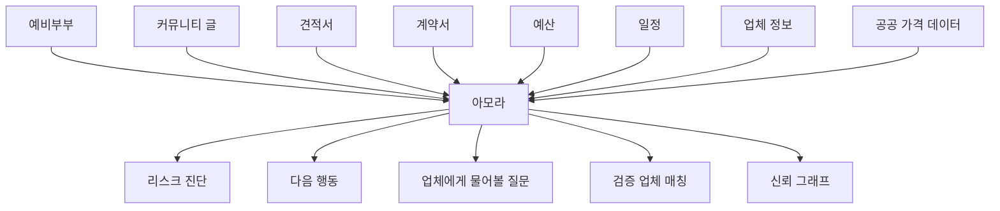

# 아모라 웨딩 OS 플레이북

최종 수정일: 2026-05-11

> **전략·목표 문서**: 아래 “판단·진단·실행” 표현은 현재 베타 기능 약속이 아니다. 아모라는 제공된 문서와 공식 근거를 바탕으로 확인 질문을 정리할 뿐 법률 판단·손해액 계산을 하지 않으며, 모델 기반 쓰기 도구도 비활성이다. 현재 계약은 `CONSUMER_JOURNEY_AND_AMORA_REVIEW_2026-07-11.md`를 우선한다.

## 결론

웨딩한방이 국내 웨딩 시장에서 살아남는 길은 "웨딩 업체 목록 서비스"가 아니다. 업체 목록은 따라잡히기 쉽고, 초기에는 공급도 부족하다. 진짜 시작점은 아모라가 예비부부의 실제 견적, 계약서, 일정, 예산, 커뮤니티 경험을 읽고 "지금 계약해도 되는지"를 판단해주는 신뢰 엔진이 되는 것이다.

아모라는 일반 상담 챗봇이면 차별점이 약하다. 반드시 아래 역할을 해야 한다.

1. 계약 전 리스크를 잡아주는 견적 진단자
2. 계약서와 환불 조건을 쉬운 말로 풀어주는 번역자
3. 예산과 일정을 실제 행동으로 바꾸는 플래너
4. 커뮤니티 글, 견적, 업체 응답, 공공 가격 데이터를 연결하는 신뢰 그래프
5. 검증된 업체와 사용자 사이를 안전하게 연결하는 중개 운영체제

초기에는 "웨딩 전부를 할 수 있는 플랫폼"이라고 크게 말하기보다 "계약금 넣기 전 아모라에게 먼저 물어보는 서비스"로 들어가야 한다. 이 행동이 반복되면 아모라가 결혼 준비의 중심이 될 수 있다.

## 시장 근거

2026-05-11 기준으로 확인한 공공 자료 기준이다.

- 국가데이터처의 2025년 혼인 이혼 통계에 따르면 2025년 혼인 건수는 24만 건으로 전년 대비 8.1% 증가했다. 결혼 수요는 완전히 죽은 시장이 아니다.
  - 출처: https://mods.go.kr/board.es?act=view&bid=204&list_no=444103&mid=a10301020100&ref_bid=203,204,205,206,207,0073&tag=
- 한국소비자원 참가격은 결혼서비스를 예식장, 스튜디오, 드레스, 메이크업 등으로 정의하고 통계정보, 가격 검색 및 비교, 예상견적 기능을 제공한다. 즉 가격표 자체는 이미 공공 영역에 가까워지고 있다.
  - 출처: https://www.price.go.kr/tprice/portal/pricenewsandtpriceintro/tpriceintro/getWeddingPriceIntro.do
- 한국소비자원 참가격의 결혼서비스 통계는 2026년 3월 조회 기준 전국 평균 계약 금액을 2,136만원, 서울 강남을 3,382만원으로 보여준다. 단, 선택품목 옵션은 포함하지 않는다고 안내한다.
  - 출처: https://www.price.go.kr/tprice/portal/wedding/areaStatistic.do
- 공정거래위원회는 2025년 4월 3일 결혼준비대행업 표준계약서를 제정했다. 이는 웨딩 시장의 불투명한 계약과 소비자 피해가 제도권 문제로 다뤄지고 있다는 신호다.
  - 출처: https://www.korea.kr/briefing/pressReleaseView.do?newsId=156682367

해석: 공공 가격 데이터는 웨딩한방의 방어력이 아니다. 웨딩한방의 방어력은 사용자의 실제 견적서와 계약서를 기준으로 "내 상황에서는 무엇이 위험한가"를 판단하고, 그 판단을 커뮤니티와 업체 신뢰 데이터로 계속 강화하는 것이다.

## 실제 상담 시나리오가 없을 때의 답

상담 시나리오가 아직 없는 것은 정상이다. 초기 서비스는 실제 로그가 없기 때문에 "가짜로 잘 아는 척"하면 안 되고, 검증 가능한 반복 상황에서 출발해야 한다.

해야 할 일은 세 가지다.

1. 합성 시나리오를 만든다.
   - 웨딩 준비에서 반복되는 의사결정 순간을 먼저 쪼갠다.
   - 예: 스드메 견적 비교, 원본 데이터 추가금, 드레스 헬퍼비, 예식장 보증인원, 계약 취소, 날짜 변경, 부모님 예산 갈등.
   - 이 단계의 목적은 완벽한 정답이 아니라 아모라의 응답 기준을 만드는 것이다.

2. 첫 사용자 50명은 수동 상담을 섞는다.
   - 겉으로는 아모라가 응답하되, 위험도가 높은 견적과 계약은 사람이 검토한다.
   - 이를 Wizard of Oz 운영이라고 본다.
   - 이 과정을 통해 실제 질문, 실제 견적, 실제 불안, 실제 업체명을 모은다.

3. 실제 로그로 합성 시나리오를 교체한다.
   - 사용자 질문, 첨부 견적, 아모라 답변, 사용자의 다음 행동, 결과를 모두 라벨링한다.
   - 2주마다 "자주 반복되는 20개 질문"을 뽑아 아모라 평가셋으로 만든다.

핵심은 상담 시나리오를 처음부터 많이 갖고 있는 것이 아니다. 실제 결혼 준비의 반복 문제를 빠르게 구조화하고, 실제 데이터가 들어올 때마다 아모라의 판단 기준을 업데이트하는 운영 루프를 갖는 것이다.

## 상담 시나리오 카드 형식

모든 상담 시나리오는 아래 형식으로 관리한다.

```md
### 시나리오 이름

상황:
- 사용자의 결혼 단계, 지역, 예산, 남은 기간

사용자 원문:
- 실제 사용자가 말할 법한 문장

필요한 추가 질문:
- 아모라가 바로 답하면 안 되고 먼저 물어봐야 하는 것

아모라의 목표:
- 불안 완화, 위험 탐지, 비교 기준 생성, 행동 추천 중 무엇인지

사용할 도구:
- 견적 진단, 계약서 진단, 예산 업데이트, 일정 생성, 업체 리드 기록 등

좋은 답변 기준:
- 가격 범위, 빠진 항목, 질문 문구, 다음 행동이 포함되어야 함

실패 기준:
- 확정 추천 남발, 법률 단정, 유료 업체 추천 숨김, 근거 없는 가격 판단

사람 검토 필요 조건:
- 계약금 입금 직전, 환불 분쟁, 특정 업체 공개 비난, 개인정보 포함 문서
```

## 초기 상담 시나리오 뱅크

처음에는 아래 30개부터 만든다. 이 30개가 아모라의 첫 평가셋이 된다.

1. 스드메 견적 280만원이 정상인지 묻는 사용자
2. 원본 데이터 비용이 견적서에 빠져 있는 사용자
3. 드레스 피팅비와 헬퍼비를 처음 듣는 사용자
4. 촬영 드레스 벌수와 본식 드레스 벌수가 헷갈리는 사용자
5. 메이크업 얼리스타트비가 왜 붙는지 묻는 사용자
6. 부모님 혼주 메이크업 포함 여부를 확인해야 하는 사용자
7. 예식장 식대는 괜찮지만 최소 보증인원이 부담스러운 사용자
8. 대관료 무료라고 들었는데 꽃장식비가 큰 사용자
9. 계약금 넣기 전 환불 규정이 애매한 사용자
10. 계약 후 날짜 변경 가능 여부가 불안한 사용자
11. 플래너가 오늘 계약하면 할인이라고 압박하는 사용자
12. 업체명이 커뮤니티에 반복 언급되어 신뢰도를 묻는 사용자
13. 두 업체 중 가격은 비슷하지만 포함 항목이 다른 사용자
14. 예산 1,000만원 안에서 스드메와 예식장을 맞추려는 사용자
15. 예산 초과가 커플 갈등으로 번진 사용자
16. 상견례 장소와 비용을 어떻게 정할지 묻는 사용자
17. 혼수와 예식 예산을 분리해야 하는 사용자
18. 본식 DVD와 스냅을 꼭 해야 하는지 묻는 사용자
19. 폐백, 사회자, 축가, 부케 추가금이 헷갈리는 사용자
20. 지역이 서울이 아니라 비교 데이터가 부족한 사용자
21. 웨딩박람회에서 받은 견적이 괜찮은지 묻는 사용자
22. 카페 후기만 보고 업체를 정해도 되는지 묻는 사용자
23. 계약서에 원본 파일 제공 기준이 없는 사용자
24. 드레스 업그레이드 비용이 현장 결정이라고 적힌 사용자
25. 본식 당일 추가금이 발생할 수 있는 항목을 묻는 사용자
26. 결혼 준비 시작일이 늦어서 우선순위를 묻는 사용자
27. 이미 계약했는데 손해를 줄이는 방법을 묻는 사용자
28. 부모님 요구와 커플 취향이 충돌하는 사용자
29. 업체가 답변을 늦게 해서 일정 리스크가 생긴 사용자
30. 계약 전 업체에게 보낼 질문 문구를 만들어 달라는 사용자

## 아모라 역량 사다리

아모라는 단계적으로 커야 한다.

| 단계 | 역할 | 현재 목표 | 제품 기준 |
|---|---|---|---|
| L0 | 일반 답변 | 기본 웨딩 지식 응답 | 누구나 따라할 수 있으므로 차별점 약함 |
| L1 | 체크리스트 | 사용자 단계별 할 일 생성 | 일정과 예산에 저장되어야 의미 있음 |
| L2 | 견적 진단 | 포함 항목, 빠진 항목, 추가금 리스크 탐지 | 현재 가장 강한 쐐기 |
| L3 | 계약 진단 | 환불, 변경, 원본, 추가금 조항 해석 | 신뢰 차별점의 핵심 |
| L4 | 실행 플래너 | 예산, 일정, 질문, 커뮤니티 기록을 자동 연결 | 웨딩 OS로 진입 |
| L5 | 업체 매칭 | 검증 업체와 사용자 조건을 설명 가능한 방식으로 연결 | 공급망 확보 후 가능 |
| L6 | 거래 운영 | 상담 예약, 계약, 결제, 분쟁 예방까지 관리 | 가장 마지막 단계 |

지금 웨딩한방은 L2와 L3를 가장 먼저 확실히 해야 한다. L5와 L6를 먼저 외치면 공급이 부족해서 신뢰를 잃는다.

## 아모라가 중심이 되는 제품 구조

아모라를 화면 하나의 챗봇으로 보면 작아진다. 아모라는 제품 전체를 관통하는 엔진이어야 한다.



각 데이터는 따로 놀면 안 된다.

- 커뮤니티 글에서 업체명이 나오면 vendor lead가 생긴다.
- 견적 진단에서 업체명이 나오면 비공개 신뢰 신호가 쌓인다.
- 계약서 진단에서 위험 조항이 나오면 사용자 일정에 "입금 전 확인" 작업이 생긴다.
- 예산 초과가 감지되면 아모라가 절감 가능한 항목을 제안한다.
- 업체가 공식 정보를 등록하면 사용자에게는 "검증된 항목"으로 보인다.

## 사용자 수급 전략

처음부터 "웨딩을 전부 해결해드립니다"라고 하면 너무 크고 흐릿하다. 사용자가 바로 행동할 한 문장을 잡아야 한다.

첫 번째 유입 문구:

> 계약금 넣기 전, 내 견적이 정상인지 3분 안에 확인하세요.

초기 랜딩과 커뮤니티의 모든 흐름은 이 행동으로 모아야 한다.

초기 유입 채널:

1. 네이버 카페, 인스타그램, 웨딩 커뮤니티에서 "견적 진단" 콘텐츠 발행
2. "스드메 추가금 체크리스트" 무료 배포
3. "계약 전 업체에게 보낼 질문 10개" 무료 배포
4. 익명 견적 진단 결과를 커뮤니티 글로 전환
5. 베타 사용자에게 견적 진단 우선권과 저장 기능 제공

초기 사용자가 해야 할 핵심 행동은 하나다.

> 내 견적을 입력하거나 올린다.

이 행동이 없으면 아모라는 평범한 상담 챗봇이 된다.

## 업체 수급 전략

업체에게 처음부터 광고 상품을 팔면 안 된다. 웨딩한방이 아직 트래픽과 신뢰가 없기 때문이다.

첫 번째 업체 메시지:

> 예비부부들이 귀사 견적의 포함 항목과 추가금 기준을 확인하고 있습니다. 공식 정보를 무료로 정리해 정확하게 보이도록 도와드리겠습니다.

초기 업체에게 줄 가치는 세 가지다.

1. 무료 투명 프로필
   - 가격 범위
   - 포함 항목
   - 추가금 기준
   - 환불과 변경 기준
   - 포트폴리오

2. 사용자 질문 리포트
   - 예비부부가 가장 많이 묻는 질문
   - 계약 전 불안 포인트
   - 견적에서 자주 오해되는 항목

3. 초기 검증 배지
   - 사업자 확인
   - 가격 기준 공개
   - 포함 항목 공개
   - 환불 기준 공개

초기 목표는 전국 업체 확보가 아니다. 서울과 경기의 스튜디오, 드레스, 메이크업부터 시작한다.

12주 목표:

- 원천 리드 400개
- 연락 완료 160개
- 온보딩 40개
- 검증 업체 16개
- 사용자 견적에 3회 이상 언급된 업체 우선 접촉

## 진입장벽이 생기는 지점

아모라의 진입장벽은 AI 모델 자체가 아니다. 모델은 누구나 붙일 수 있다. 진입장벽은 아래 데이터와 운영 루프에서 생긴다.

1. 실제 견적서 데이터
   - 포함 항목
   - 빠진 항목
   - 추가금 패턴
   - 지역별 가격 차이

2. 실제 계약 조항 데이터
   - 환불
   - 일정 변경
   - 원본 제공
   - 현장 추가금

3. 사용자 행동 데이터
   - 어떤 답변 후 계약을 보류했는지
   - 어떤 질문 후 가격이 조정됐는지
   - 어떤 항목에서 불안이 줄었는지

4. 업체 신뢰 그래프
   - 사용자 언급
   - 견적 진단 결과
   - 공식 정보 등록
   - 응답 속도
   - 분쟁 신호

5. 커뮤니티와 아모라의 순환
   - 커뮤니티 질문이 시나리오가 된다.
   - 시나리오가 아모라 평가셋이 된다.
   - 아모라 진단이 다시 커뮤니티 지식이 된다.

이 루프가 돌아가면 단순 업체 목록 서비스가 따라오기 어렵다.

## 12주 실행 계획

### 1-2주차: 상담 시나리오와 평가셋

- 위 30개 상담 시나리오를 실제 프롬프트 평가셋으로 만든다.
- 아모라 답변을 매일 20개씩 테스트한다.
- 견적 진단 결과에 "계약 전 물어볼 질문"을 반드시 포함한다.
- 위험도가 높은 케이스는 사람 검토 필요로 표시한다.

### 3-4주차: 계약 진단 MVP

- 계약서 텍스트 붙여넣기부터 시작한다.
- 환불, 일정 변경, 원본 파일, 현장 추가금 조항을 위험 라벨로 분류한다.
- 법률 판단처럼 말하지 않고 "확인 필요 조항"과 "업체에게 보낼 질문"으로 출력한다.

### 5-8주차: 사용자 데이터와 업체 리드

- 견적 진단 후 사용자에게 업체명, 지역, 최종 계약 여부를 선택 입력하게 한다.
- 커뮤니티 글 작성 시 업체명은 공개 여부를 사용자가 고르게 한다.
- vendor_leads를 매주 50개씩 보강한다.
- 상위 언급 업체 40곳에 무료 투명 프로필 제안 메시지를 보낸다.

### 9-12주차: 검증 업체와 매칭

- 검증 업체 10곳 이상을 확보한다.
- 아모라 추천은 검증 업체와 공공 데이터, 사용자 조건에 근거가 있을 때만 한다.
- 유료 노출이 생기면 반드시 표시한다.
- "왜 이 업체가 추천됐는지" 설명할 수 없는 추천은 막는다.

## 지금 만들면 좋은 제품 기능

우선순위 순서다.

1. 상담 시나리오 평가셋
   - 아모라가 잘 답했는지 매번 사람이 확인할 기준

2. 계약서 진단 페이지
   - 견적 진단 다음으로 강한 진입점

3. 견적 진단 후 질문 자동 생성
   - 사용자가 업체에게 바로 보낼 수 있는 문장

4. 커뮤니티 글에서 업체 언급 수집
   - 공개 비난이 아니라 내부 신뢰 그래프용

5. 업체 무료 투명 프로필
   - 가격과 포함 항목을 업체가 직접 정리하게 만드는 B2B 진입점

6. 아모라 메모리
   - 사용자의 예산, 지역, 예식일, 계약 상태, 선호도를 기억

7. 아모라 주간 브리핑
   - 이번 주 해야 할 일, 놓친 계약 확인, 예산 리스크를 요약

## 절대 하면 안 되는 것

- 검증되지 않은 업체를 강하게 추천하지 않는다.
- 광고 업체를 일반 추천처럼 숨기지 않는다.
- "무조건 싸다", "무조건 안전하다" 같은 단정 표현을 쓰지 않는다.
- 법률 자문처럼 환불 가능성을 확정하지 않는다.
- 업체 목록을 많이 모으는 것만으로 플랫폼이 완성됐다고 착각하지 않는다.
- 전국 모든 카테고리를 동시에 하겠다고 말하지 않는다.

## 성공 지표

초기에는 매출보다 신뢰 행동을 봐야 한다.

사용자 지표:

- 방문 후 10분 안에 견적 진단을 완료한 비율
- 견적 진단 후 질문 문구를 복사하거나 저장한 비율
- 두 번째 견적 또는 계약서를 다시 올린 비율
- 아모라 답변 후 일정이나 예산을 업데이트한 비율
- "숨은 추가금 발견", "계약 전 질문 생성", "예산 절감" 사례 수

업체 지표:

- 사용자에게 3회 이상 언급된 업체 수
- 연락 완료 업체 수
- 무료 프로필 등록 업체 수
- 가격 기준 공개 업체 수
- 검증 업체 전환율

신뢰 지표:

- 아모라가 근거 없이 추천한 비율
- 위험 조항을 놓친 비율
- 사용자가 답변을 수정 요청한 비율
- 사람 검토가 필요했던 케이스 비율

## 최종 판단

웨딩한방은 가능하다. 하지만 가능해지는 조건은 명확하다.

처음부터 업체를 많이 모으는 플랫폼으로 가면 어렵다. 이미 큰 플랫폼과 카페가 있다. 반대로 "계약 전 불안을 줄이는 아모라"로 시작하면 진입할 틈이 있다. 국내 웨딩 시장은 가격, 포함 항목, 추가금, 환불 기준이 여전히 복잡하고, 공공기관도 가격 공개와 표준계약서를 다루고 있다. 이 문제는 사용자가 돈을 쓰기 직전에 가장 아프게 느낀다.

웨딩한방의 첫 승부처는 업체 수가 아니라 사용자가 이런 말을 하게 만드는 것이다.

> 계약하기 전에 일단 아모라한테 물어보자.

이 문장이 습관이 되면, 그 다음에 업체가 들어오고, 검증 프로필이 생기고, 상담 예약과 결제까지 이어질 수 있다.
