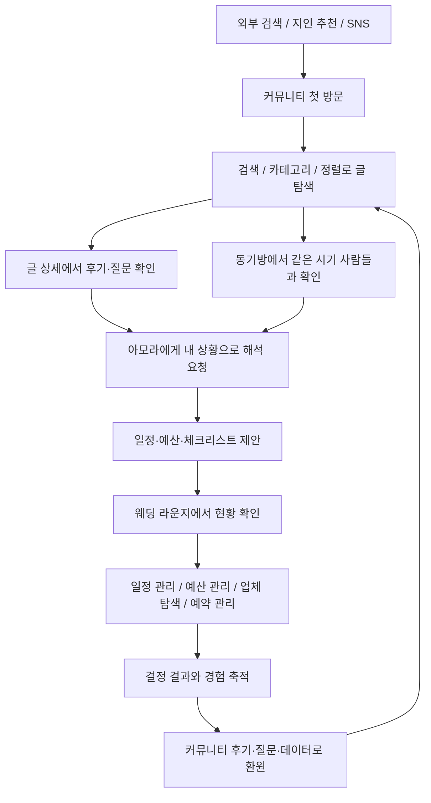

# 커뮤니티에서 웨딩 라운지까지 유저 저니 전략 문서

> [!WARNING]
> **목표 사용자 여정 문서입니다.** 아래 자동 일정·예산 반영, 예약 관리, 구조화된 후기 순환은 현재 동작을 보장하지 않습니다. 현재 AI는 읽기·정리 중심이고 새 업체 상담 요청·예약·결과 저장은 비활성입니다. 실제 소비자 여정은 [`../WEDDINGHANBANG_SERVICE_DOC.md`](../WEDDINGHANBANG_SERVICE_DOC.md)와 [`CONSUMER_JOURNEY_AND_RELEASE_AUDIT_2026-07-11.md`](CONSUMER_JOURNEY_AND_RELEASE_AUDIT_2026-07-11.md)를 우선합니다.

작성일: 2026-05-29  
범위: 커뮤니티(`/community`) → 아모라 → 웨딩 라운지(`/lounge`) → 서비스 기능 전반  
작성 목적: 웨딩한방의 커뮤니티와 서비스가 어떤 사용자 여정을 만들고, 각 화면이 어떤 역할을 해야 하는지 제품 관점에서 정리한다.

---

## 1. Executive Summary

웨딩한방의 핵심 제품 구조는 **커뮤니티에서 실제 경험을 발견하고, 아모라가 그 경험을 개인 상황으로 해석하며, 웨딩 라운지가 실행 항목으로 관리하는 흐름**이다.

커뮤니티는 단순한 게시판이 아니다. 사용자가 처음 들어와서 "남들은 어떻게 했는지", "내 상황이 정상인지", "이 가격이나 계약 조건이 괜찮은지"를 확인하는 신뢰 탐색 공간이다.

웨딩 라운지는 단순한 대시보드가 아니다. 커뮤니티와 아모라를 통해 얻은 정보를 사용자의 예식일, 예산, 일정, 체크리스트, 예약 상태에 맞춰 관리하는 개인 실행 공간이다.

아모라는 두 영역 사이의 연결 장치다. 커뮤니티에 있는 일반적인 경험을 사용자의 실제 상황으로 번역하고, 그 결과를 일정, 예산, 체크리스트, 업체 질문, 예약 관리로 이어지게 만든다.

우리가 만들어야 하는 제품 감각은 다음 한 문장으로 정리된다.

> 커뮤니티에서 본 정보가 흘러가버리지 않고, 내 결혼 준비의 다음 행동으로 남는다.

---

## 2. Product Thesis

웨딩 준비 사용자는 정보가 부족해서 어려운 것이 아니다. 오히려 정보가 너무 많고, 대부분 광고인지 후기인지 구분하기 어렵고, 내 상황에 적용해도 되는지 판단하기 어렵다.

따라서 웨딩한방이 해결해야 하는 문제는 "정보 제공"보다 "판단과 실행의 연결"이다.

### 2.1 사용자의 본질적 문제

사용자는 결혼 준비에서 아래와 같은 질문을 반복한다.

- 이 가격이 정상인가?
- 이 계약 조건이 위험한가?
- 지금 이 시기에 내가 늦은 건가?
- 남들은 어떤 선택을 했나?
- 업체에 무엇을 물어봐야 하나?
- 커플끼리 의견이 다른데 어떻게 정리해야 하나?
- 본식 전까지 무엇을 놓치면 안 되나?

기존 커뮤니티는 "남들은 이렇게 했다"를 보여준다. 기존 웨딩 관리 앱은 "체크리스트를 관리하라"고 한다. 하지만 사용자가 정말 원하는 것은 그 사이에 있다.

> 남들의 경험을 보고, 내 상황에서는 무엇을 해야 하는지 알고 싶다.

### 2.2 웨딩한방의 차별점

웨딩한방은 세 가지 층을 연결해야 한다.

| 층 | 역할 | 핵심 가치 |
|---|---|---|
| 커뮤니티 | 실제 후기와 질문 수집 | 현실감, 비교 기준, 사회적 안심 |
| 아모라 | 개인 상황으로 해석 | 판단 보조, 위험 발견, 다음 행동 생성 |
| 웨딩 라운지 | 실행 항목 관리 | 일정, 예산, 체크리스트, 예약의 지속 관리 |

이 세 층이 따로 놀면 제품은 평범해진다. 커뮤니티만 강하면 카페와 다르지 않고, 라운지만 강하면 체크리스트 앱과 다르지 않다. 아모라만 강조하면 일반 AI 상담과 다르지 않다.

세 층이 연결될 때 웨딩한방은 "웨딩 준비 신뢰 OS"가 된다.

---

## 3. Target User State

웨딩한방의 사용자는 결혼 준비 기간 전체에 걸쳐 상태가 변한다. 각 상태마다 필요한 화면과 설계 원칙이 다르다.

### 3.1 탐색 전 사용자

아직 예식일, 예산, 지역, 업체 후보가 명확하지 않은 사용자다.

주요 감정:
- 막막하다.
- 뭐부터 해야 하는지 모른다.
- 웨딩 정보가 광고처럼 느껴진다.

제품의 역할:
- 커뮤니티 첫 화면에서 실제 글을 보여준다.
- 검색과 카테고리로 빠르게 탐색하게 한다.
- 날짜 미정 사용자도 배제하지 않는다.

중요 화면:
- `/community`
- `/community?category=is_normal`
- `/market-prices`
- `/onboarding`

### 3.2 비교 중 사용자

웨딩홀, 스드메, 드레스, 메이크업, 스냅, 본식 영상 등 후보를 비교하는 단계다.

주요 감정:
- 가격이 맞는지 모르겠다.
- 빠진 항목이 있을까 봐 불안하다.
- 후기와 실제 계약 조건이 다른지 걱정된다.

제품의 역할:
- 후기와 시세를 함께 보여준다.
- 업체명, 지역, 카테고리 중심 검색을 돕는다.
- 아모라가 내 조건으로 비교 기준을 정리한다.

중요 화면:
- `/community`
- `/community/post/[id]`
- `/community/vendor/[name]`
- `/market-prices`
- `/chat`

### 3.3 계약 직전 사용자

계약금, 환불, 일정 변경, 원본 데이터, 추가금, 보증 인원 등 위험 조건을 확인해야 하는 사용자다.

주요 감정:
- 돈을 넣기 전에 확신이 필요하다.
- 업체 설명이 명확한지 모르겠다.
- 커플 또는 부모님과 의견이 다를 수 있다.

제품의 역할:
- 아모라가 계약 전 질문을 만든다.
- 위험 조건을 쉬운 말로 해석한다.
- 확인해야 할 일을 일정과 체크리스트에 남긴다.

중요 화면:
- `/chat`
- `/schedule`
- `/budget`
- `/lounge`

### 3.4 진행 중 사용자

일부 계약이 끝났고, 여러 일정과 준비 항목을 관리해야 하는 사용자다.

주요 감정:
- 너무 많은 일이 동시에 진행된다.
- 어디까지 끝냈는지 기억하기 어렵다.
- 커플끼리 역할 분담이 필요하다.

제품의 역할:
- 웨딩 라운지가 지금 상태를 요약한다.
- 다가오는 일정과 남은 체크를 먼저 보여준다.
- 예산 초과와 일정 지연을 드러낸다.

중요 화면:
- `/lounge`
- `/schedule`
- `/budget`
- `/bookings`
- `/settings`

### 3.5 본식 전후 사용자

본식 직전에는 실수 방지가 중요하고, 본식 후에는 정산과 후기, 사진/영상 수령, 감사 인사가 남는다.

주요 감정:
- 당일 실수는 되돌리기 어렵다.
- 길게 읽을 여유가 없다.
- 결혼식 후에도 처리할 일이 남는다.

제품의 역할:
- 체크리스트와 타임라인을 단순하게 보여준다.
- 필요한 문구, 대본, 예절 정보를 빠르게 제공한다.
- 경험을 커뮤니티에 다시 공유하게 만든다.

중요 화면:
- `/schedule`
- `/etiquette`
- `/scripts`
- `/money`
- `/community/post/write`

---

## 4. Journey Architecture

### 4.1 Ideal Journey

이 흐름에서 가장 중요한 전환은 두 가지다.

1. **커뮤니티 → 아모라**
   - 사용자가 공개 경험을 보고 "내 상황에서는?"이라고 묻는 순간이다.

2. **아모라 → 웨딩 라운지**
   - AI 답변이 정보로 끝나지 않고 일정, 예산, 체크리스트, 예약, 업체 후보로 저장되는 순간이다.

### 4.2 Minimum Successful Journey

최소한 아래 흐름은 막힘 없이 작동해야 한다.

1. 사용자가 `/community`에 들어온다.
2. 최신 글 또는 검색으로 관심 글을 찾는다.
3. 글 상세를 읽는다.
4. "아모라에게 묻기"를 누른다.
5. 아모라 입력창에 글 맥락이 미리 들어간다.
6. 사용자가 내 예식일/예산 기준으로 질문한다.
7. 답변에서 일정, 예산, 체크리스트 액션을 얻는다.
8. 사용자는 `/lounge` 또는 관련 기능에서 실행 상태를 관리한다.

이 흐름이 매끄러워야 커뮤니티와 서비스가 하나의 제품처럼 느껴진다.

---

## 5. Screen Responsibilities

### 5.1 커뮤니티 홈: `/community`

커뮤니티 홈의 역할은 서비스 소개가 아니라 **살아 있는 웨딩 정보 탐색**이다.

사용자가 첫 화면에서 이해해야 하는 것:
- 여기에는 실제 후기와 질문이 있다.
- 검색할 수 있다.
- 카테고리별로 볼 수 있다.
- 인기글과 최신글을 구분해서 볼 수 있다.
- 비슷한 시기 사람들의 동기방이 있다.
- 필요한 경우 아모라와 웨딩 라운지로 이어갈 수 있다.

우선순위:
1. 검색
2. 글 목록
3. 카테고리
4. 동기방
5. 인기글
6. 시세 스냅샷
7. 아모라/웨딩 라운지 연결

주의점:
- 웨딩 라운지 CTA가 커뮤니티 글 탐색보다 앞서면 안 된다.
- 글 목록 밀도가 낮으면 커뮤니티처럼 보이지 않는다.
- 카드가 너무 크거나 반복 섹션이 많으면 사용자가 글을 충분히 읽지 못한다.

### 5.2 글 상세: `/community/post/[id]`

글 상세는 커뮤니티와 서비스가 만나는 가장 강한 지점이다.

사용자의 의도:
- 이 글을 자세히 읽고 싶다.
- 댓글 반응을 보고 싶다.
- 저장하거나 공유하고 싶다.
- 내 상황에 적용해도 되는지 알고 싶다.

필수 액션:
- 좋아요
- 댓글
- 저장
- 공유
- 신고
- 작성자 활동 보기
- 아모라에게 이 글 기준으로 묻기

현재 반영 사항:
- 글 상세의 다음 행동 CTA에서 아모라 상담으로 이동할 때 글 제목과 글 링크가 `prefill`에 포함된다.
- `정상인가요?` 글은 견적 체크보다 아모라 상담으로 먼저 이어지도록 조정했다.

추가 권장:
- "이 글을 내 준비에 반영하기"라는 문구를 더 명확히 테스트한다.
- 북마크한 글이 라운지에서 참고글로 보이는 구조를 검토한다.

### 5.3 동기방: `/community/cohort`

동기방은 "같은 시기 예비부부"라는 맥락이 핵심이다.

사용자의 의도:
- 나와 비슷한 시기에 준비하는 사람들이 뭘 하는지 보고 싶다.
- 지금 늦은 건지 확인하고 싶다.
- 공개 피드보다 편하게 질문하고 싶다.

설계 원칙:
- 분기별 방은 실제로 분리되어야 한다.
- 내가 쓴 메시지는 오른쪽, 다른 사람 메시지는 왼쪽으로 보여야 한다.
- 사용자 프로필은 공개 가능한 활동만 보여준다.
- 개인 상담, 예산, 일정, private 아모라 대화는 노출하지 않는다.
- 신고 기능은 명확해야 하고, 다수 신고는 관리자 검토 큐로 올라가야 한다.

서비스 연결:
- 동기방에서 본 유용한 메시지를 체크리스트 또는 일정으로 저장할 수 있어야 한다.
- "내 상황에서는 늦은 건가?"를 아모라에게 바로 물을 수 있어야 한다.

### 5.4 아모라 상담: `/chat`

아모라는 커뮤니티의 일반 정보를 개인 실행으로 바꾸는 해석 엔진이다.

아모라의 제품 역할:
- 커뮤니티 글의 맥락을 사용자의 예식일, 예산, 지역, 진행 상태로 해석한다.
- 가격, 계약, 일정, 커뮤니케이션 리스크를 분리해 설명한다.
- 다음 행동을 제안한다.
- 일정, 예산, 체크리스트, 업체 질문으로 연결한다.

중요 원칙:
- 정보성 답변에서 끝나면 안 된다.
- 근거가 부족하면 부족하다고 말해야 한다.
- 사용자가 특정 날짜를 말하면 임의로 바꾸지 않는다.
- shared 대화와 private 대화는 절대 섞이면 안 된다.
- 커플이 함께 보는 대화와 개인 상담은 명확히 구분되어야 한다.

### 5.5 웨딩 라운지: `/lounge`

웨딩 라운지는 서비스의 홈이며, 사용자가 오늘 무엇을 해야 하는지 판단하는 공간이다.

웨딩 라운지의 역할:
- 결혼 준비 현황 요약
- 다음 일정 확인
- 남은 체크리스트 확인
- 예산 사용률 확인
- 커플 연결 상태 확인
- 아모라 브리핑
- 준비 항목별 상태 확인

좋은 라운지의 조건:
- 5초 안에 현재 상태가 보인다.
- 기능 버튼보다 실제 상태가 보인다.
- 다음 일정, 남은 체크, 예산 리스크가 우선이다.
- 상세 관리는 관련 기능으로 자연스럽게 이어진다.

피해야 할 것:
- 사이드바와 같은 기능 버튼을 반복해서 나열하는 것
- 긴 설명문으로 첫 화면을 채우는 것
- 모든 기능을 같은 중요도로 보여주는 것
- 사용자가 바로 행동할 수 없는 데이터만 보여주는 것

### 5.6 일정 관리: `/schedule`

일정 관리는 결혼 준비의 시간축이다.

역할:
- D-day 기준 일정 관리
- 체크리스트 관리
- 타임라인과 캘린더 전환
- 임박 항목 확인
- 직접 일정 추가, 수정, 삭제

커뮤니티 연결 예:
- 동기방에서 "본식스냅은 중요하다"는 이야기를 본다.
- 아모라에게 내 일정 기준으로 물어본다.
- 본식스냅 체크리스트와 상담 일정을 저장한다.

### 5.7 예산 관리: `/budget`

예산 관리는 가격 정보가 실제 돈의 흐름으로 바뀌는 곳이다.

역할:
- 총 예산과 사용 금액 확인
- 항목별 지출 관리
- 예상 추가금 반영
- 예산 초과 가능성 확인

원칙:
- 평균 시세와 내 예산을 혼동시키지 않는다.
- 예산 배분이 필요 없는 사용자에게 불필요한 차트를 강요하지 않는다.
- 가격 판단은 포함 항목과 계약 조건까지 함께 봐야 한다.

### 5.8 시세 정보: `/market-prices`

시세 정보는 "평균 감"을 잡는 보조 판단 도구다.

역할:
- 전국 평균
- 지역별 평균
- 항목별 평균
- 성수기/비수기 차이
- 스드메, 웨딩홀, 스튜디오, 드레스, 메이크업 등 주요 항목 기준 제공

원칙:
- 시세는 진단이 아니라 참고 기준이다.
- 공공 데이터, 커뮤니티 입력, 사용자 견적, AI 추론을 구분해야 한다.
- 수치와 단위는 어떤 해상도에서도 줄바꿈이나 겹침 없이 보여야 한다.

### 5.9 업체 탐색과 예약 관리: `/vendors`, `/bookings`

업체 탐색과 예약 관리는 비교에서 실행으로 넘어가는 구간이다.

역할:
- 업체 후보 탐색
- 찜하기
- 업체 상세 확인
- 예약 생성과 상태 관리
- 예약 일정과 라운지 연결

커뮤니티 연결:
- 업체명이 반복 언급되면 업체 페이지로 연결한다.
- 후기, 가격, 질문할 항목을 함께 보여준다.
- 예약한 업체는 라운지와 일정 관리에 반영된다.

### 5.10 설정: `/settings`

설정은 개인화의 기반이다.

역할:
- 예식일
- 예산
- 웨딩 스타일
- 우선순위
- 하객 규모
- 커플 연결
- 공개/비공개 관련 기반 설정

원칙:
- 선택 즉시 반응해야 한다.
- 저장 상태를 보여줘야 한다.
- 커플 연결 시 공유 범위를 명확히 해야 한다.
- private 상담 내용은 상대방에게 보이면 안 된다.

---

## 6. Core UX Principles

### 6.1 커뮤니티는 빠르게 읽혀야 한다

커뮤니티의 첫 가치는 글 탐색이다. 사용자는 많은 글을 훑어보고, 관심 있는 글만 열어본다. 따라서 커뮤니티 화면은 시각적으로 예뻐야 하지만 글 밀도를 해치면 안 된다.

### 6.2 서비스 전환은 작지만 선명해야 한다

커뮤니티에서 웨딩 라운지 CTA가 너무 크면 커뮤니티의 목적이 흐려진다. 그러나 사용자가 "내 준비에 반영하고 싶다"고 느끼는 순간에는 바로 갈 수 있어야 한다.

좋은 위치:
- 글 상세 하단
- 하단 브릿지 섹션
- 상단 nav
- 북마크/저장 완료 후 안내

### 6.3 아모라는 답변보다 행동을 남겨야 한다

아모라의 답변은 정보 제공으로 끝나면 안 된다. 적어도 다음 중 하나를 남겨야 한다.

- 확인할 질문
- 일정
- 체크리스트
- 예산 반영 항목
- 업체 후보
- 커플과 이야기할 문장
- 부모님/업체에게 보낼 문구

### 6.4 공개 데이터와 개인 데이터는 절대 섞지 않는다

커뮤니티와 서비스가 연결될수록 개인정보 리스크가 커진다.

절대 노출 금지:
- private 아모라 상담
- 개인 예산
- 개인 일정
- 계약서 원본
- 견적서 원본
- 커플 간 민감한 대화

공개 가능:
- 사용자가 직접 올린 커뮤니티 글
- 익명화된 후기
- 공개 프로필의 제한된 활동
- 동기방 내 메시지

### 6.5 라운지는 상태 중심이어야 한다

라운지는 기능 모음이 아니다. 사용자는 "어떤 기능이 있지?"보다 "지금 뭘 해야 하지?"를 알고 싶다.

라운지의 우선 정보:
1. 다음 일정
2. 남은 체크
3. 예산 사용/위험
4. 아모라 브리핑
5. 커플 연결
6. 최근 참고 정보

---

## 7. Data & Privacy Model

| 데이터 | 커뮤니티 노출 | 서비스 노출 | 아모라 사용 |
|---|---|---|---|
| 공개 글 | 공개 또는 로그인 사용자 | 북마크/참고 가능 | 사용자가 요청한 경우 해석 |
| 댓글 | 공개 범위에 따름 | 직접 저장 전에는 미노출 | 맥락 참고 가능 |
| 동기방 메시지 | 같은 방 구성원 | 직접 저장 전에는 미노출 | 사용자가 요청한 경우 해석 |
| shared 아모라 대화 | 커뮤니티 미노출 | 커플 공동 노출 | 주 컨텍스트 |
| private 아모라 대화 | 커뮤니티 미노출 | 본인만 노출 | 본인 컨텍스트 |
| 예산 | 미노출 | 본인/커플 서비스 | 개인화 근거 |
| 일정 | 미노출 | 본인/커플 서비스 | 개인화 근거 |
| 계약/견적 파일 | 미노출 | 본인/커플 서비스 | 민감 데이터로 처리 |
| 공개 프로필 | 제한 노출 | 제한 노출 | 작성자 맥락만 참고 |

운영 원칙:
- 커뮤니티 글을 서비스로 가져오는 것은 가능하다.
- 서비스의 개인 데이터를 커뮤니티로 자동 공유하면 안 된다.
- 아모라 답변을 커뮤니티에 공유하려면 사용자가 명시적으로 선택해야 한다.
- 업체명, 가격, 계약 조건은 익명화 옵션을 제공해야 한다.

---

## 8. Product Requirements

### 8.1 커뮤니티 홈 요구사항

- 최신순, 인기순, 좋아요순이 명확히 다르게 작동해야 한다.
- 미리보기 상태에서는 글을 충분히 보여주고, 더보기로 전체 피드에 진입해야 한다.
- 모바일에서도 글 제목, 이미지, 메타 정보가 겹치지 않아야 한다.
- 검색 결과는 사용자가 기다린다는 느낌 없이 빠르게 보여야 한다.
- 오른쪽 패널은 보조 정보여야 하며, 글 탐색을 압도하면 안 된다.

### 8.2 글 상세 요구사항

- 본문, 이미지, 슬라이드, 비용 공유, 투표가 깨지지 않아야 한다.
- 저장, 공유, 신고가 명확해야 한다.
- 글 상세에서 아모라 상담으로 넘어갈 때 글 맥락이 유지되어야 한다.
- 광고/협찬 여부가 숨겨지면 안 된다.
- 작성자 프로필 이동은 가능하되 민감 정보는 노출하지 않아야 한다.

### 8.3 동기방 요구사항

- 분기별 방이 실제로 분리되어야 한다.
- 내가 쓴 메시지와 타인 메시지의 방향이 구분되어야 한다.
- 프로필, 신고, 멤버 관리가 privacy-safe하게 작동해야 한다.
- 동기방의 좋은 정보를 일정/체크리스트로 저장하는 경로가 필요하다.

### 8.4 아모라 요구사항

- 커뮤니티 글 제목과 링크를 prefill로 받아야 한다.
- shared/private 대화가 섞이면 안 된다.
- 탭 복귀, 새 채팅, 스크롤 유지가 안정적이어야 한다.
- 사용자가 특정 날짜를 말하면 그 날짜를 우선해야 한다.
- 예약 불가능한 경우 임의 확정이 아니라 대안 제안으로 응답해야 한다.

### 8.5 웨딩 라운지 요구사항

- 상단 문구는 짧고 상태 중심이어야 한다.
- 중복 기능 버튼보다 다음 일정, 남은 체크, 예산 사용, 커플 연결을 보여줘야 한다.
- 준비 항목별 상태는 상세 체크리스트를 접어 볼 수 있어야 한다.
- 넓은 화면에서도 너무 좁아 보이지 않아야 한다.
- 모바일에서도 카드와 텍스트가 겹치지 않아야 한다.

---

## 9. Prioritized Roadmap

### P0. 반드시 유지해야 하는 기반

- 커뮤니티 최신순/인기순/좋아요순 정상 작동
- 글 상세 로딩, 댓글, 저장, 공유, 신고 안정성
- shared/private 아모라 대화 분리
- 웨딩 라운지 현황 카드 안정성
- 일정, 예산, 설정 저장 안정성

### P1. 바로 개선하면 좋은 것

1. 글 상세 → 아모라 prefill 연결 강화  
   - 현재 반영됨.

2. 북마크 → 라운지 참고글 연결  
   - 라운지에 최근 저장 글 2~3개를 작게 보여주는 방식 검토.

3. 동기방 메시지 → 체크리스트 저장  
   - 메시지 메뉴에서 "내 체크리스트로 저장" 추가 검토.

4. 아모라 답변 → 일정/예산 반영 성공률 측정  
   - 단순 채팅 사용량보다 실제 실행 전환율이 중요하다.

5. 글 상세 CTA 카피 테스트  
   - "아모라에게 묻기" vs "내 상황으로 해석하기" vs "이 글을 내 준비에 반영하기"

### P2. 다음 실험

1. 커뮤니티 하단 브릿지 위치 A/B 테스트
2. 동기방에서 "내 시기 기준으로 보기" CTA 테스트
3. 시세 정보에서 아모라 질문으로 넘어가는 흐름 테스트
4. 라운지에 커뮤니티 참고글 섹션 추가 여부 테스트
5. 커뮤니티 글 작성 후 "라운지에 남기기" 유도 테스트

### P3. 아직 크게 밀지 말아야 할 것

- 커뮤니티 첫 화면에 큰 서비스 소개 섹션 추가
- 견적 진단을 다시 메인 전면에 배치
- 모든 기능을 동일한 카드 크기로 나열
- 개인 데이터와 커뮤니티 활동 자동 연결
- 업체 추천을 근거 없이 강하게 노출

---

## 10. KPI Framework

| 단계 | 핵심 KPI | 해석 |
|---|---|---|
| 첫 방문 | 첫 화면 이탈률, 검색 사용률 | 커뮤니티 입구가 이해되는지 |
| 탐색 | 글 클릭률, 더보기 클릭률, 정렬 사용률 | 글을 충분히 읽는지 |
| 신뢰 행동 | 북마크율, 댓글률, 신고율 | 커뮤니티가 참여를 만드는지 |
| 서비스 전환 | 글 상세 → 아모라 클릭률 | 커뮤니티 정보가 개인화로 이어지는지 |
| 실행 전환 | 아모라 답변 후 일정/예산/체크 저장률 | AI 답변이 행동으로 남는지 |
| 라운지 재방문 | `/lounge` 재방문율, 알림 클릭률 | 서비스가 일상 관리 공간이 되는지 |
| 데이터 순환 | 후기 작성률, 업체 태그 증가, 시세 참고 클릭 | 경험이 다시 커뮤니티 자산이 되는지 |

가장 중요한 KPI는 단순 체류시간이 아니다.

> 커뮤니티에서 본 정보가 아모라를 거쳐 실제 일정, 예산, 체크리스트로 저장되는 비율.

이 비율이 올라가야 웨딩한방의 핵심 루프가 작동한다.

---

## 11. Product Quality Bar

### 커뮤니티가 좋아졌다고 판단하는 기준

- 글을 더 많이 읽게 된다.
- 검색과 정렬을 더 많이 사용한다.
- 저장과 댓글이 늘어난다.
- 사용자가 광고성 정보와 실제 정보를 구분할 수 있다.
- 커뮤니티에서 아모라로 넘어가는 이유가 자연스럽다.

### 웨딩 라운지가 좋아졌다고 판단하는 기준

- 사용자가 오늘 할 일을 바로 안다.
- 다음 일정과 남은 체크가 명확하다.
- 예산 위험이 보인다.
- 라운지에서 기능 이동이 자연스럽다.
- 커뮤니티에서 얻은 정보가 끊기지 않고 이어진다.

### 아모라가 좋아졌다고 판단하는 기준

- 답변이 길기만 하지 않고 실행 항목을 남긴다.
- 개인 상황을 반영한다.
- 모르는 것은 모른다고 말한다.
- shared/private 범위를 지킨다.
- 일정, 예산, 체크리스트 반영이 실제로 일어난다.

---

## 12. Final Product Narrative

웨딩한방의 이상적인 사용자 경험은 다음과 같다.

사용자는 처음에 검색이나 커뮤니티 글로 들어온다. 실제 후기와 질문을 훑어보며 "나만 이런 고민을 하는 게 아니구나"라고 느낀다. 동기방에서는 비슷한 시기 사람들이 지금 무엇을 하고 있는지 확인한다.

그 다음 애매한 정보는 아모라에게 묻는다. 아모라는 커뮤니티 글을 단순 요약하지 않고, 사용자의 예식일, 예산, 진행 단계에 맞춰 해석한다. 그리고 확인할 질문, 일정, 예산 반영, 체크리스트를 제안한다.

마지막으로 사용자는 웨딩 라운지에서 오늘 해야 할 일을 본다. 다음 예약, 남은 체크, 예산 사용, 커플 연결 상태가 보이고, 필요하면 일정 관리나 예산 관리로 들어가 실제로 수정한다.

이 흐름이 반복되면 웨딩한방은 단순한 웨딩 커뮤니티도, 단순한 관리 도구도 아니다. 사용자가 결혼 준비 중 마주치는 불안한 순간마다 들어와서 확인하고, 해석하고, 실행하는 서비스가 된다.

우리가 만들어야 하는 최종 인식은 이것이다.

> 결혼 준비하다가 애매하면 웨딩한방에서 먼저 확인하고, 아모라에게 물어보고, 라운지에 남기면 된다.

