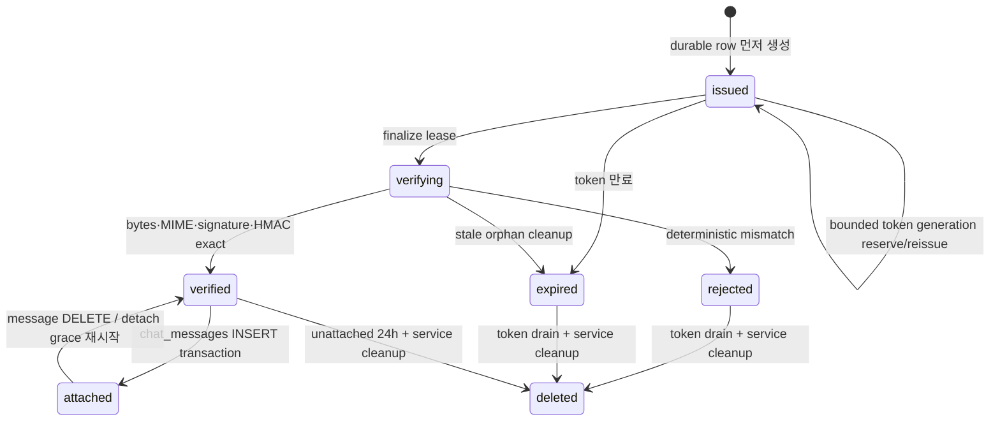

# 아모라 채팅 첨부 고아 객체 lifecycle release candidate

날짜: 2026-08-04
상태: **STAGED ONLY — 현재 런타임 미연결, hosted 적용·배포 승인 없음**

## 결론

현재의 브라우저 `chat-image` 직접 업로드 뒤 `/api/chat/messages` 저장 방식은 탭 종료,
프로세스 중단, 계정·커플 전환, 업로드 성공 뒤 ingest 실패 사이에 서버가 다시 찾을 수
없는 객체를 만들 수 있다. 클라이언트의 `remove()` 보상은 도움이 되지만 authoritative
cleanup이 아니다. 현재 Storage 계약은 authenticated `UPDATE`와 `DELETE`를 제거하므로
그 보상 자체가 hosted 정책에서 거절될 수도 있다.

배포 안전한 최소 경계는 다음 네 가지가 동시에 있어야 닫힌다.

1. **signed token 발급 전 durable session과 bounded token generation을 먼저 기록한다.**
2. **실제 bytes 검증 뒤에만 session을 `verified`로 바꾼다.**
3. **`chat_messages` INSERT와 같은 DB transaction에서 exact path를 attach한다.**
4. **token 만료 뒤 unattached session을 lease하고, service-role이 exact object 부재를
   확인한 뒤에만 cleanup receipt를 확정한다.**

이번 변경은 이 DB lifecycle과 미래의 signed-upload-only Storage 수축안을 release
candidate로 만들었다. 기존 `chatStore.ts`, `/api/chat/messages`, `/api/chat`, cron,
Vercel 설정은 의도적으로 연결하지 않았다. candidate는 `supabase/migrations` 밖에 있고
DB mode 기본값은 `disabled`다. 따라서 이 문서는 구현 방향과 검증 가능한 로컬 계약이지
production 완료 증거가 아니다.

## 이번 세션에서 직접 확인한 현재 경계

- `apps/web/src/stores/chatStore.ts`는 image object를 먼저 업로드하고 그 다음
  `/api/chat/messages`를 호출한다. 새 보상 코드는 이번 요청에서 업로드한 path만 추적해
  제거를 시도하지만 탭 crash에는 실행될 수 없다.
- `supabase/platform-operations/storage/20260714167000_chat_attachment_contract.sql`은
  authenticated update/delete 정책을 제거하고 image를 immutable로 취급한다.
- `/api/chat/messages`와 `/api/chat`은 현재 v2 manifest/path/실제 Storage bytes를 다시
  확인한다. 이 검증은 잘못된 bytes가 AI로 가는 것을 막지만, ingest 전에 멈춘 object의
  durable inventory를 만들지는 않는다.
- community 업로드는 `community_upload_sessions`, signed exact path, finalize claim,
  atomic consumer attach, token cleanup, unattached cleanup lease와 absence checkpoint를 이미
  사용한다.

따라서 클라이언트 cleanup을 더 많이 호출하는 것만으로는 P1을 닫을 수 없다. 서버 session
ledger와 sweeper가 필수다.

## community lifecycle에서 재사용한 것과 재사용하지 않은 것

| community에서 검증된 패턴 | chat-image 적용 | 이유 |
| --- | --- | --- |
| token 발급 전 session INSERT + generation reserve | 그대로 적용 | crash 뒤에도 exact owner/path와 살아 있을 수 있는 마지막 token 만료가 남는다. |
| account-deletion intake와 같은 owner advisory lock | 그대로 적용 | 삭제 inventory와 새 token 발급 중 하나만 먼저 commit한다. |
| signed exact-path, `upsert: false` | 그대로 적용 | 임의 path와 overwrite를 제거한다. |
| full-byte finalize + durable status | 그대로 적용 | Storage metadata만 성공 증거로 쓰지 않는다. |
| consumer write transaction의 row lock attach | path 기반 trigger로 적용 | message와 attachment가 서로 다른 transaction으로 갈라지지 않는다. |
| latest token generation expiry + grace 뒤 cleanup | 그대로 적용 | 삭제 뒤 아직 유효한 token으로 object가 재생성되는 race를 막는다. |
| cleanup lease + `SKIP LOCKED` + stale reclaim | 그대로 적용 | 병렬 cron과 crash retry가 안전하다. |
| remove 후 exact absence check 뒤 DB checkpoint | 그대로 적용 | 외부 Storage 삭제를 추정으로 완료 처리하지 않는다. |
| 공개 sanitized final asset | **그 테이블/상태를 직접 재사용하지 않음** | chat은 private raw provider input이고 소비자·retention·privacy가 다르다. |

`community_upload_sessions`에 chat row를 섞지 않는다. 상태 기계와 race 해법은 재사용하되,
table과 bucket contract는 분리한다.

## staged DB contract

후보 파일:

- `supabase/release-candidates/amora-safety-20260804/wave-c-chat-attachment-lifecycle/20260804100000_amora_chat_attachment_upload_sessions.sql`
- `supabase/release-candidates/amora-safety-20260804/wave-c-chat-attachment-lifecycle/platform-storage/20260804101000_chat_attachment_signed_upload_storage_contract.sql`

현재 canonical SHA-256:

| artifact | SHA-256 |
| --- | --- |
| DB candidate | `9e3556fd4a247829a777dd43c95dc5277170d7a661ada43c0fefb727d34bed73` |
| Storage platform candidate | `13751efd00640c79b4291c72a1f05ce5297325c68e1d75a0d141c15e8e482317` |

SQL을 수정하면 이 표와 별도 immutable manifest hash를 함께 다시 생성해야 한다.

### runtime mode

`chat_attachment_runtime_state.mode`는 다음 세 단계다.

| mode | session init | session 없는 기존 image message | 목적 |
| --- | --- | --- | --- |
| `disabled` | 거절 | session 없는 기존 path만 허용 | 새 runtime을 켜지 않되 이미 생긴 session의 attach/cleanup fence는 유지 |
| `shadow` | 허용 | 허용 | 새 fleet을 관찰하고 old fleet과 공존 |
| `enforced` | 허용 | DB에서 거절 | 지원 fleet 전체가 session flow임이 증명된 뒤 최종 경계 |

환경 flag `AMORA_CHAT_ATTACHMENT_SESSION_ENABLED`도 별도로 기본 `false`여야 한다. DB
mode만 또는 환경 flag만 켜서는 안 된다. `disabled`는 begin뿐 아니라 token reserve/confirm도
DB에서 거절해 drift한 runtime이 새 token을 노출하지 못하게 한다. 이미 confirm된 object의
verification, 기존 session path attach fence와 cleanup은 계속 허용한다. cleanup cron은 새 init을 끈 상태에서도 계속
돌아야 한다. 단, 아래 Storage write contract가 `signed_only`로 확정되기 전 cleanup RPC는
DB에서 fail-closed다.

### Storage write contract gate

`chat_attachment_runtime_state.storage_write_contract`의 기본값은 `legacy_mutable`이다. 이 상태는
authenticated direct INSERT policy가 남아 있을 수 있음을 뜻하므로 orphan cleanup claim/finalize를
모두 거절한다. object를 지우고 receipt를 쓴 뒤 unsigned client가 같은 path를 다시 만드는 replay를
막기 위한 DB 정본 gate다.

별도 platform candidate는 마지막 unsigned mutation policy 제거, private bucket contract 확정,
`storage_write_contract='signed_only'`와 evidence hash 기록을 **같은 transaction**에서 수행한다.
service role에는 이 세 Storage gate 컬럼의 UPDATE 권한이 없고, `signed_only` 전환 뒤 evidence와
상태는 trigger가 immutable하게 만든다. mode를 `disabled`로 rollback해도 Storage contract는
`signed_only`를 유지하므로 기존 session cleanup만 안전하게 계속할 수 있다.

### service-only session ledger

각 image는 `(user_id, client_request_id, attachment_index)`로 idempotent하다. 최초 batch의
cardinality, session UUID, path와 manifest binding도 고정되어 이후 확장·축소·교체는 conflict다.
한 message batch는 최대 5개, 실제 전체 선언 크기는 10 MiB 이하다. path는 현재 v2와 같은
`{couple_uuid}/{user_uuid}/{deterministic_v5_uuid}.{ext}` exact shape만 허용한다.

ledger에는 raw SHA-256을 저장하지 않는다. 서버가 다음 canonical payload에 keyed
HMAC-SHA256을 계산하고 `binding_hmac`과 `binding_key_version`만 저장하는 방향이다.

```text
amora-chat-attachment-v1\0
binding_key_version\0couple_id\0user_id\0client_request_id\0attachment_index\0
media_type\0byte_length\0raw_sha256
```

canonical encoding은 UTF-8, UUID와 SHA는 lowercase, 숫자는 base-10, 구분자는 실제 NUL
byte로 고정해야 한다. 이 canonicalizer와 test vector는 runtime 구현 전에 별도 shared
module로 만든다. 클라이언트는 HMAC secret을 알지 못한다. init API가 클라이언트의
manifest를 검증하고 path/HMAC/session UUID를 서버에서 만든다. HMAC과 raw SHA는 API
response, analytics, Sentry, 일반 log에 넣지 않는다.

session 상태는 다음과 같다.



`binding_hmac`은 content fingerprint를 직접 노출하지 않지만 서비스 내부 상관관계는 남긴다.
cleanup 완료 session의 별도 purge/anonymization retention도 release 전에 확정해야 한다.

### init idempotency와 partial failure

`begin_chat_attachment_upload_sessions`는 image batch 전체를 한 transaction에서 처리한다.

- 같은 identity와 같은 session UUID/path/MIME/size/HMAC/key version은 기존 session을 반환한다.
- 같은 identity의 다른 session UUID/payload 또는 최초 batch cardinality의 확장·축소는 conflict다.
- batch 합계가 10 MiB를 넘으면 첫 row를 포함해 전부 rollback된다.
- current couple roster와 profile role이 모두 일치해야 한다.
- active account-deletion job이 있으면 same advisory lock 아래에서 거절된다.
- 이미 `chat_messages.metadata.imagePaths`가 참조하는 path로 새 session을 만들지 않는다.

서버는 session row가 commit된 뒤 `reserve_chat_attachment_upload_token`으로 generation을 먼저
commit한 다음에만 signed upload token을 만든다. reserve는 exact 7,200초 TTL 계약, 2분 signing
deadline, `token_not_after = token_signing_deadline + 2시간`을 durable하게 남긴다. signer **응답을
deadline 전에 받아야** 하며, runtime은 응답 token의 observed expiry를 읽어 current
reservation/generation과 `observed_exp <= token_not_after`를
`confirm_chat_attachment_upload_token`으로 commit한 뒤에만 token을 client response에 넣는다.
deadline 뒤 도착한 token은 client/log/analytics에 노출하지 않고 폐기한다. 같은 reservation UUID는 deadline 안에서만 idempotent하고,
다른 reservation은 이전 signing deadline이 지난 뒤 새 generation으로만 가능하다. 새 generation의
`token_not_after`는 이전 값보다 뒤이므로 cleanup은 항상 마지막으로 살아 있을 수 있는 token을 drain한다.
verified/attached/cleanup-claimed/expired/deleted row에는 새 token을 예약할 수 없다.

token 생성 중 일부가 실패해도 session과 reservation이 sweeper inventory다. 보수적으로 실제 token이
없어도 기록된 `token_not_after`까지 기다린다. 실패 row를 allowlisted rejection code로 표시하는
runtime RPC는 후속 구현에 추가해야 한다.

### verification

`claim_chat_attachment_upload_session`은 token generation과 observed expiry가 confirm된 exact
owner/session만 lease한다. reserve, confirm, verification claim/finalize는 모두 account-deletion intake와 같은 owner advisory lock을
먼저 잡고 active deletion job을 fail-closed로 확인한 뒤 session row를 잠근다. finalize route는
Storage에서 bytes를 전부, 그러나 선언 크기까지만 bounded stream으로 읽고 아래를 다시
검증해야 한다.

- object 존재, exact byte length, exact MIME metadata
- JPEG/PNG/GIF/WebP signature와 현재 decoder safety contract
- raw bytes SHA-256
- 저장된 key version으로 recompute한 HMAC
- session owner/couple/request/index/path의 현재 일치

transient Storage 장애는 session을 거짓 `rejected`로 바꾸지 않고 stale lease retry로 남긴다.
deterministic mismatch만 allowlisted code로 reject한다. provider 직전에도 실제 bytes와 같은
HMAC을 다시 확인한다. verification checkpoint가 provider 입력 검증을 대체하지 않는다.

### atomic attach와 retry

`chat_attachment_upload_bind` BEFORE INSERT trigger는 `metadata.imagePaths`에 session path가
하나라도 있으면 mode와 무관하게 **첫 session 조회보다 먼저** owner advisory lock → active deletion
check → session match 조회 → 관련 session UUID 순서 row lock을 적용한다. begin RPC도 같은 owner
lock 안에서 message reference를 조회하므로 shadow init/message 경합에서 양쪽이 서로의 uncommitted
row를 놓치는 것을 막는다. 모든 path가 정확히 한 verified session과 일치해야 하며
owner/couple/client request가 message와 같아야 한다. cleanup lease가 먼저
잡혔다면 message INSERT 전체를 거절한다. attach가 먼저 잡혔다면 sweeper candidate에서
제외된다.

이 trigger는 명시적 session id를 shared chat metadata에 추가하지 않아도 현재 path contract로
attach할 수 있다. `disabled`에서도 기존 session path의 cleanup fence는 우회하지 않는다.
`enforced`에서만 session 없는 image path 자체를 거절한다. message request id unique conflict가
난 retry는 trigger transaction도 rollback되고 기존 canonical message를
API가 reconciliation하는 현재 idempotency 경계를 유지한다.

message의 couple/sender/client request/imagePaths는 attach 뒤 immutable이다. message 삭제는
같은 transaction에서 detach하고 24시간 grace를 새로 시작한다.

### sweeper와 receipt

새 cron은 다음 순서만 허용한다.

1. `CRON_SECRET` 확인과 service client 생성
2. DB Storage contract가 `signed_only`인지 확인하고 `claim_chat_attachment_cleanup_sessions` 호출
3. 반환 row의 bucket/path/UUID/status/claim token을 다시 exact validation
4. `chat-image`에서 exact path만 service-role remove
5. 각 path에 `exists=false`를 다시 확인
6. exact session/claim에 `finalize_chat_attachment_cleanup(..., true)` 호출
7. 성공·retry 개수와 oldest age만 log/metric에 기록

issued/verifying/rejected/expired는 `GREATEST(session expiry, latest token_not_after) + 5분` 뒤에만
정리할 수 있다. verified unattached는 caller cutoff와 별개로 DB가
`coalesce(detached_at, verified_at, updated_at) <= now() - 24시간` hard floor를 강제한다. stale cleanup lease는
15분 뒤 재획득할 수 있다. claim과 finalizer는 매번 `chat_messages.imagePaths` exact reference를
다시 확인한다. Storage absence가 확인되지 않으면 DB를 `deleted`로 만들지 않는다.

`chat_attachment_cleanup_receipts`는 session UUID, cleanup claim UUID, `deleted`, absence=true,
timestamp만 저장한다. user/couple/path/digest/file name은 receipt와 일반 log에 넣지 않는다.

## 필요한 runtime 변경 — 아직 구현되지 않음

### 1. `POST /api/chat/attachments/init`

- trusted origin, authenticated user, current couple/profile roster를 검증한다.
- bounded strict JSON만 읽고 v2 manifest를 검증한다.
- persistent fail-closed burst/daily limits와 batch/item idempotency limit을 적용한다.
- account deletion을 session 생성 전과 생성 뒤에 다시 확인한다.
- path, session UUID, HMAC을 서버에서 만들고 begin RPC를 호출한다.
- 각 exact path마다 고유 reservation UUID로 token generation RPC를 먼저 commit한다.
- `createSignedUploadUrl(..., { upsert: false })`에 DB signing deadline보다 짧은 hard timeout을
  적용하고, 성공 응답을 받은 직후 deadline을 다시 확인한다. timeout/재시도는 같은 active
  reservation만 사용하고 deadline 뒤에는 새 generation을 먼저 reserve한다.
- token에서 observed expiry를 읽고 exact reservation/generation/expiry confirm RPC가 성공한 뒤에만
  response에 session id, bucket, path, token과 보수적 `token_not_after`를 넣는다.
- deadline 뒤 도착했거나 confirm이 거절한 token은 어떤 client/log에도 내보내지 않는다.
- raw SHA/HMAC, file name, local path를 log하지 않는다.

### 2. web client

- image마다 직접 authenticated `upload()`를 호출하지 않는다.
- init response의 signed token으로 `uploadToSignedUrl`을 사용한다.
- 모든 upload와 finalize가 끝난 뒤 현재 `/api/chat/messages` ingest를 호출한다.
- account/couple/role 전환은 fetch를 abort하고 state mutation을 막는다.
- client remove는 빠른 보상으로만 유지하고, 성공 여부를 데이터 보존 보장으로 표현하지 않는다.
- W2 private safety routing, deterministic 4xx, 두 번째 image 실패도 session sweeper에 맡긴다.

### 3. `POST /api/chat/attachments/finalize`

- trusted mutation/auth/current roster/account deletion과 persistent rate limit을 확인한다.
- item 단위 claim을 얻고 exact object를 bounded full download한다.
- signing reservation, claim, finalize마다 동일 owner deletion fence를 통과해야 한다.
- actual bytes/MIME/signature/HMAC을 검증한 뒤 finalize RPC를 호출한다.
- retry 가능한 Storage 장애와 deterministic invalid bytes를 분리한다.
- 이미 verified인 exact retry는 idempotent하게 같은 결과를 준다.

### 4. `/api/chat/messages`와 `/api/chat`

- `/api/chat/messages`는 DB attach 실패 코드를 안전한 user response로 매핑한다.
- `/api/chat`은 provider 직전 actual object HMAC을 service-only session row와 대조한다.
- 현재 shared/private message metadata의 `provider_attachment_manifest.sha256` 저장은 별도
  privacy migration/runtime wave에서 제거한다. opaque server reference 또는 service-only
  table을 사용하고 old row read compatibility를 유지한다.
- replay된 assistant 답변은 bytes가 없어도 기존 답변을 반환할 수 있지만 새 provider call은
  반드시 reattach/verified session을 요구한다.

### 5. cron, account deletion, retention

- `/api/cron/chat-attachment-cleanup`과 Vercel schedule을 추가한다.
- 기존 account deletion worker는 현재 `chat-image`의 모든 couple root 아래 exact user prefix를
  pagination해 object를 찾는다. 여기에 session row checkpoint/anonymization을 연결하고 Auth
  delete 전에 모든 token generation의 latest `token_not_after` drain, object 부재와 session 처리
  완료를 함께 증명해야 한다. sign reserve/verify/attach와 같은 owner lock order를 지켜야 한다.
- final-deleted session과 content-free receipt의 보유 기간, purge job, legal hold 예외를
  privacy policy와 일치시킨다.

## Storage 수축이 필수인 이유

DB session flow를 추가해도 authenticated direct INSERT policy가 남으면 오래된 또는 악성
client가 init API를 건너뛰고 다시 untracked object를 만들 수 있다. 그러므로 supported fleet가
signed flow로 이동한 뒤 `storage.objects`의 마지막 authenticated INSERT policy를 제거해야 한다.

platform candidate는 현재의 exact one-policy prestate, `legacy_mutable` gate와 private `chat-image`
bucket을 확인한 뒤 global Storage policy를 zero로 수축하고 bucket을 10 MiB + exact image MIME
allowlist로 고정하며 같은 transaction에서 DB gate를 immutable `signed_only`로 바꾼다.
signed token positive path가 zero-policy hosted Supabase에서 실제로 동작한다는 clone 증거 없이는
적용하면 안 된다. PGlite는 Supabase Storage API를 재현하지 못한다.

정책 제거 전에 새 token 발급과 legacy upload UI를 freeze하고, DB의 최대 latest
`token_not_after + 5분`과 기존 fleet의 보수적 2시간 10분 중 더 늦은 시각까지 기다린 뒤
object/session/reference count가 안정적인지 두 번 확인한다.
policy 제거 후에는 unsigned authenticated upload/update/delete/read와 anonymous path가 모두
거절되고, exact signed upload와 authorized signed read만 성공해야 한다.

## 배포 순서와 release controller gate

현재 successor release 문서는 `deployment_blocked`이며 hosted evidence 다섯 종류가 없다.
이 candidate를 현재 manifest나 앞선 Wave A/B에 끼워 넣지 않는다. 별도의 immutable Wave C와
clean commit, hash, predecessor chain, backup, restore, hosted staging, Storage, finalizer receipt가
필요하다.

1. runtime HMAC canonicalizer/init/finalize/cleanup을 TDD로 구현하되 환경 flag는 off로 둔다.
2. account deletion과 retention integration을 닫는다.
3. candidate를 새 immutable manifest에만 pin하고 remote ledger를 read-only로 확인한다.
4. 다른 hosted project에 backup을 restore하고 DB candidate를 기본 `disabled`로 적용한다.
5. hosted clone에서 signed init/upload/finalize/attach/crash/cleanup을 검증한다.
6. backward-compatible runtime을 배포하고 DB mode `shadow`로 제한된 canary를 연다.
7. web/mobile supported minimum version과 old direct-upload cutoff를 증명한다.
8. 새 upload를 freeze하고 DB 최대 latest `token_not_after + 5분`과 legacy 2시간 10분을 모두 drain한다.
9. Storage inventory가 안정적이고 orphan/reference audit가 끝난 뒤 zero-policy 수축과 DB
   `signed_only` gate 전환을 한 platform transaction으로 적용한다.
10. DB mode를 `enforced`로 바꾸고 positive/negative canary를 수행한다.
11. rollback rehearsal, monitoring, support recovery가 모두 green일 때만 production 결정을 한다.

Wave C DB apply와 Storage 수축은 같은 증거 묶음으로 관리하되, Storage owner operation은 일반
migration push가 아니다. `supabase db push`, history repair, 직접 SQL Editor 적용으로 controller를
우회하지 않는다.

## 실패 시 안전한 rollback

기본 rollback은 다음과 같다.

- 환경 flag를 off, DB mode를 `disabled`로 바꿔 새 signed session을 중지한다.
- DB `disabled`가 begin/reserve/confirm을 모두 차단했는지 negative probe로 확인한다.
- cleanup cron은 계속 실행한다.
- `disabled`에서도 이미 존재하는 session path의 owner/deletion/row-lock attach fence는 유지한다.
- Storage는 zero-policy private 상태를 유지한다.
- 기존 text/document chat과 이미 저장된 image signed read는 유지한다.
- image 신규 첨부만 일시 중지하고 forward fix한다.

authenticated direct INSERT policy를 자동 복원하면 바로 untracked orphan 경계를 다시 연다.
따라서 자동 rollback으로 사용하지 않는다. 정말 필요한 incident compatibility restore는 별도
보안 검토, 시간 제한, exact inventory와 cleanup 계획이 있는 수동 절차여야 한다.

## hosted/device에서 반드시 검증할 crash·race matrix

| 시나리오 | 기대 결과 |
| --- | --- |
| session commit 뒤 generation reserve/token 발급 전 crash | session과 보수적 token expiry가 남고 drain 뒤 idempotent cleanup |
| signer 지연 또는 token 재발급 | deadline 전 응답+DB confirm만 노출; 늦은 token 폐기, 새 generation/더 늦은 expiry 먼저 commit |
| incident 중 mode disabled | begin/reserve/confirm 거절; 기존 confirmed verify/attach/cleanup만 계속 |
| 첫 image upload 뒤 두 번째 upload 실패 | 두 session 모두 inventory에 있고 업로드된 exact path만 삭제 |
| upload 뒤 finalize 전 탭 종료 | issued/verifying session이 token expiry+grace 뒤 삭제 |
| finalize 뒤 message ingest 전 종료 | verified unattached가 24시간 뒤 lease cleanup |
| W2가 imagePaths를 discard | private message에는 attach되지 않고 session cleanup |
| account/couple/role 전환 | 이전 lifecycle mutation 없음, old-owner session만 cleanup |
| message INSERT와 cleanup 동시 시작 | row lock 승자 하나; attach 또는 delete 중 하나만 commit |
| remove 성공 뒤 DB checkpoint 전 crash | stale lease가 absence를 확인하고 idempotent finalize |
| signed token replay | `upsert:false`; latest reserved `token_not_after`+grace 전에는 cleanup하지 않음 |
| shadow cleanup 뒤 unsigned replay | `legacy_mutable`에서는 cleanup RPC 자체 거절; zero-policy와 같은 commit에서만 gate 개방 |
| duplicate init/finalize/message request | exact retry만 재사용, payload drift는 conflict |
| referenced legacy path | claim/finalizer가 exact `imagePaths` reference를 보고 삭제 거절 |
| account deletion 중 init/sign/verify/attach | same owner advisory lock에서 session row lock 전에 거절 |
| shadow message INSERT와 init 동시 시작 | 첫 session/reference 조회 전 같은 owner lock으로 직렬화 |
| rollback disabled 중 attach/cleanup 경합 | 기존 session path는 disabled에서도 cleanup claim을 우회하지 못함 |
| verified cleanup에 caller cutoff=now 오입력 | DB hard floor가 detached/verified 기준 24시간 전까지 거절 |

## monitoring과 privacy acceptance

배포 전 최소 dashboard/alert:

- issued/verifying 중 latest token expiry+grace를 넘긴 개수와 oldest age
- token generation 수, signing deadline miss/reissue, confirm reject와 active generation의 oldest age
- verified unattached 24시간 초과 개수와 oldest age
- active/stale cleanup lease, delete retry, absence-check failure
- Storage object 수와 session/attached/reference inventory의 차이
- init/finalize/attach의 4xx·409·429·5xx 비율과 latency
- account deletion이 chat session 때문에 대기하는 job 수
- raw SHA/HMAC/path/user UUID가 error log, Sentry, analytics에 없는지 자동 test

metric label에는 path, request UUID, user/couple UUID, digest를 쓰지 않는다. reason/status 같은
bounded allowlist와 aggregate count만 사용한다.

## 이번 candidate가 아직 닫지 못한 한계

1. init/finalize/client/cron runtime이 아직 없다. 현재 P1은 production에서 **열려 있다**.
2. 과거에 이미 생긴 session 없는 orphan은 이 ledger가 자동 발견하지 못한다. hosted Storage와
   canonical message reference를 두 번 안정적으로 inventory하고 backup 뒤 별도 quarantine해야
   한다. prefix 전체를 추정 삭제하지 않는다.
3. 현재 message metadata의 raw attachment SHA는 partner/Realtime privacy 범위에 남을 수 있다.
   session HMAC candidate만으로 그 P2가 해결되지는 않는다.
4. raw chat image sanitation/malware 문제는 orphan lifecycle과 별개다. 현재 signature/decoder
   validation이 일반 malware scanner 또는 metadata sanitation을 의미하지 않는다.
5. DB reservation은 signed-upload token TTL을 exact 7,200초로 고정한다. zero-policy positive
   path, 실제 TTL, 2분 signer timeout, `upsert:false`, object absence를 hosted Supabase clone과
   real SDK로 증명하기 전에는 runtime을 켜면 안 된다. provider 계약이 다르면 SQL·runtime·hash를
   함께 새 immutable candidate로 바꿔야 한다.
6. physical-device/background/kill behavior, 실제 account switch, Vercel cron, production Storage
   latency와 provider availability는 로컬 PGlite test로 증명되지 않는다.

## 로컬 검증

```powershell
corepack pnpm --filter @hanbang/web exec vitest run `
  src/lib/ai/__tests__/amoraChatAttachmentUploadSessionMigration.test.ts
git diff --check
```

테스트는 candidate가 active migration 밖에 있는지, 기본 disabled인지, service-only ACL, raw
digest 비저장, exact batch/session idempotency, aggregate rollback, durable token generation과 latest
expiry drain, init/sign/verify/attach owner-deletion fence, verification claim, disabled에서도 유지되는
atomic attach/detach fence, enforced mode, DB 자체 verified 24시간 hard floor, stale cleanup reclaim,
reference/cleanup race와 content-free receipt를 PGlite에서 확인한다. 이것은 hosted apply나 Storage
성공 증거가 아니다.
