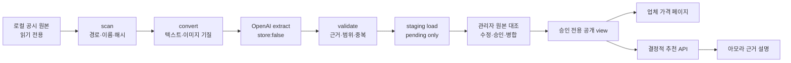

# 업체 공시 적재·속성·아모라 추천 V2

최종 갱신: 2026-07-18  
상태: 구현 및 로컬 검증 중. 운영 DB 미적용, 운영 배포 미실행.

## 이 문서의 지위

이 문서는 한국소비자원 참가격 원본 적재, 업체 속성 보강, 공시 가격 공개, 아모라 업체 추천의 현재 구현 기준이다. 오래된 업체 전략 문서와 충돌하면 이 문서와 실제 코드가 우선한다.

현재 절대 원칙은 다음과 같다.

- 로컬에 사용자가 직접 내려받은 공시 원본만 읽는다. 외부 업체 사이트를 크롤링하거나 fetch하지 않는다.
- 업체 사진·소개문·포트폴리오 문구를 복사·저장하지 않는다. 팀이 확인한 HTTPS URL과 직접 작성한 내부 메모만 저장한다.
- 원문에 없는 숫자는 추정하지 않는다. 모든 가격은 원문 근거와 함께 검수한다.
- 광고, 제휴, 수수료, 상단 노출 비용을 추천 점수에 넣지 않는다.
- AI 출력과 원본 문구는 신뢰할 수 없는 데이터다. 시스템 지시나 DB 쓰기 권한으로 해석하지 않는다.
- 자동 검증을 통과해도 자동 승인하지 않는다. 공개는 사람의 원본 대조와 명시적 승인 뒤에만 가능하다.

## 사용자에게 달라지는 점

공개가 승인된 뒤 소비자는 업체별 공시 기본가, 추가 옵션, 공시 기간, 근거 문구와 출처를 한 화면에서 확인할 수 있다. 아모라는 취향 태그, 명시적으로 말한 카테고리 예산, 필요한 조건과 지역을 기준으로 결과를 설명한다. 공식 데이터가 없거나 조회가 실패하면 기존 평점 목록으로 몰래 대체하지 않고, 데이터 부족 또는 일시적 장애를 정직하게 알린다.

## 전체 흐름



## 구현 위치

- CLI: `scripts/ingest/`
- DB migration은 아래 순서를 하나의 묶음으로 적용한다.
  - `20260718120000_vendor_public_column_privilege_hotfix.sql`: public 업체 컬럼 권한 fence
  - `20260718130000_vendor_disclosure_foundation.sql`: 공시·업체 속성·추천 기반
  - `20260718140000_disclosure_source_previews.sql`: 관리자 전용 변환 미리보기
  - `20260718150000_price_snapshot_promotion.sql`: 검수 완료 snapshot 원자적 승격
  - `20260718160000_vendor_alias_proposals.sql`: 비공개 과거 상호 제안 큐
  - `20260718170000_admin_review_optimistic_concurrency.sql`: 관리자 검수 동시성 토큰
  - `20260718180000_disclosure_storage_privacy_fence.sql`: private Storage 정책 fence
  - `20260718190000_price_consumer_contract.sql`: 공개 가격·찜·조합·알림·이벤트 계약
  - `20260718200000_price_publication_immutability.sql`: 발행 가격 불변성과 재검수 경계
  - `20260718201000_admin_json_evidence.sql`: JSON 업로드 근거 보존
  - `20260718202000_price_upload_confirmation_queue.sql`: 모호한 업체 매칭 확인 큐
  - `20260718203000_price_consumer_cross_contract_hardening.sql`: 별칭·병합·공개 계약 교차 강화
  - `20260718204000_price_combo_idempotency.sql`: 조합 저장 멱등성
  - `20260718205000_legacy_demo_vendor_retirement.sql`: 레거시 데모 UUID의 공개 재활성화를 데이터 변경 없이 차단
  - `20260718206000_unverified_contract_clause_safety_fence.sql`: 법무 미검수 계약 조항 비활성화
  - `20260718207000_public_disclosure_evidence_privacy.sql`: 공개 근거 필드에서 원문 인용을 제거하고 공개 옵션 원문에 PII·연락처·길이 검증을 강제
  - `20260718208000_atomic_weighted_rate_limit.sql`: 이벤트 배치 크기를 DB 공유 버킷에서 원자적으로 차감해 수요 지표 오염 상한을 강제
- 가격 검수: `/admin/price`
- 업체 보강: `/admin/enrich`
- 내부 추천: `POST /api/internal/vendors/recommend`
- 내부 프로필: `GET /api/internal/vendors/{id}/profile`
- 소비자 가격 근거: `/price/vendor/{slug}`
- 속성 단일 진실 원천: `apps/web/src/lib/vendors/attributeSchemas.ts`
- 추천 점수: `apps/web/src/lib/vendors/recommendation.ts`

## 데이터 모델과 공개 경계

### 공시와 검수

- `official_prices`, `official_price_options`: 스튜디오·드레스·메이크업·예식장 공시 가격과 옵션
- `official_agency_packages`: 대행사 패키지 공시
- `price_snapshots`: `period_label`과 `source='kca_tprice'` 기준 시점
- `vendor_dedupe_candidates`, `agency_dedupe_candidates`: 자동 병합하지 않는 사람 검수 큐
- `vendor_alias_proposals`: 추출된 과거 업체명의 비공개 검토 큐. `pending/approved/rejected` 결정과 검토자를 보존하며 공개 view에는 포함하지 않는다.
- `source_file`, `source_object_keys`, `source_quote`, `confidence`, `needs_review`, `validation_issue_codes`, `review_status`: 원본 추적과 승인 상태

공개 API와 화면은 승인된 행을 내보내는 `v_public_official_prices`, `v_public_official_price_options`, `v_public_agency_packages`만 읽는다. Storage object key, 관리자 ID, 내부 검증 코드, 원본 다운로드 권한은 공개하지 않는다.

`anon`과 `authenticated`는 `vendors` base table을 직접 읽을 수 없다. 기존 고객 화면과 모바일은 서버 공개 API의 명시적 allowlist만 사용하고, 사용자별 찜·조회 기록만 사용자 세션 client로 처리한다. 운영 적용 전에는 disposable/staging 프로젝트에서 `corepack pnpm supabase:vendor-security:probe`를 실행해 base table 거부, 공개 view 허용, 타 사용자 데이터 차단을 다시 증명해야 한다.

과거 저장소에는 실제 업체처럼 보이는 이름·브랜드·주소·가격·평점이 든 데모 migration이 있었다. 이미 어느 DB에서 실행됐을지 알 수 있는 migration은 불변 이력이므로 원문과 정규화 SHA-256을 그대로 고정한다. 이 네 과거 파일은 §3 하드코딩 금지 스캔의 유일한 핀 고정 예외이며, 신규 seed·fixture·runtime 데이터의 예외가 아니다. 20500은 `vendors` 쓰기를 잠깐 막고 고정 레거시 UUID 중 하나라도 `approved`이면 배포를 실패시킨다. 출처가 확정되지 않은 UUID만으로 이름·가격·자식 행을 덮어쓰지 않으며, 판정 전후 데이터가 동일한지와 멱등성을 테스트한다.

법무 검수를 요구한다고 스스로 명시하면서 활성 상태였던 과거 계약 조항 seed 역시 불변 이력으로 보존한다. 기존 행은 20600이 정확한 조항 코드만 비활성화한다. 정확한 원문·버전·시행일과 법무 승인 기록을 가진 별도 migration 전에는 다시 활성화하지 않는다. 이 기능은 법률 자문을 제공하는 경로로 간주하지 않는다.

### 업체 보강

- 공개 가능 값: `vendors`의 HTTPS URL과 카테고리별 공개 속성, `tags`, `vendor_tags`
- 내부 값: `vendor_enrichment_private`의 `price_band`, `notes_internal`, 담당 관리자
- 원본 파일: private `disclosure-raw` Storage bucket. service role만 업로드하며 관리자는 짧은 signed URL로 확인한다.
- 파생 텍스트: private `disclosure-preview` bucket. 변환 fingerprint·개별 hash·UTF-8·크기 상한을 다시 확인한 inert text만 저장하고 관리자 API가 server-side로 읽는다. object key와 local path는 응답하지 않는다.

기존 DB의 예식장 카테고리는 `venue`다. 관리 화면·추천 요청에서는 `hall`을 사용하고 서버 경계에서 명시적으로 변환한다. 공시 가격 category는 원본 의미를 지키기 위해 `hall`을 사용한다.

## 적재 CLI

```powershell
corepack pnpm ingest scan data/raw
corepack pnpm ingest convert
corepack pnpm ingest extract --limit 5
corepack pnpm ingest validate
corepack pnpm ingest status
corepack pnpm ingest load --snapshot 2026Q3
```

`load`는 기본 dry-run이다. 실제 staging 쓰기는 아래 조건이 모두 일치해야 한다.

```powershell
corepack pnpm ingest load --snapshot 2026Q3 --apply --confirm-project-ref <STAGING_PROJECT_REF>
```

- `INGEST_LOAD_ENABLED=true`
- `INGEST_TARGET_ENV=staging`
- `SUPABASE_URL`이 `https://<STAGING_PROJECT_REF>.supabase.co` 형태이고 credential, query, 비표준 port가 없음
- `SUPABASE_PROJECT_REF`, `INGEST_STAGING_PROJECT_REF`, CLI 확인 값이 동일
- `SUPABASE_PRODUCTION_PROJECT_REF`와 staging ref가 다름
- service-role JWT의 role이 `service_role`

원본과 상태 산출물은 Git에 들어가지 않는다. CLI의 기본 state는 `scripts/ingest/.state/default/`이고, `--state-dir pilot-2026q3`처럼 지정한 상대경로도 `scripts/ingest/.state/` 아래로만 해석한다. 이 root 밖의 절대경로·상위경로 탈출과 root 자체 사용은 차단한다. `data/raw/`와 `scripts/ingest/.state/` 전체가 ignore 대상이며, 각 단계는 manifest의 `state_dir`이 실제 요청 디렉터리와 정확히 일치하지 않으면 중단한다.

## OpenAI 추출 정책

프로젝트의 현행 공급자 정책에 따라 Anthropic/Claude가 아니라 OpenAI Responses API를 사용한다.

- 기본 모델: `gpt-5.6-luna`
- 고비용 모델: 복잡한 저품질 표본에서 운영자가 명시적으로 선택한 `gpt-5.6-terra`
- `store:false`, schema-validated structured output, SDK 자동 재시도 0
- 429/5xx만 애플리케이션 최대 3회, 구조화 출력 repair는 최대 1회. `Retry-After` 초 또는 HTTP date를 존중하되 지연은 최대 60초로 제한
- 텍스트 30,000자 또는 이미지 5장 단위 분할, unit당 최대 20 requests
- 성공 배치 체크포인트를 fingerprint·prompt version에 묶어 재사용
- 실제 provider 시도마다 token·비용·latency·request ID·안전한 오류 분류를 content-free ledger에 기록
- 프롬프트, 원문, 응답 본문, API key는 ledger에 기록하지 않음

비용을 유발하는 전체 추출은 금지한다. 먼저 서로 다른 형식 5개만 추출하고 관리자 화면에서 원본과 대조한 뒤 범위를 늘린다.

extract는 state별 `.cache/locks/extract.lock`을 exclusive create해 별도 프로세스의 동시 실행과 중복 과금을 차단한다. 잠금에는 lock ID, PID, hostname, 시작 시각을 기록한다. 같은 host의 PID가 죽은 stale lock이나 손상된 lock은 자동 삭제하지 않고 진단 코드와 경로를 출력한다. 운영자는 해당 PID가 실제로 종료됐는지 확인하고 cache·ledger를 보존한 뒤 lock 파일만 수동 격리하거나 제거해 재실행한다. 손상 체크포인트도 자동으로 버리거나 재과금하지 않는다.

## 검증과 승인

검증기는 다음을 차단하거나 사람 검토로 보낸다.

- 문서 종류와 루트 종류가 모순됨. `mixed`도 실제 payload를 검사해 agency 루트의 hall 내용과 hall 루트의 agency/partner 내용을 차단한다.
- scan에서 정한 canonical 업체명과 AI가 읽은 상호가 다름
- 가격·min/max·예식장 대관료·식대의 근거 문구가 없거나 숫자와 일치하지 않음
- 비정상 가격 범위, `min > max`, 빈 가격 payload
- 같은 대행사 패키지 identity에 서로 다른 값이 존재함
- 같은 snapshot/source identity의 기존 행과 staged 값이 다름
- 여러 원본 unit의 가격·패키지·옵션·예식장 항목에 행 단위 `source_file_ids`가 없거나, 중복·알 수 없는 ID·변환 증거 없는 ID가 있음
- 동일 지역 유사 이름 후보

`needs_review=false`는 자동 경고가 없다는 뜻일 뿐 승인 완료가 아니다. `review_status='approved'`는 관리자 승인 RPC만 만들 수 있으며, 승인 시 근거·값·검증 이슈를 다시 확인한다.

추출 `old_names`는 신뢰할 수 없는 제안이다. load는 `vendors.aliases`를 직접 변경하지 않고 가격행별 `vendor_alias_proposals`에 `pending`으로 적재한다. `/admin/price` 승인 시 체크한 제안만 가격 검수와 동일한 service-role 전용 transaction에서 승인·alias union하며, 체크하지 않은 제안은 반려한다. 가격 반려는 전부 반려하고 수정 저장은 pending을 유지한다. 검토 완료 행은 immutable이고, 정확한 재실행은 no-op이며, 부분 적재 재실행은 누락된 pending 제안만 복구한다.

모든 원본은 안정적인 `source_file_id`와 상대경로를 AI 입력의 데이터 라벨로 붙인다. 단일 원본 행이 ID를 생략하면 검증기가 유일한 원본에 자동 결속한다. 다중 원본 unit은 각 패키지·partner 가격·옵션·예식장 대관료·식대·개별 항목에 실제 근거 파일의 `source_file_ids`가 반드시 있어야 하며, 검증기는 해당 파일의 변환 증거 안에서 quote와 숫자를 확인한다. 누락·중복·unit 밖 ID·증거 없는 ID는 error로 적재를 차단하고 임의 파일이나 전체 bundle로 대체하지 않는다.

scan은 portable 상대경로 codepoint 순서로 `source_files`를 고정하고 `scanner_parser_version`을 manifest에 기록한다. convert·extract·load는 이 순서를 그대로 사용한다. load가 conversion artifact 번호를 기준으로 다시 정렬하지 않으므로 기존 비정렬 manifest도 당시 변환 순서와 정확히 연결된다. parser/지역 매핑 버전이 바뀌거나 버전 없는 v1 manifest를 다시 scan하면 raw hash가 같아도 downstream 상태를 폐기하고 `scanned`부터 재처리한다.

대행사 루트의 `partner_price_list`는 scan-derived 대행사 identity를 가격과 함께 운반한다. load는 대행사를 보장한 뒤 `official_prices.agency_id`에 연결하고 재실행에서도 같은 연결을 대조하므로, partner 가격만 존재하는 대행사도 dedupe와 출처 추적에서 빠지지 않는다.

업체·대행사 병합은 row lock을 잡고 보존 대상을 명시한다. 같은 non-null 지역이 아닌 대행사는 병합할 수 없고, 패키지 identity 충돌이 있으면 실패한다. 탈락 행은 삭제하지 않고 merge audit 상태로 남기며 이름은 보존 행의 aliases에 합친다. 업체 병합과 가격·별칭 검수는 모두 `vendor → official_price` 순서로 잠그며, 잠금 대기 중 가격의 vendor 연결이 바뀌면 `40001`로 재시도시켜 교착과 stale 승인 모두 막는다.

## 수동 JSON 업로드 안전 경계

동기 업로드는 30초 statement budget 안에서 끝나도록 `entries 50`, entry당 `prices 20`, price당 `options 50`, 업로드 전체 `prices 200`, `options 1,000`으로 제한한다. 이 수치와 동일한 상한을 Zod와 DB RPC가 각각 검증한다. 전체 상한 초과와 동일 `source_record_key` identity 중복은 service client 또는 private 증빙 Storage를 만들기 전에 HTTP 400으로 거절한다.

업체·대행사 조회는 read-only preflight다. 신규 draft 업체, 스냅샷, 확인 큐, 가격, 옵션 쓰기는 `apply_admin_json_price_upload` 단일 RPC 트랜잭션에서만 수행한다. 어느 한 entry라도 실패하면 해당 요청의 모든 DB 쓰기를 롤백한다. 기존 `(source, period_label)` draft snapshot을 재사용할 때는 `source_note`와 `collected_at`까지 정확히 같아야 한다.

확인 큐 해소 시 같은 category의 name/alias namespace를 하나의 transaction advisory lock으로 직렬화하고, lock 획득 뒤 선택 업체와 다른 업체의 정규화 name/alias를 다시 읽는다. 로컬 PGlite는 함수 순서·재조회·롤백을 검증하지만 실제 두 DB session의 lock 대기를 증명하지 않는다. 따라서 hosted staging에서 같은 정규화 alias를 서로 다른 업체에 동시에 연결하는 두 요청을 시작해 정확히 하나만 alias를 얻고, 다른 요청은 alias 없이 안전하게 완료되며 deadlock/timeout이 없는지 확인하기 전에는 이 동시성 게이트를 통과로 표시하지 않는다.

## 관리자 사용자 여정

### `/admin/price`

1. 낮은 confidence와 검증 이슈를 우선 확인한다.
2. 가격 또는 대행사 패키지 행을 고른다.
3. 원문 근거, 검증 코드, private 원본 signed link를 대조한다.
4. 필요한 값만 수정한다. 수정 여부와 관리자를 기록한다.
5. 옛 상호 제안은 기본 미선택 상태에서 확인한다. 가격 승인 시 선택한 대기 제안만 승인되고 나머지는 반려된다.
6. 모든 검수 요청은 화면에 그려진 `review_version`을 보내며, 다른 관리자가 먼저 저장한 `409`가 오면 최신 행을 다시 읽고 덮어쓰지 않는다.
7. 목록은 100건씩 안정적인 정렬로 이어 불러오며 응답의 bounded cursor와 `has_more`를 따른다. 저장·승인·반려 뒤에는 첫 페이지부터 다시 읽는다.
8. vendor/agency 중복 후보는 양쪽 지역과 이름을 비교하고, 보존할 이름이 표시된 최종 확인 뒤 같은 업체 또는 다른 업체로 결정한다. 한 결정이 진행 중이면 다른 결정 버튼도 잠근다.
9. 상단 스냅샷 패널에서 가격·패키지의 pending, 승인, 근거, `needs_review` 집계를 확인한다. 준비된 스냅샷만 `승격 검토 → 최종 승격` 두 단계와 DB 재검증을 거치며, 이전 스냅샷 재승격이 롤백 절차다.

현재 `v1` 목록 cursor는 최대 offset을 제한한 방식이다. 정적인 큐에서는 누락·중복 없이 순회하지만, 여러 관리자가 동시에 앞 페이지의 상태나 confidence를 바꾸면 뒤 페이지 위치가 일시적으로 이동할 수 있다. 각 저장 뒤 첫 페이지를 다시 읽고 스냅샷 승격 RPC가 남은 pending과 근거를 전수 재검증하므로 미검수 공개로 이어지지는 않는다. 다만 동시 검수 인원이 늘기 전에는 immutable queue rank 또는 별도 review-session snapshot을 도입해 cursor를 keyset 방식으로 바꾸는 것을 P2 운영 개선으로 남긴다.

### `/admin/enrich`

1. category·region·status·내 담당 필터로 큐를 연다.
2. 담당 버튼으로 작업을 선점한다.
3. 왼쪽에서 승인 전 공시와 원본 근거를 읽는다.
4. 오른쪽에서 HTTPS URL, schema 기반 속성, tag를 입력한다.
5. 검색 도우미는 새 탭 링크만 만들며 외부 페이지를 서버가 fetch하지 않는다.
6. 저장 후 다음 pending 업체로 이동하거나 완료 처리한다.

큐·진행률·상세·저장은 `vendors.status IN ('pending','approved')`인 활성 업체만 대상으로 한다. vendor merge의 탈락 행은 `rejected` tombstone이므로 API에서 404로 숨기고, service-role 전용 assign/save RPC도 같은 상태 검사를 row lock 안에서 다시 수행해 직접 호출 우회를 막는다.

화면 상단에는 항상 `업체 사진·소개문 복사 금지 — URL과 직접 작성한 설명만 저장하세요.`를 표시한다.

## 추천 API와 아모라

내부 API는 32자 이상 별도 `INTERNAL_API_TOKEN`을 canonical secret으로 사용해 `X-Internal-Token`과 비교한다. 기존 배포의 `VENDOR_INTERNAL_TOKEN`은 canonical 값이 없을 때만 호환 fallback으로 사용한다. 두 변수가 모두 설정되어 값이 다르면 어느 쪽도 허용하지 않고 fail closed한다. 토큰이 없거나 짧아도 fail closed한다.

`GET /api/internal/price/lookup`은 `v_public_official_prices`와 `v_public_official_price_options`만 읽고 최신 발행 스냅샷의 공개 최소 필드만 반환한다. `source_quote`, 내부 row ID, alias, similarity, 원문 query는 응답에 포함하지 않는다. 조회가 성공하려면 같은 service-role client로 `events`에 `anon_id='amora'`, `surface='amora'`, `event_type='vendor_detail_view'`, 서버 고정 weight `2`인 행이 정확히 1건 저장되어야 하며, 이벤트 저장 실패 시 가격 응답 대신 500으로 fail closed한다.

추천은 category·active/approved 상태·공식 가격·요청 지역·명시적 필수 속성·명시적 카테고리 예산으로 hard filter한다. 속성이 unknown/null이면 탈락시키지 않고 `확인 필요` 이유를 붙인다. 지역 결과가 3개 미만이면 전국으로 한 번만 넓히고 응답에 범위 완화를 명시한다.

점수는 다음 고정식이다.

```text
0.5 × 선호 태그 일치율
+ 0.2 × 예산 여유도
+ 0.2 × 공개 데이터 완성도
+ 0.1 × 공시 최신성
```

동점은 가격, 이름, ID 순으로 결정해 같은 입력에 같은 결과를 낸다. 광고·수수료·제휴 값은 후보 타입, query, 점수 함수에 존재하지 않는다.

아모라는 사용자의 전체 결혼 예산에서 카테고리 예산을 임의 추정해 hard filter하지 않는다. 사용자가 스튜디오·드레스·메이크업·예식장 예산을 명시했을 때만 해당 필터를 쓴다. 홍대·서초·송파처럼 지원 지역으로 해석 가능한 표현은 매핑하고, 모르는 지역은 전국으로 넓히지 않고 되묻는다. 공식 데이터 조회 장애나 pagination 상한 초과 시 레거시 추천으로 우회하지 않는다.

## 실제 로컬 파일럿 증거

2026-07-18에 원본을 변경하지 않고 새 기본 state
`scripts/ingest/.state/default/`에서 `scan → convert → status`를 다시 실행했다.

| 항목 | 결과 |
|---|---:|
| units | 249 |
| files | 253 |
| bytes | 23,767,447 |
| 대행사 units | 54 |
| 예식장 units | 195 |
| 변환 성공 | 235 |
| HWP 수동 변환 | 8 |
| PDF 래스터 수동 변환 | 6 |
| 변환 오류 | 0 |
| OpenAI/Supabase 호출 | 0 |
| token/추정 비용 | 0 |

수동 변환 14건은 실패를 성공으로 숨긴 것이 아니라 명시적 작업 큐다. HWP 8건은 같은 위치에 PDF 대체본을 만들고, 텍스트가 부족한 PDF 6건은 Poppler 설치 또는 페이지 PNG 내보내기 후 scan부터 다시 실행해야 한다. 이 결과는 변환 단계 증거이며 AI 추출 품질, staging 쓰기, 관리자 실제 승인, 운영 공개를 검증했다는 뜻이 아니다.

## 배포 게이트와 롤백

로컬 게이트는 `corepack pnpm test:ingest`, `corepack pnpm ingest:typecheck`, 웹·모바일 전체 test/typecheck/lint/build와 정적 release fence를 모두 다시 실행해 PR CI에 고정한다. 로컬 fixture 통과는 아래 실제 provider·staging·운영 게이트를 대체하지 않는다.

현재 successor manifest는 `supabase/release-manifests/vendor-disclosure-v2-20260718.json`이다. 기존 아모라 manifest를 해시로 연결하고 12000~20800 migration 전체를 정확한 순서·정규화 SHA-256으로 고정한다. hosted staging, backup, restore, Storage, finalizer 증거가 아직 없으므로 `status=deployment_blocked`다. 이 상태에서 정적 fence는 무결성 검증을 통과하지만 `--remote`와 실제 release controller는 DB 명령 실행 전에 실패해야 정상이다.

실제 Vercel production Next 빌드도 `apps/web/next.config.ts`에서 같은 상태를 확인한다. manifest가 명시적 `deployment_authorized`가 아니거나 hosted staging·backup·hosted restore·Storage·finalizer 증거 중 하나라도 `missing`이면 `VENDOR_DISCLOSURE_PRODUCTION_BUILD_BLOCKED`로 artifact 생성을 중단한다. CI의 일반 `next build`는 `VERCEL_ENV=production`이 아니므로 코드·정적 빌드 검증만 수행하며 배포 승인을 뜻하지 않는다.

### 아직 하지 않은 일

- 실제 OpenAI 5-unit 파일럿
- staging DB migration과 dry-run 대조
- staging Storage 업로드·signed download 검증
- hosted staging 2-session alias 경쟁·재조회·deadlock 부재 검증
- 실제 관리자 계정으로 수정·승인·중복 결정 검증
- 승인 데이터의 공개 페이지·아모라 end-to-end 검증
- 운영 DB backup/restore rehearsal, migration 적용, 운영 배포, canary

### 순서

1. 코드 전체 test·typecheck·lint·build·보안 검토를 통과하고 commit을 고정한다.
2. staging DB를 백업하고 project ref를 대조한 뒤 migration dry-run/apply를 수행한다.
3. OpenAI 5-unit 파일럿을 실행하고 token·비용 ledger와 원본 대조 결과를 남긴다.
4. staging `load` dry-run 결과를 승인한 뒤 `--apply`한다.
5. 관리자 검수, public view, 공개 가격 페이지, 아모라 추천을 staging에서 검증한다.
6. 운영 backup과 복구 리허설, exact migration hash, write fence, rollback 담당자가 준비된 경우에만 운영 릴리스 절차로 넘긴다.

DB migration은 additive이지만 public view와 기존 table constraint를 바꾸므로 무검증 down migration을 제공하지 않는다. 문제가 생기면 애플리케이션에서 내부 추천 토큰을 제거하고 신규 화면·route를 이전 commit으로 되돌려 노출을 차단한다. DB는 릴리스 직전 검증된 backup으로 복구하거나, 실제 적용 상태를 확인한 뒤 별도 검토된 forward-fix를 사용한다. 일부 REST 적재가 실패한 경우 manifest를 `loaded`로 바꾸지 말고 실패 원인을 확인한 뒤 같은 identity로 재실행한다.

## 다른 컴퓨터에서 이어가기

```powershell
git fetch --prune origin
git switch feat/vendor-disclosure-pipeline-v2-20260718
git pull --ff-only
corepack pnpm install --frozen-lockfile
corepack pnpm test:ingest
corepack pnpm --filter @hanbang/web test
```

원본 공시와 `.env`는 Git에 없으므로 새 컴퓨터에서 별도로 안전하게 준비해야 한다. GitHub PR의 최신 commit, checks, 이 문서의 ‘아직 하지 않은 일’을 확인한 뒤 staging 작업을 이어간다.
